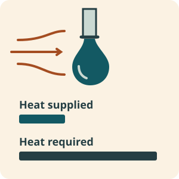
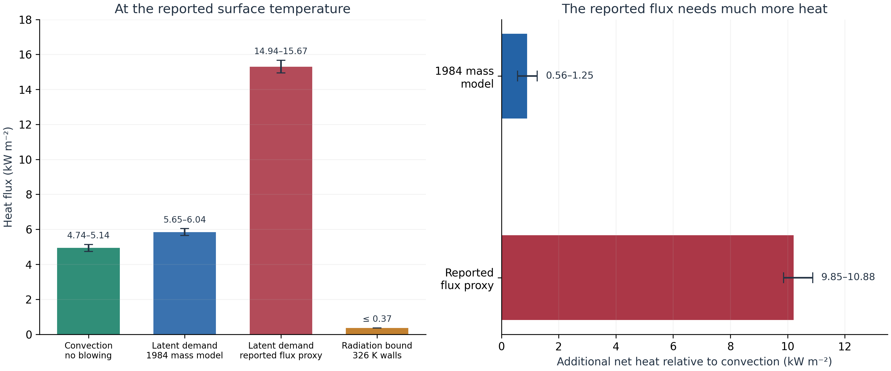

# Modeled convection supplies only a third of the heat needed for the reported pentane drop evaporation rate

Chuchottaworn, Fujinami and Asano kept a pentane drop at steady size by feeding it liquid as it evaporated in dry air at 326 K. At their reported surface temperature of 263.6 K, the reconstructed evaporation rate requires **14.94–15.67 kW m⁻²** of latent heat. Under the same geometry and property assumptions, modeled convection before the blowing correction supplies only **4.74–5.14 kW m⁻²**. Using the authors’ reported Prandtl number still leaves a gap of **9.60–10.79 kW m⁻²**. Solving both balances together with the authors’ blowing corrections places the drop about 3–5 K cooler than measured. An independent heat budget therefore starts with the absolute evaporation rate and drop area. The numerical root is already stable to less than 0.002 K, well below the temperature discrepancy. [Experiment, p. 9](https://doi.org/10.1252/jcej.17.7) · [Worked comparison](pendant_drop_evaporation.py)

## The feed rate measures evaporation while the drop size stays steady

Chuchottaworn, Fujinami and Asano's
[experimental study](https://doi.org/10.1252/jcej.17.7) reports the selected
pentane condition on journal page 9. It gives surface temperature 263.6 K, ambient
temperature 326 K, surface Reynolds number 60, Prandtl number 0.86,
mass injection ratio 0.080 and horizontal diameter 1.61 mm.
The authors maintained drop size by feeding liquid, measured evaporation
through that feed rate and estimated area from an ellipsoidal shape.
Atmospheric pressure is approximated as 101325 Pa here.

The reconstruction uses a spherical diameter/area proxy and dry
nitrogen/oxygen/argon. Original unrounded injection ratio, paired drop height,
absolute evaporation and individual property records were not recovered.
The selected case accompanies a gas-temperature profile; this study does not
compare a computed spatial temperature field with those profile measurements.
The paper's table lists pentane temperatures 266–278 K, which does not contain
the selected 263.6 K condition. That source inconsistency remains unresolved.

## Can convective heat transfer sustain the inferred evaporation rate?

The [companion theory](https://doi.org/10.1252/jcej.17.1), equations 20, 24 and
28, supplies the thermal transfer-number definition and blowing/film
corrections. Thermal and mass transfer numbers are kept distinct.
Ranz–Marshall heat transfer plus the companion blowing correction is an
explicit model combination. No fluid PDE, tube conduction, radiation
correction or transient droplet dynamics is solved.

### The latent heat demand exceeds convection at the measured surface temperature

For each of 16 property configurations, the printed injection ratio sets the inferred evaporative mass flux. Multiplying that flux by the latent heat of pentane gives the heat demand per unit area. The heat-supply estimate uses convection before the blowing correction. Evaporative blowing reduces the calculated transfer further. At 263.6 K the paired difference between that demand and convective supply is **9.85–10.88 kW m⁻²**. These ranges span selected property and transfer methods. Each end of the difference range comes from a paired calculation. [Fluxes at the reported temperature](https://github.com/uncscode/particula/blob/main/docs/data/pendant-evaporation/at-printed-temperature.csv)

### The heat gap persists when the model uses the reported Prandtl number

The measured case specifies a Prandtl number of 0.86. Substituting that value for the property-based Prandtl numbers leaves a positive residual of **9.60–10.79 kW m⁻²**. Even blackbody radiation from surroundings entirely at 326 K would supply at most 0.367 kW m⁻² under that assumption. The actual wall temperature, feed enthalpy and heat flow through the support remain uncertain. [Calculations using the reported Prandtl number](https://github.com/uncscode/particula/blob/main/docs/data/pendant-evaporation/printed-Pr-sensitivity.csv)

### Even the coarsest grid locates the equilibrium temperature within 0.002 K

Solving for the surface temperature at which modeled heat supply and evaporative demand balance gives 258.59–260.36 K when the 1984 blowing corrections are applied to both. The coarsest interpolation grid shifts the numerical root by at most 0.00152 K. Refining that grid cannot account for the 3–5 K difference from the reported temperature. [Root and refinement results](pendant_drop_evaporation.py)

## Measure the drop area and heat entering through the feed and support

The first comparison to recover is absolute liquid feed rate divided by the area inferred from the paired horizontal diameter and drop height. Together with the original velocity and property conventions, that would test the mass flux reconstructed from the printed injection ratio. If the heat deficit persists, measuring inlet-liquid temperature, support heat flow and surrounding wall temperatures would test whether those sources can close it. Added heat can satisfy the energy balance while leaving the modeled mass-transfer rate at the measured surface temperature in error.

## Reproduction and retained data

Base library revision: ebabce042edb929b9ebcf0dcce388e278c08be83
(Particula source version 0.3.3). Installed distribution metadata reports
0.2.14 in the original environment; the imported source is 0.3.3.
The private study was performed on 20 November 2026. The publication refresh
has its own timestamp, source fingerprints and runtime in the result bundle.

The example's downloadable ZIP includes both helper modules. From a checkout
with Python 3.12+, the chemical-property dependencies and Warp CUDA, run:

~~~bash
python scripts/docs_examples.py refresh pendant-drop-evaporation
~~~

That command requires actual CUDA and does not fall back to CPU.
For figure-only changes after a matching refresh, reuse saved arrays:

~~~bash
python scripts/docs_examples.py replot pendant-drop-evaporation
~~~

The original compact calculations and factual source conditions are retained
in [the data provenance](https://github.com/uncscode/particula/blob/main/docs/data/pendant-evaporation/provenance.json).
The registered result bundle stores newly executed curves, intersections,
property configurations, numerical checks, figures and downloadable source.
No publisher PDF, scanned figure or digitized image is redistributed.

Properties use local thermo 0.4.2 and chemicals 1.3.3. The comparison crosses
two collision-data selections, two viscosity models, two collision-integral
correlations and two conductivity mixing rules. Saturation and latent heat
use HEOS_FIT; pure gas conductivity uses REFPROP_FIT.
[Property method names and ranges](https://github.com/uncscode/particula/blob/main/docs/data/pendant-evaporation/property-methods.json)
and [the original summary](https://github.com/uncscode/particula/blob/main/docs/data/pendant-evaporation/summary.json)
record provenance.

### Computation and grid checks

The original full campaign ran on an NVIDIA GeForce RTX 5060 with Warp 1.11.1,
Python 3.12.12, NumPy 2.3.4 and SciPy 1.16.2. Properties and scalar roots run
on CPU. The study-specific float64 kernel evaluates batched correlations and
reverse derivatives on CUDA. It is not a native time-dependent simulation.

| Check | Original retained result |
| --- | --- |
| CUDA curve evaluations | 5136: 16 configurations × 321 temperatures |
| CUDA equilibrium and gradient points | 16, with one reverse launch |
| CPU root solves | 96 coupled cases and 96 reported-Prandtl sensitivity cases |
| Maximum NumPy/CUDA positive-flux relative difference | 1.11 × 10⁻¹⁵ |
| Maximum temperature-derivative relative difference | 1.47 × 10⁻⁸ |
| Maximum root interpolation error, 81 points | 0.001520 K |
| Maximum root interpolation error, 161 points | 0.000374 K |
| Maximum root interpolation error, 321 points | 0.0000945 K |
| Relative heat-equivalent mass residual at roots | Below 10⁻⁹ |

The derivative check chains CUDA reverse derivatives through CPU property
finite differences at 0.01, 0.001 and 0.0001 K. Thermo correlations are not
natively differentiated on CUDA. Positive outputs are checked for finiteness
and sign. No timestep or particle-number refinement applies.

The original corrected pilot took 1.51 s. The full campaign took 60.51 s
through result serialization, excluding final plotting, and the separate
reported-Pr sensitivity took 7.57 s. The initial pilot had a Warp
tuple-assignment compilation failure corrected before the campaign.
The publication refresh took 69.67 s on the same RTX 5060, including plotting.
Its full curves agree with the retained arrays at relative tolerance $10^{-12}$
and absolute tolerance $10^{-15}$; all 192 equilibrium roots agree within
$10^{-9}$ K. A saved-data replot preserves the CUDA execution provenance.
Runtime is whole-workload evidence, not a GPU speedup measurement.
