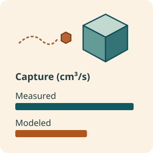
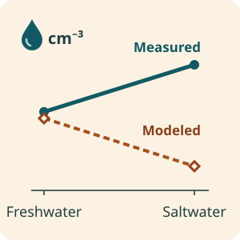
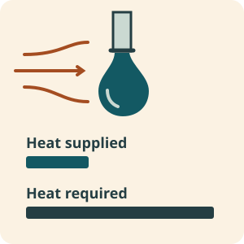

# Literature analyses

Follow comparisons with published measurements, reference calculations and datasets. Each report identifies the observable, experimental or model conditions, and the limits of the comparison.

[\
Particula predicts half the rise in ion concentration CLOUD measured from 7% to 70% humidity](cloud-ion-humidity/index.md)

[\
Particula predicts about 60% of the NaCl capture rate measured at 4 nm](nacl-scavenging/index.md)

[\
Π Chamber cloud counts rose over salt water, but separate haze fits predicted a decline](pi-chamber/haze-and-cloud/index.md)

[\
Modeled convection supplies only a third of the heat needed for the reported pentane drop evaporation rate](evaporation-and-uptake/pendant-drop/index.md)

<!-- STUDY_LIST_START -->
- [Dry PSL mobility sizing against 49 measured slip factors](dry-psl-mobility/index.md)
- [Evaporation and reactive uptake](evaporation-and-uptake/index.md)
- [Particle water uptake and activation](particle-water-uptake/index.md)
- [Particula predicts about 60% of the NaCl capture rate measured at 4 nm](nacl-scavenging/index.md)
- [Particula predicts half the rise in ion concentration CLOUD measured from 7% to 70% humidity](cloud-ion-humidity/index.md)
- [Π Chamber experiments and modeling](pi-chamber/index.md)
- [CUDA wall loss agrees with spherical deposition theory](../validation/wall-loss/index.md)
<!-- STUDY_LIST_END -->
