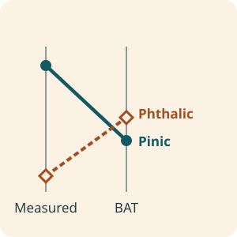
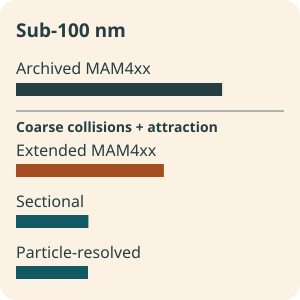

# Literature analyses

Follow comparisons with published measurements, reference calculations and datasets. Each report identifies the observable, experimental or model conditions, and the limits of the comparison.

[\
Fitting mean drop mass with a constant collision rate leaves a sixfold shortfall in counts at twice the starting radius](shear-drop-spectrum/index.md)

[\
At low ion production, CLOUD’s 70% humidity measurement exceeds the ceiling set by the reported wall loss](cloud-ion-humidity/index.md)

[\
A 35% polarization effect for a charged 4 nm NaCl tracer shrinks to 0.06% in the modeled chamber scan](nacl-scavenging/index.md)

[\
Π Chamber cloud counts rose over salt water, but separate haze fits predicted a decline](pi-chamber/haze-and-cloud/index.md)

[\
Modeled convection supplies only a third of the heat needed for the reported pentane drop evaporation rate](evaporation-and-uptake/pendant-drop/index.md)

[\
A cloud activation fit predicts 49% more water than BAT at 95% humidity for one organic](particle-water-uptake/ccn-retrieval/index.md)

[\
Adding settling and diffusion lowers predicted one-hour survival of 1 µm particles from 68% to 58% in a spherical chamber](../validation/wall-loss/index.md)

[\
Particula sizes a 100.7 nm PSL standard at about 102 nm near atmospheric pressure](dry-psl-mobility/index.md)

[\
BAT and AIOMFAC both overpredict water activity at all 12 measured citric acid concentrations](particle-water-uptake/citric-acid/index.md)

[\
BAT reverses the measured ordering of pinic and phthalic acid hygroscopicity at cloud activation](particle-water-uptake/bat-ccn.md)

[\
After glyoxal dilution, two models predict rising organic mass per sulfate as measurements fall](https://uncscode.github.io/particula/studies/literature/evaporation-and-uptake/glyoxal_chamber/)

[\
A delayed source predicts 19 minutes of the 21-minute gap between two chamber isomer signals](pinic-isomers/index.md)

[\
Liquid salt mixing widens the winter foothill growth-factor bias at Mt. Hua from +0.54 to +0.72](particle-water-uptake/mt-hua/index.md)

[\
After a day in simulated polluted air, archived MAM4xx retains nearly three times the sub-100 nm count predicted by two models with attraction](mam4xx-coagulation/index.md)

[\
Sea2Cloud’s March 22 spectra favor earlier arrival of larger particles in a two-hour exchange model](sea2cloud-events/index.md)

[\
At the inferred Π Chamber humidity, modeled sulfate haze falls below the optical detection limit](pi-chamber/seed-chemistry.md)

<!-- STUDY_LIST_START -->
- [A 35% polarization effect for a charged 4 nm NaCl tracer shrinks to 0.06% in the modeled chamber scan](nacl-scavenging/index.md)
- [A delayed source predicts 19 minutes of the 21-minute gap between two chamber isomer signals](pinic-isomers/index.md)
- [After a day in simulated polluted air, archived MAM4xx retains nearly three times the sub-100 nm count predicted by two models with attraction](mam4xx-coagulation/index.md)
- [At low ion production, CLOUD’s 70% humidity measurement exceeds the ceiling set by the reported wall loss](cloud-ion-humidity/index.md)
- [Evaporation and reactive uptake](evaporation-and-uptake/index.md)
- [Fitting mean drop mass with a constant collision rate leaves a sixfold shortfall in counts at twice the starting radius](shear-drop-spectrum/index.md)
- [Particle water uptake and activation](particle-water-uptake/index.md)
- [Particula sizes a 100.7 nm PSL standard at about 102 nm near atmospheric pressure](dry-psl-mobility/index.md)
- [Sea2Cloud’s March 22 spectra favor earlier arrival of larger particles in a two-hour exchange model](sea2cloud-events/index.md)
- [Π Chamber experiments and modeling](pi-chamber/index.md)
- [Adding settling and diffusion lowers predicted one-hour survival of 1 µm particles from 68% to 58% in a spherical chamber](../validation/wall-loss/index.md)
<!-- STUDY_LIST_END -->
