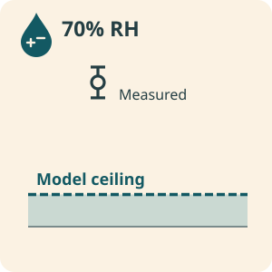
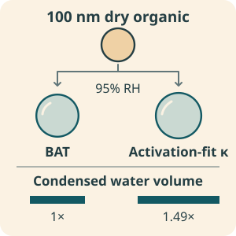
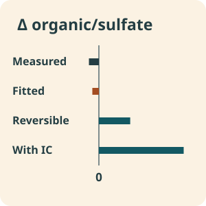

# Literature analyses

Follow comparisons with published measurements, reference calculations and datasets. Each report identifies the observable, experimental or model conditions, and the limits of the comparison.

[\
Particula predicts half the rise in ion concentration CLOUD measured from 7% to 70% humidity](cloud-ion-humidity/index.md)

[\
Particula predicts about 60% of the NaCl capture rate measured at 4 nm](nacl-scavenging/index.md)

[\
Π Chamber cloud counts rose over salt water, but separate haze fits predicted a decline](pi-chamber/haze-and-cloud/index.md)

[\
Modeled convection supplies only a third of the heat needed for the reported pentane drop evaporation rate](evaporation-and-uptake/pendant-drop/index.md)

[\
A cloud activation fit predicts 49% more water than BAT at 95% humidity for one organic](particle-water-uptake/ccn-retrieval/index.md)

[\
Adding settling and diffusion losses predicts too few airborne particles in a spherical chamber](../validation/wall-loss/index.md)

[\
Particula sizes a 100.7 nm PSL standard at about 102 nm near atmospheric pressure](dry-psl-mobility/index.md)

[\
BAT and AIOMFAC both overpredict water activity at all 12 measured citric acid concentrations](particle-water-uptake/citric-acid/index.md)

[\
BAT puts pinic acid’s activation hygroscopicity too low and phthalic acid’s too high](particle-water-uptake/bat-ccn.md)

[\
After glyoxal dilution, two models predict rising organic mass per sulfate as measurements fall](https://uncscode.github.io/particula/studies/literature/evaporation-and-uptake/glyoxal_chamber/)

<!-- STUDY_LIST_START -->
- [Evaporation and reactive uptake](evaporation-and-uptake/index.md)
- [Particle water uptake and activation](particle-water-uptake/index.md)
- [Particula predicts about 60% of the NaCl capture rate measured at 4 nm](nacl-scavenging/index.md)
- [Particula predicts half the rise in ion concentration CLOUD measured from 7% to 70% humidity](cloud-ion-humidity/index.md)
- [Particula sizes a 100.7 nm PSL standard at about 102 nm near atmospheric pressure](dry-psl-mobility/index.md)
- [Π Chamber experiments and modeling](pi-chamber/index.md)
- [Adding settling and diffusion losses predicts too few airborne particles in a spherical chamber](../validation/wall-loss/index.md)
<!-- STUDY_LIST_END -->
