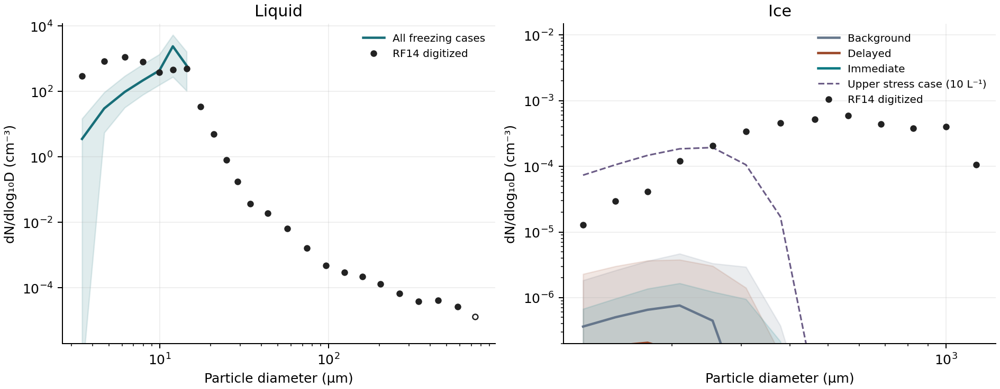
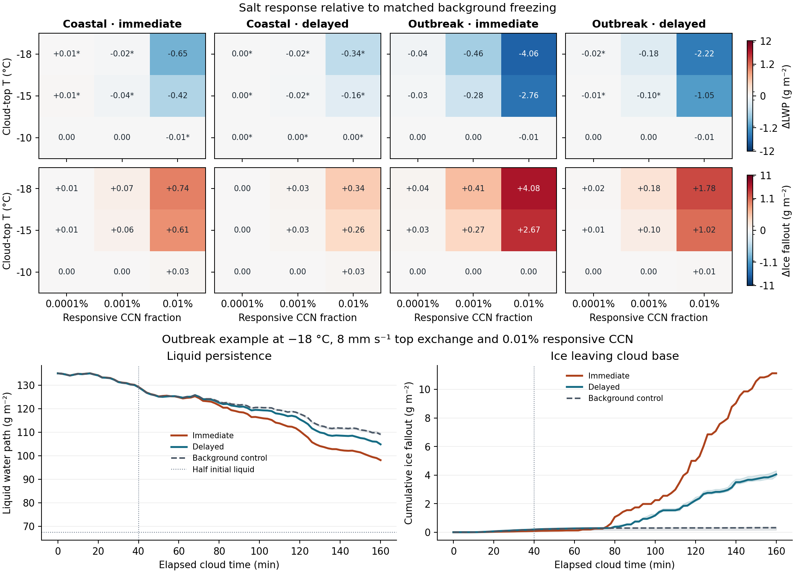

# From Jeju chamber ice to marine clouds

## The chamber images constrain growth more closely than freezing time

In warm salted ambient air (run 2), the cloud particle imager recorded a 61 µm faceted particle about 19 minutes after salt addition. In colder ambient air (run 6), it recorded a 124 µm plate about 14 minutes after the inferred injection time. Each image gives a time by which recognizable ice had reached the imager. Each crystal had already spent time growing and moving through the chamber, and the two fills began at different temperatures.

An early joint fit of all six chamber runs reproduced the large plate only when ice could grow beyond the size of the parent droplet. Vapor deposition and riming could each supply that growth. Three freezing histories were consistent with the observations. Ice could form on background aerosol alone. In the salt-associated fits, the response could begin immediately or after particles spent time in supercooled liquid. We carried those earlier fits into the cloud comparisons below, keeping their freezing settings fixed. [Park et al., Jeju experiments](https://doi.org/10.1029/2026GL123395)

## The marine parcels contained too much liquid water and too little large ice

On 1 March 2020, NASA ACTIVATE flight RF14 sampled marine clouds over the western North Atlantic. We compared prescribed parcels with the published case-mean liquid and ice spectra, applying the authors’ cloud mask and instrument size ranges. The flight-leg data require Earthdata access, so this comparison averages over sampled cloud states. Nearby aerosol measurements constrain the scale of the loading. The fraction of aerosol able to respond to salt and the time individual particles spent in liquid remain assumptions. [Sorooshian et al., Figs. 10–12](https://essd.copernicus.org/articles/15/3419/2023/) · [ACTIVATE flight archive](https://doi.org/10.5067/SUBORBITAL/ACTIVATE/DATA001)

The observed droplet count fell within the simulated range, but the parcels put too much liquid in larger droplets near the peak. The published liquid spectrum from 3 to 830 µm gave about 476 droplets/cm³ and 0.173 g/m³ of liquid water. Across the parcel histories, the corresponding values were 196–520 droplets/cm³ and 0.215–0.410 g/m³.

The ice discrepancy was larger. The published spectrum contained 0.309 ice crystals/L at 108–1,300 µm. With up to 0.3 salt-responsive candidates/L prescribed before freezing, the simulations produced at most 0.00229 ice crystals/L in that size range. Even the high-loading test with 10 candidates/L reached only 0.0684 ice crystals/L. RF14 imaged rimed ice. Riming, aggregation and secondary ice production were absent from the parcel model. The shortfall alone cannot distinguish their contributions from uncertainty in the aerosol supply or its exposure history.

*Figure 1. Points follow the published RF14 size spectra. Open symbols mark bins in which less than 80% of the diameter interval is visible on the logarithmic axis. Shading spans the 10th–90th percentiles across modeled histories and chamber fits. The dashed ice curve gives the upper envelope in the cold, high-loading test. Shifting the digitized trace vertically by three pixels changes number density by about 13%. Probe and phase-classification uncertainties are additional. [Published RF14 spectra](https://essd.copernicus.org/articles/15/3419/2023/essd-15-3419-2023-f12.png)*

## Cold, wet exposure increased fallout before the cloud lost half its liquid

A separate set of prescribed-flow simulations paired each salt-responsive case with a background-only cloud at the same aerosol loading and meteorology. In a 650 m deep marine outbreak cloud with a −18 °C top, we prescribed 0.01% of incoming droplet-forming particles as salt-responsive. In the stronger circulation, incoming particles were still dry at 40 minutes. By 160 minutes they had reached supercooled liquid. Relative to the paired backgrounds, cumulative ice mass crossing cloud base increased by 10.97–11.22 g/m² with the immediate response and 3.60–4.12 g/m² with the delayed response. These ranges span chamber fits and particle realizations. Numerical refinement changed the strongest immediate case from 10.97 to 13.25 g/m² of extra fallout. [Marine outbreak observations motivating the profile](https://doi.org/10.1175/JAS-D-23-0203.1)

*Figure 2. The maps compare each salt response with its matched background at 160 minutes. An asterisk marks a cell in which the change exceeded 0.02 g/m² in both directions across cases. The example time series show the range across chamber fits and mark half the initial liquid water path.*

Every cloud in the main comparison retained at least half its initial liquid water path through 160 minutes. A drier coastal case reached half after 153 minutes with the immediate response. That time ranged from 148 to 160 minutes under refinement, and the paired background crossed the same threshold on one of four grids. Extra fallout can therefore occur while substantial supercooled liquid persists. Testing whether such a response occurs in the atmosphere would require measurements of incoming ice-active particles, their time in supercooled liquid and ice mass flux at cloud base under the same conditions.

[Six-run results and conclusions](index.md)
