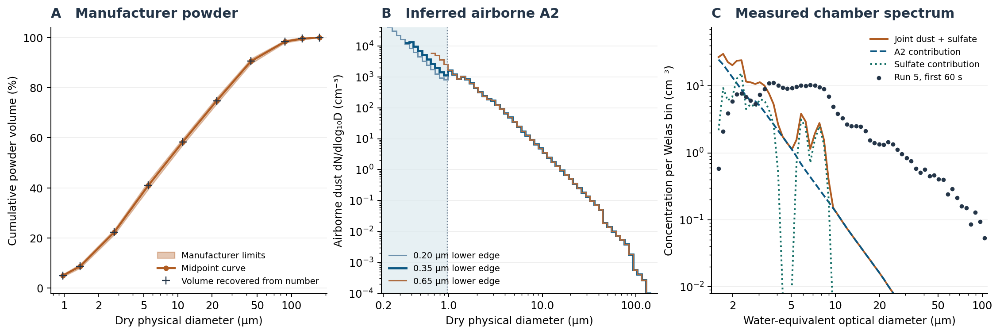

# What keeps 5–10 µm particles in the sampled air in run 5?

Run 5 combined ammonium sulfate, Arizona Test Dust and a later NaCl injection. Before cloud formation Welas already counted 90.6 particles/cm³ at 5–10 µm and 23.8 at 10–20 µm. A nonnegative mixture of the manufacturer-constrained A2 dust with the run-4 sulfate shape yielded 17.5 and 0.53 particles/cm³, respectively. Preferential loss of coarse powder during injection worsened the discrepancy. The supplier reports cumulative dry volume by physical diameter. Converting that grading to airborne number requires assumptions about delivery, the unresolved population below 0.97 µm and the optical response of mineral particles. [A2 grading limits](https://www.powdertechnologyinc.com/product/iso-12103-1-a2-fine-test-dust/) · [Jeju chamber data](https://doi.org/10.6084/m9.figshare.31744108.v1)

*Figure 1. The supplier constrains cumulative dry volume. The airborne curves show inferred number after delivery and optical sizing. The coarse-tail discrepancy is visible before simulated cloud growth begins.*

Earlier matched six-run fits separated the effect of the A2 source from the effect of refitting. Under that earlier objective, which gives optical, vapor and CPI evidence equal channel weight, changing the source alone increased the score from 1.000 to 1.027. Repeating the shared fit with the two sources gave 0.872 with archived initialization and 0.915 with A2. At finer resolution the refitted A2 score was 0.889. The small refitted difference falls within its numerical sensitivity. These scores use a different objective from the later optical-led six-run table.

## Changing the aerosol and the vapor gradient separately

We froze the independent full-record run-5 fit and changed only the source treatment and the imposed vertical vapor-target contrast. The A2 case carries mineral particles separately from sulfate. The alternative uses the earlier optical initialization. Removing the imposed target contrast leaves the measured bulk water history, wall vapor uptake, transport and local microphysical response active. This substitution tests two representations of the unmeasured quantities within the same fitted physics.

| Source and vapor target | 2–5 µm (cm⁻³) | 5–10 µm (cm⁻³) | 10–20 µm (cm⁻³) | Vapor RMSE (g/m³) | Full-record optical error (decades) |
|---|---:|---:|---:|---:|---:|
| Measured mean, minutes 31–40 | 142 | 292 | 20.9 | — | — |
| A2, fitted contrast | 12.1 | 4.48 | 22.5 | 0.222 | 1.202 |
| A2, contrast removed | 12.2 | 3.97 | 22.6 | 0.221 | 1.202 |
| Earlier optical fill, fitted contrast | 0.25 | 5.31 | 23.5 | 0.222 | 0.980 |
| Earlier optical fill, contrast removed | 0.27 | 4.70 | 23.8 | 0.221 | 0.986 |

*Table 1. Mean late concentrations and late vapor RMSE are from uninterrupted simulations of the entire record. Parameters were selected once under the A2 source and fitted contrast. The model comparison column uses all valid minutes, while the other numeric columns use minutes 31–40. The source swap jointly changes the initial distribution and material assignment.*

Switching the source reduced the whole-record error but depleted the late 2–5 µm band even further. Removing the imposed gradient changed the late 5–10 µm count by less than one particle/cm³ in either source case on either grid. At 2 s the four cases spanned 4.63–6.48 particles/cm³ in that band. At 1 s with doubled size resolution the range was 3.97–5.31. Eight GPU trajectories and a standard-grid CPU reference were checked. The maximum absolute water-budget discrepancy was below 0.0008 g/m³. All four fine-grid vapor errors satisfy the earlier 0.25 g/m³ working limit. Substantial failures in both smaller size bands therefore coexist with a close bulk vapor record.

## What the measured restarts add

Resetting the optical spectrum at minute 20 or 30 temporarily reintroduces the particles missing from the uninterrupted trajectory. In the earlier A2 joint refit, surviving original A2 supplied only 2.6% of modeled 2–10 µm number at the first restart and 2.0% at the second. Assigning every remaining particle to a non-growing class brought all three bands and vapor within tolerance after minute 30 in the midpoint A2 case. The same assignment missed the vapor limit after minute 20. No tested assignment passed at both restarts on both numerical grids. That artificial class bounds how many slow-growing particles would be required under those assumptions. It is not a measured dust fraction.

The persistent mode could reflect which material entered the sampled air, its hygroscopic growth, or a local humidity history not recovered by the present forcing. A dry and humidified particle-size pair with colocated vapor, on a repeat run at the same stages, would directly test that distinction.

[Six-run results and conclusions](index.md)
