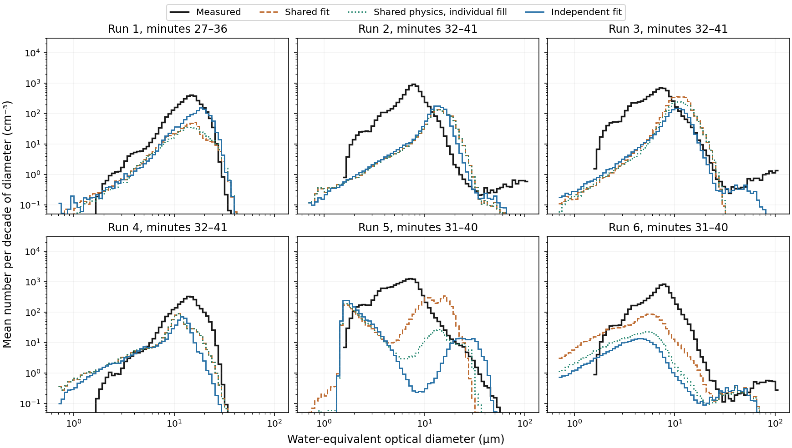

# What fitting each chamber run separately improves

Fitting each expansion separately lowered the optical error in all six complete records. A different pattern emerged when we set the final ten measured minutes aside. With parameters fitted only to earlier observations, individual fits gave smaller late errors than the shared fit in runs 1–3 and larger errors in runs 4–6. The two comparisons answer different questions about the same experiments.

## How the measurements enter the fit

Welas measures particle concentration in 70 bins of water-equivalent optical diameter. The fit gives 65% of its weight to error across these bins and 20% to integrated number in six diameter bands. Vapor contributes 10% and particle images contribute 5% through size and crystal habit. Where a channel is missing, the available weights are rescaled to sum to one. The optical-bin term weights each represented time stage and each of eight logarithmic size groups equally. In the shared fit each experiment has equal weight. The optical errors reported here measure the bin-by-bin part of the score, in decades of number density.

We started each parameter search from two separated points. Paired changes to the particle-solver parameters supplied a local approximation to the score. Automatic differentiation of that approximation suggested the next parameter changes. We ranked the leading candidates with the particle solver at a 2 s timestep. We checked the selected fits at 1 s, doubling the resolution of cloud condensation nuclei, salt and ice while retaining the same 70 measurement bins. Representative CPU and GPU calculations agreed to within 0.000001 decades in whole-record optical error. The largest absolute discrepancies in the retained water and particle budgets were 0.00134 g/m³ and 0.0357 particles/cm³, respectively.

## How much does the most recent spectrum tell us?

*Figure 1. Curves in each panel average the same ten withheld minutes. The simulations start at the pre-cloud fill and continue under measured forcing. The persistence comparison holds the last observed spectrum before that window constant.*

The most recent measured spectrum gave the smallest late error in every run. Holding that spectrum constant gave a six-run mean optical error of 0.263 decades. Simulating forward from the fill gave 0.934 decades with shared parameters, 0.970 with individual parameters and 0.971 when only aerosol and initial conditions varied by run. Persistence starts much closer in time to the withheld observations. These comparisons show how far a fit carries along a measured expansion. Testing transfer to another chamber experiment would require an independent record.

A separate check varies how much weight very small concentrations carry in the optical score. Restricting the calculation to occupied bins tests agreement where Welas registered particles, while the all-bin calculation also counts simulated particles in measured-empty bins. [Sensitivity to low counts and neighboring minutes](spectra.md)

[Six-run results and conclusions](index.md)
