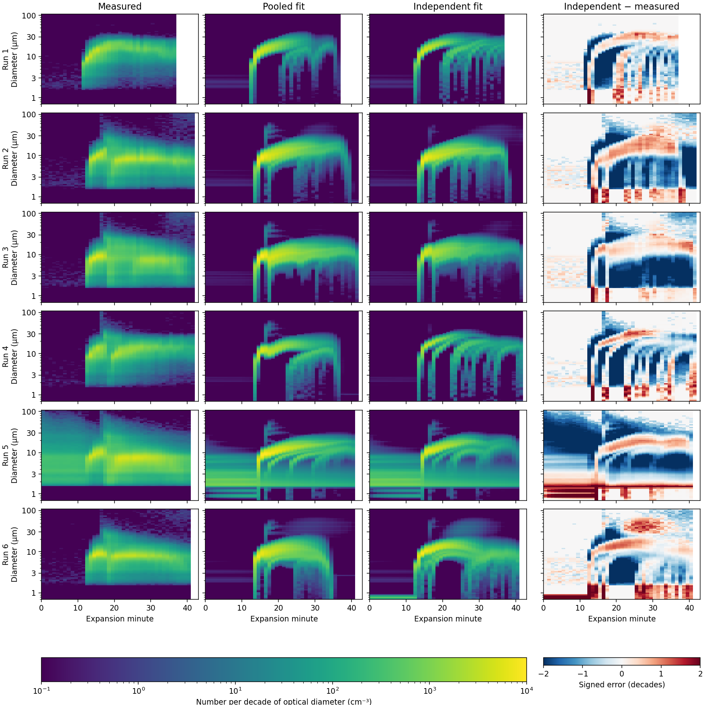
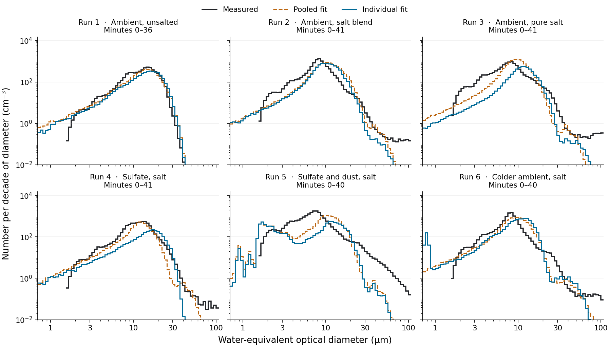

# The Jeju chamber model matches the unsalted droplet peak and undercounts 5–10 µm particles in the dust run

In six expanding clouds at Jeju, particles grew as the air cooled, and salt addition produced a pulse of large particles. Could a chamber model recover the sizes that made up those changes in number? We compared measured and simulated distributions across 70 optical diameter bins. In the unsalted ambient-air run, the shared fit placed the record-mean peak in the measured 14.9 µm bin. In a salted ambient-air run it came close to the total particle count while shifting the peak to larger sizes. The clearest discrepancy came from the sulfate–dust experiment. Averaged over minutes 31–40 of its full-record reconstruction, the individually fitted simulation reproduced the concentration at 10–20 µm yet contained only 4.48 of the 292 particles/cm³ measured at 5–10 µm. The most useful next measurement is a paired dry and humidified size distribution at the optical inlet, with local air temperature and dew point recorded on the same clock. This would show whether the missing particles were already airborne before cooling or reached the measured sizes as they took up water.

## Six expansions measured from filling through ice appearance

Park and colleagues expanded ambient air or laboratory aerosol in the cooled K-CPEC chamber at Seogwipo. The Welas optical counter followed the size distribution. A separate cloud particle imager recorded recognizable ice crystals, including a 124 µm plate in the colder ambient run. Large liquid droplets and dust also appear in the optical record. We therefore compare calculations with Welas in water-equivalent optical diameter and use the imager separately to constrain phase. [Jeju experiment](https://doi.org/10.1029/2026GL123395) · [Versioned observations](https://doi.org/10.6084/m9.figshare.31744108.v1) · [Chamber setup, instruments and six fills](methods.md)

The 18-cell, two-dimensional model follows particles through prescribed circulation, water uptake, freezing, ice growth and loss to the walls or pump. Recorded pressure and thermometry drive each expansion. One fit pools the six experiments. A second estimates parameters independently for each run with the same search effort per fit and the same scoring rule. Both calculations start from the first usable pre-cloud record. In run 5 the initial sulfate–dust mixture is constrained by pre-cloud counts and the A2 powder grading. Vapor measurements are available for five runs. The model carries an uncertain initial humidity through run 6.

## Results across the six experiments

*Figure 1. Each row follows one expansion. The first three columns share a concentration scale in particles/cm³ per decade of optical diameter. The last shows the signed logarithmic difference between the individual fit and Welas. Red indicates excess simulated particles and blue a deficit. Blank times fall outside the measured record. The central growth band and the particles on its smaller-diameter side can have different errors.*

| Run | Chamber fill | Whole-record error, shared → individual | Final ten minutes, shared → individual |
|---|---|---:|---:|
| 1 | Ambient air, unsalted | 0.538 → 0.519 | 0.593 → 0.453 |
| 2 | Ambient air, salt with anticaking agent | 0.594 → 0.571 | 1.135 → 1.117 |
| 3 | Ambient air, pure salt | 0.589 → 0.586 | 0.890 → 0.781 |
| 4 | Sulfate, salt | 0.586 → 0.552 | 0.921 → 0.951 |
| 5 | Sulfate and dust, salt | 1.220 → 1.202 | 0.725 → 1.074 |
| 6 | Colder ambient air, salt | 0.546 → 0.536 | 1.341 → 1.442 |

*Table 1. Lower values mean closer spectral agreement. Errors are mean absolute differences in log₁₀ number density, in decades, using a 0.1 cm⁻³ per-decade floor and equal weighting of represented stages and logarithmic size bands. The whole-record columns score reconstructions fitted to all available minutes. For the last two columns, separate fits used the earlier minutes and continued from the initial spectrum under the recorded forcing, with no reset at the cutoff. Values use the 1 s timestep and doubled particle resolution.*

Individual fits lowered full-record optical error by 0.003–0.034 decades. In runs 2–5 the gain exceeded the change in the paired comparison upon numerical refinement. In the ten-minute forward comparison, runs 1–3 improved and runs 4–6 worsened. Holding the last measured spectrum constant gave a smaller late error than the individual simulation in every run. That baseline starts from an observation just before the final window. Its advantage shows how informative a recent spectrum is about this late window. [Fit design, errors and parameter transfer](fitting.md)

*Figure 2. Each step is an original Welas bin. The three curves average exactly the same measured minutes within a run and report number per decade of diameter at chamber conditions. The six panels retain the individual fills. Pooling all observations into one average would conceal the sulfate–dust discrepancy.*

The observed and shared-fit mean spectra in run 1 peak in the same 14.9 µm bin. The shared fit gives 98.6 particles/cm³ at 10–20 µm against 116 measured. Run 2 illustrates a different outcome. Its shared-fit mean total, 298 particles/cm³, nearly matches the observed 300, although the simulated mean spectrum peaks at 10.4 µm and the measured one at 8.36 µm.

*Figure 3. The columns are common expansion minutes 12, 20 and 30. Minute 12 precedes nominal salt addition in the seeded runs. The two later columns sample the development and decay of the warm pulse or the colder cloud. These are clock-matched cuts, so the same column can represent different temperatures and phases. Both sets of simulations were fitted to the full records.*

At minute 20 the run-2 individual fit gives 688 particles/cm³ against 669 measured. Only 198 of those simulated particles fall in the 5–10 µm band, compared with 479 measured. Run 5 misses that band much more sharply. At minute 20 the counter records 698 particles/cm³ there. The shared fit gives 117 and the individual fit gives 14.9. In minutes 31–40 the individual fit gives 22.5 versus 20.9 measured at 10–20 µm, alongside the 4.48 versus 292 at 5–10 µm. A similar total or a well-placed neighboring band can coexist with a large error in the population available for further growth. [Size cuts and sensitivity to the scoring rule](spectra.md)

## What the sulfate–dust run can tell us

Run 5 already contained coarse particles before salt addition. Combining the supplier’s A2 dry powder distribution with the sulfate shape inferred from run 4 gave 17.5 particles/cm³ at 5–10 µm against 90.6 measured before cloud formation. The powder grading constrains the fraction of dry volume by size. Inferring the airborne number that entered the sampling region also requires assumptions about delivery and optical response. When the score includes only occupied bin–minutes, the small run-5 advantage changes sign on refinement. In a further test, we crossed two starting aerosol mixtures with two assumptions about the vertical vapor gradient, holding the other run-5 settings fixed. All four refined simulations gave only 3.97–5.31 particles/cm³ at 5–10 µm in minutes 31–40, against 292 measured. All four stayed within the working vapor tolerance of 0.25 g/m³. [Starting aerosol, measured restarts and humidity tests](dust.md) · [A2 powder grading](https://www.powdertechnologyinc.com/product/iso-12103-1-a2-fine-test-dust/)

## Which measurements would constrain the chamber model?

**Measure the airborne mixture and its water uptake at the optical inlet first.** In a repeat of the sulfate-only and sulfate–dust runs, sample dry size, humidified size at known relative humidity, local air temperature and dew point together. Sample the pre-cloud fill, the salt pulse and the intervals around minutes 20 and 30. Size-resolved mineral and salt composition would show how much of the 5–10 µm population can be assigned to each material. An excess present in dry air before cooling would point toward aerosol delivery or sizing. An excess that develops upon humidification would constrain water uptake. A difference between inlet and bulk vapor would help quantify the particles’ local exposure. Several effects could coexist.

| Additional record or control | What it would constrain |
|---|---|
| Individual wall and air probe histories with probe positions, response times and synchronized clocks | The measured vertical and near-wall temperature gradients would constrain the range of growth histories that can broaden a spectrum. The deposited mean wall temperature alone cannot locate the cold surfaces. |
| Injection start and stop, airborne salt size and number near the injection and sampling ports, and a tracer-pulse transit time between ports | These would separate delivery and mixing delays from a delayed particle response. Powder mass placed in the feeder does not specify the size-resolved dose reaching Welas. |
| Pump and instrument sample flows through the pressure ramp, a dry size-resolved aerosol decay, and a particle-free repeat with vapor and wall temperatures | Flow and dry decay would separate exhaust from size-dependent particle deposition. Vapor loss in the particle-free control would constrain how much water the walls could remove before droplet growth is fitted. |
| CPI sampled volume as a function of size and time, detection efficiency and clock offset relative to Welas | These would put ice counts on a concentration basis and quantify how long sparse ice could have escaped detection before the first recognizable plate. |

Existing probe logs, inlet geometry, flow settings and injection records would already narrow the fit if they can be recovered. A repeat at matched forcing would also establish how much the airborne size distribution varies between nominally identical fills. These constraints would help distinguish chamber variability from assumptions in the reconstruction. [Experimental records](https://doi.org/10.6084/m9.figshare.31744108.v1) · [Chamber and instrument layout](https://amt.copernicus.org/articles/18/3781/2025/)

## Supporting studies and data

The chamber process comparisons examine which mechanisms broaden the band and which observations identify ice. The field and atmospheric extensions test how far an earlier chamber fit carries into other clouds under specified conditions. [Wall loss, collisions and circulation](processes.md) · [Ice, measured marine cloud and prescribed flows](clouds.md)

The six chamber spectra come from the authors’ original files. The accompanying data release contains the image annotations and readings extracted from published aircraft figures. [Data downloads, attribution and checksums](sources.md) · [Source-to-figure and replay guide](replay.md)
