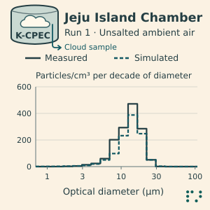
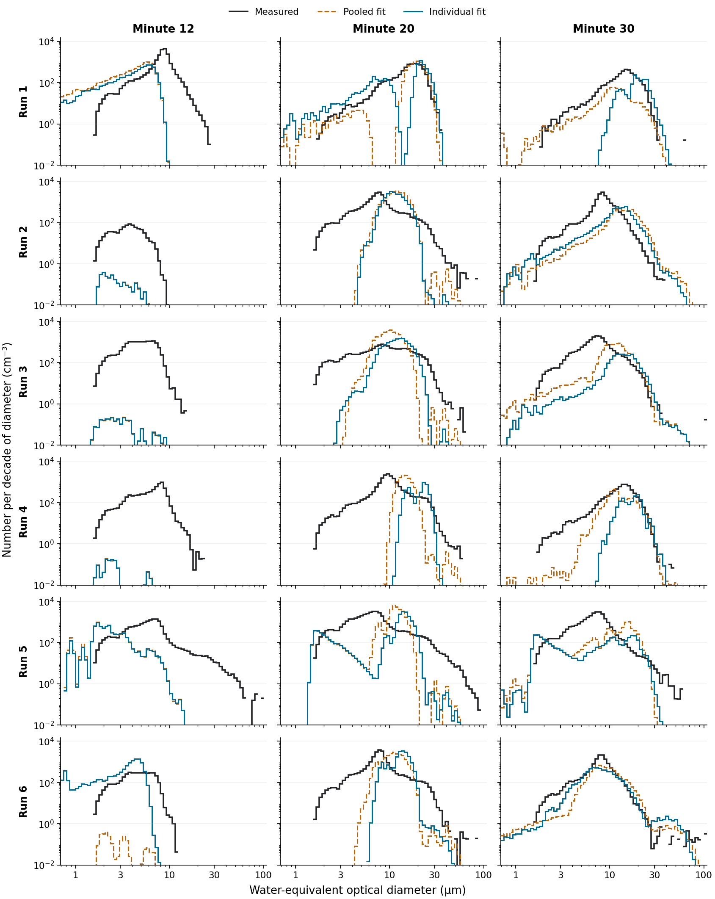

# Reconstructing particle growth in the Jeju Island cloud chamber

In the Jeju Island cloud chamber, a model fitted across six experiments reproduced the peak droplet size in the cloud with no added salt. The measured and simulated distributions, averaged over that run, both peaked at 14.9 µm. Park and colleagues designed the experiments to study whether salt exposure helps ambient aerosol form ice. We used Particula to ask which particle sizes the model could reproduce as each cloud evolved. The clearest mismatch came in the sulfate–dust run. Even when fitted to that run alone, the model gave only 4.48 particles/cm³ at 5–10 µm during minutes 31–40, compared with 292 measured. It came close in the adjacent 10–20 µm band. Paired dry and humidified spectra at the Welas sampling inlet would show whether particles in the missing band were already that large when dry or grew into it as they took up water.

## How the Jeju experiments followed droplet growth and ice appearance

At K-CPEC in Seogwipo, Park and colleagues expanded and cooled six chamber fills containing either outdoor air or laboratory-generated aerosol. After adding salt to a warm ambient-air cloud, they observed a pulse of large droplets and later recognized ice crystals in the cloud particle imager (CPI). A colder ambient-air run yielded a 124 µm plate. The authors interpreted the ambient-air experiments as evidence that exposure to high salinity could enhance ice formation. Identifying ice required the images because droplets, dust and ice all contribute to the Welas optical size distribution. Our comparison therefore uses water-equivalent optical diameter for Welas and crystal size and shape for the imager. [Jeju experiment](https://doi.org/10.1029/2026GL123395) · [Versioned observations](https://doi.org/10.6084/m9.figshare.31744108.v1) · [Chamber setup, instruments and six fills](methods.md)

We reconstructed each expansion from its pre-cloud measurements, driving a two-dimensional, 18-cell model with the recorded pressure and temperatures. Particles circulate, exchange water vapor, freeze and grow, and can be lost to the walls or pump. We first fitted process parameters jointly across all six runs, then fitted each run separately with the same scoring rule and search effort per fit. Run 5 used the pre-cloud counts and the supplier’s A2 dust grading to constrain its starting mixture. Vapor measurements constrained five runs. Initial humidity in run 6 remained uncertain.

## Which particle sizes did the six reconstructions recover?

*Figure 1. Each row follows one expansion. The measured, shared-fit and individual-fit spectra use the same concentration scale, in particles/cm³ per decade of optical diameter. The last column shows the signed logarithmic difference between the individual fit and Welas. Red marks an excess of simulated particles and blue a deficit. Blank times fall outside the measured record.*

| Run | Chamber fill | Whole-record error, shared → individual | Final ten minutes, shared → individual |
|---|---|---:|---:|
| 1 | Ambient air, unsalted | 0.538 → 0.519 | 0.593 → 0.453 |
| 2 | Ambient air, salt with anticaking agent | 0.594 → 0.571 | 1.135 → 1.117 |
| 3 | Ambient air, pure salt | 0.589 → 0.586 | 0.890 → 0.781 |
| 4 | Sulfate, salt | 0.586 → 0.552 | 0.921 → 0.951 |
| 5 | Sulfate and dust, salt | 1.220 → 1.202 | 0.725 → 1.074 |
| 6 | Colder ambient air, salt | 0.546 → 0.536 | 1.341 → 1.442 |

*Table 1. Lower errors indicate closer agreement, in decades of particle number density. Each error averages absolute differences in log₁₀ density, using a 0.1 cm⁻³ per-decade floor and equal weights for the stages and size bands represented. Whole-record fits use every available minute. For the final-ten-minute comparison, only earlier minutes enter the fit. The simulations continue from the pre-cloud spectrum under measured forcing. Both comparisons use the 1 s timestep and doubled particle resolution.*

Fitting each run separately lowered the whole-record optical error in all six runs, by 0.003–0.034 decades. In runs 2–5 the gain exceeded the shift in the comparison under numerical refinement. In run 5, however, scoring only bins where Welas detected particles reversed the ranking of the two fits between resolutions. The advantage was less consistent when we withheld the last ten minutes. Individual fits then improved on the shared fit in runs 1–3 and worsened in runs 4–6. In every run, simply holding the last measured spectrum constant gave a smaller error over those ten minutes than continuing the individual simulation from the pre-cloud fill. [Fit design, errors and parameter transfer](fitting.md)

*Figure 2. Each panel averages the same valid minutes for the measurement and both fits in one run. Each step is an original Welas bin. Concentrations are per decade of optical diameter at chamber conditions.*

In run 1 the shared fit located the droplet peak but underestimated the number of particles around it. The mean spectra peaked in the same 14.9 µm bin, while the fit gave 98.6 particles/cm³ across 10–20 µm and Welas measured 116. In run 2 the shared fit nearly recovered the total concentration (298 particles/cm³ compared with 300 measured), yet its peak lay at 10.4 µm, above the measured 8.36 µm. A total count alone would have hidden that shift.

*Figure 3. The columns show one-minute averages starting at minutes 12, 20 and 30 of each expansion. Minute 12 precedes nominal salt addition in the seeded runs. At minutes 20 and 30, runs can differ in temperature and phase even at the same elapsed time. Both simulated curves come from uninterrupted whole-record fits.*

The one-minute spectra show that even during the salt pulse the model could match the total count while missing the dominant size band. At minute 20 in run 2, the individual fit came close to the total (688 particles/cm³ against 669 measured) but placed only 198 particles/cm³ at 5–10 µm, where Welas counted 479. The discrepancy was larger in run 5. At the same minute Welas measured 698 particles/cm³ in that band, compared with 117 in the shared fit and 14.9 in the individual fit. [Size cuts and sensitivity to the scoring rule](spectra.md)

### The sulfate–dust deficit begins before cloud formation

The reconstructed starting mixture already contained too few 5–10 µm particles. Combining the supplier’s A2 dust grading with the sulfate distribution inferred from run 4 gave 17.5 particles/cm³ in that band before cloud formation, against 90.6 measured. The supplier reports how the dry powder’s volume is distributed across sizes. Converting those values to the number of particles reaching Welas requires assumptions about both powder delivery and the optical response to dust.

The 5–10 µm deficit persisted across four tests of those starting conditions and the humidity field. Holding the other run-5 settings fixed, we combined each of two starting aerosol mixtures with and without an imposed vertical contrast in the vapor supplied to the cells. All four refined simulations stayed within 0.25 g/m³ root-mean-square error in bulk water vapor during minutes 31–40. All four gave only 3.97–5.31 particles/cm³ at 5–10 µm, against 292 measured. In the individually fitted A2 case, the adjacent 10–20 µm band contained 22.5 particles/cm³, close to the observed 20.9. Agreement with the vapor analyzer and with a neighboring size band therefore leaves the source of the missing particles unresolved. [Starting aerosol, measured restarts and humidity tests](dust.md) · [A2 powder grading](https://www.powdertechnologyinc.com/product/iso-12103-1-a2-fine-test-dust/)

### What did the outdoor air contribute?

Runs 1, 2, 3 and 6 each began with a separate sample of outdoor air at Seogwipo, about 2 km from Jeju’s southern shore. For each fill, the first minute of measurements inside K-CPEC set the initial counts in the Welas size range. The model also fits smaller particles capable of forming droplets and an effective abundance of ice-active particles. The optical counts describe the mixed aerosol entering each expansion. Its marine and terrestrial contributions remain unknown. In particular, run 1 received no added salt, although its outdoor air could already have contained sea salt. Its 14.9 µm peak is evidence about growth in that fill. Changes in the incoming aerosol complicate attribution of differences between ambient runs to the injected salt. [Jeju experiment, site and ambient aerosol measurements](https://doi.org/10.1029/2026GL123395) · [How the initial populations enter the model](methods.md)

## What would distinguish incoming particles from growth inside the chamber?

The most informative repeat would pair dry and humidified size distributions at the Welas inlet in the sulfate-only and sulfate–dust runs. Measure local air temperature and dew point on the same clock, from the pre-cloud fill through the salt pulse and the intervals around minutes 20 and 30. Size-resolved mineral and salt measurements would narrow the material assignments. Comparing inlet vapor with the chamber analyzer would show how closely the bulk measurement represents conditions where Welas samples.

| Additional record or control | What it would constrain |
|---|---|
| Paired outdoor and in-chamber pre-cloud dry size distributions, size-resolved sea-salt and mineral tracers, and droplet- and ice-activation measurements on the same fill | These would separate changes in the outdoor mixture from size-dependent losses during filling and constrain how many of the particles entering each expansion can form droplets or ice. |
| Individual wall and air probe histories with probe positions, response times and synchronized clocks | The measured vertical and near-wall temperature gradients would constrain the range of growth histories that can broaden a spectrum. The deposited mean wall temperature alone cannot locate the cold surfaces. |
| Injection start and stop, airborne salt size and number near the injection and sampling ports, and a tracer-pulse transit time between ports | These would separate delivery and mixing delays from a delayed particle response. Powder mass placed in the feeder does not specify the size-resolved dose reaching Welas. |
| Pump and instrument sample flows through the pressure ramp, a dry size-resolved aerosol decay, and a particle-free repeat with vapor and wall temperatures | Flow and dry decay would separate exhaust from size-dependent particle deposition. Vapor loss in the particle-free control would constrain how much water the walls could remove before droplet growth is fitted. |
| CPI sampled volume as a function of size and time, detection efficiency and clock offset relative to Welas | These would put ice counts on a concentration basis and quantify how long sparse ice could have escaped detection before the first recognizable plate. |

In a repeat with the same pressure and cooling history, the first comparison would be the measured and reconstructed dry spectra before cloud formation. An excess of measured dry 5–10 µm particles at the sampling port would point first to delivery or optical sizing of the starting aerosol. If the dry counts agree and the deficit develops during humidification, the size shift at known humidity would constrain how the model represents water uptake. Existing probe logs, flow records and inlet geometry would help interpret either outcome. [Experimental records](https://doi.org/10.6084/m9.figshare.31744108.v1) · [Chamber and instrument layout](https://amt.copernicus.org/articles/18/3781/2025/)

## Supporting studies and data

The chamber process comparisons test how wall loss, collisions and circulation affect spectral width. A separate analysis carries an earlier set of chamber fits into a measured marine cloud and into prescribed cloud flows. It compares suspended ice with the aircraft observations and follows liquid persistence and ice fallout in the simulated clouds. [Wall loss, collisions and circulation](processes.md) · [Ice, measured marine cloud and prescribed flows](clouds.md)

The chamber spectra come from the authors’ original files. The accompanying data release contains our annotations of chamber images and readings from published aircraft figures. [Data downloads, attribution and checksums](sources.md) · [Source-to-figure and replay guide](replay.md)
