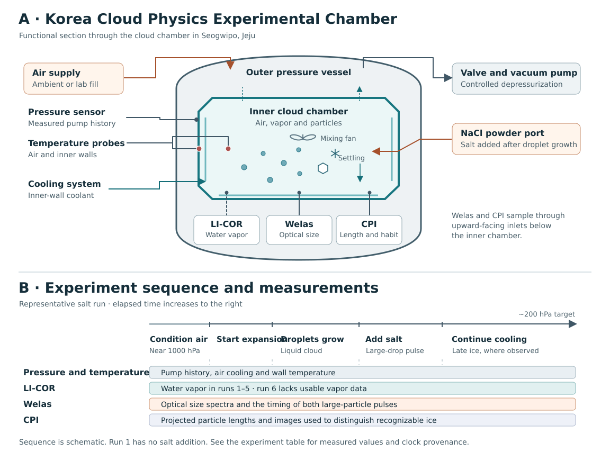

# How the Jeju chamber and its instruments constrain the simulation

Park and colleagues followed six cloud expansions in the Korea Cloud Physics Experimental Chamber (K-CPEC) at Seogwipo in October and November 2025. The optical counter (Welas) measured how particle number changed with size. The cloud particle imager (CPI) supplied the separate evidence for ice. A faceted crystal can be recognized in an image even when a liquid drop has the same optical diameter. [Jeju experiment](https://doi.org/10.1029/2026GL123395)

*Figure 1. The inner chamber cools as the pump removes air. Welas and the CPI sample near the bottom, while the LI-COR vapor analyzer samples a warmer region. The timeline shows when each instrument can constrain the simulation. Positions are schematic. [Facility schematic](https://amt.copernicus.org/articles/18/3781/2025/) · [Experiment sequence](https://doi.org/10.1029/2026GL123395)*

## What was in each expansion?

| Run | Initial fill and salt treatment | Salt addition (local time) | Pressure and mean air temperature at addition | Vapor record | Early particles and later ice evidence |
|---|---|---|---|---|---|
| 1 | Ambient air, no added salt | — | — | Measured | No salt pulse. During 33 s near the temperature of the run-6 plate, CPI recorded no particles 60 µm or longer. |
| 2 | Ambient air, 5 g NaCl with 1% anticaking agent | 11:16, published | 710 hPa, 5.85 °C | Measured | Rounded large drops, then a 61 µm faceted plate. |
| 3 | Ambient air, pure NaCl, nominal 5 g repeat | 16:16, inferred | 700 hPa, 5.32 °C | Measured | Large-particle pulse. The authors report ice formation comparable to run 2. |
| 4 | Ammonium sulfate, 5 g NaCl | 13:56, inferred | 713 hPa, 5.23 °C | Measured | Warm large-particle pulse. Few ice crystals reported. |
| 5 | Ammonium sulfate and Arizona Test Dust, NaCl dose unverified | 17:06, inferred | 688 hPa, 4.15 °C | Measured | Coarse particles before salt addition, then a second warm pulse. Few ice crystals reported near −10 °C. |
| 6 | Colder ambient air, NaCl dose unverified | 15:16, inferred | 700 hPa, −2.31 °C | Unavailable | Large-particle pulse below freezing, then a 124 µm hexagonal plate. |

*Table 1. Pressure and temperature are chamber measurements at the nominal injection minute. For runs 3–6 we inferred the time to the nearest minute from the chamber records. In run 5 we used the renewed warm pulse because coarse particles were already present. The dose for runs 5 and 6 could not be verified from the available records. [Experiment and phase observations](https://doi.org/10.1029/2026GL123395) · [Chamber data](https://doi.org/10.6084/m9.figshare.31744108.v1)*

## How the outdoor sample enters the model

For each ambient fill we average the first 60 seconds of Welas counts in each optical size bin. All 18 simulated cells start with that run’s measured in-chamber distribution. We also fit the abundance and characteristic size of a smaller population that can form cloud droplets, and an effective abundance of ice-active particles. Injected salt enters separately at the time listed in Table 1.

Across the ambient fills, Park and colleagues measured 2,400–8,100 aerosol particles/cm³. At 0.6% water supersaturation they measured 580–1,370 cloud condensation nuclei (CCN) per cm³. Those counts provide an independent check on a model fitted to chamber spectra, vapor and images. To make the comparison, we would need to calculate how many simulated particles activate at the counter’s supersaturation for each fill. [Ambient measurements and Table S1](https://doi.org/10.1029/2026GL123395) · [Chamber observations](https://doi.org/10.6084/m9.figshare.31744108.v1)

## Which quantities are measured or fitted?

The model uses measured pressure, the mean of four air-temperature probes, the coldest air reading and the mean of six wall-temperature probes. The deposited wall record contains only the mean. The model prescribes how wall temperatures vary across the chamber and fits an effective circulation speed. We score the original 70 Welas bins at chamber conditions using one-minute means. [Versioned measurements](https://doi.org/10.6084/m9.figshare.31744108.v1)

| Kind of evidence | What enters the calculation |
|---|---|
| Measured forcing and initial populations | Pressure (hPa), air and wall temperatures (°C), pre-cloud Welas number in each optical bin (particles/cm³), and available LI-COR vapor (converted to g/m³). For run 5, the pre-cloud counts constrain the combined airborne sulfate and dust. |
| Independent instrument calibration | The authors calibrated Welas with MonoDust 1500. We follow their water-equivalent optical sizing. Both the Welas optical diameter and the CPI projected length can differ from the physical dry diameter. |
| Fitted or inherited effective quantities | Circulation and exchange, heat transfer, CCN loading and size, wet growth and activation, vapor response and wall uptake, dry-particle loss, salt delivery, ice-active abundance and ice growth. Previously inferred instrument response and analyzer correction are frozen in the final fits. |
| Assumptions tested | Spatial vapor contrast, wall-temperature contrast, aerosol delivery and optical response, collision efficiencies, unresolved humidity in run 6 and removal of selected processes. |

*Table 2. The manufacturer reports A2 dry volume by size. Converting it to airborne number requires assumptions about powder delivery and optical sizing. Bulk vapor constrains the chamber water budget, while the supersaturation experienced by particles at the sampling port remains uncertain. [Manufacturer A2 grading](https://www.powdertechnologyinc.com/product/iso-12103-1-a2-fine-test-dust/) · [Jeju methods](https://doi.org/10.1029/2026GL123395)*

[Six-run results and conclusions](index.md)
