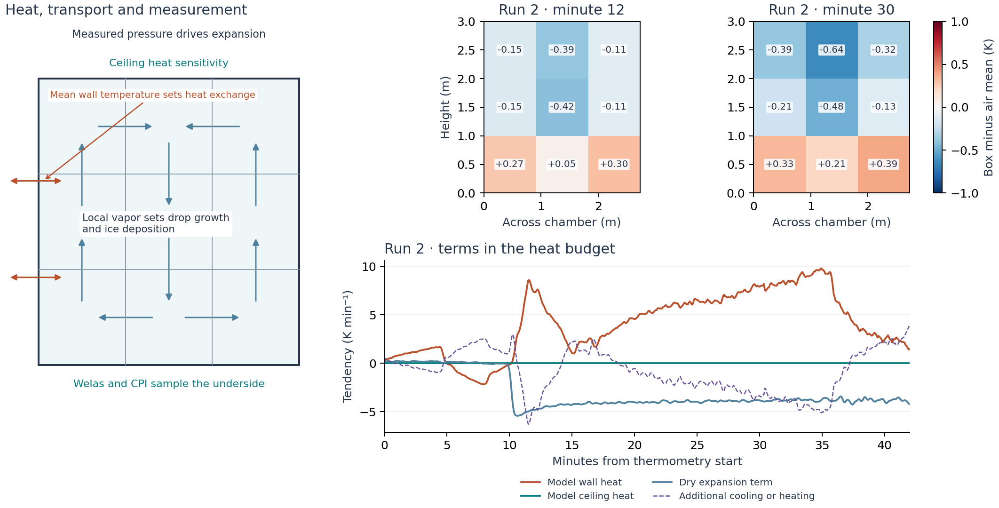

# Which chamber processes broaden the spectrum?

An earlier well-mixed chamber fit produced a droplet band that was too narrow. Across 163 common measured minutes, mean width in the 2–40 µm range increased from 0.204 to 0.256 decades after refitting Particula’s native size-dependent wall loss. Including Brownian, van der Waals, differential-settling and turbulent-shear collision kernels gave 0.263 decades, against 0.393 observed. Width here is log₁₀(D₉₀/D₁₀) by number. Adding all collision kernels at fixed parameters slightly narrowed the band on three numerical grids. The independently fitted wall eddy-loss parameter spans more than five orders of magnitude across the six runs. Those fitted coefficients would require independent deposition measurements to interpret physically.

## What heterogeneous growth adds

Splitting the chamber into nine boxes with prescribed circulation and spatial temperature differences broadened the size range even with earlier microphysics held fixed. Across 166 common minutes, mean width increased from 0.205 to 0.395 decades, close to the measured 0.393. Removing the temperature contrast largely erased the effect. A fit that retained the earlier number-error constraint improved width while increasing error in the tail above 40 µm. Thus a close mean width can arise while important parts of the measured distribution remain unexplained.

The mean wall was 0.70 K warmer than the mean air at the median after minute 18. The measured mean wall and coldest air temperature therefore constrain heat exchange, while leaving room for different circulation fields. When air-temperature spread was prescribed in both 18-cell geometries, refined optical errors were 0.659 decades in 2D and 0.654 in 3D under the earlier spectral objective. Only two runs favored 3D. The main comparison retained the 2D geometry and evaluated the complete distribution and its evolution.

*Figure 1. The earlier nine-box experiment illustrates the prescribed circulation with local temperature departures at two stages of run 2. The modeled heat budget uses measured chamber means. Neither the local velocity field nor the individual wall-face temperatures were observed.*

## When transport can move between fills

The independent full fits used circulation speeds of 0.012–0.208 m/s. Replacing a run’s transport parameters with each of the other five while holding its aerosol, salt, freezing and observations fixed usually increased optical error. The median increase over the 30 exchanges was 0.029 decades on the standard grid. For run 5 the increase was only 0.013–0.026 decades against an error of 1.188. That small range motivates a closer examination of its initial particle mixture and vapor exposure. [Run-5 source and restart tests](dust.md) · [Chamber measurements](https://doi.org/10.6084/m9.figshare.31744108.v1)

[Six-run results and conclusions](index.md)
