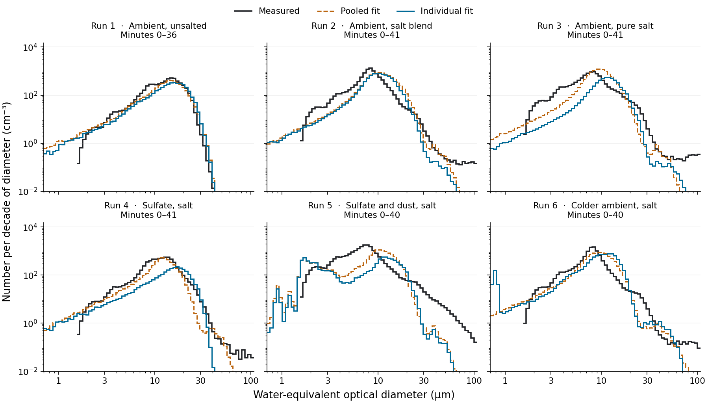
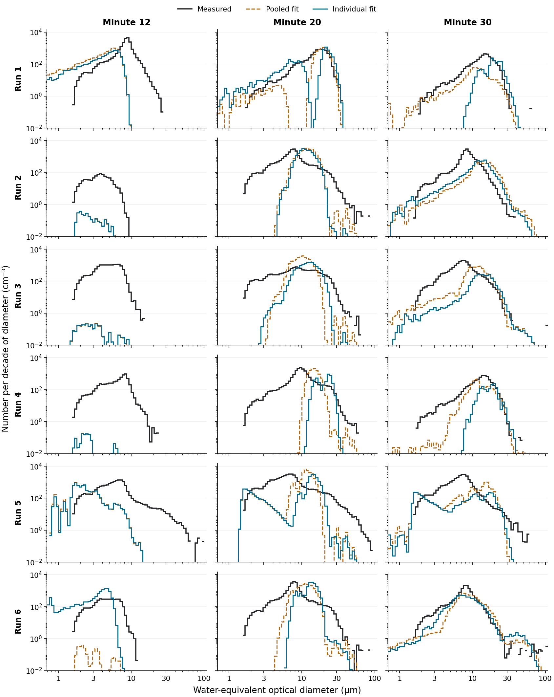

# Which parts of the six Jeju size distributions do the chamber fits recover?

The mean optical spectrum of the unsalted ambient cloud peaked at 14.9 µm. The pooled fit recovered that bin, and the individual fit peaked one bin higher, at 16.0 µm. Run 5, which contained sulfate and Arizona Test Dust before salt addition, showed a much larger mismatch in the middle of the measured spectrum. Across its 41 recorded minutes, Welas measured 388 particles cm⁻³ at 5–10 µm. The pooled fit gave 141 cm⁻³ and the individual fit gave 40.8 cm⁻³. That deficit persists on either side of the selected minute cuts. [Jeju experiment](https://doi.org/10.1029/2026GL123395) · [Archived measurements](https://doi.org/10.6084/m9.figshare.31744108.v1)

## The record means show where totals conceal errors in size

**Figure 1.** Each step is one original Welas bin. The black curve gives the arithmetic mean of all valid one-minute chamber-condition measurements in that run. The orange dashed and blue solid curves use the same minutes for the pooled and individual full-record fits, respectively. Curves show number per decade of water-equivalent optical diameter. A band concentration integrates those densities over the actual logarithmic bin widths. Zero concentrations have no position on the log ordinate.

In run 2, the pooled fit gives nearly the measured record-mean total across the optical range, 298 versus 300 cm⁻³. Its mean spectrum peaks at 10.4 µm against the measured 8.36 µm. The 5–10 µm band has 126 cm⁻³ in the pooled fit and 209 cm⁻³ measured. Agreement in total can therefore coexist with a deficit through the measured peak. In run 5 the record-mean mode shifts from 7.78 µm measured to 9.65 µm in the pooled fit and 11.2 µm in the individual fit.

## The deficit in run 5 persists across adjacent minutes

**Figure 2.** Columns show minutes 12, 20 and 30 from each run’s chamber clock. A plotted minute is the valid one-minute acquisition average starting at that label. Minute 12 precedes nominal salt injection and minute 20 follows it in the seeded runs. Run 1 was unsalted. Minute 30 samples later evolution at different thermodynamic conditions across experiments. Each simulated curve is an uninterrupted full-record fit on the refined grid. Optical diameter alone cannot identify phase. The same diameter and concentration axes apply to all 18 panels. [Experiment clocks and injection provenance](methods.md) · [Size–time spectra and signed residuals](../../../images/jeju-chamber/six-spectra.png)

| Run and minute | Measured total (cm⁻³) | Individual total (cm⁻³) | Measured 5–10 µm (cm⁻³) | Pooled 5–10 µm (cm⁻³) | Individual 5–10 µm (cm⁻³) |
|---|---:|---:|---:|---:|---:|
| 2, minute 20 | 669 | 688 | 479 | 188 | 198 |
| 5, minute 20 | 1,173 | 511 | 698 | 117 | 14.9 |
| 5, minute 30 | 795 | 111 | 599 | 47.5 | 17.1 |

Moving the run-5 cut one minute earlier or later leaves the 5–10 µm deficit in both fits. Across minutes 19–21 the individual fit gives 8.2–20.3 cm⁻³ while the measurements span 388–928 cm⁻³. Across minutes 29–31 the corresponding ranges are 9.8–18.6 and 575–668 cm⁻³. These are ranges across adjacent observation windows. The recorded distributions establish the timing and size of a discrepancy. The same optical data do not identify its cause or quantify how many of those particles contained dry dust. [Material and restart tests](dust.md)

## The gain from individual fits depends on which bins are scored

We rescored the six frozen full-record fits with three concentration floors and a separate occupied-bin test. The optical error is the absolute log₁₀ difference between modeled and measured density after adding the listed floor to both. Stages and diameter groups carry equal weight. The occupied-bin test includes points with measured density of at least 0.1 cm⁻³ per decade and renormalizes within represented groups. This concentrates the comparison on measured particles and drops the penalty for placing simulated particles in measured-empty bins. The baseline calculation recovered each of the archived full-record optical scores at both resolutions.

| Bins scored | Floor (cm⁻³ per decade) | Runs with lower individual error on the fine grid | Runs with a gain exceeding the paired grid shift¹ | Six-run mean gain (decades) |
|---|---:|---:|---:|---:|
| All original bins | 0.03 | 6/6 | 3/6 | 0.0212 |
| All original bins | 0.10 | 6/6 | 4/6 | 0.0181 |
| All original bins | 0.30 | 5/6 | 2/6 | 0.0152 |
| Measured occupied bins | 0.10 | 5/6 | 2/6 | 0.0402 |

¹ Gain is pooled minus individual error. The last count requires the smaller gain on the two grids to exceed the absolute change in that gain when moving from the standard 2 s configuration to 1 s with doubled cohort resolution. Both grids retain the original 70 measurement bins. These paired shifts quantify numerical sensitivity. The table reports fixed-parameter rescoring, and contains no new optimizer or chamber trials.

The average optical gain remains positive throughout. Run 3’s fine-grid advantage slips from 0.0035 decades at the reference floor to −0.0003 at the higher floor. For run 5, masking the sparsest measured bins changes the fine-grid gain from +0.0183 to −0.0008 decades. On the standard grid the occupied-bin gain is +0.0026 decades. Even the direction changes with refinement. Resolving the pronounced physical deficit at 5–10 µm will require information beyond an aggregate log-error improvement. Paired near-port dry composition and humidity during the peak would distinguish an unusual airborne population from a difference between local particle exposure and the sampled bulk vapor. [Underlying chamber fits and checks](fitting.md)

[Six-run results and conclusions](index.md)
