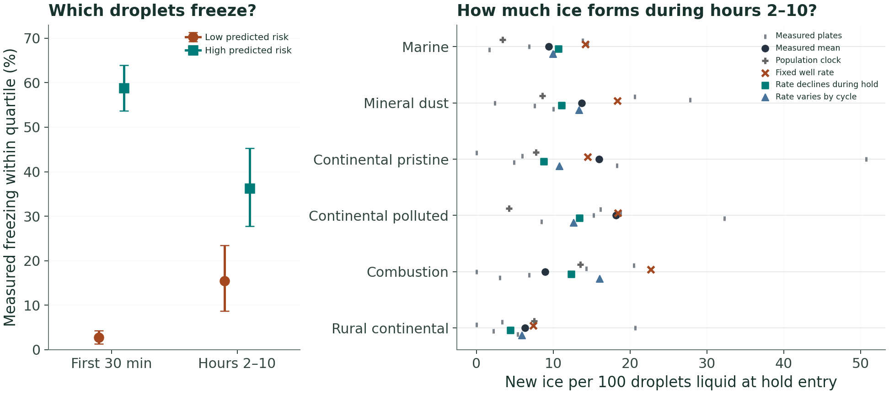
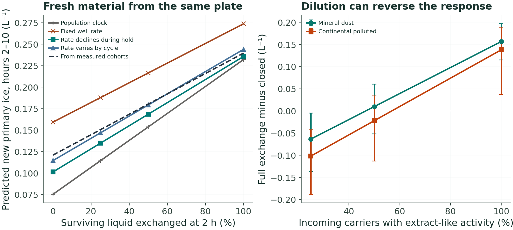

# Short freezing histories identify which droplets still form ice hours later

A droplet’s freezing history predicted whether it would freeze again, even after two hours at constant temperature. Jakobsson and colleagues repeatedly cooled and thawed the same droplets from six ambient aerosol extracts. We used their short exposures to rank droplets, then tested those rankings in 30 overnight records. In the first half hour, 59% of droplets in the highest-risk quarter froze, compared with 3% in the lowest. Among droplets still liquid at two hours, 36% of the highest-risk quarter and 15% of the lowest froze over the next eight hours. Predicting the total ice yield was harder. A fixed rate for each well predicted 15.9 additional freezes per 100 droplets liquid at hold entry, against 12.1 measured. Allowing the rate to vary between freeze–thaw cycles predicted 11.5. The measurements support preferential freezing of the most susceptible droplets. How much a given droplet’s rate changes during one exposure remains open.

Forecasts on these 30 plates use their short-hold records and cooling-ramp temperatures. The overnight outcomes are withheld. Some cooling ramps occurred after the overnight hold, so the test assesses transfer between protocols on familiar wells.

## A cold stage tracks the same droplets across freeze–thaw cycles

Jakobsson et al. asked how long ambient particles continue to nucleate primary ice at constant temperature. Each aerosol extract supplied five arrays of 100 one-microlitre droplets. The stage cooled to −14 °C for five extracts and −16 °C for the continental polluted extract. Cooling ramps tracked the temperature at which each droplet ordinarily froze. Repeated two-hour holds measured its response to prolonged cold. Each array also underwent an 11–16 h exposure. Ice continued to appear well after the target temperature was reached. The authors proposed that the most active particles leave the liquid first, slowing subsequent ice production. Later cloud simulations tested the atmospheric importance of this time dependence. The repeated well identities offer a more direct test of the depletion step. [Jakobsson et al.](https://doi.org/10.5194/acp-22-6717-2022) · [Waman et al.](https://doi.org/10.1175/JAS-D-22-0187.1)

## The averaging convention matters most when few droplets freeze

Counting frozen droplets at fixed times reproduced ten of the 18 published values within the prespecified tolerance of three droplets per 100. At ten hours the marine arrays had 66.0 frozen droplets per 100, close to the published 65.0. The rural continental arrays had 22.0 against 30.6 published. For comparison with those counts, we reconstructed the authors’ Figure 9 curves from equations 2 and 4 and Tables 3–4. The authors used the long exposures to fit those curves.

Weighting the counts by freezing events recovered the published rural continental value but widened the discrepancy for polluted continental aerosol. The authors averaged observations in logarithmic time bins. In the last 0.1 decade before ten hours, just five rural continental events gave an average of 30.6 frozen droplets per 100. For polluted continental aerosol the same calculation gave 96.7, compared with 81.4 from the complete arrays and 75.0 published. Ten events in one frame gave one plate disproportionate weight. The archive mentions technical exclusions without identifying every excluded record. We therefore retained all plates and scored every droplet still liquid at hold entry. [Author event archive](https://web.nateko.lu.se/vp/inp_raw_data.tar)

The main study’s first figure compares the archived observations with the authors’ fitted curves and both short-hold forecasts. [Figure 1 in the main study](index.md)

## Droplet identity carries information after the fastest wells have frozen

The difference in measured freezing between the highest- and lowest-risk quarters narrowed from **56.1 percentage points** in the first half hour (95% interval 51.4–60.6) to **20.8 points** during hours 2–10 (13.7–28.2). We used each well’s short-hold history to rank the droplets still liquid on its plate at the start of each interval. Of the 3,000 droplets on the overnight cooling ramps, 2,164 remained liquid at hold entry and 1,556 at two hours. The intervals describe plate-to-plate variability within the six extracts.

The model identified which survivors were more likely to freeze, although it exaggerated the difference between the two quarters. It predicted that 50.3% of the highest-risk quarter and 10.5% of the lowest would freeze during hours 2–10. The measured fractions were 36.3% and 15.5%. The ranking also held among wells matched by coordinates and grouped by plate, half-kelvin ramp-temperature band and inner or outer stage region. In either period, none of 4,000 shuffles of the freezing outcomes within those groups produced as strong an association. Individual wells can still differ in local temperature and in how many ice-nucleating particles they contain.

*Figure 1. Bars on the quartile points give 95% plate-bootstrap intervals. On the right, small ticks show individual plates. Each model saw the two-hour calibration records. All four use the same measured liquid inventory when the overnight hold begins.*

## A fixed rate for each well gave no clear gain in predicting late ice counts

The archive cannot establish what caused the apparent bursts of freezing on two plates. Keeping or excluding those plates led to the same conclusion about the forecasts. With all 30 plates included, assigning each well its own constant rate reduced mean absolute error by 0.7 freezes per 100 droplets relative to the population clock. The paired 95% interval (−1.6 to +3.0) allowed either model to be more accurate.

The fixed-rate model overpredicted late freezing in the combustion extract, at 22.7 freezes per 100 droplets liquid at hold entry against 8.9 measured. Its largest single-plate error went the other way. On pristine continental plate 3, 35 of the 69 droplets still liquid at hold entry froze between hours two and ten. The model predicted 14.5 freezes per 100 against 50.7 recorded. Of those 35 freezes, 34 shared one timestamp. On polluted continental plate 4, ten freezes shared one timestamp. Excluding both plates lowered the measured late yield from 12.1 to 10.1 per 100. The estimated error reduction then fell to 0.1 per 100 (paired 95% interval −2.3 to +2.5).

Across all 30 plates, 256 droplets froze between hours two and ten. Weighting plates equally gave a measured yield of **12.1 freezes per 100 droplets liquid at hold entry** (95% interval 8.7–16.0). All four forecasts below use that denominator.

| Short-hold rule | Mean late freezes per 100 | Mean absolute plate error per 100 |
| --- | ---: | ---: |
| Population clock, one response curve per extract | 7.5 | 9.3 |
| Persistent, constant rate for each well | 15.9 | 8.6 |
| Persistent activity with a rate declining during each hold | 10.1 | 6.6 |
| Persistent activity with a new constant rate drawn each cycle | 11.5 | 7.4 |

Two explanations for the slowdown improved different aspects of the forecast. Letting each well’s rate decline during a hold gave the smallest mean absolute plate error, 6.6 per 100. That was an improvement of 2.03 per 100 over the fixed-rate rule (paired 95% interval 0.29–3.74). Drawing a new constant rate after each thaw came closest to the mean yield, at 11.5 per 100 against 12.1 measured, and gave the better fit to withheld short runs. Both rules were exploratory follow-ups. We chose their parameters using the short runs alone.

Observing the first four hours improved the forecast for hours 6–10. Updating each plate’s rate from four hours of data reduced absolute error by 0.80 per 100 (95% interval 0.22–1.33). With only the first two hours, the estimated gain was 0.33 per 100 and its interval included zero (−0.22 to 0.87). Both forecasts used the measured six-hour survivors.

## Replacing survivors changes ice production only if the incoming liquid has different activity

All four models predicted more primary ice when fresh material from the same source replaced the two-hour survivors. For a layer starting with one liquid carrier per litre, each with the freezing behavior of an assay droplet, complete replacement added **0.114–0.157 ice particles L⁻¹** over the next eight hours compared with retaining the survivors. Temperature and carrier loading were held fixed during exchange. A separate estimate using each plate’s measured freezing fractions at two, eight and ten hours gave **+0.119 L⁻¹** (95% interval 0.102–0.133). Both estimates describe a hypothetical exchange. The laboratory exposures kept the original droplets in place.

*Figure 2. Left, one carrier per litre initially. Fresh arrivals receive their own exposure clock. Giving them the resident layer’s age erases the exchange response. Right, the replacement source is drawn independently from the same extract, with a specified share of inactive carriers. Intervals resample the five source plates. Each panel uses its stated source allocation.*

Diluting the incoming mineral-dust extract reversed the predicted effect of replacement. An incoming carrier needed more than a 20.1% chance of freezing over eight hours to produce more ice than a resident survivor. Fresh extract gave 43.1%. Mixing one extract-like carrier with three inactive ones lowered that probability to 10.8% and **reduced** predicted ice by 0.064 L⁻¹ (95% interval 0.005–0.137 fewer). Applying this threshold in a cloud requires independent estimates of source activity, carrier loading and residence time, as well as a way to relate an extract droplet to a cloud-borne nucleus.

## Tag the two-hour survivors and measure the response to fresh liquid

Tagged arrivals would show whether the extra ice forms in fresh material entering the layer. At an initial loading of one carrier per litre, replacing half the two-hour survivors with matched fresh material is predicted to add **0.057–0.078 ice particles per litre** over the next eight hours. Compare that treatment with undisturbed survivors and a sham exchange. Record temperature and freezing times separately for arrivals and residents, then test whether diluting the source across the measured survivor threshold reverses the response.

Warming and recooling the same survivors would test how much their exposure history matters when the droplet identities stay fixed. If the excursion fully restarts their exposure, the two variable-rate rules predict 0.023–0.026 additional ice particles per litre. Unchanged constant rates predict zero. Counting ramp freezes separately would let the subsequent hold test that prediction.

## Reproducibility

The benchmark uses 125 ramp records, 96 short holds and 30 overnight holds. We scored every droplet still liquid at overnight entry, including the 48 whose coordinates could not be matched reliably and which received the extract-wide prior. A CPU calculation and 184,320 final GPU ensemble boxes tested the replacement calculation at prescribed loading. The experiment and the synthetic exchange use separate denominators, respectively droplets liquid at hold entry and litres of layer air. [Author records and replay](reproducibility.md) · [Main cloud study](index.md)
