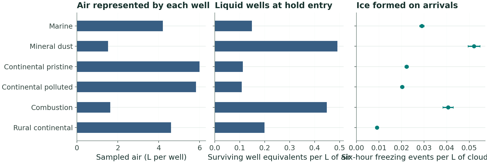
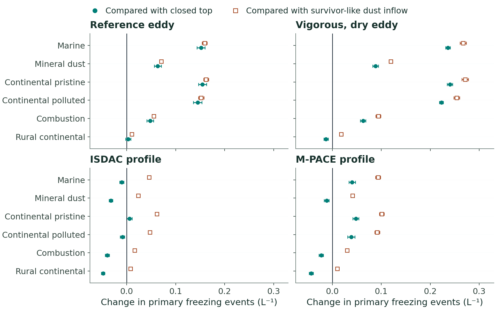
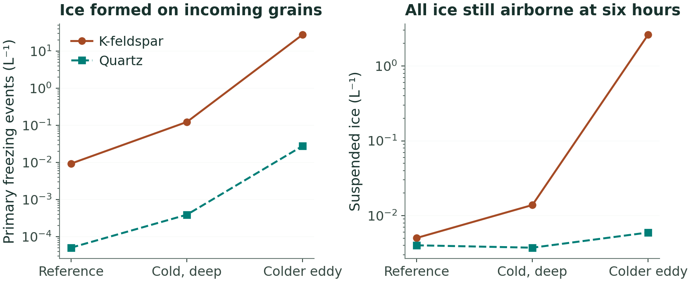

# How aerosol source, cloud water and circulation change the response to entrainment

The sign of the effect of entrainment on primary ice depends on two quantities per litre of layer air. The first is ice formed on incoming particles. The second is the change in freezing on residents. Each experiment below holds one part of that balance fixed. The six Lund air-mass labels each represent one sampled filter in Sweden. ISDAC and M-PACE identify Arctic thermodynamic profiles used to initialize the simulated clouds. [Main study](index.md)

## At the concentrations estimated from the filters, dust arrivals produced more ice than marine arrivals

Using each filter’s sampled air volume, the reference eddy produced **0.052 primary freezing events per litre of cloud air** on incoming material from the dust-influenced sample and **0.029** on material from the marine sample over six hours. The dust–marine difference was 0.023 events L⁻¹ (paired 95% simulation interval 0.021–0.025). A paired run on a 1,600-cell grid gave a difference of 0.025 events L⁻¹.

Each marine well contained material collected from 4.20 L of air. Each dust well represented 1.525 L. Of 500 wells per filter, 313 marine wells and 375 dust wells were still liquid when the hold began. Dividing those fractions by the sampled litres per well gave the model its incoming concentrations of 0.149 marine and 0.492 dust well equivalents per litre of air.

This estimate assumes complete filter recovery and uniform mixing of the extract. A well can contain several ice-nucleating particles, and each filter represents one sampling date. The paired interval describes simulation variability for these two filters.

*Figure 1. The first two panels come from the measured sampling volumes and counted hold-entry wells. The third uses those filter-specific concentrations to predict freezing on arrivals per litre of cloud air over six hours in the reference eddy. Error bars describe paired particle sampling. Each label represents one environmental filter, divided among five plates.* [Published sampling volumes](https://acp.copernicus.org/articles/22/6717/2022/acp-22-6717-2022-t01.xlsx)

## The resident aerosol changes how much freezing the cloud can lose

Opening the cloud top increases total freezing when incoming particles produce enough events to offset the decline in freezing on residents. Using the concentrations inferred from the filters, the reference eddy needed 2.85 freezing events per 100 admitted dust equivalents to offset lost resident production. The incoming dust delivered 10.28. In the ISDAC profile under rapid exchange, dust delivered 2.59 against 3.97 required. The open and closed simulations give the change in resident freezing. Dividing this change by the number of arrivals gives the threshold a source must exceed in that cloud.

Source identity alone could also change the sign. In the vigorous, dry eddy, exchanging the same air with the same carrier loading produced 0.236 more events L⁻¹ than closing the top when the marine extract supplied the aerosol (0.231–0.241 more). The rural continental extract instead produced 0.013 fewer (0.008–0.017 fewer). Both labels refer to the air sampled on a particular date. Diluting that marine inflow with inactive carriers while keeping total carrier number fixed also moved the cloud across zero. With 25% carrying the marine spectrum, the change was −0.009 L⁻¹. At 100% it was +0.236 L⁻¹.

The sign of the ISDAC response also depended on the resident aerosol. With the same fresh dust arriving in rapid-exchange ISDAC, the change relative to closing the top was +0.006 events L⁻¹ with rural continental survivors (paired interval +0.004 to +0.009), −0.050 with marine survivors (−0.055 to −0.044), and −0.032 with dust survivors. The two alternative resident populations each had six matched realizations. Incoming activity, initial carrier number and air motion stayed fixed.

A core can freeze again after its ice sublimates and it forms a new droplet. This matters where the net change is small. In ISDAC, pristine continental inflow increased the cumulative event count by 0.0055 L⁻¹ on the 100-cell grid. The change in distinct cores ever frozen was −0.0034 L⁻¹ and its interval spanned zero. At 900 cells the distinct-core estimate was +0.0034 L⁻¹, again with an interval spanning zero. The event increase is clearer than a change in how many different cores formed ice.

*Figure 2. Circles compare each fresh inflow with closing the top. Squares compare it with bringing in the same number of dust-survivor-like carriers in identical air. Both use one initial and one incoming assay-equivalent carrier per litre. Bars show paired 95% Monte Carlo intervals. Positive values mean more freezing in the fresh-inflow run.*

## The two Arctic profiles begin with different water reservoirs

ISDAC represents a thin cloud, whereas the M-PACE profile initially held substantially more liquid. The initial liquid water paths calculated from the profiles are about 14 g m⁻² for the ISDAC layer and 206 g m⁻² for the modeled slice of the M-PACE layer. The modeled slices span 225–825 m above sea level for ISDAC and 732–1,332 m for M-PACE. The same prescribed circulation ventilates both, exchanging vapor with air taken from just above each inversion. The mean one-way inward air speed is the volume entering the top per unit top area and time. At 28.6 mm s⁻¹, about one layer volume enters over six hours. Temperature stays fixed as the air mixes. The calculations omit radiative cooling, buoyancy feedback, riming and secondary ice.

The main profiles start with 200 background cloud nuclei cm⁻³ in ISDAC and 50 cm⁻³ in M-PACE. In the M-PACE runs with rapid exchange and equal aerosol loading, adding vapor at the lower boundary at a quarter of the parent case’s specified surface latent-water flux changed the dust-minus-closed contrast from −0.012 to +0.060 L⁻¹. At zero surface supply, filter normalization changed both initial resident and incoming dust loadings. From one equivalent per litre in each population, the concentrations fell to 0.340 for residents and 0.492 for arrivals. Accounting for sampled air volumes shifted the net change from −0.012 to +0.004 L⁻¹ (0.002–0.006) on the 100-cell grid. The moisture flux that reaches this layer and the incoming concentration both matter near this threshold. The surface flux sensitivity applied the same additional vapor to the open and closed controls. [ISDAC case setup](https://doi.org/10.1002/2013MS000282) · [M-PACE case setup](https://doi.org/10.1002/qj.416)

## Mixing and cloud-scale circulation change the advantage of fresh aerosol

Turbulent dispersion and an organized shift of the roll changed the aerosol response in different directions. Adding an effective diffusivity of 2 m² s⁻¹ to the reference eddy raised the fresh-minus-survivor dust advantage from 0.071 to 0.086 L⁻¹ (paired change +0.015, interval +0.011 to +0.018). Increasing it to 8 m² s⁻¹ gave approximately the same advantage. At fixed diffusivity, moving the interior roll laterally by 400 m over a 30-minute cycle reduced the advantage by 0.008 L⁻¹ (0.005–0.011 lower). On the 900-cell grid, one matched realization gave source advantages of 0.073 with no explicit mixing, 0.085 at 2 m² s⁻¹, and 0.075 when the roll also shifted by 400 m. Thus the difference between diffusive mixing and coherent motion persisted under refinement.

## Individual mineral grains give a separate test of the atmospheric scale

At equal grain number and area, K-feldspar produced much more ice than quartz in the cold eddy. We used the mineral-specific active-site density measured by Harrison and colleagues. Each grain could freeze once immersed and cooled past its sampled threshold. The accessible area was the surface of a sphere of the specified dry diameter.

With 1,000 incoming 1 µm grains L⁻¹ and equal accessible area per grain, the reference eddy produced about 0.009 primary ice events L⁻¹ on K-feldspar and 0.00005 on freshly milled quartz. At this loading and temperature, the bulk liquid response was small. In a colder eddy reaching about −24 °C, K-feldspar produced 27.75 events L⁻¹ on incoming grains, compared with 0.028 on quartz. Enabling feldspar freezing reduced the six-hour liquid water path by 10.5 g m⁻² (paired interval 9.7–11.3 lower) relative to a control carrying the same weighted grains with freezing switched off. The corresponding quartz change spanned zero. Under the warmer profile with the same circulation and diffusivity, the feldspar water-path change also spanned zero. The ice response is consequently sensitive to mineral identity, coldest *immersed* temperature and surface area, even under identical air motion. The grain calculations use measured cooling-based active-site densities. The Lund transfer uses elapsed wet time and the activity of a whole microlitre well.

*Figure 3. Both treatments admit the same number of 1 µm grains and retain the same dust-survivor-like resident population. The left panel counts freezing events on incoming grains. The right includes all suspended ice at six hours. Panels use logarithmic scales. The K-feldspar and quartz active-site laws were measured independently of the Lund extracts.* [Harrison et al., Fig. 7](https://doi.org/10.5194/acp-19-11343-2019)

## Spatial refinement preserved the ISDAC loss

Rapid exchange still reduced primary ice production in the thin Arctic layer on the finest grid. At equal loading, the dust-minus-closed change went from −0.032 events L⁻¹ at 100 cells to −0.027 at 3,600 cells (one paired realization). M-PACE was closer to the threshold. Its change was −0.012 L⁻¹ at 100 cells and −0.003 at 3,600 cells. At 1,600 cells the M-PACE interval already spanned zero. Its small net effect is sensitive to resolution. Absolute water paths also changed. With fresh dust in the reference eddy, the six-hour liquid water path rose from 46 to 98 g m⁻² between 100 and 1,600 cells. The prescribed two-dimensional roll can test the direction of a source effect, while prediction of cloud water requires a better-resolved flow and coupled temperature and moisture.

| Cells | Reference | Rapid ISDAC | Slower ISDAC | M-PACE | Reference water |
| ---: | ---: | ---: | ---: | ---: | ---: |
| 100 | +0.063 (8) | −0.032 (8) | +0.015 (8) | −0.012 (8) | 45.7 |
| 400 | +0.081 (3) | −0.031 (3) | +0.013 (4) | −0.009 (3) | 63.5 |
| 900 | — | — | — | — | — |
| 1,600 | +0.086 (1) | −0.027 (2) | +0.013 (2) | −0.005 (2) | 98.1 |
| 3,600 | — | −0.027 (1) | — | −0.003 (1) | — |

*Six-hour fresh-minus-closed differences in cumulative primary freezing (events L⁻¹) with equal loading. Parentheses count matched particle realizations, and dashes indicate unsampled comparisons at the displayed settings. The last column reports absolute liquid water path (g m⁻²).*

## Reproducibility

The two-sided 95% intervals use paired differences among particle realizations. The main turbulent comparisons used widely spaced random seeds across realizations and common forcing and draws within each pair. Water-budget checks included vapor, liquid, ice and boundary fluxes. The largest relative residual at a saved time was 7.84 × 10⁻¹³. [Source data, software and replay](reproducibility.md)
