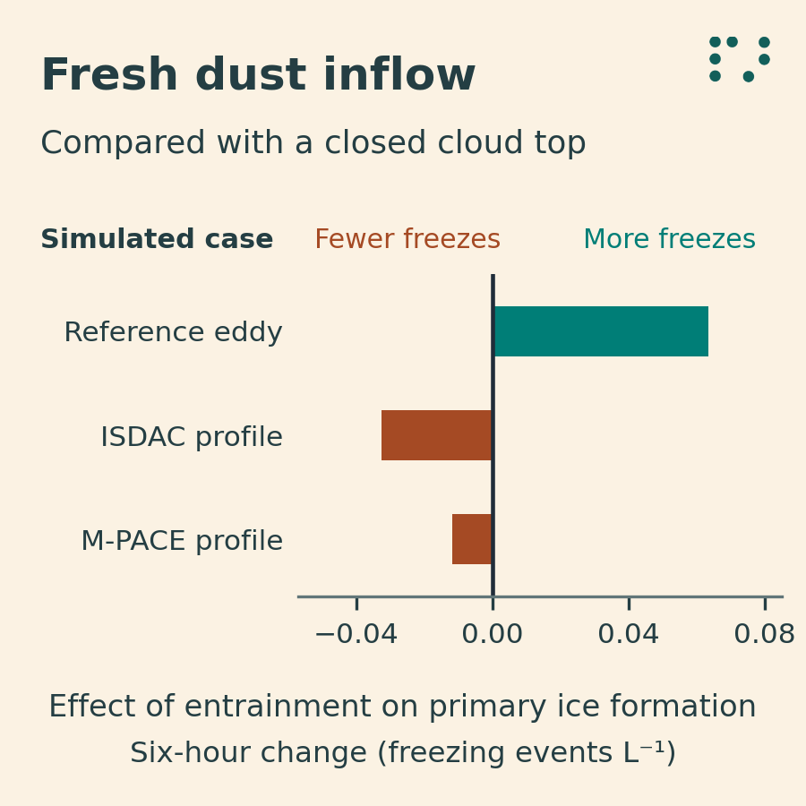
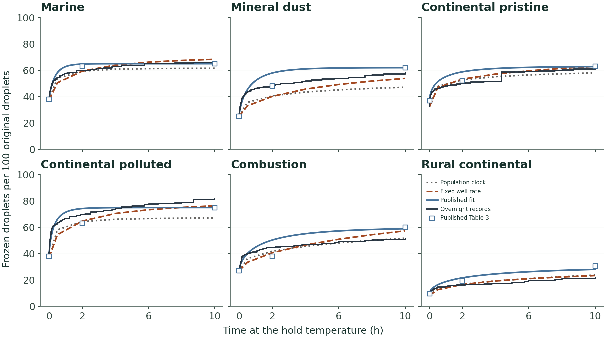
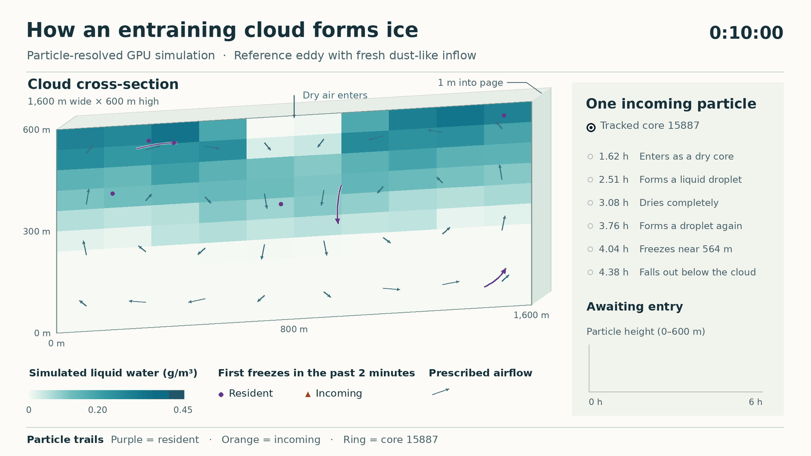
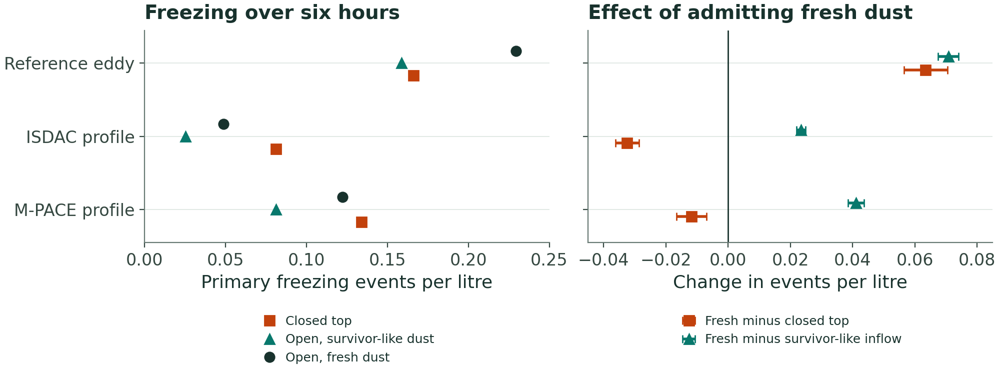
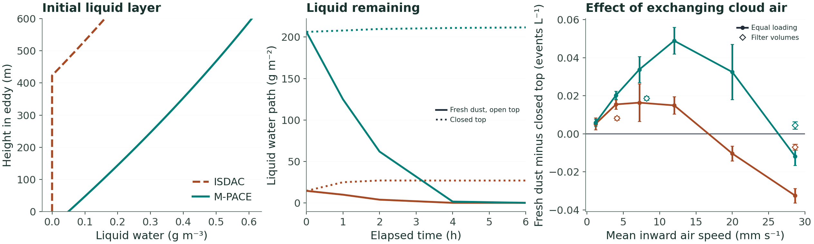

# Fresh aerosol can form ice while entrainment reduces freezing across the cloud

Jakobsson and colleagues showed that droplets containing ambient aerosol continued to freeze for hours at constant temperature. We used their repeated measurements to identify which surviving droplets were most likely to freeze next, then asked whether bringing fresh aerosol into a cloud would replenish that activity. Fresh dust-like aerosol increased six-hour primary freezing by 45% in a simulated eddy when it replaced equally abundant, previously exposed aerosol in the same inflow. Opening the cloud top also introduced dry air. Compared with keeping the top closed, the same fresh source produced 0.0635 more freezing events per litre of air in the reference eddy and 0.032 fewer in a thin Arctic cloud profile. The sign depended on whether the incoming particles formed enough ice to offset the freezing lost as resident droplets dried or left the cloud.

*Graphical abstract. Each row represents a simulation initialized with the indicated cloud profile. The bars show how opening the top to fresh dust-like aerosol changed cumulative primary freezing relative to a closed top. Right indicates more freezing, left fewer. The ISDAC and M-PACE names identify the Arctic campaigns that supplied the initial profiles.*

## How Jakobsson et al. tracked freezing in the same droplets

Jakobsson et al. repeatedly cooled and thawed one-microlitre droplets from six Swedish ambient aerosol extracts. Five extracts were held at −14 °C and the polluted continental extract at −16 °C. The authors proposed that the most active nuclei froze their droplets early, leaving a progressively less active liquid population. Our reconstruction of their time-dependent frozen fractions matched 10 of 18 reported values within three droplets per 100. The rural continental sample showed one of the larger differences at ten hours, with 22.0 per 100 reconstructed and 30.6 reported. [Published comparison and averaging convention](assay-and-pulse.md#the-averaging-convention-matters-most-when-few-droplets-freeze)

We fitted the short holds and tested that interpretation against 30 withheld overnight records. Among droplets still liquid after two hours, 36% of those in the highest predicted risk quarter froze during the next eight hours, compared with 15% in the lowest quarter. The early measurements thus identified which droplets were more susceptible even after prolonged exposure. Their freezing rates were harder to predict. A constant rate for each well predicted 15.9 late freezes per 100 droplets liquid at hold entry, against 12.1 measured. [Jakobsson et al.](https://doi.org/10.5194/acp-22-6717-2022) · [Reproduction, burst checks and alternative rate laws](assay-and-pulse.md)

*Figure 1. Black steps show the archived overnight frozen fractions sampled at the plotted times. The blue line reconstructs the published fit from rounded tabulated inputs. Squares give the authors’ Table 3 values. Orange dashed and gray dotted curves are our forecasts from short holds, using rates for individual wells or a common response for each extract.*

A simulated replacement first isolated what fresh material could contribute. At fixed temperature and one initial carrier per litre, replacing all two-hour survivors with fresh material from the same extract added 0.114–0.157 primary freezing events L⁻¹ over the next eight hours across four rate laws. Here “fresh” carries the activity of wells still liquid at hold entry. “Survivor” carries the activity of those still liquid two hours later. These terms describe selection through freezing in the assay. [Fixed-temperature exchange experiments](assay-and-pulse.md#replacing-survivors-changes-ice-production-only-if-the-incoming-liquid-has-different-activity)

## Fresh aerosol can increase freezing even as the entraining cloud produces less ice

Jakobsson et al. proposed estimating the time that air has spent in a cold cloud with a passive tracer. Mixing in outside air brings in fresh ice-nucleating particles and lowers that estimated age. Later cloud studies examined time-dependent freezing and depletion of ice-nucleating aerosol. Our extension asks how much freezing occurs on newly arrived particles and how much is lost among residents during the same exchange. We tracked both populations for six hours in a prescribed circulation. [Jakobsson et al., section 5, equations 7–8](https://doi.org/10.5194/acp-22-6717-2022) · [Waman et al.](https://doi.org/10.1175/JAS-D-22-0187.1) · [Paukert and Hoose](https://doi.org/10.1002/2014JD021917)

In this simulation a particle could enter dry, collect liquid water, evaporate back to its core, reactivate, freeze and settle out. In the main comparison, the initial residents were two-hour survivors from the dust-influenced extract. We supplied one incoming well equivalent per litre of exchanged air and compared fresh dust-like inflow with two controls. An **open top with survivor-like inflow** held the air exchange and aerosol loading fixed. This comparison isolates the activity of the aerosol that arrived. A **closed top** kept outside air and aerosol from entering. This comparison measures the net effect of entrainment, including its influence on resident droplets.

In the idealized reference eddy, the interior roll had a vertical speed scale of 0.55 m s⁻¹. For the other two clouds we initialized the same circulation using published thermodynamic profiles for the Indirect and Semi-Direct Aerosol Campaign (ISDAC) and the Mixed-Phase Arctic Cloud Experiment (M-PACE). Temperature and air motion were prescribed throughout. Incoming and resident particles accumulated freezing probability only while immersed. Each simulated carrier represented the freezing activity of a whole microlitre well, which could contain several nuclei. [Cloud configuration](cloud-sensitivity.md#the-two-arctic-profiles-begin-with-different-water-reservoirs) · [ISDAC](https://doi.org/10.1002/2013MS000282) · [M-PACE](https://doi.org/10.1002/qj.416)

*Animation 1. Blue arrows show prescribed airflow. Colored trails follow six simulated cores through a 1,600 m wide, 600 m high slice with one 1 m depth cell. The ring follows an incoming core that dried, formed another droplet and froze near 564 m. Liquid-water shading updates every ten simulated minutes and particle positions every 20 seconds.* [Trajectories and phase histories](reference-eddy.md#the-same-particle-can-dry-reactivate-and-then-freeze)

In the reference eddy, fresh dust increased freezing relative to either baseline. The net gain over closing the top was **0.0635 events L⁻¹** (paired 95% interval 0.0565–0.0704). In rapid-exchange ISDAC, fresh inflow increased freezing relative to survivor-like inflow by 0.0235 events L⁻¹, yet opening the top **reduced total freezing by 0.032 L⁻¹** (0.029–0.036 fewer). Incoming particles supplied 0.027 events L⁻¹. Residents produced 0.059 fewer events L⁻¹ in the open cloud than in the closed one. In M-PACE, fresh inflow also increased freezing relative to survivor-like inflow (+0.041 L⁻¹), while the net change from opening the top was −0.012 L⁻¹ on the 100-cell grid. At 1,600 cells the paired interval for that net change spanned zero. The ISDAC loss persisted at 3,600 cells. [Refinement and uncertainty](cloud-sensitivity.md#spatial-refinement-preserved-the-isdac-loss)

*Figure 2. Left, cumulative freezing events per litre of layer air in three simulated clouds. Right, the difference between fresh inflow and each control. Each point is the mean of eight paired realizations per cloud at equal aerosol loading. Horizontal bars on the right are 95% paired intervals. Positive differences mean more freezes with fresh inflow.* [Figure values and replay](reproducibility.md)

### A 45% increase in primary freezing had little effect on cloud liquid

In the reference eddy, replacing survivor-like inflow with fresh inflow increased cumulative freezing from 0.1587 to 0.2295 events L⁻¹. The paired gain was **71 extra freezes per cubic metre over six hours** (95% interval 67–74). By hour six the excess still airborne was 7.5 crystals m⁻³. Suspended ice nearly doubled from 0.0076 to 0.0151 L⁻¹, while the remaining liquid water path fell only 0.18%, from 45.75 to 45.66 g m⁻². Ice can sublimate or fall out after a droplet freezes.

Aircraft counts give a scale for *suspended* ice. An ISDAC flight averaged about 0.4 crystals L⁻¹ larger than 100 µm. M-PACE profiles averaged 2.8 crystals L⁻¹ larger than 53 µm. Our simulated concentration includes all modeled crystal sizes throughout the layer, including clear air. A quantitative field comparison would sample simulated ice along the flight path at the instrument’s size threshold. [ISDAC aircraft observations](https://doi.org/10.1029/2011JD015910) · [M-PACE aircraft observations](https://doi.org/10.1029/2007JD008633)

### Moisture supply sets the time available for incoming particles to freeze

Slowing the imposed ISDAC exchange let more arriving particles reach cloud water. Using source concentrations inferred from the filters, 82% entered a droplet under slow exchange and the average arrival spent 39 minutes immersed. Under rapid exchange those figures fell to 30% and just over three minutes. Slowing the mean inward speed from 28.6 to 4.125 mm s⁻¹ shifted the fresh-minus-closed difference from −0.007 to +0.008 events L⁻¹.

With equal aerosol loading, the two prescribed cloud cases responded differently to the same exchange rate. At an inward speed of 20 mm s⁻¹, opening the top reduced primary freezing by 0.010 events L⁻¹ in ISDAC and increased it by 0.032 events L⁻¹ in M-PACE. The sign changed between the tested speeds of 12 and 20 mm s⁻¹ in ISDAC and between 20 and 28.6 mm s⁻¹ in M-PACE. These brackets apply to the imposed circulation and moisture supply.

*Figure 3. The left panel gives the initial liquid profiles. The middle panel follows each simulated layer with fresh inflow or a closed top. On the right, points above zero indicate more freezing with inflow. Circles hold carrier loading equal, while open diamonds use the filter-based loading at selected speeds. Error bars are paired 95% simulation intervals. Both layers have zero lower-boundary moisture supply in this comparison.* [Exchange-rate and moisture experiments](cloud-sensitivity.md#the-two-arctic-profiles-begin-with-different-water-reservoirs)

Source concentration and composition set the supply available to freeze. With loading inferred from sampled air volumes, dust arrivals produced 0.052 and marine arrivals 0.029 events L⁻¹ in the reference eddy. Each filter represents a single sampling date, and a well can contain several nuclei. The resident population also changes the baseline. With identical fresh dust entering the rapid-exchange ISDAC layer at equal loading, the net effect was +0.006 events L⁻¹ with rural continental survivors and −0.050 with marine survivors. [Filter volumes and resident-source comparisons](cloud-sensitivity.md)

Ice production also responded to how the particles moved through the eddy. In the reference eddy, adding a diffusivity of 2 m² s⁻¹ raised the fresh-over-survivor gain from 0.071 to 0.086 events L⁻¹. Moving the roll sideways at that same diffusivity reduced the gain by 0.008 events L⁻¹. Mineral identity could also matter for cloud water under colder conditions. In a separate eddy reaching about −24 °C, enabling freezing on incoming 1 µm K-feldspar grains reduced liquid water path by 10.5 g m⁻² relative to identical grains with freezing disabled. At the same concentration of 1,000 grains L⁻¹, the quartz interval included zero. These grain calculations use laboratory active-site densities independent of the Lund filter extracts. [Flow and mineral experiments](cloud-sensitivity.md)

## What would distinguish enhanced freezing from faster removal at a cloud edge?

To predict whether entrainment enhances primary ice, measure the freezing spectra of incoming and resident aerosol per litre of air alongside humidity, temperature and one-way exchange at the cloud edge. Particle trajectories can then constrain how long each population remains immersed. Simultaneous in-cloud crystal counts and a downward ice flux would help distinguish low production from rapid removal. Absolute liquid water path in the reference eddy rose from 46 to 98 g m⁻² when the grid increased from 100 to 1,600 cells. That sensitivity limits predictions of cloud water. A direct test would drive the model with measured humidity and exchange velocity, then compare suspended crystals on the aircraft’s size and sampling criteria. If a deficit persisted, measurements of crystal size and downward flux would help determine whether too few droplets froze, crystals grew too slowly to reach the detection threshold, or ice left the layer too quickly. [Cloud-edge humidity measurements](https://doi.org/10.5194/acp-21-6347-2021)

## Reproducibility

Particula transported water vapor on the grid. Study-specific CUDA kernels advanced particle motion, water exchange and freezing. The cloud and source comparison comprised 4,350 integrations on an NVIDIA GeForce RTX 5060, including two half-hour pilots, using 100–3,600 cells. Eleven selected cases reproduced their saved histories in a separate replay. The paired intervals describe variation across particle realizations under fixed forcing. The spread among donor plates, aerosol loading, imposed temperatures and numerical resolution place separate limits on atmospheric inference. [Author observations, figure data and replay instructions](reproducibility.md)

The supporting analyses trace the calculation from the repeated assays to the individual particles and then to the source and cloud comparisons. [Forecasts from short holds and simulated replacement](assay-and-pulse.md) · [Water cycling and tagged particles in the reference eddy](reference-eddy.md) · [Aerosol sources, Arctic profiles, mixing and refinement](cloud-sensitivity.md)
