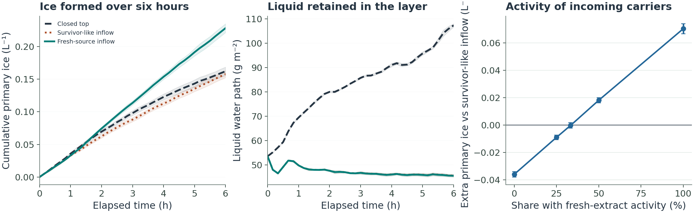
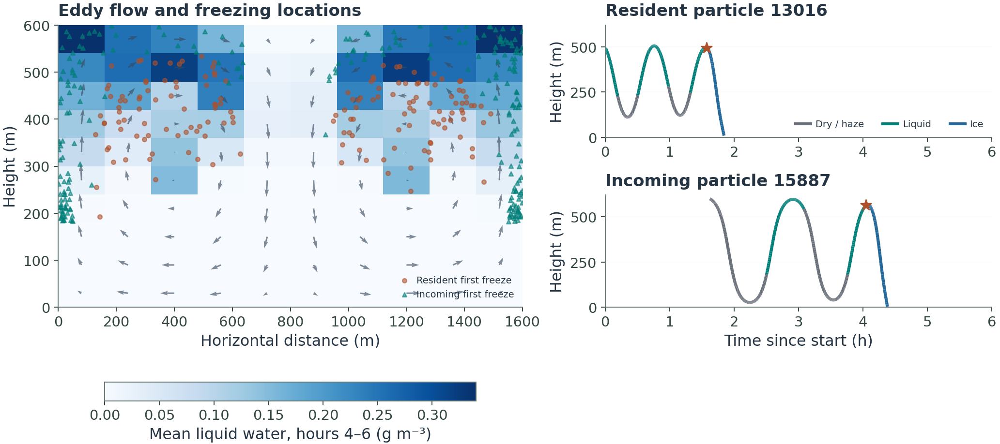

# Fresh dust-like aerosol increases primary ice while entrained air controls cloud water

Fresh aerosol produced 45% more primary ice than an equal loading of aerosol with the freezing activity of two-hour survivors. Both sources entered the same simulated cloud in the same dry air. Over six hours they produced 0.228 and 0.158 primary ice particles per litre of layer air. The paired difference was **+0.070 L⁻¹** (95% Monte Carlo interval +0.067 to +0.074). Most of that ice had already left the airborne ice population by hour six. Only 0.0157 and 0.0077 L⁻¹ remained suspended. At the assumed loading, changing the aerosol source had little effect on the remaining liquid. Its response depended much more strongly on how much moisture entered with the aerosol.

These values come from the initial 144-run eddy experiment. The main study reports the subsequent cloud comparison with its own paired particle realizations. The fresh-minus-survivor estimate rounds to 0.07 events per litre in both experiments.

## Imported particles more than offset the loss of resident ice production

Opening the top of the eddy to dry air and fresh aerosol increased cumulative primary ice by **0.066 L⁻¹** relative to a closed top (paired interval +0.061 to +0.072). Incoming particles supplied 0.106 L⁻¹. Resident production fell by 0.040 L⁻¹ as the cloud exchanged air and particles. Holding the top open and giving arrivals the activity distribution of survivors isolated the effect of the source. The resident contribution was then 0.122 L⁻¹ in both cases, and the incoming contribution fell from 0.106 to 0.036 L⁻¹.

| Six-hour, 100-cell result | Closed top | Survivor-like inflow | Fresh-source inflow |
| --- | ---: | ---: | ---: |
| Cumulative primary ice on residents (L⁻¹) | 0.162 | 0.122 | 0.122 |
| Cumulative primary ice on arrivals (L⁻¹) | 0 | 0.036 | 0.106 |
| Ice still airborne at hour six (L⁻¹) | 0.0056 | 0.0077 | 0.0157 |
| Liquid water path at hour six (g m⁻²) | 107.35 | 45.66 | 45.58 |

*Each column averages eight paired random seeds. Ice concentrations use the entire layer volume. Cumulative counts include ice that subsequently sublimated or crossed a boundary. Water paths integrate condensate over the full layer.*

*Figure 1. Left and center, eight-seed means with 95% Monte Carlo intervals. Fresh and survivor-like liquid water paths nearly overlap. Right, the rest of each diluted incoming population is inactive. Error bars compare each mix to the same survivor-like inflow.*

The sign of the ice response depended on what was entrained. When only a quarter of incoming carriers had fresh-extract activity, they produced 0.009 fewer ice particles per litre than the survivor-like source. A one-third share gave a difference indistinguishable from zero (−0.0002 L⁻¹, interval −0.0022 to +0.0018). A half share produced 0.018 more per litre. These shares refer to the rare model carriers, each assigned the activity of an assay droplet.

## The same particle can dry, reactivate and then freeze

Incoming particle 15887 entered at cloud top after 1.62 h. It first carried a liquid droplet by 2.51 h, had lost all its modeled water by 3.08 h, and carried liquid again by 3.76 h. It froze at 4.04 h near 564 m and crossed the lower boundary by 4.38 h. The model followed the same core through each transition. The example was selected from particles that froze after drying. Across the full fresh-source ensemble, about 78% of resident ice formation and 13% of incoming ice formation followed a previous liquid-to-haze or dry transition.

*Figure 2. Left, simulated mean liquid water during hours 4–6, prescribed air velocity (arrows), and first freezing locations during the same interval. Each symbol represents one weighted particle record. Right, two selected six-hour trajectories end when the particle leaves the domain. The star marks first freezing.*

Watch the colored arrowheads in the animation to follow six cores as the prescribed flow carries them around the eddy. Purple tracks belong to residents and orange tracks to arrivals. The ring follows particle 15887 and the trails cover up to four simulated minutes. Particle positions update every 20 simulated seconds and the liquid-water shading every ten minutes. The oblique view exaggerates the 1 m depth of this two-dimensional section. [Animation in the main study](index.md)

## Humidity changed the water path much more than source activity

Water cycled repeatedly. The fresh-source ensemble condensed 842 g m⁻² onto liquid particles and evaporated 684 g m⁻² over six hours. These are gross transfers that can count the same water more than once. Only 45.58 g m⁻² remained as liquid. With winds and aerosol held fixed, increasing inlet relative humidity from 85% to 100% raised that final water path by 27.99 g m⁻². Changing from survivor-like to fresh aerosol at 85% humidity reduced it by just 0.081 g m⁻² (paired 95% interval 0.064–0.097 lower). Turning off freezing altogether raised it by 0.197 g m⁻².

Refinement preserved the paired ice result and exposed substantial uncertainty in the water inventory. On 20 × 20, 30 × 30 and 40 × 40 grids, the fresh-minus-survivor ice gains were 0.0740, 0.0724 and 0.0722 L⁻¹ in one matched realization each. Over those grids the absolute fresh-source water path rose from 63.8 to 78.3 to 98.0 g m⁻². The finest-grid source contrast in water path was −0.109 g m⁻², while saturating the inlet raised the path by 25.4 g m⁻². The absolute liquid water path remains unresolved. Additional seeds narrow Monte Carlo error but cannot establish spatial convergence or the atmospheric carrier loading.

The spread from the laboratory source also exceeded the numerical sampling interval. Using each of the five mineral-dust plates separately gave fresh-source gains of 0.044–0.102 L⁻¹ in single-seed pairs. Varying the assumed loading from 0.1 to 10 carriers L⁻¹ changed the mean gain from 0.007 to 0.708 L⁻¹. Extrapolating the magnitude to a particular cloud requires a measured concentration and activity spectrum for its incoming and resident aerosol.

## What the laboratory measured and what the cloud calculation adds

Jakobsson and colleagues measured when individual microlitre wells froze under repeated cooling and prolonged constant temperature. Our earlier comparison used short records to forecast withheld overnight records for those same wells. Its replacement experiment exchanged a prescribed fraction of surviving carriers once. Here a 1,600 m wide, 600 m deep prescribed eddy continuously exchanges aerosol and vapor with its surroundings. Particles can visit cloud several times, evaporate to dry cores, reactivate, freeze, grow or lose ice and settle out. Observed Arctic mixed-phase cloud depths and air motions motivated the scales. The flow and humidity are prescribed. The fixed temperature profile omits latent-heating feedback on either cloud temperature or circulation. Ice growth and settling assume spheres. The model includes primary immersion freezing and omits riming, aggregation and secondary ice. [Jakobsson et al.](https://doi.org/10.5194/acp-22-6717-2022) · [Shupe et al.](https://doi.org/10.1175/2007JAS2479.1)

The next discriminating test is to replay measured or archived cloud-edge velocities, temperature and humidity alongside independent measurements of incoming and resident ice-nucleating activity. Repeat matched source swaps on those trajectories. Measure liquid water path and suspended ice separately, and sample residual cores from dried droplets to test whether their freezing activity persists on reactivation. That would test both the inferred source advantage and its transfer through a real humidity cycle.

## Reproducibility

Each of the 144 eddy runs used the NVIDIA GeForce RTX 5060. The model conserved water, including boundary fluxes, to a maximum relative residual of 1.5 × 10⁻¹³ at the saved times. Repeating all 144 cases reproduced the 17 numerical tables within their stated tolerances. Summing the 1,151 weighted particle records with a freezing event in the illustrated realization independently recovered its source-specific totals. The animation and tagged trajectories depict that one realization. [Run instructions, software and figure sources](reproducibility.md) · [Main study](index.md)
