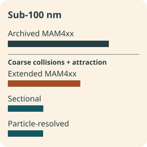
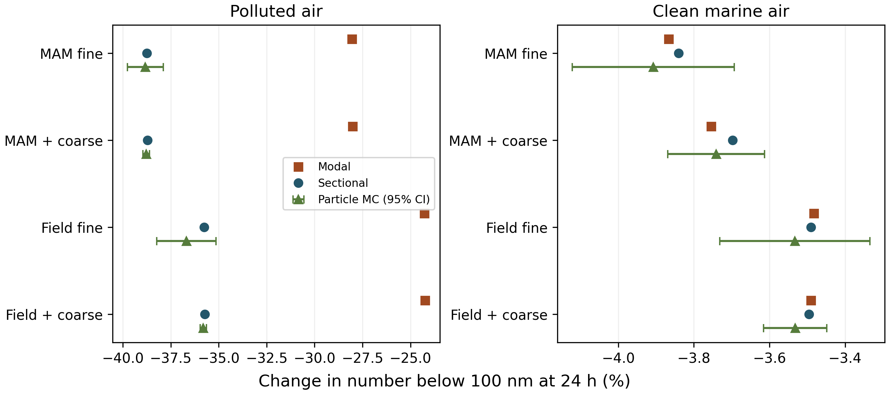
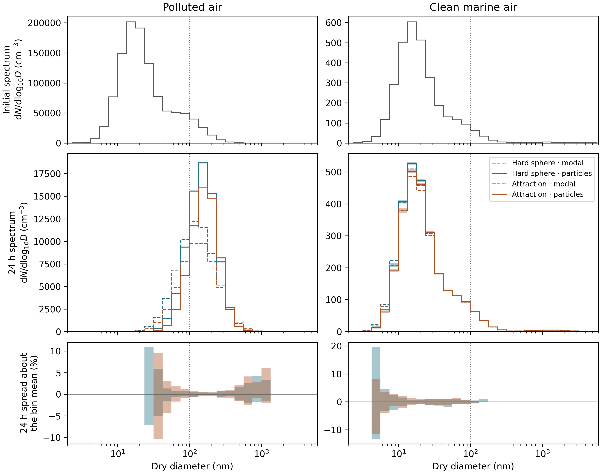
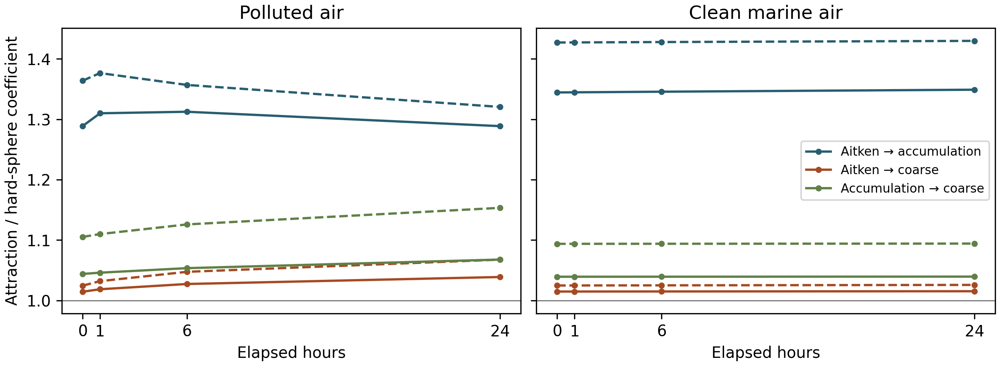
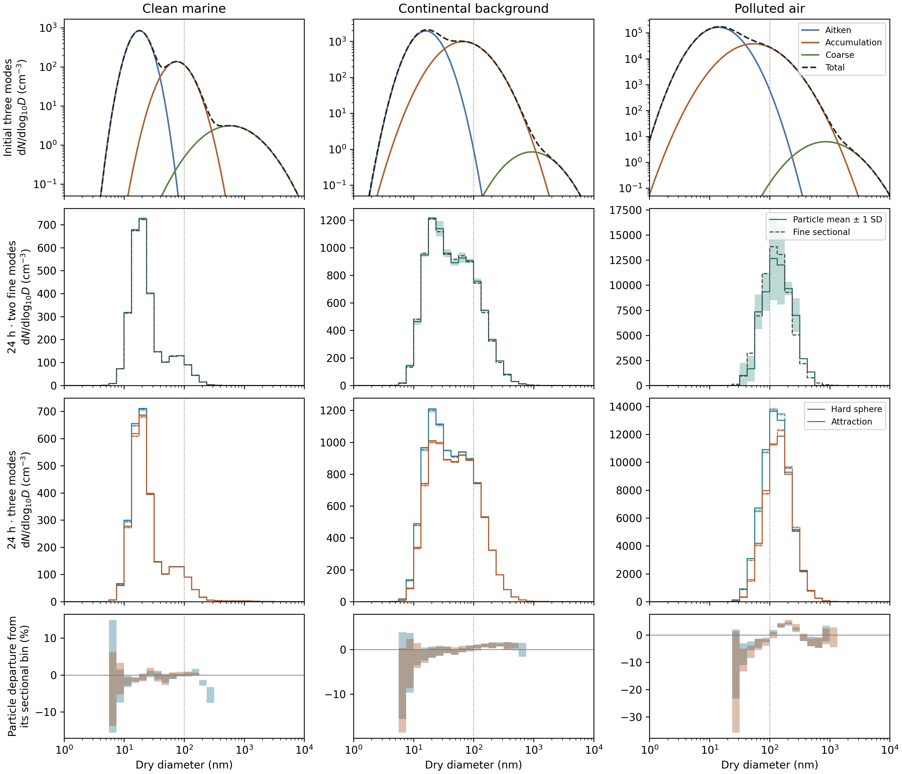

# After 24 hours in simulated polluted air, attraction cuts sub-100 nm counts by 28% with fixed mode widths and 39% with evolving sizes

In a dry box initialized with a polluted-air size distribution, how much does attraction between neutral particles change the number still smaller than 100 nm after a day? Adding attraction to the archived MAM4xx coagulation rates gives **28% fewer** such particles than its hard-sphere calculation. With the same starting sizes and widths, a model that follows the evolving size distribution in sections gives **39% fewer** than its own hard-sphere calculation. Replacing the archived rates with independently integrated rates while keeping the widths fixed still gives 28%. That leaves an **11-percentage-point gap** and points to the evolving size distribution as the next feature to test. The clean marine case shows how strongly this result depends on the starting aerosol. There the two predicted reductions are only 3.3% and 3.7%. [24-hour comparison](mode_attraction.py)

## What Fast et al.’s archived model lets us compare

Fast et al. describe the four-mode aerosol module MAM4xx and provide the EAMxx source for a regional simulation. Within each aerosol mode, the model carries particle number and material mass and prescribes a lognormal width. Coagulation can change the number and median diameter while that width stays fixed. The archived single-subarea calculation lets us isolate this process in a dry box. We initialize a particle-resolved model with the same number and dry volume, then compare their counts and size distributions. Published air-mass spectra specify the starting conditions for the 24-hour comparison. Its endpoints are model predictions. [Fast et al.](https://doi.org/10.5194/gmd-19-11103-2026) · [Archived setup](https://doi.org/10.5281/zenodo.19140449) · [Pinned MAM4xx source](https://github.com/eagles-project/mam4xx/blob/0f51633242168c90018f6e296d02776f86dc9be6/src/mam4xx/coagulation.hpp)

## How much of the 24-hour attraction response survives a fixed-width treatment?

The 24-hour comparison starts from size distributions representative of polluted, clean marine and continental air. First compare the corrected archived model, fixed-width integration, evolving sections and particles at the same starting widths. Then use the process rankings below to place attraction alongside coarse-particle collection, charge and mechanical encounters. Throughout this comparison, sub-100 nm number means the concentration currently below 100 nm, including newly merged particles that still fall in this interval. [Published initial distributions, Table 1](https://doi.org/10.1029/2004JD004596)

### The host correction captures a smaller polluted-air response than freely evolving particles

At 24 hours, the polluted box with all three MAM-width modes contains **3,363 cm⁻³ below 100 nm** with the archived fine-mode rates and proposed hard-sphere coarse collection. Applying the neutral attraction correction lowers that to **2,424 cm⁻³**, a **27.91%** decrease. Replacing the archived fine-mode coefficients entirely with Particula’s integrated coefficients gives **28.02%**. Letting the size spectrum evolve in sections gives **38.72%** at the same initial widths. Most of the response difference therefore persists after replacing the archived rate approximation. [Modal and stochastic comparison](mode_attraction.py)

| Three-mode box | Archived fine rates with pair-specific corrections | Integrated Particula rates, fixed widths | Evolving size sections | Particle Monte Carlo, mean ± 95% CI |
| --- | ---: | ---: | ---: | ---: |
| Polluted, MAM widths | -27.91% | -28.02% | -38.72% | -38.78% ± 0.17 points |
| Polluted, field widths | — | -24.24% | -35.73% | -35.80% ± 0.17 points |
| Clean marine, MAM widths | -3.29% | -3.75% | -3.70% | -3.74% ± 0.13 points |
| Clean marine, field widths | — | -3.49% | -3.50% | -3.53% ± 0.08 points |

Percentages give the change in 24-hour sub-100 nm number when attraction replaces hard-sphere capture. The first column applies multipliers to the archived Aitken and accumulation coefficients. Both variants extend collection to the coarse mode. The field-width rows keep the published widths as a separate control. The archived code prescribes its widths, so only the MAM-width rows have an archived-host value. Particle intervals measure sampling across 16 paired seeds. Ratios in the deterministic columns use the two endpoint concentrations.

At the published widths of the polluted modes, the original screening calculation gave **−35.32%** with eight size bins per decade. Replaying those inputs recovers that value. Refining the sections to 32 bins per decade and evaluating neutral attraction beyond the native 32:1 ratio gives **−35.73%**. Holding those field widths fixed throughout gives **−24.24%**. Changing the initial widths and holding widths fixed during aging are distinct interventions. Both field- and MAM-width runs retain the initial number and dry volume of each mode.

### Clean marine collection depends on the width of the coarse mode

Activating coarse encounters while attraction is already present removes **20.9 cm⁻³** from the archived marine host after 24 hours, or **6.3%** relative to a passive coarse population at the same initial composition. In the evolving sections, active coarse collection removes **19.2 cm⁻³ (5.90%)** at MAM widths and **8.0 cm⁻³ (2.44%)** at field widths. The passive comparison carries the initial coarse population through without any collisions and adds it to the fine-only endpoint. It therefore counts the same initial aerosol on both sides.

The field coarse mode has number-median diameter 0.58 µm and geometric width 2.49. Preserving its number and dry volume while narrowing it to the archived width of 1.8 moves its median to **1.20 µm**. This changes the number of effective collectors in each size range. A fixed-width attraction correction is a reasonable marine development candidate **provided the coarse spectrum is constrained**. For polluted air, test a representation that lets the fine distribution reshape before calibrating a single enhancement factor against the 24-hour endpoint. [Published input spectra, Table 1](https://doi.org/10.1029/2004JD004596) · [Archived modal widths](https://github.com/eagles-project/mam4xx/blob/0f51633242168c90018f6e296d02776f86dc9be6/src/mam4xx/aero_modes.hpp)

Under attraction, the polluted fixed-width calculation retains **2,012 cm⁻³ between 31.6 and 100 nm**, compared with **1,179 cm⁻³** in the particle mean. That interval accounts for **94%** of the 883 cm⁻³ excess below 100 nm. In marine air the same interval holds 64.7 and 64.8 cm⁻³, respectively. This identifies the part of the polluted distribution to target with a second width or shape moment.

### Integrating number loss and dry-volume transfer separately

For each pair of evolving lognormals we average the complete neutral thermal kernel over the two **number** distributions. For intermodal dry-volume transfer, the donor distribution is instead weighted by its particle volume. Each multiplier divides its attraction-weighted integral by its own hard-sphere integral **at the same current diameters and widths**. At initialization the polluted Aitken–accumulation number multiplier is 1.289 and the donor-volume multiplier is 1.364. The marine values are 1.344 and 1.427. Intramodal encounters remove one particle per distinct colliding pair and retain all dry volume in that mode. Intermodal products remain in the receiving mode. [Time-dependent factors for every pair](../../../../website/public/study-data/mam4xx/mode-coefficients.csv)

The archived replay recomputes its fine-pair base rates each host step and uses the original number and aerosol-mass updates. We add coarse self-collection and fine-to-coarse encounters in two half steps around the archived update. Primary carbon is empty. With all multipliers set to one and coarse collection disabled, the replay matches the archived Aitken and accumulation number and volume at 0, 1, 6 and 24 hours within 10⁻¹⁰ relative tolerance. Refining from 48 to 96 diameter cells per decade and updating the factors every 30 rather than 60 seconds changes the archived three-mode attraction effect by less than **0.002 percentage points** in either regime. The host step is 10 seconds in both refinements. These are dry, closed boxes at 298.15 K and 101325 Pa. [Pinned coagulation routines](https://github.com/eagles-project/mam4xx/blob/0f51633242168c90018f6e296d02776f86dc9be6/src/mam4xx/coagulation.hpp) · [Archived-host trajectories and refinements](../../../../website/public/study-data/mam4xx/archived-attraction.csv)

Particula supplies the neutral GPU capture rate through radius ratio 32. For larger ratios we separately integrate the nonretarded neutral Hamaker sphere potential over separation for continuum resistance and over thermal incident energy for ballistic capture, then use the same transition law. The independent neutral integral agrees with GPU rates to **0.014%** across their shared nominal grid. Doubling radial and energy resolution changes the independent rates by at most **0.012%** there and across the wider grid. An adaptive integration with continuous orbit minimization independently checks the continuum and ballistic limits at radius ratios 32, 128 and 1,024 to within 0.05%. Zero attraction recovers hard spheres. With MAM widths, about 90% of the initial Aitken-to-coarse dry-volume transfer rate involves radius ratios above 32 in both regimes. Including attraction for those pairs changes the *whole marine box’s* 24-hour modal attraction effect from −3.65% to −3.75%. A large share of a particular transfer pathway need not dominate total ultrafine number. The extension assumes compact neutral spheres, a common material, unit sticking and no retardation. [Hamaker’s sphere potential](https://www.damtp.cam.ac.uk/user/gold/pdfs/teaching/hamaker.pdf) · [Particula interparticle forces](../../../theory/dynamics/interparticle-forces.md)

Varying the Hamaker constant from 4.45 × 10⁻²⁰ to 1.78 × 10⁻¹⁹ J gives a polluted three-mode MAM-width response of **−22.9% to −33.6%** in the fixed-width calculation and **−31.9% to −45.7%** in sections. Comparing at each matched material value preserves the shortfall. The corresponding marine ranges are **−3.0% to −4.7%** and **−2.9% to −4.6%**. The Monte Carlo experiment samples continuous waiting times and collision partners from the size-tabulated kernel while conserving actual merged particle volumes. An exact constant-kernel decay checks the modal solver. A two-particle exponential waiting-time experiment checks the Monte Carlo collision rate and self-pair exclusion. The refined polluted and marine three-mode boxes hold 1,380,054 and 7,662 particles initially. Their stochastic bands describe collision histories for one prescribed population. The literature modal means do not determine campaign-to-campaign variability.

### What the archived atmospheric model carries

| Candidate | Status in the archived calculation | Source or host coupling |
| --- | --- | --- |
| Size distribution and transfer | Simplified. Fixed lognormal widths, separate number and volume moments, three intermodal transfer pairs. | Aitken–accumulation, primary carbon–accumulation and Aitken–primary carbon enter the coagulation routine. The host supplies wet diameters and densities. |
| Electrostatic collision, ion attachment and recombination | Omitted from this coagulation path. | The host calls the scalar coagulation routine without free-ion concentrations or aerosol charge states. The nucleation and aging routines have distinct responsibilities. |
| van der Waals attraction and dielectric polarization | Omitted from the audited pair-rate calculation. | The archived thermal kernel uses modal Brownian rates. |
| Coarse-mode pair collection, differential settling and shear | Omitted as aerosol–aerosol encounter mechanisms in this routine. Surface sedimentation and removal by precipitation are represented elsewhere. | Dry deposition transfers aerosol to the surface. Wet scavenging and convection remove or transport aerosol through separate host processes. |

The comparisons hold humidity, transport, cloud processing and emissions fixed in a closed dry box. A stored dry-volume transfer into particles above 100 nm and a surface deposition flux answer different questions. [Archived coagulation](https://github.com/eagles-project/mam4xx/blob/0f51633242168c90018f6e296d02776f86dc9be6/src/mam4xx/coagulation.hpp) · [Host subarea processing](https://github.com/eagles-project/mam4xx/blob/0f51633242168c90018f6e296d02776f86dc9be6/src/mam4xx/mam4_amicphys.hpp) · [Dry deposition](https://github.com/eagles-project/mam4xx/blob/0f51633242168c90018f6e296d02776f86dc9be6/src/mam4xx/seq_drydep.hpp) · [Wet removal](https://github.com/eagles-project/mam4xx/blob/0f51633242168c90018f6e296d02776f86dc9be6/src/mam4xx/wet_dep.hpp)

### Atmospheric process comparisons

The three published trimodal spectra have coarse diameters of 0.58, 0.93 and 0.86 µm and coarse concentrations of 3.1, 0.72 and 5.4 cm⁻³, respectively. Our primary comparison uses a common 298.15 K to isolate spectrum effects. Field-informed controls use 13.9–14.6 °C for remote marine air, −4 to 17 °C for boreal background and 8.2–34 °C for urban polluted air. These ranges and the size distributions come from different campaigns. Concentration varies by ±30% around the published modal values. Ion production spans 2–10 pairs cm⁻³ s⁻¹, with equal mobility for both signs and recombination at 1.6 × 10⁻⁶ cm³ s⁻¹. [Size spectra, Lance et al., Table 1](https://doi.org/10.1029/2004JD004596) · [Marine event temperatures](https://doi.org/10.5194/egusphere-2026-6891) · [Boreal temperatures](https://doi.org/10.1002/2017GL076394) · [Urban temperatures](https://acp.copernicus.org/articles/20/12721/2020/) · [Measured ion production](https://www.borenv.net/BER/archive/pdfs/ber12/ber12-323.pdf)

The coarse comparison adds the entire coarse mode to the fine-only Brownian population. Settling and shear each add one mechanical collision process to neutral Brownian encounters. Settling uses geometric collection efficiency of one. Turbulent dissipation varies from 0.001 to 0.1 m² s⁻³. The charge experiment compares a neutral hard-sphere reference to the same kernel averaged over a size-dependent stationary bipolar charge distribution. The dynamic experiment starts with neutral aerosol and an initially recombination-balanced free-ion pool. Charge moves through attachment, recombination and particle mergers. Neutral dispersion replaces the neutral hard-sphere law. The combined dielectric/dispersion law replaces the charge-only thermal law on the same stationary charged population. Each pair therefore receives exactly one thermal kernel.

Material controls span Hamaker constants of 4.45 × 10⁻²⁰ to 1.78 × 10⁻¹⁹ J and relative permittivities of 2.1–12. The nominal values are 8.9 × 10⁻²⁰ J and 5.9. Uncovered radius/charge pairs retain the bare thermal rate. They account for roughly 22%, 13% and 14% of the initial charge-averaged encounter rate. A neutral two-radius CPU calculation checks the GPU capture kernel. Concentrating all charge probability at zero recovers the neutral hard-sphere rate. Refinement increases size bins per decade from 8 to 12, extends the charge range from ±3 to ±5 and tightens the integration tolerance. Collisions that would exceed the finite state domain are excluded. The 24-hour dry-volume relative error stays below 10⁻⁸ and the free-ion plus particle charge residual stays below 2 × 10⁻⁶ elementary charges cm⁻³. The ion source introduces equal positive and negative charge.

#### The distributions behind the rankings

The top row shows the three lognormal number spectra used to initialize each regime. In the middle row, shading gives the binwise mean ± one sample standard deviation of four refined native Brownian trajectories. These two-mode runs provide the particle baseline. In the third row, solid lines are the three-mode sectional distributions entering the neutral dispersion ranking. Dashed lines and shading show the means and pointwise 16th–84th percentiles of 16 three-mode particle trajectories with the same field inputs and kernel spacing. The fourth row shows those bands as departures from the corresponding sectional bins. It includes bins with at least ten particles per box on average. Each bin contains its plotted height multiplied by its width in log₁₀ diameter. Summing bins left of the vertical 100 nm line recovers the reported ultrafine concentration. The native ensembles also retain underflow and overflow counts. [Number densities and sampling bands by diameter bin](../../../../website/public/study-data/mam4xx/regime-spectra.csv) · [Saved spectra and plotting code](regimes.py)

On the original kernel grid, integrating the plotted spectra gives the following 24-hour changes. Particle percentages use ratios within each seed before averaging. The intervals quantify uncertainty in the paired mean.

| Field input | Sectional dispersion effect | Particle dispersion effect, mean ± 95% CI |
| --- | ---: | ---: |
| Clean marine | -3.47% | -3.55% ± 0.17 points |
| Continental background | -11.43% | -11.34% ± 0.09 points |
| Polluted air | -35.32% | -35.87% ± 0.21 points |

### Ranked changes in sub-100 nm retention at 24 hours

Signed percentages compare the fraction of the initial ultrafine number remaining in each process pair. Absolute differences use final concentrations directly. The range spans the stated inputs and refinement. The grid column gives the absolute shift in percentage points after numerical refinement. Rows are ordered by central magnitude. The full charged interaction is an alternative to neutral dispersion and uses its own charged reference. Times are seconds per central 24-hour box on this machine, including available table setup. The clean marine coarse row also pays for the shared capture-table construction used by later rows. Subsequent timings reflect warm tables. These timings do not estimate coupled MAM4xx cost.

#### Clean marine

Neutral dispersion and coarse Brownian collection have overlapping ranges. Pilot the coarse pairs and a neutral attraction correction together. Settling and shear make small additions at geometric efficiency one.

| Process representation | ΔN <100 nm (cm⁻³) | Change (%) | Input and grid range (%) | Grid shift (points) | Box time (s) |
| --- | ---: | ---: | ---: | ---: | ---: |
| Neutral dispersion | -11.4 | -3.47 | -5.34 to -1.93 | 0.0086 | 0.003 |
| Full charged interaction | -11.1 | -3.38 | -5.16 to -1.9 | 0.01 | 0.003 |
| Add coarse Brownian pairs | -8.31 | -2.48 | -3.02 to -1.69 | 0.019 | 0.710 |
| Equilibrium bipolar charge | -0.552 | -0.168 | -0.209 to -0.118 | 0.00097 | 0.003 |
| Differential settling | -0.313 | -0.0952 | -0.126 to -0.0696 | 0.0017 | 0.003 |
| Fixed-width closure | +0.283 | +0.0839 | +0.0406 to +0.102 | 0.043 | 0.007 |
| Evolve free ions and charge | +0.166 | +0.0504 | +0.0218 to +0.0577 | 0.029 | 0.145 |
| Turbulent shear | -0.00296 | -0.000901 | -0.00377 to -0.00021 | 1.3e-05 | 0.004 |

#### Continental background

Neutral dispersion leads across the input range. Check the two-mode closure against the particle reference next. Equilibrium charge and coarse collection have overlapping effects.

| Process representation | ΔN <100 nm (cm⁻³) | Change (%) | Input and grid range (%) | Grid shift (points) | Box time (s) |
| --- | ---: | ---: | ---: | ---: | ---: |
| Neutral dispersion | -109 | -11.4 | -15.6 to -7.14 | 0.008 | 0.008 |
| Full charged interaction | -104 | -11 | -14.9 to -7.04 | 0.00048 | 0.009 |
| Fixed-width closure | -18.6 | -1.95 | -2.55 to -1.03 | 0.14 | 0.014 |
| Equilibrium bipolar charge | -5.53 | -0.58 | -0.665 to -0.455 | 0.0079 | 0.009 |
| Add coarse Brownian pairs | -5.09 | -0.534 | -0.591 to -0.398 | 0.00012 | 0.009 |
| Evolve free ions and charge | +0.762 | +0.0804 | +0.0243 to +0.081 | 0.056 | 0.172 |
| Differential settling | -0.235 | -0.0248 | -0.0319 to -0.0198 | 0.00066 | 0.011 |
| Turbulent shear | -0.00387 | -0.000408 | -0.00167 to -0.000104 | 5.5e-06 | 0.011 |

#### Polluted air

Neutral dispersion is the largest persistent effect. The mode-width effect changes sign across inputs. A diagnostic bipolar state captures most of the smaller charge effect. Its incremental sensitivity to prognostic ions is comparable to numerical refinement in some cases.

| Process representation | ΔN <100 nm (cm⁻³) | Change (%) | Input and grid range (%) | Grid shift (points) | Box time (s) |
| --- | ---: | ---: | ---: | ---: | ---: |
| Neutral dispersion | -961 | -35.3 | -44.8 to -26.3 | 0.21 | 0.032 |
| Full charged interaction | -867 | -32.5 | -41.6 to -24.3 | 0.25 | 0.033 |
| Fixed-width closure | -104 | -3.74 | -14.2 to +8.59 | 0.64 | 0.087 |
| Equilibrium bipolar charge | -51.4 | -1.89 | -2.01 to -1.77 | 0.047 | 0.035 |
| Evolve free ions and charge | +12.3 | +0.462 | +0.144 to +0.472 | 0.32 | 0.352 |
| Add coarse Brownian pairs | -10.9 | -0.391 | -0.451 to -0.324 | 0.0039 | 0.033 |
| Differential settling | -1.56 | -0.0562 | -0.0562 to -0.0515 | 0.0024 | 0.031 |
| Turbulent shear | -0.0504 | -0.00181 | -0.00438 to -0.00061 | 2.2e-05 | 0.031 |

### What the particle-resolved reference changes

To compare with the archived widths, we preserve the observed number and dry volume of each fine mode and recompute its median diameter at the MAM4xx width. Archived and kernel-matched boxes use those same moments and widths. Native Particula particles start from the same projected distributions and then evolve freely. A second native run starts with the published widths. Marine and continental boxes start with 1,520 and 1,800 particles, six seeds and a 300 s step. The polluted box starts with 414 particles, four seeds and a 600 s step. The field-width refinement doubles each particle count and halves its step with four fresh seeds.

| Regime | Archived total at 24 h (cm⁻³) | Matched modal total (cm⁻³) | Particle total, same initial widths (cm⁻³) | Sub-100 nm, field widths (cm⁻³, 95% MC) | Refined field widths (cm⁻³, 95% MC) |
| --- | ---: | ---: | ---: | ---: | ---: |
| Marine | 356.4 | 351.8 | 351.0 | 337.4 ± 2.2 | 338.7 ± 2.6 |
| Continental | 1,195.2 | 1,125.3 | 1,167.7 | 940.3 ± 7.9 | 950.9 ± 17.3 |
| Polluted | 8,866.0 | 8,102.4 | 9,333.3 | 2,000.0 ± 1,145.8 | 2,416.7 ± 459.3 |

At the archived initial widths, the following differences test whether changing the rate integral alone recovers the particle result. The last column bounds Monte Carlo uncertainty in total number using the sum of the two size-class interval half-widths. That bound allows for covariance between the size classes.

| Regime | Archived minus native total (%) | Kernel-matched modal minus native total (%) | Native 95% MC half-width upper bound (cm⁻³) |
| --- | ---: | ---: | ---: |
| Marine | +1.55 | +0.23 | 3.1 |
| Continental | +2.36 | -3.63 | 19.7 |
| Polluted | -5.01 | -13.19 | 2190.6 |

Replacing the archived rate integral brings the marine total within 0.23% of the particle mean. In continental air the same substitution moves the error from +2.36% to −3.63%. A revised rate integral alone therefore does not recover both central cases. In polluted air the sampling interval is too wide to choose between the two modal predictions.

The measured-width Brownian comparison checks the neutral sectional baseline used for screening. It excludes the coarse mode on both sides. The deviations below use the independent, refined native ensembles.

| Regime | Sectional sub-100 nm (cm⁻³) | Native sub-100 nm (cm⁻³, 95% MC) | Sectional minus native (%) |
| --- | ---: | ---: | ---: |
| Marine | 337.5 | 338.7 ± 2.6 | -0.36 |
| Continental | 953.2 | 950.9 ± 17.3 | +0.24 |
| Polluted | 2,796.3 | 2,416.7 ± 459.3 | +15.71 |

Each sectional endpoint falls within the sampling interval of the refined neutral particle ensemble. The polluted interval is wide enough to include substantial differences. A particle-resolved ensemble with each force enabled would be needed to measure sampling uncertainty on the paired force effects directly.

The neutral dispersion calculation reproduces the full charge-averaged interaction’s central sub-100 nm count to +0.07% in marine air, +0.12% in continental background and −2.35% in polluted air. The native particle intervals describe Monte Carlo sampling at fixed inputs. The published modal means leave campaign-to-campaign uncertainty open.

The CSV tables contain [ranked retention effects](../../../../website/public/study-data/mam4xx/priorities.csv) and [time-resolved paired number and dry-volume differences](../../../../website/public/study-data/mam4xx/paired-effects.csv).

## When can one-hour number agreement hide a different size spectrum?

The dry Aitken number-median diameter is 26 nm. Accumulation diameters of 60, 110 and 220 nm describe progressively separated modes. Their geometric standard deviations are 1.6 and 1.8. The synthetic boxes contain 200,000 particles cm⁻³ at 298.15 K and 101325 Pa, with uniform dry density 1770 kg m⁻³. The high number concentration makes coagulation measurable over one hour. Varying the initial Aitken-to-accumulation number ratio (0.25, 1, 4) changes the relative importance of intra- and intermodal collisions. The coarse and primary-carbon modes start empty.

### Mode separation changes the number discrepancy

The table gives the high-resolution Particula mean minus MAM4xx at one hour, as a percentage of the modal number. Values after ± are 95% sampling half-widths for the mean of 12 seeds. They exclude model and input uncertainty.

| Initial accumulation diameter | Aitken/accumulation 0.25 | Ratio 1 | Ratio 4 |
| --- | ---: | ---: | ---: |
| 60 nm | −2.03 ± 0.51% | −3.20 ± 0.56% | −6.73 ± 0.81% |
| 110 nm | −0.62 ± 0.70% | −1.00 ± 0.67% | −3.75 ± 0.99% |
| 220 nm | −0.20 ± 0.71% | +0.36 ± 0.69% | −0.04 ± 0.80% |

With 220 nm accumulation particles, the MAM4xx endpoint is inside all three Particula sampling intervals. Normalizing each final spectrum by its own number still gives total-variation distances of 0.045–0.070 across these cases. The metric is half the sum of absolute differences in bin fractions. At equal initial counts, it falls from 0.094 for the 60 nm mode to 0.045 for the 220 nm mode. Size-resolved output can therefore distinguish predictions that a total particle counter would struggle to separate.

### Matching the thermal kernel changes the interpretation of the 220 nm benchmark

At 220 nm the original agreement in total number concealed two effects of opposite sign. In the 4:1 benchmark, MAM4xx leaves 64,570 particles cm⁻³ after one hour. Integrating Particula’s Brownian kernel over the same evolving fixed-width modes gives 58,642. Allowing the individual particles to merge gives 64,544 ± 515 cm⁻³. At 60 nm the corresponding results are 100,272, 90,736 and 93,520 ± 812 cm⁻³. Intervals are 95% Monte Carlo intervals for 12 native CUDA replicates at fixed input. The matched closure updates number and dry volume separately and assigns the small particle’s entire volume to the receiving mode in every unlike-mode collision. [Runnable benchmark and atmospheric comparisons](regimes.py)

The matched initial number losses are 67.85 and 157.21 cm⁻³ s⁻¹ for 60 and 220 nm, compared with 55.46 and 127.94 in the archive. Over the first hour the archive transfers 3.977% and 0.153% of all dry volume from Aitken to accumulation, compared with 4.506% and 0.163% under matched Brownian integration. The initial donor-to-receiver dry-volume rates are 4.298 × 10⁻¹⁶ and 9.688 × 10⁻¹⁶ m³ m⁻³ s⁻¹. A separate calculation with a volume-weighted donor lognormal verifies the transfer moment. Direct number quadrature verifies the loss moment. Using 24 versus 32 quadrature nodes per mode changes the number trajectories by less than two parts in ten million.

The original model pair nearly agrees at 220 nm because changing the rate integral lowers the modal count and allowing the distribution to reshape raises it again. A total counter at one hour would miss that cancellation. The initial loss-rate comparison and the final size spectra expose it.

### Matched moments and size spectra

For each mode, Particula places unit-count particles at midpoint lognormal quantiles and rescales their volumes to match the analytical dry mass. MAM4xx updates its modal number and component mass with the published scalar coagulation routines. After each step the driver reconstructs number-median diameter from the third and zeroth moments at the prescribed width. Particula lets the individual dry particles merge. All 49 interior bin edges are common to both models and number closure includes particles outside the plotted range. [Runnable example and spectra](mam4xx_coagulation.py)

Each of nine mixtures uses 480, 1,920 and 3,840 initial particles and 12 independently seeded runs per resolution. Three mixtures also use half the 60 s outer step with 12 fresh seeds. The modal reference steps at 10, 30 and 60 s with the 10 s result used for the trajectory comparison. Independent CPU Gauss–Hermite quadrature integrates the initial Particula collision kernel over both distributions. These calculations distinguish an initial difference in collision rates from subsequent changes in distribution shape.

### Numerical checks and interpretation

Halving the particle outer timestep from 60 to 30 s changes the endpoint mean by 0.23–0.47 percentage points of modal number across three checks, including sampling variability. Increasing from 1,920 to 3,840 particles shifts the mean by at most 1.04 percentage points across the nine mixtures. Changing the modal step from 10 to 60 s changes reference number by at most 0.27% at the observation times. The largest Particula relative dry-mass drift is below 1e-12. The reference generator checks its header checksum and the analysis verifies mass conservation across all modal timesteps. A separate replay of the authors’ archived E3SM one-subarea test case reproduced four final modal numbers within 2.0e-10 relative error and all 28 material-by-mode outputs within 7.8e-10 for nonzero values, with exact agreement at zero. [E3SM validation case](https://github.com/eagles-project/mam_x_validation/blob/3eb380561d71f7fdbbef902f8ea36850704a4e69/coagulation/mam_coag_1subarea.py)

Integrating the Particula kernel over the initial continuous lognormals gives a **19–23% higher initial number-loss rate across all nine mixtures**. Those rates characterize the instant before the spectra evolve. The one-hour counts also depend on how each model redistributes dry volume during mergers. [Initial rate checks and final spectra](mam4xx_coagulation.py)

## Test an evolving fine-mode width against the 31.6–100 nm excess

In the polluted box, replacing the archived collision rates while holding the modal widths fixed leaves the predicted attraction response near 28%. The evolving sections give 39%, and the particle calculation independently gives the same rounded response. The 31.6–100 nm interval accounts for 94% of the fixed-width excess over the particle count below 100 nm in the attraction runs. That interval offers a sharper test of model improvements than total number, which agreed in the 220 nm benchmark despite different collision rates. A model that lets the fine-mode width evolve can be tested against the particle prediction in that interval while holding the initial moments and material properties fixed. A reduction in both the excess there and the error in sub-100 nm response would support that change. For clean marine aerosol, the comparison instead points to the measured coarse-mode spectrum as the condition that must accompany a test of coarse collection. Field tests in either regime would require contemporaneous size spectra and material properties.

## Reproduction

The reference uses the archive's simulation branch `78fb724b939f7e5e6300719ddf73682ea1bc3320` and its MAM4xx gitlink `0f51633242168c90018f6e296d02776f86dc9be6`. The coagulation header in the deposited working directory has the same SHA-256 as the pinned Git source. The example bundle includes the reference outputs, host driver and generator.

From a checkout, run `python scripts/docs_examples.py refresh mam4xx-coagulation` with CUDA. Run `python scripts/docs_examples.py replot mam4xx-coagulation` to redraw the saved results. To regenerate the frozen reference, obtain the pinned MAM4xx header above and run `python scripts/mam4xx_coagulation/build_reference.py PATH/TO/coagulation.hpp docs/data/mam4xx-coagulation/modal.csv` with a C++17 compiler. The generator verifies the archived header hash and compiles the scalar routines without modifying their bodies. Its host adapter supplies double-precision math and the modal layout. The result is an isolated microphysics calculation. The regional model's transport, humidity changes, modal redistribution by other processes, and host-model computational costs are outside the comparison.

### Regional process rankings and native ensembles

The saved numerical data contain spectra, number below and above 100 nm, volume above 100 nm, and absolute and percentage differences at 1, 6 and 24 h. The archived two-mode outputs also retain dry-volume exchange and timestep sensitivity. Regenerate the regional archive with `python -m scripts.mam4xx_coagulation.regime_reference PATH/TO/coagulation.hpp docs/data/mam4xx-coagulation/regional-modal.csv`. Run `python scripts/docs_examples.py refresh regimes` on CUDA to reproduce the ensembles and `python scripts/mam4xx_coagulation/export_regimes.py` to regenerate the two CSV tables. A long workstation run can set `PARTICULA_MAM4XX_CHECKPOINTS` to a fresh directory for this checkout. It saves each regional particle case, its hardware and exact inputs before advancing.

A larger three-regime ensemble exceeded the two-hour notebook limit. The reported intervals use the two completed particle counts in each regime. A pilot with the broad polluted spectrum exhausted the initial limit of 128 internal steps. The polluted runs allow up to 4,096 internal steps. The cleaner regimes use 128, with the same 0.01 s minimum internal step and 64 MiB device-memory ceiling. The GPU schedules guarded work up to the cap, which makes an unnecessarily high cap costly even in dilute air.

Native ensemble wall times include all seeds and all four output times. Hardware is an NVIDIA GeForce RTX 5060. The process comparisons use GPU collision tables and CPU integration of the size and charge distributions.

| Regime | Archived-width native (s) | Field-width native (s) | Refined field-width native (s) |
| --- | ---: | ---: | ---: |
| Marine | 50.0 | 50.1 | 66.8 |
| Continental | 50.3 | 50.3 | 66.7 |
| Polluted | 521.3 | 520.3 | 1090.0 |

### Archived-host attraction correction and particle comparison

The response table gives paired number below and above 100 nm and dry volume above 100 nm at 1, 6 and 24 hours. The saved results also contain initial modes, spectra, seed-level endpoints and the numerical refinements. Regenerate the host tables with `python -m scripts.mam4xx_coagulation.host_attraction PATH/TO/coagulation.hpp docs/data/mam4xx-coagulation`. Run `python scripts/docs_examples.py refresh mode-attraction` on CUDA and `python -m scripts.mam4xx_coagulation.export_attraction` for the particle, sectional and modal response table. [Paired simulation responses](../../../../website/public/study-data/mam4xx/attraction-response.csv) · [Particle simulation and download](mode_attraction.py) · [Regime spectra, host coefficients and download](regimes.py)
