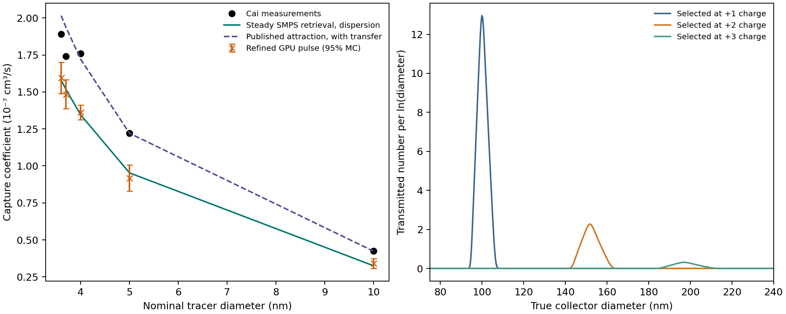

# Can charge explain nanoparticle scavenging in a NaCl chamber?

Cai et al. measured how fast nominally 100 nm NaCl particles captured 3.6–10 nm NaCl particles. Capture was 1.84–2.14 times faster than Particula’s neutral Brownian hard-sphere prediction. At 4 nm, our calculation of electrostatic attraction adds only 2.7% at the expected neutralizer outlet charge distribution. A larger effect arises because doubly and triply charged collectors can pass the upstream classifier at larger physical diameters. Under the reference source spectrum, the combined effect of finite classifier widths and multiple charges raises the dispersion calculation by 16% at 4 nm. [Cai et al. (2022)](https://doi.org/10.5194/acp-22-11529-2022) · [Runlong Cai’s archived figure data, CC BY 4.0](https://doi.org/10.5281/zenodo.6982767)

Using Particula’s native dielectric-sphere kernel, dispersion accounts for most of the modeled increase at the measured charge distribution. In the recorded 4 nm scan it raises the apparent rate from 0.926 to 1.065 × 10⁻⁷ cm³/s. Adding dielectric polarization gives 1.066, against 1.760 measured. These figures use charged hard-sphere rates for unsupported pairs. The largest unresolved group consists of large collectors admitted on multiply charged classifier branches. [Matched process comparisons and domain coverage](#what-changes-with-the-native-dispersion-and-dielectric-kernel)

## What charge reached the chamber?

Cai et al. identify a 90 MBq ⁶³Ni neutralizer on the chamber inlet, **after** mobility selection. Bipolar ion attachment establishes a distribution of signed charges. The authors describe electrostatic loss of charged sub-10 nm particles in the Teflon inlet. The sampling SMPS has a separate charger and classifier. Its charge distribution determines the probability of detection at each mobility setting. The total-count CPC monitoring collector abundance counts each particle once. [Experiment layout and methods, Fig. 1 and §2.1](https://acp.copernicus.org/articles/22/11529/2022/)

| Population and location | Ion pair production (cm⁻³ s⁻¹) | Negative | Neutral | Positive |
| --- | ---: | ---: | ---: | ---: |
| 4 nm, ideal bipolar outlet | — | 1.72% | 96.81% | 1.47% |
| 100 nm, ideal bipolar outlet | — | 33.51% | 42.07% | 24.42% |
| Nominal 4 nm, chamber | 2 | 0.24% | 99.57% | 0.19% |
| Nominal 4 nm, chamber | 100 | 1.00% | 98.27% | 0.74% |
| Nominal 100 nm, chamber | 2 | 34.69% | 40.02% | 25.30% |
| Nominal 100 nm, chamber | 100 | 34.86% | 39.59% | 25.55% |

The outlet values are normalized estimates at individual diameters. The chamber estimates integrate the transmitted true sizes at steady state with 10,000 collectors/cm³, relative charged-tracer inlet transmission of 0.1, and either natural-background or elevated ion production. The experiment reported neither the chamber ion concentrations nor the charge-resolved inlet counts. The scenario spread therefore measures sensitivity to those assumptions. [Outlet fractions](https://github.com/uncscode/particula/blob/main/docs/data/nacl-scavenging/charge-fractions.csv) · [Chamber scenarios](https://github.com/uncscode/particula/blob/main/docs/data/nacl-scavenging/steady.csv)

The [worked example](nacl_scavenging.py) evaluates `par.particles.get_bipolar_charge_probability(diameter_m, charge)`. It uses the Wiedensohler polynomial $f_z=10^{\sum_{i=0}^{5} a_i(z)[\log_{10}(d/\mathrm{nm})]^i}$ for the neutral and singly charged states at 1–1000 nm and the doubly charged states at 20–1000 nm. The independent fits give a raw neutral fraction of 0.4259 at 100 nm. For population sampling we add the higher-charge tails and normalize, giving 0.4207. At sufficiently large diameters the study uses the asymmetric Gaussian with an ion mobility ratio of 0.875 for higher states. It uses ion-attachment flux ratios for rare, small multiply charged particles. A separate ⁶³Ni experiment measured the positive singly charged fraction for 100 nm PSL. Transfer of that result to nanometer salt requires assumptions about ion exposure and residence time. [Wiedensohler (1988)](https://doi.org/10.1016/0021-8502(88)90278-9) · [Coefficient table A7](https://doi.org/10.5194/amt-5-657-2012) · [TSI manual, Appendix B](https://cires1.colorado.edu/jimenez-group/Manuals/SMPS_3080_manual.pdf) · [Funato et al.](https://doi.org/10.11203/jar.40.253)

## What did the size classifiers transmit?

The classifier passes a band of electrical mobilities proportional to $|z|C_c(d)/d$. For a nominal 100 nm setting, particle diameters of **100, 152 and 197 nm** share the central mobility at charges +1, +2 and +3. The inlet neutralizer changes their subsequent charge while preserving their physical size. In the reference run, those branches supplied 82.2%, 15.5% and 2.3% of the incoming collectors. The +2 branch supplied only 0.022% of the nominal 4 nm tracers. The deposited chamber scans do not characterize the upstream collector size spectrum, so the transmitted branch weights are model estimates. [DMA transfer theory](https://doi.org/10.1080/02786820802157823)

We assumed lognormal source number spectra centered at the nominal diameters with geometric standard deviation 1.6. Balanced-flow triangular transfer functions use the reported 3.5/10 aerosol-to-sheath flow ratio for the small classifier and an assumed 0.10 for the collector and the original single-channel sampling calculation. Additional Gaussian broadening in relative mobility has standard deviation 0.03 for the small classifier and sampling SMPS, and 0.01 for the collector classifier. The sampling calculation sums the three positive branches with unit CPC efficiency. Sensitivity runs vary polarity, charge distribution, source spectrum, transmission width, charge tails and counting efficiency. [Study inputs](https://github.com/uncscode/particula/blob/main/scripts/nacl_scavenging/instrument.py)

### Check against the recorded 4 nm SMPS scan

The authors’ later deposit preserves the original figure archive and adds chamber SMPS, CPC and flow time series. The July 29 4 nm file identifies a TSI 3085 DMA and a 3776 high-flow CPC. It exports raw counts at seven nominal diameters from 3.59 to 4.45 nm, with multiple-charge and diffusion corrections switched off. The recorded aerosol and sheath settings are 1.5 and 5 L/min, giving a flow ratio of **0.30**. All 103 scans carry an inlet flow rate error flag. Those entries establish the configured flows. Actual flow and size-dependent transmission remain uncertain. [Cai’s updated archive, `metadata/timeseries/SMPSchamber20210729_4nm.txt`](https://doi.org/10.5281/zenodo.13291658)

We summed the seven modeled channels with equal dwell time, including singly, doubly and triply charged particles in each. Keeping the original collector spectrum, wall model and flat CPC efficiency gives **1.31 × 10⁻⁷ cm³/s** for Particula plus dispersion and **1.67 × 10⁻⁷ cm³/s** on the authors’ attraction baseline, 5.0% below the measured 1.76. This is a forward calculation with recorded scan settings. Recovering an experimental coefficient directly from those time series also requires matching the blank, loaded periods and source-flow corrections. [Results with the recorded 4 nm settings](https://github.com/uncscode/particula/blob/main/docs/data/nacl-scavenging/archived-4nm-scan.csv)

## Compare the same observable as the experiment

For each size we fitted the blank decay to obtain the total first-order loss rate. At 4 nm this gives 7.07 h⁻¹, including 0.60 h⁻¹ of dilution and 6.47 h⁻¹ of wall loss. We interpolate six wall-loss fits in log diameter and log rate, holding endpoint rates constant outside 3–100 nm. The steady chamber calculation balances continuous injection, both polarities of ion attachment, wall loss, dilution and collector capture. From the simulated blank and loaded SMPS signals $S_0$ and $S_N$, we retrieve $\beta_{\mathrm{app}}=\lambda_{\mathrm{blank}}(S_0/S_N-1)/N$. The steady calculation holds the collector abundance at its CPC value. [Six blank decay fits](https://github.com/uncscode/particula/blob/main/docs/data/nacl-scavenging/wall-fits.csv)

| Tracer (nm) | Measured | Charged hard spheres with transfer | Particula + dispersion with transfer | Published attraction at nominal sizes | Published attraction with transfer |
| ---: | ---: | ---: | ---: | ---: | ---: |
| 3.6 | 1.89 | 1.13 | 1.58 | 1.73 | 2.02 |
| 3.7 | 1.74 | 1.08 | 1.52 | 1.66 | 1.94 |
| 4.0 | 1.76 | 0.953 | 1.34 | 1.48 | 1.72 |
| 5.0 | 1.22 | 0.668 | 0.953 | 1.06 | 1.22 |
| 10.0 | 0.425 | 0.221 | 0.325 | 0.378 | 0.424 |

All rates are in 10⁻⁷ cm³/s. The last column anchors the absolute rate for a 100 nm collector to the authors’ van der Waals curve and uses the simulation for the relative size and charge dependence. Changing the assumed collector source geometric mean from 70 to 160 nm moves its 4 nm prediction from 1.60 to 2.01. The reference agrees within 2.3% at 4, 5 and 10 nm and overshoots at 3.6 and 3.7 nm by 6.6% and 11.2%. A downstream size scan spanning 100–200 nm would constrain the collector spectrum and distinguish this explanation from a change in collision physics. [Coefficient comparison](https://github.com/uncscode/particula/blob/main/docs/data/nacl-scavenging/comparison.csv) · [Authors’ model, Eqs. S4–S11](https://doi.org/10.5194/acp-22-11529-2022-supplement)



For a tracer growing from 3.6 to 10 nm at a prescribed 3 nm/h, the concentration of 100 nm collectors giving 50% survival is 2,096/cm³ using neutral Particula rates and 1,010/cm³ using log-log interpolation of the five measurements. Linear interpolation gives 916/cm³. This calculation integrates coagulation loss alone and shows how the unmeasured 5–10 nm interval affects inferred survival. [Survival calculations](https://github.com/uncscode/particula/blob/main/docs/data/nacl-scavenging/survival.csv)

## What changes with the native dispersion and dielectric kernel?

We repeated the continuous-source retrieval with the same injection, charging, wall loss, classifier transfer and SMPS response. Four calculations switch the effective Hamaker constant between zero and 8.9 × 10⁻²⁰ J and the static relative permittivity between 1 and 5.9. Every calculation retains the signed monopole charges. The values represent a dry, homogeneous NaCl sphere scenario at 293.15 K and 101325 Pa, with unit sticking. The native CUDA pair law evaluates dispersion and dielectric polarization along the same encounter trajectory. The earlier calculation added an approximate neutral dispersion correction to a charged kernel. [Kernel theory](../../../theory/dynamics/interparticle-forces.md) · [Capture model validation](../../validation/coagulation/dispersion/index.md) · [Cai et al., supplement](https://doi.org/10.5194/acp-22-11529-2022-supplement)

| Tracer diameter (nm) | Measured | Bare charge | With dispersion | With dispersion and polarization | Pairs inside capture domain |
| ---: | ---: | ---: | ---: | ---: | ---: |
| 3.6 | 1.890 | 1.127 | 1.2851 | 1.2858 | 81.3% |
| 3.7 | 1.740 | 1.080 | 1.2338 | 1.2345 | 82.0% |
| 4.0 | 1.760 | 0.953 | 1.0950 | 1.0957 | 82.8% |
| 5.0 | 1.220 | 0.668 | 0.8016 | 0.8023 | 94.8% |
| 10.0 | 0.425 | 0.221 | 0.2810 | 0.2815 | 99.3% |

The coefficients are apparent rates in 10⁻⁷ cm³/s for the reference classifier settings. Measured values come from the five NaCl points in the authors’ archive. Dispersion increases the predicted retrieval by 14.1–27.0%. Adding dielectric polarization raises it a further 0.06–0.19%. With both forces active, the five rates are still 29–38% low. Doubling the number of diameter samples per transmitted branch and halving the interpolation-grid spacing changes every reference result by less than 0.065%. These are numerical sensitivities. They do not quantify uncertainty in the assumed source distribution or material properties. [Steady results](https://github.com/uncscode/particula/blob/main/docs/data/nacl-scavenging/capture-steady.csv)

**Which partner carries charge matters.** For one 4 nm tracer and one 100 nm collector, dispersion with both particles neutral gives 0.97169 × 10⁻⁷ cm³/s. Giving the collector one charge and including dielectric response gives 0.97170. Giving that charge to the tracer instead gives 1.31622, a 35% increase over dispersion alone for that pair. In the reference chamber, only about 0.4% of the loaded 4 nm tracers are charged. Even allowing every charged tracer through the connecting tubing gives an apparent rate of 1.101, compared with 1.096 at reference transmission. Increasing the ion-production setting from 2 to 100 ion pairs cm⁻³ s⁻¹ gives 1.098. Dielectric attraction can therefore matter to individual collisions while changing this population measurement very little. [Nominal pair calculations](https://github.com/uncscode/particula/blob/main/docs/data/nacl-scavenging/capture-pairs.csv) · [Worked example and figures](nacl_scavenging.py)

**The collector size distribution affects the inference.** At 4 nm, restricting the source classifier to its singly charged branch gives 0.972. Admitting the double and triple branches gives 1.096. Moving the assumed collector source geometric mean from 70 to 160 nm changes the result from 1.034 to 1.250 and increases the fraction of pairs outside the model’s range from 9.3% to 35.4%. A downstream physical-size measurement would constrain both effects.

**The uncovered population is consequential.** We check the actual size ratio, charge strength and opposite-charge attraction for each pair. We assign the earlier charged hard-sphere rate to every uncovered pair in all four controls and retain its full population weight. At 4 nm, 17.2% of pairs lie outside the domain, primarily because the collector-to-tracer size ratio exceeds 32. These pairs supply 26.4% of the reference true collision rate under that assumption. Pair fractions use steady number populations. Collision-rate fractions use flux weighting.

With the seven recorded 4 nm SMPS channels, the full calculation gives **1.066** against **1.760** measured. Assigning zero capture to uncovered pairs gives 0.780. Giving them the older additive dispersion correction gives 1.159. These are sensitivity scenarios; 1.159 is not a physical upper bound. Halving or doubling the Hamaker constant on the supported pairs gives 1.038 and 1.099 with the same hard-sphere treatment outside. The previously reported 1.672 uses the authors’ neutral attraction curve to set the absolute scale. Its closer agreement cannot identify dielectric polarization as the cause of the measured excess. At 10 nm, 99.3% of pairs are covered and the full prediction is still 34% low. The two alternative treatments of the uncovered pairs give 0.279 and 0.282 there, compared with 0.425 measured. [Measurement and scan sources](https://doi.org/10.5281/zenodo.13291658) · [Native campaign provenance](https://github.com/uncscode/particula/blob/main/docs/data/nacl-scavenging/capture-run.json)

## Can settling, turbulence or another thermal kernel explain the residual?

Cai et al. report a low-speed mixing fan and a verified well-mixed chamber. We found no measured turbulent energy dissipation rate in the article. We therefore swept dissipation over 0.001, 0.1, 1 and 10 m²/s³, with air density 1.204 kg/m³. We applied the geometric settling kernel at unit collection efficiency and the Saffman–Turner turbulent shear kernel to all modeled tracer–collector diameters. For each addition we recomputed the loaded chamber populations and the apparent rate with the same blank retrieval. Settling here means particles catching one another because their fall speeds differ. Wall deposition is already included in the separately fitted blank. [Cai et al., chamber methods](https://acp.copernicus.org/articles/22/11529/2022/#section2) · [Saffman and Turner (1956)](https://doi.org/10.1017/S0022112056000020)

For a **4 nm tracer and 100 nm collector**, the nominal pair kernel from differential settling is **1.53 × 10⁻¹⁴ cm³/s**. The shear kernel ranges from **1.48 × 10⁻¹⁵ to 1.48 × 10⁻¹³ cm³/s** across the sweep. The measured coefficient is 1.76 × 10⁻⁷ cm³/s. The small collision cross-section limits both mechanisms and the differential fall speed is also small. Even after accounting for the classifier’s larger collectors, settling plus the highest shear changes the reference apparent rate by **0.00023% at 4 nm** and by at most **0.0011% across all five sizes**. Refining the size quadrature changes these paired increments by less than 0.01% relative. In the recorded scan, the largest mechanical addition is 2.53 × 10⁻¹³ cm³/s against a residual of 6.94 × 10⁻⁸ cm³/s. These calculations test direct collisions; fan-driven changes to spatial mixing or deposition would require independent chamber information. [Nominal mechanical pair rates](https://github.com/uncscode/particula/blob/main/docs/data/nacl-scavenging/other-kernels-pairs.csv)

The Ayala turbulence kernel includes gravity and inertial effects. We evaluated it separately at a Taylor-scale Reynolds number of 100, dissipation of 0.01 m²/s³ and zero imposed air–particle slip. It gives 5.50 × 10⁻¹⁵ cm³/s for the nominal 4/100 nm pair. This is an extrapolation from cloud-droplet DNS covering radii of 10–60 µm. Both experimental particles are far smaller. The study does not add this kernel to the settling or shear terms. [Ayala et al., DNS](https://doi.org/10.1088/1367-2630/10/7/075015) · [Ayala et al., theory](https://doi.org/10.1088/1367-2630/10/7/075016)

The thermal kernels describe alternative models of the same Brownian encounters. We substituted each kernel in the retrieval and repeated the Coulomb fits with the collision partners set to zero charge. The classifiers, ion attachment, source populations, detection model and blank calculation are identical in both columns.

| Thermal model, recorded 4 nm scan | With modeled charges | With zero charge in the collision law |
| --- | ---: | ---: |
| Fuchs Brownian | — | 0.970 |
| Dimensionless hard-sphere fit | 0.926 | 0.926 |
| D’yachkov | 0.926 | 0.925 |
| Gopalakrishnan | 0.926 | 0.926 |
| Chahl | 0.926 | 0.926 |
| Gatti–Kortshagen | **1.241** | **1.240** |
| Measured | **1.760** | — |

Rates are in 10⁻⁷ cm³/s. The Gatti–Kortshagen fit comes closest among the tested unanchored thermal laws for this scan. Its predicted rate is already 1.240 with both collision charges zero. The difference is primarily the fit’s transition-regime interpolation. It does not establish that additional charged collisions occurred. The fit was developed for particle charging in plasmas. Even its charged predictions remain 16–28% below the five measurements under the reference instrument settings. Adding a second complete thermal kernel would double-count encounters. [Gatti and Kortshagen (2008)](https://doi.org/10.1103/PhysRevE.78.046402) · [All 209 retrievals](https://github.com/uncscode/particula/blob/main/docs/data/nacl-scavenging/other-kernels-steady.csv) · [Run settings](https://github.com/uncscode/particula/blob/main/docs/data/nacl-scavenging/other-kernels-run.json)

## What did the particle-resolved runs check?

The CUDA calculation follows 300 s source-off pulses. Each independent volume initially contains one tagged tracer and zero or eight collectors. Two salt mass inventories distinguish the cohorts after collisions. We track wall deposition, dilution, charge exchanged with a prescribed ion bath, collector depletion and the capture exposure experienced by live tracers. The ensembles check number, mass and signed charge at each output. The chamber uses the conductive-particle ion-attachment rates at their tabulated 298.15 K, with pair collisions calculated at 293.15 K. The assumed ion balance includes recombination, dilution and initial collector uptake. [Attachment model](https://doi.org/10.1080/02786826.2013.783684) · [Ion recombination](https://doi.org/10.5194/acp-15-7203-2015)

At 4 nm the dispersion pulse gave **1.36 ± 0.05 × 10⁻⁷ cm³/s** at a 2.5 s step, compared with 1.46 ± 0.14 at 5 s. Intervals are 95% Student-t intervals over four seeds and quantify Monte Carlo variation. After five minutes, 37.9% of tracers remained, 34.1% reached the walls, 3.6% left by dilution, and 24.4% coagulated. The steady retrieval uses a separate continuous-source model. Refining its size quadrature and kernel grid changed the reference results by less than 0.1%. [GPU pulse ensembles](https://github.com/uncscode/particula/blob/main/docs/data/nacl-scavenging/gpu-summary.csv)

The original GPU dispersion calculation adds $(E_{\mathrm{vdW}}-1)K_0$ to the native charge-dependent hard-sphere kernel, using the neutral rate $K_0$ at the actual pair sizes and a Hamaker constant of $8.9\times10^{-20}$ J. Joint electrostatic and dispersion forces are approximated this way. A separate monodisperse calculation sums the conducting-sphere electrostatic and Hamaker potentials before evaluating capture. It includes induced polarization of neutral partners and gives a 2.4–5.4% charge-only enhancement across the five sizes. Surface charge redistribution on dry salt is a material assumption. [Conducting spheres](https://doi.org/10.1098/rspa.2012.0133) · [Monodisperse results](https://github.com/uncscode/particula/blob/main/docs/data/nacl-scavenging/charge-scenarios.csv)

### Particle trajectories with the additional kernels and the recorded SMPS distribution

The extended campaign follows each particle for 300 s on an RTX 5060. Each live pair has a collision rate based on its current masses and signed charges. After a merger the two NaCl inventories and charge move to the surviving particle. We use a study-specific competing-clock sampler to give out-of-domain pairs the same charged hard-sphere fallback as the steady study. Settling and shear enter the same draw as thermal capture. The exploratory Ayala case uses a CPU-tabulated rate interpolated on the GPU. Environmental ion attachment, wall loss and dilution operate between collision steps.

We ran two tracer inputs. The reference uses the earlier classifier-selected distribution at five sizes. For the second input we summed the exported raw counts in each of the seven 4 nm channels over all 103 scans. The count-weighted mean channel was **4.145 nm**. The reference inlet predicts **4.028 nm**. We tilted the modeled true-diameter distribution by $(d / (4\,\mathrm{nm}))^s$ before inlet sampling and fitted one parameter, $s=11.98$, to the observed channel mean after applying the tube and SMPS response. This moves the mean physical tracer diameter after the tube from 4.10 to 4.43 nm. All calculations retain the same collector distribution. The pooled scans span several chamber conditions and carry an inlet-flow error flag. The fit is a sensitivity to the observed tracer spectrum; the spectra alone cannot identify the physical inlet or collector distribution. [Recorded channel counts and attribution](https://doi.org/10.5281/zenodo.13291658)

| Collision law | Reference tracer input | Tracer input fitted to the SMPS mean |
| --- | ---: | ---: |
| Charged hard spheres | 0.952 ± 0.101 | 0.882 ± 0.055 |
| With van der Waals attraction | 1.101 ± 0.104 | 1.005 ± 0.063 |
| With van der Waals attraction and dielectric polarization | 1.101 ± 0.104 | 1.007 ± 0.064 |
| Full thermal model plus settling and shear at 10 m²/s³ | 1.101 ± 0.104 | 1.007 ± 0.064 |
| Gatti–Kortshagen | 1.284 ± 0.129 | 1.166 ± 0.071 |

Each entry is a detector-weighted **pulse** coefficient in 10⁻⁷ cm³/s at a 2.5 s step. For each seed we summed the weighted tracer captures across the seven channels and divided by the corresponding exposure to live collectors. The ± values are 95% Student-t intervals for the four-seed mean and capture Monte Carlo uncertainty. Cai et al.'s **1.760** is a continuous-source experimental retrieval. In the fitted-input full model, the 5 s result is 1.002 ± 0.062. The finer-step result uses 1,531 actual tracer captures across 8,192 loaded boxes. Weighting the physically larger tracers more strongly shifts the prediction further below the experimental coefficient. Repeating the continuous-source retrieval with the same fitted tracer input gives **0.988** for full thermal capture and **1.154** for Gatti–Kortshagen, compared with **1.066** and **1.241** using the original tracer input. The pulse and steady calculations therefore give the same direction of change. [Matched steady retrievals](https://github.com/uncscode/particula/blob/main/docs/data/nacl-scavenging/pulse-matched-steady.csv)

Paired runs used the same initial particles and random streams within each input and time step. Adding settling and the strongest shear produced **zero mechanically caused tracer captures** in the fitted 4 nm ensemble at 2.5 s. Integrating the mechanical hazard along those trajectories predicts **0.0041 such events**, or a detector-weighted contribution of **2.52 × 10⁻¹³ cm³/s**. The event count has insufficient resolution to measure that increment. Integrated thermal hazards give 0.9901 for dispersion alone and 0.9908 with dielectric polarization, in units of 10⁻⁷ cm³/s. About 25% of the latter thermal hazard comes from the hard-sphere fallback. Sampling and fallback uncertainty matter for small differences between models. [Pulse coefficients and Monte Carlo intervals](https://github.com/uncscode/particula/blob/main/docs/data/nacl-scavenging/pulse-kernels-summary.csv) · [Per-channel spectra](https://github.com/uncscode/particula/blob/main/docs/data/nacl-scavenging/pulse-smps-spectrum.csv)

The 208 GPU runs followed 2,555,904 box histories across the campaign and recorded 246,920 mergers. Models sharing an input and seed reuse identical initial draws. The campaign includes all five charge-dependent thermal fits with charge-zero controls, Fuchs Brownian capture, separate dispersion and polarization cases, settling, four shear strengths, the combined settling and shear case, and the Ayala sensitivity. The five primary models were repeated at half the time step. Checks cover both species masses, signed charge and particle number against the collision and loss records at each output. The GPU rate components passed 126 pair/model comparisons against the CPU equations. An independent two-particle case with 32,768 boxes gave a captured fraction of 0.25369 against 0.25286 from the exponential survival law. [GPU run record](https://github.com/uncscode/particula/blob/main/docs/data/nacl-scavenging/pulse-kernels-run.json)

## Reproduce the calculations

Run these commands from the repository root with Particula’s scientific Python environment active and Warp installed. The particle-resolved campaign and both kernel sweeps require CUDA. The capture sweep evaluates pair rates on the GPU and solves the steady chamber balances on the CPU. Results are written to `.artifacts/nacl-scavenging/`. Set `PARTICULA_SCAVENGING_OUTPUT` to choose a different destination.

```bash
export PYTHONPATH=.
study=scripts/nacl_scavenging
python "$study/study.py"
python "$study/charge_study.py"
python "$study/campaign.py"
OPENBLAS_NUM_THREADS=1 python "$study/steady.py"
OPENBLAS_NUM_THREADS=1 python "$study/capture_study.py"
OPENBLAS_NUM_THREADS=1 python "$study/other_kernels.py"
python "$study/summarize.py"
OPENBLAS_NUM_THREADS=1 python "$study/check_pulses.py"
OPENBLAS_NUM_THREADS=1 python "$study/pulse_campaign.py"
OPENBLAS_NUM_THREADS=1 python "$study/pulse_summary.py"
OPENBLAS_NUM_THREADS=1 python "$study/pulse_steady.py"
```

The original eight-scenario campaign used Particula 0.3.2 at revision `2303121c90`, Warp 1.11.1 and an RTX 5060. Eight scenarios, four seeds, five sizes, paired loadings and 2,048 boxes per condition gave 655,360 box histories. The raw figure archive is redistributed unchanged under CC BY 4.0. The worked example recalculates outlet charge fractions and equivalent mobility diameters and plots the saved steady results, GPU pulse intervals and measured SMPS spectrum. [Original run record](https://github.com/uncscode/particula/blob/main/docs/data/nacl-scavenging/run.json) · [Reproduction scripts](https://github.com/uncscode/particula/tree/main/scripts/nacl_scavenging) · [Source data](https://doi.org/10.5281/zenodo.6982767)
