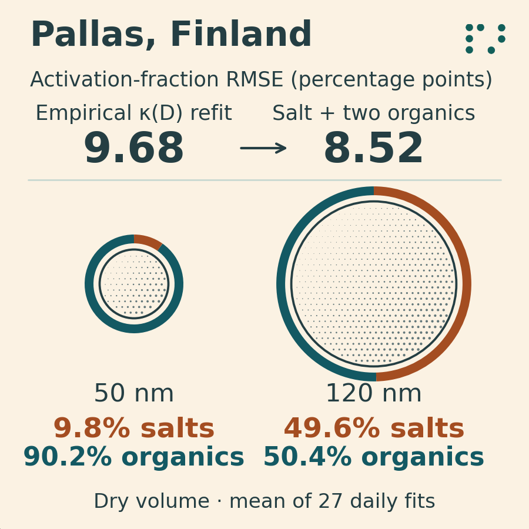
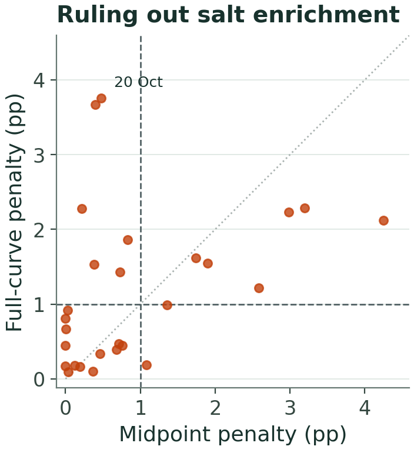
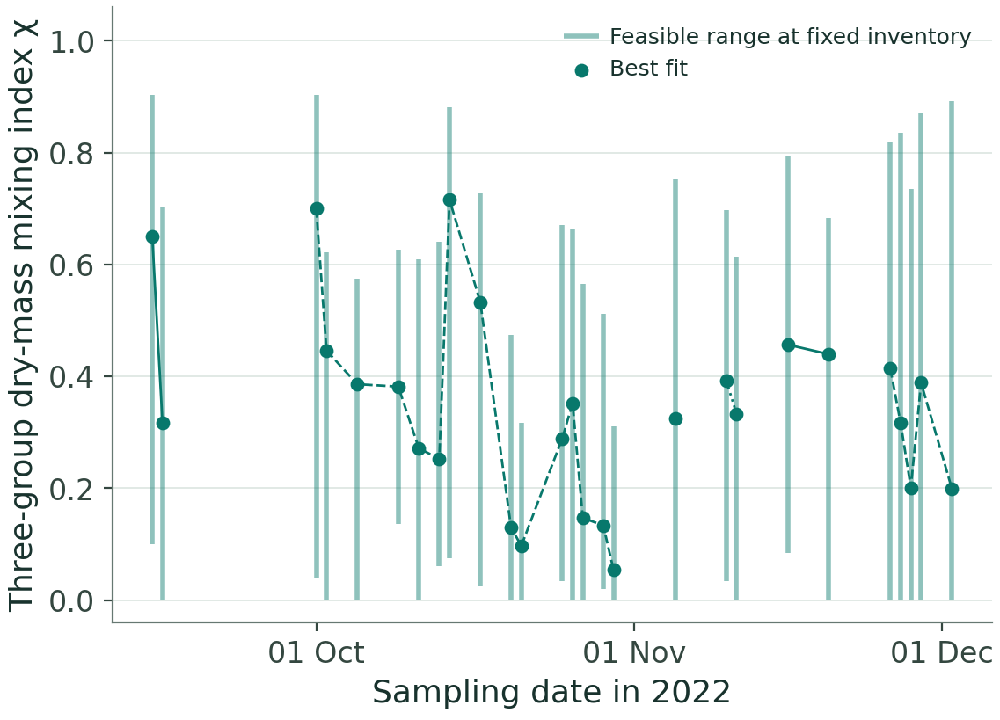

# Which particles carry the salt? What the Pallas activation curves reveal beyond their midpoints

Backman and colleagues reported the dry diameter at which half the particles at Pallas activated at each supersaturation. What can the rest of the activation curve tell us about which particles carried the salt? We fitted the same chemically constrained particle population twice on each of 27 dates, first to the five published midpoints and then to all measured activated fractions. The midpoints required more salt by dry volume at 120 nm than at 50 nm on eight dates. The full curves required it on twelve, using a tolerance of one percentage point above each fit’s minimum error. Six dates met the criterion in both comparisons, six only with the full curves, and two only with the midpoints. The other thirteen admitted a fit without enrichment in both cases. Across all dates, the full-curve best fits assigned an average of 9.8% salt at 50 nm and 49.6% at 120 nm. Those fractions give a size-specific chemical interpretation that can be tested at the summit. [Backman et al., §3.3](https://doi.org/10.5194/essd-2025-284) · [Pallas measurements, version 4](https://doi.org/10.5281/zenodo.23309964)

*Graphical abstract. The counts give the days when each fit required a higher salt fraction at 120 nm than at 50 nm within one percentage point of its best activation error. The rings show the mean dry-volume fractions of salt (rust) and organics (teal) across the 27 full-curve fits.*

## How Backman et al. measured activation at Pallas

At Sammaltunturi in northern Finland, the counter alternated hourly between bulk sampling and sampling particles selected by dry mobility diameter. Backman et al. pooled the size scans by date because individual channels contained few particles. For each supersaturation they reported the fitted diameter at which half of the selected particles activated, its standard error and an inferred κ. Applying the analytical κ-Köhler conversion to the archived diameters, with an effective Kelvin diameter coefficient of 2.09915 nm, recovered all 332 usable κ values at their reported two-decimal precision. Backman et al. used these midpoints to characterize effective hygroscopicity. We used their archived midpoints and underlying fractions to ask which salt allocations each description can distinguish. [Instrument and analysis methods](https://essd.copernicus.org/preprints/essd-2025-284/essd-2025-284.pdf#page=12) · [κ-Köhler description](https://doi.org/10.5194/acp-7-1961-2007)

The chemical model distributed 15 candidate particle compositions across dry sizes. It used two salts, ammonium sulfate and sodium chloride, and two representative organics, water-soluble sorbitol and oil-like squalane. For each composition we calculated activation from AIOMFAC water activity and the Kelvin curvature term, assuming that squalane formed a separate oil reservoir with limited aqueous solubility and that the activating surface was water-rich. Full phase equilibrium in the salt–organic mixture remains unverified. Regional filter measurements constrained organic carbon relative to the amounts of salt that could be formed from the measured ions. The filters sampled Matorova, about 6 km away and 220 m below the summit. The organic compounds in the calculation represent possible water-uptake behaviors. Their identities and size distributions remain unmeasured at the counter. [Chemical constraints and thermodynamic assumptions](chemistry.md) · [Matorova carbon](https://doi.org/10.48597/CAMS-V8ZB) · [Matorova ions](https://doi.org/10.48597/J4SV-VVBN) · [AIOMFAC thermodynamics](https://doi.org/10.5194/acp-11-9155-2011)

## On which dates does the size distribution of salt matter?

For the midpoint comparison, the chemical model was asked to activate half the particles at each of the authors’ five reported D₅₀ values. For the full-curve comparison, the same model fitted all 1,823 observed fractions, weighting each supersaturation equally within its day. We repeated each fit while requiring the 120 nm salt fraction to be less than or equal to the 50 nm fraction. If imposing that constraint raised daily root-mean-square error (RMSE) by more than one activation percentage point, we counted the date as requiring enrichment. The midpoint calculation uses the central reported diameters. It scores errors in *activated fraction* at those diameters and does not propagate the authors’ diameter standard errors.

On 20 October the constraint cost just **0.48 activation percentage points** at the five midpoints, but **3.76 points** across the measured curves. The fractions away from 50% activation distinguish salt allocations that fit the midpoints almost equally well. The reverse occurred on two dates: an allocation could fit the whole scan within tolerance even though the midpoint-only score favored enrichment. At tolerances of 0.5, 1 and 2 points, respectively, the midpoint comparison required enrichment on 13, 8 and 4 dates, and the full curves on 16, 12 and 6. These are conditional fit comparisons on the same observations. They do not measure a change in atmospheric composition between samples.

*Figure 1. What the full curve adds to the five activation midpoints. Each point is a sampling day. Moving right shows how much worse the five midpoints fit when we forbid a higher salt fraction at 120 nm than at 50 nm. Moving up shows the same cost for the full curve. At the dashed lines the increase in activation RMSE reaches one percentage point (pp). On the six shaded days, the midpoint fit can accommodate an equal or lower salt fraction at 120 nm within that tolerance, while the full curve requires enrichment. The arrow marks 20 October.* [Daily scores](https://github.com/uncscode/particula/blob/main/docs/data/pallas-activation/midpoint-check.csv)

*Figure 2. Left, open circles show the measured fraction of particles activating at each dry diameter and supersaturation on 16 September, the day with median fit error. Lines connect the chemical model’s fitted fractions at those diameters. Right, the line gives the mean fitted salt fraction by dry volume across 27 dates. Shading spans the 25th to 75th percentiles of the daily fits.*

All 27 full-curve best fits placed more salt at 120 nm than at 50 nm. The best fits assigned 9.8%, 36.9%, 49.6% and 36.7% of dry volume to salt at 50, 80, 120 and 180 nm, respectively. Salt enrichment was concentrated in the middle of this size range. Across dates, the fitted organics averaged 62% sorbitol-like material by organic dry volume. Only six dates required both organic classes within the one-point error tolerance. That tolerance measures how much fit quality we allowed an alternative allocation to lose. It is an analyst’s choice, distinct from the instrumental error.

## Does the chemical interpretation transfer to other measurements?

Holding the chemical class abundances constant across sizes gave a mean daily activation RMSE of 14.31 points. Allowing them to vary by size gave 8.52 points. In a separate empirical comparison, we fitted a continuous κ(D) power law to the same fractions and obtained 9.68 points. The chemical fit reduced this error by 1.16 percentage points (95% paired date-bootstrap interval 0.33–1.99 points). Both models used all five settings in this calibration, and the chemical model had more freedom to adjust the population. When we refitted each date on four settings and tested the fifth, the mean error was 10.62 points for the chemical model and 10.77 for κ(D).

Bulk sampling supplied a second test. We integrated the modeled activation probability over measured dry size spectra and scaled the result to simultaneous ambient particle counts. On 4,110 matched bulk minutes across ten dates and four settings, the chemical model predicted 48.6 CCN cm⁻³ against 63.9 cm⁻³ measured. Its mean absolute error was 18.87 cm⁻³, compared with 16.27 cm⁻³ for κ(D), with dates and settings weighted equally. The bulk observations came from other sampling hours and shared the same CCN counter. A closer fit to the size scans did not improve the count estimate in those hours.

## The same bulk mixing index can conceal different particles

The fitted three-group dry-mass mixing index, χ, treats the salts as one group and the two organic surrogates as separate groups. A value of zero describes particles each containing one group only. A value of one describes particles with identical mass compositions. The daily best fits ranged from 0.054 to 0.716. When we preserved each day’s fitted amounts of the three groups and allowed the activation error to rise by one point, 16 of the 27 dates admitted an effectively external mixture (χ near zero). [Riemer and West, mixing-index definition](https://doi.org/10.5194/acp-13-11423-2013)

*Figure 3. Each dot gives the daily best-fit dry-mass mixing index (χ) for salt and the two organic classes. Bars span the indices compatible with the same daily ingredient totals and an increase of at most one percentage point in activation RMSE. Lines join sampling dates at most four days apart.*

Even if the whole-population mixing index were known exactly, the spacing of the size scans leaves some salt allocations indistinguishable. On 16 September we redistributed the same particle composition classes between two dry-spectrum channels lying between measured activation diameters. For this test we allowed finer variation than in the original five-knot fit, tapering each change to zero at the surrounding measured sizes. The salt fraction at 112.2 nm changed from 78.4% to 58.5%, and at 130.5 nm from 61.5% to 75.1%. Both allocations preserved the total dry volume of every composition class, the mixing index (0.31683) and the predicted activation at every measured size and setting. Each retained the original daily error of 8.523 percentage points.

*Figure 4. The solid and dashed lines give the fitted and redistributed salt-volume fractions on 16 September. Dots mark dry diameters with activation measurements. The profiles meet at those diameters and differ between them. At 112.2 nm, for example, the two allocations contain 78.4% and 58.5% salt by dry volume and predict a 6.3-percentage-point difference in activation at 0.2% supersaturation.*

At **112.2 nm and 0.2% supersaturation**, the two allocations predict **75.2% and 68.9% activation**. At 130.5 nm and 0.1%, the predictions are 43.2% and 48.3%. For air comparable to the illustrated September population, an added activation channel at 112.2 nm could distinguish the two assignments if counting and sampling precision resolve 6.3 percentage points. Measuring composition at the same dry size at the summit would test whether the inferred salt enrichment is present. [Predictions at the additional sizes](https://github.com/uncscode/particula/blob/main/docs/data/pallas-activation/new-size-test.csv)

## Reproducibility

The calculations use the version 4 PaCE 2022 data and the two Matorova chemistry records cited above. We combined AIOMFAC water activity with the Kelvin curvature term at 298.15 K. The thermodynamic tables and activation-loss gradients were evaluated on an NVIDIA GeForce RTX 5060. The optimization conserved dry number at each size and the specified regional chemical budget. The study source documents the inputs, assumptions and calculation behind each figure. [Study source and replay](https://github.com/uncscode/particula/tree/main/studies/pallas-activation) · [Daily fitted fractions and ranges](https://github.com/uncscode/particula/blob/main/docs/data/pallas-activation/daily.csv) · [Measured and fitted activation fractions](https://github.com/uncscode/particula/blob/main/docs/data/pallas-activation/activation.csv) · [Pallas source observations](https://doi.org/10.5281/zenodo.23309964)
