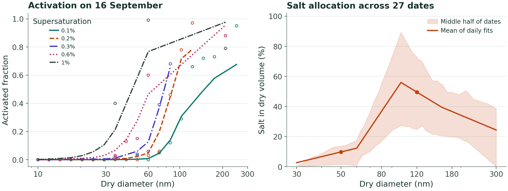
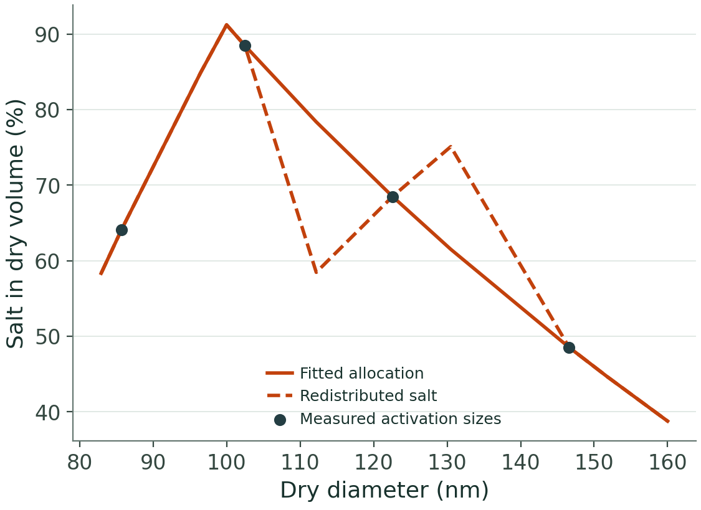

# Which particles carry the salt? A chemical interpretation of size-dependent κ at Pallas

Could the distribution of salt and organic material explain why the inferred hygroscopicity of Pallas aerosol varied with dry particle size? Backman and colleagues measured the fraction of particles that activated at each dry diameter and supersaturation. Over 27 days, a chemical model fitted the measured fractions with a mean daily root-mean-square error of 8.52 percentage points, compared with 9.68 for our empirical fit of size-dependent hygroscopicity, κ(D). On every day, the best-fitting chemical allocation put a larger fraction of dry particle volume in salt at 120 nm than at 50 nm. The respective averages were 49.6% and 9.8%. On 12 days, every allocation in the model within one percentage point of the best daily error retained that enrichment. The other 15 days admitted alternatives. The chemical fit underestimated the concentration of cloud condensation nuclei (CCN) measured during separate bulk sampling hours. [Backman et al., data preprint, §3.3](https://doi.org/10.5194/essd-2025-284) · [Pallas measurements, version 4](https://doi.org/10.5281/zenodo.23309964)

## What did the activation measurements constrain?

At Sammaltunturi in northern Finland, the counter alternated hourly between bulk sampling and sampling particles selected by dry mobility diameter. Backman et al. pooled the size scans by date because individual channels contained few particles. For each supersaturation they reported the fitted diameter at which half of the selected particles activated, its standard error and an inferred κ. Applying the analytical κ-Köhler conversion to the archived diameters, with an effective Kelvin diameter coefficient of 2.09915 nm, recovered all 332 usable κ values at their reported two-decimal precision. We used the underlying activated fractions for a different comparison. Our chemical model and our empirical κ(D) model each fitted the same 1,823 fractions at five supersaturations, from 0.1% to 1%. We weighted the five settings equally within each date and averaged the daily errors across dates. [Instrument and analysis methods](https://essd.copernicus.org/preprints/essd-2025-284/essd-2025-284.pdf#page=12) · [κ-Köhler description](https://doi.org/10.5194/acp-7-1961-2007)

The chemical model distributed 15 candidate particle compositions across dry sizes. It used two salts, ammonium sulfate and sodium chloride, and two representative organics, water-soluble sorbitol and oil-like squalane. For each composition we calculated activation from AIOMFAC water activity and the Kelvin curvature term, assuming that squalane formed a separate oil reservoir with limited aqueous solubility and that the activating surface was water-rich. Full phase equilibrium in the salt–organic mixture remains unverified. Regional filter measurements constrained organic carbon relative to the amounts of salt that could be formed from the measured ions. The filters sampled Matorova, about 6 km away and 220 m below the summit. The organic compounds in the calculation represent possible water-uptake behaviors. Their identities and size distributions remain unmeasured at the counter. [Chemical constraints and thermodynamic assumptions](chemistry.md) · [Matorova carbon](https://doi.org/10.48597/CAMS-V8ZB) · [Matorova ions](https://doi.org/10.48597/J4SV-VVBN) · [AIOMFAC thermodynamics](https://doi.org/10.5194/acp-11-9155-2011)

*Figure 1. Open circles are Pallas measurements on the date with median fit error. Lines connect fitted fractions evaluated at the measured dry diameters. The salt panel shows the mean best-fit profile and the middle half of daily profiles.*

The best fits assigned 9.8%, 36.9%, 49.6% and 36.7% of dry volume to salt at 50, 80, 120 and 180 nm, respectively. Salt enrichment was concentrated in the middle of this size range. Across dates, the fitted organics averaged 62% sorbitol-like material by organic dry volume. Only six dates required both organic classes within the one-point error tolerance. That tolerance measures how much fit quality we allowed an alternative allocation to lose. It is an analyst’s choice, distinct from the instrumental error.

## Better calibration gave little gain at an omitted setting

The chemical fit reduced mean daily activation error by 1.16 percentage points compared with our empirical κ(D) fit (95% paired date-bootstrap interval 0.33–1.99 points). Both models used all five settings in this calibration, and the chemical model had more freedom to adjust the population. When we refitted each date on four settings and tested the fifth, the mean error was 10.62 points for the chemical model and 10.77 for κ(D).

Bulk sampling supplied a second test. We integrated the modeled activation probability over measured dry size spectra and scaled the result to simultaneous ambient particle counts. On 4,110 matched bulk minutes across ten dates and four settings, the chemical model predicted 48.6 CCN cm⁻³ against 63.9 cm⁻³ measured. Its mean absolute error was 18.87 cm⁻³, compared with 16.27 cm⁻³ for κ(D), with dates and settings weighted equally. The bulk observations came from other sampling hours and shared the same CCN counter. A closer fit to the size scans did not improve the count estimate in those hours.

## The same bulk mixing index can conceal different particles

The fitted three-group dry-mass mixing index, χ, treats the salts as one group and the two organic surrogates as separate groups. A value of zero describes particles each containing one group only. A value of one describes particles with identical mass compositions. The daily best fits ranged from 0.054 to 0.716. When we preserved each day’s fitted amounts of the three groups and allowed the activation error to rise by one point, 16 of the 27 dates admitted an effectively external mixture (χ near zero). [Riemer and West, mixing-index definition](https://doi.org/10.5194/acp-13-11423-2013)

*Figure 2. Dots mark the best fits. Each bar shows how far the index could move at fixed group totals. Connecting lines span observations at most four days apart.*

Even if the whole-population mixing index were known exactly, the spacing of the size scans leaves some salt allocations indistinguishable. On 16 September we redistributed the same particle composition classes between two dry-spectrum channels lying between measured activation diameters. For this test we allowed finer variation than in the original five-knot fit, tapering each change to zero at the surrounding measured sizes. The salt fraction at 112.2 nm changed from 78.4% to 58.5%, and at 130.5 nm from 61.5% to 75.1%. Both allocations preserved the total dry volume of every composition class, the mixing index (0.31683) and the predicted activation at every measured size and setting. Each retained the original daily error of 8.523 percentage points.

*Figure 3. The two allocations agree at the existing activation channels. An added channel between them could resolve their different predictions.*

At **112.2 nm and 0.2% supersaturation**, the two allocations predict **75.2% and 68.9% activation**. At 130.5 nm and 0.1%, the predictions are 43.2% and 48.3%. For air comparable to the illustrated September population, an added activation channel at 112.2 nm could distinguish the two assignments if counting and sampling precision resolve 6.3 percentage points. Measuring composition at the same dry size at the summit would test whether the inferred salt enrichment is present. [Predictions at the additional sizes](https://github.com/uncscode/particula/blob/main/website/public/study-data/pallas-activation/new-size-test.csv)

## Reproducibility

The calculations use the version 4 PaCE 2022 data and the two Matorova chemistry records cited above. We combined AIOMFAC water activity with the Kelvin curvature term at 298.15 K. The thermodynamic tables and activation-loss gradients were evaluated on an NVIDIA GeForce RTX 5060. The optimization conserved dry number at each size and the specified regional chemical budget. The study source documents the inputs, assumptions and calculation behind each figure. [Study source and replay](https://github.com/uncscode/particula/tree/main/studies/pallas-activation) · [Daily fitted fractions and ranges](https://github.com/uncscode/particula/blob/main/website/public/study-data/pallas-activation/daily.csv) · [Measured and fitted activation fractions](https://github.com/uncscode/particula/blob/main/website/public/study-data/pallas-activation/activation.csv) · [Pallas source observations](https://doi.org/10.5281/zenodo.23309964)
