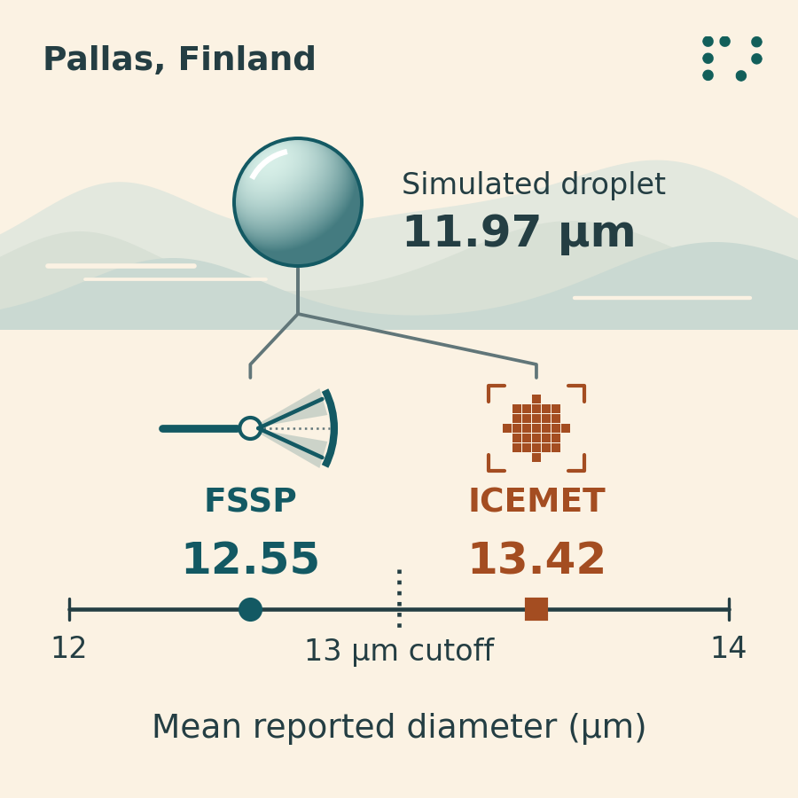
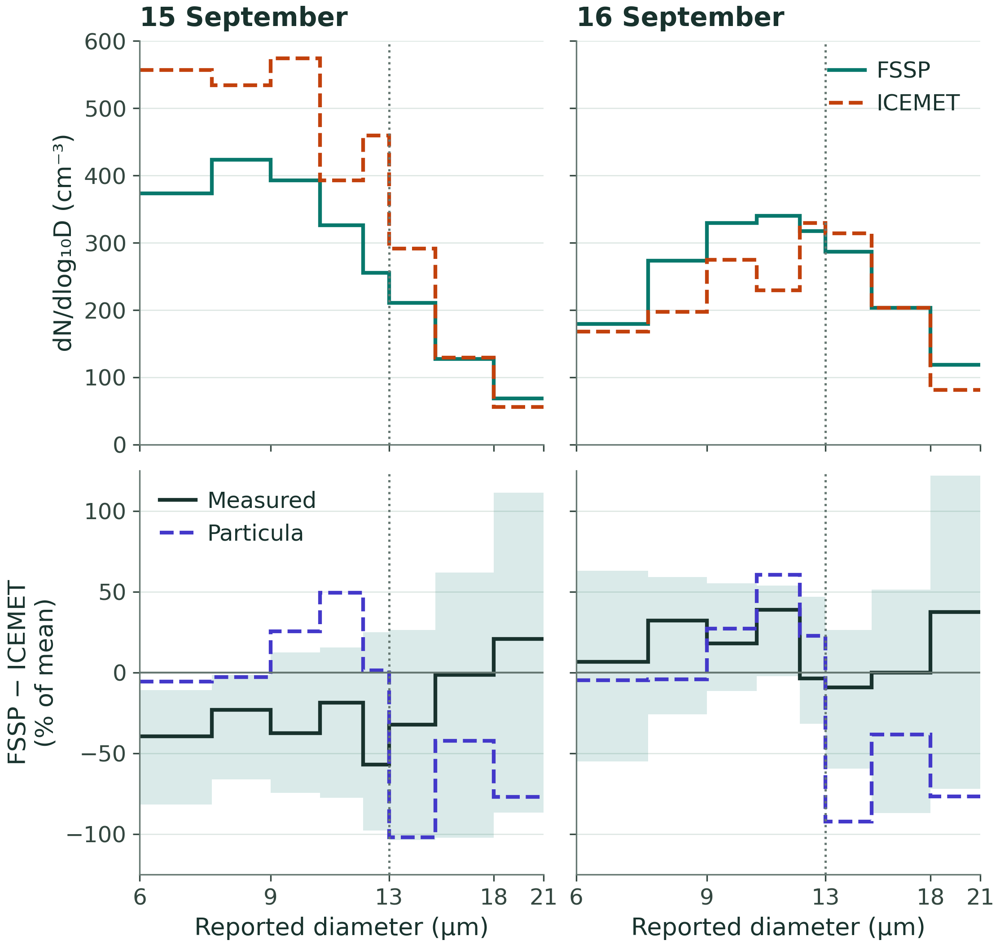
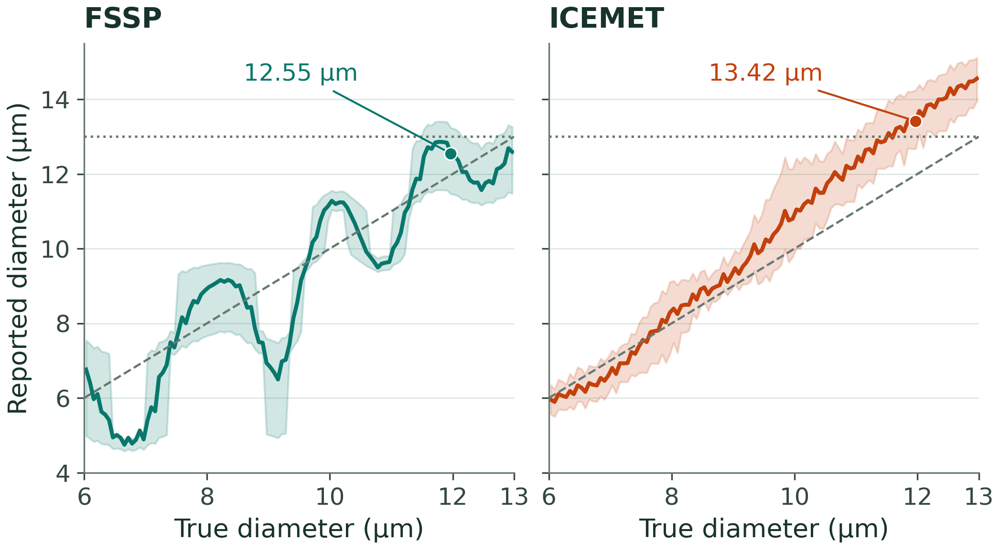
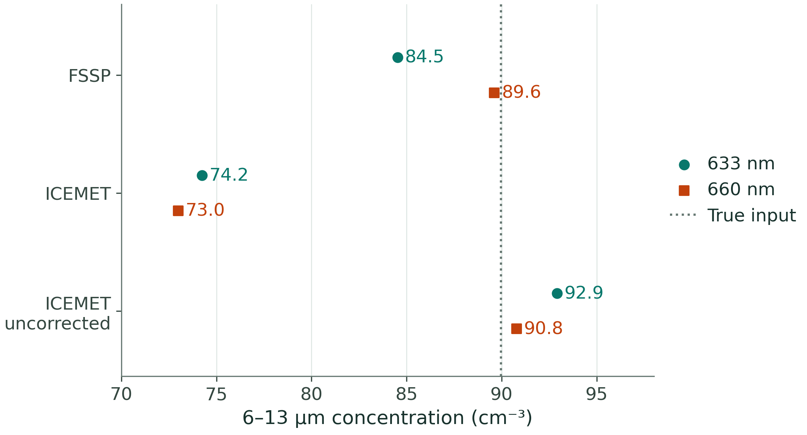

# One droplet, two reported sizes: Simulating the Pallas cloud probes

At Pallas, Finland, the forward-scattering probe used 633 nm light and the ICEMET holographic imager used 660 nm. To compare how the two methods size a droplet at the same wavelength, we set both probe models to 633 nm in Particula. Both models detected a simulated water droplet 11.97 µm across. The scattering model assigned it a mean diameter of 12.55 µm and the imaging model assigned it 13.42 µm, on opposite sides of the 13 µm cutoff. Using a droplet distribution measured at Pallas on 15 September 2022, the two models predicted 6–13 µm counts that differed by 13% of their mean in this same-wavelength test, with each model retaining its native calibration. The field measurements pose a harder question. The scattering probe counted fewer small droplets than the imager that day and more the next day. The nominal simulation predicted an excess on both days. Pallas thus gives us both a reason to model how a probe sizes droplets and a direct test of how much that model explains.

## A shared diameter interval still gave different field counts

Doulgeris and colleagues measured cloud droplets at the Sammaltunturi summit in Finland using four spectrometers. Two faced into the wind. The forward-scattering spectrometer probe (FSSP) inferred diameter from the light scattered by a droplet. ICEMET reconstructed a holographic image and estimated diameter from the particle image. The authors calibrated ICEMET with glass beads and applied a sizing correction below 13.07 µm. That breakpoint motivated our comparison of the counts assigned to 6–13 µm, an interval within both instruments’ nominal ranges. [Pallas campaign and instrument methods](https://essd.copernicus.org/articles/17/6497/2025/) · [Corrected data, version 3](https://doi.org/10.5281/zenodo.19220993)

We reconstructed the September spectra on common diameter intervals and paired the measurements by minute. We selected above-freezing, low-visibility observations with positive probe counts and unflagged imager data. The two best-sampled dates gave opposite orderings. On 15 September the FSSP and ICEMET means were **123.8 and 173.5 cm⁻³** in the 6–13 µm band. On 16 September they were **91.8 and 75.1 cm⁻³**. The 15 September difference was visible well below the upper cutoff. In the 6–7.5 µm interval alone, FSSP counted 36.2 cm⁻³ and ICEMET counted 54.0 cm⁻³.

**Figure 1.** Mean measured spectra for 1,439 and 1,320 paired minutes. The lower panels compare the measured difference (solid) with the Particula prediction (dashed), each calculated as FSSP minus ICEMET divided by their mean and expressed as a percentage. For each date, the simulation passes one spectrum measured by the cloud droplet analyzer through models of FSSP at 633 nm and ICEMET at 660 nm. Shading gives the pointwise central 95% range for the measured difference under the working instrument uncertainty assumptions. The vertical line marks 13 µm. [Full spectra through 40 µm and plot data](https://github.com/uncscode/particula/blob/main/docs/data/pallas-cloud-probes/distributions.csv)

Summing the counts over 6–13 µm before taking the percentage gives a direct test of the simulation. On 15 September, Particula predicted +14.7% against a measured −33.4%. In the 6–7.5 µm bin it predicted the observed direction but only −5.7% against −39.5%. On 16 September, the integrated differences were close (+22.5% simulated and +20.1% measured), even though the size-by-size curves diverged. To test how firmly the signs were resolved, we propagated finite counting noise and coherent shifts in each probe’s number and diameter scales. Treating the campaign’s approximate FSSP uncertainties as uniform half-widths (±16% in number, ±20% in diameter) and adopting working ICEMET bounds of ±16% and ±1 µm gave central ranges of **−65.7% to −5.3%** and **−14.8% to +48.6%**. The ICEMET bounds are assumptions. Doubling them, or reading the ambiguous FSSP diameter labels as channel centers, brought zero inside the first day’s range as well. The FSSP reconstruction also recovered total number but disagreed with the archived liquid water content, leaving additional uncertainty about the allocation of droplets among channels. [Uncertainty calculations and alternative assumptions](specification.md#instrument-uncertainty)

## Following a known droplet from signal to reported diameter

The field record gives each probe’s answer but does not give the true diameter of each droplet it encountered. In Particula we could supply that missing quantity. For each true diameter, we simulated spherical water droplets entering each probe’s effective sampling volume. The FSSP model integrated Mie scattering over the collection angles, varied pulse strength, and converted the pulse to a diameter using a calibration curve. The ICEMET model formed an idealized in-focus image, varied the droplet’s depth and position relative to the pixels, and applied an image threshold and an approximate bead-based correction. We used a third, vertically sampling cloud droplet analyzer (CDA) to set the relative abundance of each true diameter. Its measured spectrum supplied a common input and carries its own sampling losses. [Optical assumptions and replay](https://github.com/uncscode/particula/blob/main/studies/pallas-cloud-probes/source/README.md) · [Published ICEMET response and calibration](https://amt.copernicus.org/articles/15/2993/2022/)

**Figure 2.** The solid line in each panel gives the mean registered size. For this simulation only, both probe models use 633 nm and retain their respective native calibrations. Each true diameter has 512 simulated trials. Shading covers the 16th–84th percentiles of individual registered sizes. Its width shows the spread among simulated encounters at fixed true size as pulse strength or imaging position varies. The distance from the mean line to the dashed diagonal measures bias. Dots mark the means for a true 11.97 µm droplet. The dotted horizontal line marks the 13 µm reporting boundary. [Figure data](https://github.com/uncscode/particula/blob/main/docs/data/pallas-cloud-probes/method-sizing.csv)

Both models triggered on every simulated 6–13 µm target in this nominal calculation. Yet the FSSP response oscillated with diameter because light scattered into its collection angles can weaken as a sphere grows. The imager response depended on which pixels cleared its contrast threshold. Among registered droplets, weighted by the 15 September input, the within-size scatter was **0.90 µm for FSSP and 0.71 µm for ICEMET**. Including size-dependent bias raised their root-mean-square diameter errors to **1.42 and 1.11 µm**. Near 12 µm, the imager’s narrower spread was centered above the reporting boundary.

## Reprocessing the same images reversed the simulated count ordering

The 15 September input contained 90.0 cm⁻³ of droplets with true diameters inside the band. In the common-wavelength simulation at 633 nm, the FSSP model reported **84.5 cm⁻³** and the ICEMET model **74.2 cm⁻³**. Those totals include droplets assigned into the band from outside it and exclude droplets assigned out. Running the ICEMET model at its field wavelength of 660 nm gave a predicted count of 73.0 cm⁻³. A larger change came from holding the 633 nm images and segmentation threshold fixed and removing only the approximate small-droplet correction. ICEMET then reported **92.9 cm⁻³**, overtaking FSSP. The deployed imager used a correction. This control shows why its actual calibration coefficients matter to the comparison.

**Figure 3.** Every point uses the same incoming distribution. The dotted line is the known in-band concentration supplied to the simulation. The bottom row reuses the middle row’s images at each wavelength. [Optical controls and counts](https://github.com/uncscode/particula/blob/main/docs/data/pallas-cloud-probes/method-budget.csv)

At native wavelengths, the modeled FSSP excess was **+11.5 cm⁻³** on 15 September, against a measured **−49.7 cm⁻³**. On 16 September it was **+7.4 cm⁻³**, against a measured **+16.8 cm⁻³**. Wavelength changes can move counts between individual channels, but the wavelength swap did not recover the first day’s deficit. The simulations establish a mechanism for disagreement. Inlet collection, real focus and rejection losses, and campaign-specific calibrations remain unresolved contributors to the field comparison. [Four-way comparison](https://github.com/uncscode/particula/blob/main/docs/data/pallas-cloud-probes/attribution.csv)

## A calibration test that can distinguish missed droplets from mis-sized ones

For a cloud model evaluated against these data, the choice of probe changes the reported number of small droplets even when the incoming cloud is held fixed. A useful comparison would carry the simulated population through each instrument’s response and evaluate both resulting spectra against the paired record. The September results also identify where a calibration measurement would be most informative. Independently counted water droplets at **6–9 µm** would test the part of the field spectrum where the first day’s deficit was clearest. Droplets just below and above **13 µm** would test migration across the upper boundary. Recording incident number, raw detections, and assigned diameters would let us measure how often a droplet disappeared and how often it simply moved to another channel.

## Study resources

The [worked example](pallas_cloud_probes.py) regenerates Figures 1–3 from the measured and simulated concentrations and individual-droplet sizing results. The [study specification and source-to-figure guide](specification.md) identifies the author data, each calculation, the uncertainty assumptions and the values behind the graphical abstract. The complete [optical simulation and field replay](https://github.com/uncscode/particula/blob/main/studies/pallas-cloud-probes/source/README.md) starts from the corrected author archive and documents the CPU and CUDA calculations.
