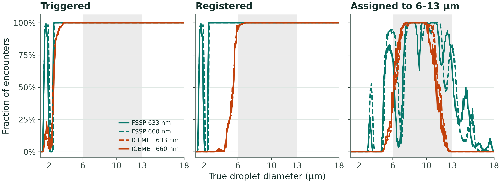

# Reproduce the Pallas cloud probe comparison

The comparison asks how often a forward-scattering spectrometer probe (FSSP) and the ICEMET holographic imager assign the same liquid droplet to different sides of a 13 µm reporting boundary. The optical calculation uses known wet diameters. The observational test compares concentrations reported over 6–13 µm in the same minutes of the Pallas 2022 campaign. The first tests a sizing mechanism. The second measures how much of the field disagreement that mechanism can explain. [Study and figures](index.md) · [Doulgeris et al.](https://doi.org/10.5194/essd-17-6497-2025)

## Reconstruct the observed spectra

Use version 3 of the PaCE archive, which corrected the September ICEMET UTC timestamps. The files are `FMI.FSSP.b1.20220913.csv`, `OULU.ICEMET.b1.20220914.csv` and `FMI.CDA.b1.20220914.csv`. Remove repeated minute keys on each instrument before matching UTC. On the paired wind-facing records require positive counts, ICEMET flag 0, FSSP-file station temperature above 0 °C and visibility of 1–999 m. These filters retained 4,283 minutes over seven September dates. Use positive, matched CDA counts for the model input on 15 and 16 September, the two most densely sampled dates. [Version 3 data, metadata and reuse terms](https://zenodo.org/records/19220993) · [Input retrieval and replay](https://github.com/uncscode/particula/blob/main/studies/pallas-cloud-probes/source/README.md)

Use the recorded concentrations in cm⁻³ and wet diameters in µm. For the imager and the vertically sampling cloud droplet analyzer (CDA), multiply the archived spectral densities by their native channel widths in log₁₀ diameter. For the FSSP, multiplying each spectral ordinate by 0.05 recovered the reported total to within 0.007 cm⁻³ on the 14 September pilot. This empirical normalization leaves a large discrepancy in reconstructed liquid water. The nominal diameter coordinates follow the upper edges given in the FSSP metadata and submitted manuscript. Testing the NetCDF interpretation of those same coordinates as centers probes a separate uncertainty. When a plotted interval cuts a native channel, allocate number in proportion to log-diameter width. Score the signed percent difference as 100 times FSSP minus ICEMET divided by their arithmetic mean, leaving the double-zero case undefined. Sum the two concentrations across constituent channels before computing the 6–13 µm percentage. [Original channel specification](https://essd.copernicus.org/preprints/essd-2025-163/essd-2025-163.pdf) · [Processed spectra](https://github.com/uncscode/particula/blob/main/docs/data/pallas-cloud-probes/distributions.csv)

## Compare optical responses to the same droplets

Use identical input populations for both instrument models. The FSSP model integrates Particula's spherical-water Mie intensities over a 4–12° collection annulus and imposes a unit-mean pulse gain with a nominal log standard deviation of 0.12. It maps pulse amplitude to diameter using a smoothed, monotone calibration. The ICEMET model integrates an ideal in-focus intensity image over pixels at varying depths and subpixel positions. Two adjacent dark pixels trigger detection. Segmented area determines diameter. Below 13.07 µm, the nominal retrieval applies an approximate correction estimated from modeled glass beads. Beam profiles, electronic thresholds, focus errors, collection losses and campaign calibration coefficients remain incompletely constrained. [FSSP measurements at Pallas](https://doi.org/10.5194/amt-13-5129-2020) · [ICEMET design](https://doi.org/10.1007/s10043-020-00583-y) · [Puijo instrument comparison](https://doi.org/10.5194/amt-15-2993-2022)

For each model simulate both 633 and 660 nm, holding its native calibration fixed. At 633 nm in both models, the difference measures the responses of two methods at a common wavelength. The comparison with deployed probes uses FSSP at 633 nm and ICEMET at 660 nm. The CDA spectrum sets the number supplied at each true diameter. It is an independent input proxy with its own collection losses. A further control changes only the small-droplet correction applied to previously simulated images. Report registered sizes conditional on detection, and band concentrations per volume of air supplied. Droplets may enter the reported interval from either side. [Wavelength and calibration comparisons](https://github.com/uncscode/particula/blob/main/docs/data/pallas-cloud-probes/attribution.csv)

The optical calculations used the CPU for Particula Mie amplitudes and the NVIDIA GeForce RTX 5060 with Warp 1.11.1 for pixel integration. The refined run used a 0.0625 µm true-diameter mesh from 1 to 40 µm, 512 paired Sobol trials per diameter, 20 depth planes and 80 angular quadrature nodes. It processed 3,225,600 target images including bead controls. An independent refinement doubled the number of trials and halved the diameter spacing for the nominal scenario. An independent CPU calculation checked 448 segmented images against CUDA. Source revision `3435f653ae2606c4eeef23bdf55b617d2ac58586` identifies the Particula implementation used for the study. [Scientific model, retrieval and reproduction commands](https://github.com/uncscode/particula/blob/main/studies/pallas-cloud-probes/source/README.md)

## Instrument uncertainty

Use daily count and diameter offsets that are coherent across channels. The default ensemble assigns independent uniform draws to each probe. For FSSP the half-widths are ±16% in number and ±20% in diameter, using the campaign's approximate uncertainties. ICEMET uses working half-widths of ±16% in number and ±1 µm in diameter. Its two numbers are modeling assumptions. A Poisson term accounts for finite sampled volume in the native channels. Use 16,384 draws per date, and compute central 95% intervals over the reconstructed daily concentrations or signed percent differences. Figure 1 shows pointwise intervals at individual sizes. Recompute the summed concentration inside every draw for a band interval. The ranges condition on the measured cloud minutes, adopted bounds and their dependencies. The original study also tests wider ICEMET bounds, shared calibration offsets and FSSP centers. [Uncertainty budget](https://github.com/uncscode/particula/blob/main/docs/data/pallas-cloud-probes/uncertainty-budget.csv)

## Source-to-figure guide

The [worked example](pallas_cloud_probes.py) draws the three manuscript figures from compact numerical tables. The full optical and uncertainty calculations can be repeated separately with the [scientific replay](https://github.com/uncscode/particula/blob/main/studies/pallas-cloud-probes/source/README.md).

| Graphic | Input and calculation |
| --- | --- |
| Graphical abstract | The [artwork source](https://github.com/uncscode/particula/blob/main/studies/pallas-cloud-probes/figures/make_toc.py) selects the true 11.96875 µm droplet at 633 nm in the [mean sizing results](https://github.com/uncscode/particula/blob/main/docs/data/pallas-cloud-probes/method-sizing.csv). It plots the two modeled means against the 13 µm boundary. |
| Figure 1, field spectra | The [spectral table](https://github.com/uncscode/particula/blob/main/docs/data/pallas-cloud-probes/distributions.csv) contains per-interval field and simulated concentrations in cm⁻³, percent differences and the pointwise limits. The top panels divide the measured concentrations by bin width in log₁₀ diameter. The lower panels compare measured and modeled differences through 21 µm. The table extends to 40 µm. |
| Figure 2, individual droplet sizing | The [conditional sizing table](https://github.com/uncscode/particula/blob/main/docs/data/pallas-cloud-probes/method-sizing.csv) supplies each modeled mean and 16th–84th percentiles at 633 nm. Both panels use the same known diameters, with the 11.97 µm example highlighted. |
| Figure 3, imager calibration | The [method controls](https://github.com/uncscode/particula/blob/main/docs/data/pallas-cloud-probes/method-budget.csv) supply 15 September band counts for both wavelengths. The two ICEMET rows differ solely in the correction applied to the same modeled images at each wavelength. The comparison uses the nominal FSSP response and the same CDA input. |

The [supplementary detection curves](https://github.com/uncscode/particula/blob/main/docs/data/pallas-cloud-probes/detection-efficiency.csv) give three probabilities by true wet diameter for each probe at each wavelength. They describe triggering, registration within the probe range, and assignment to the 6–13 µm band. The optical replay plots all three from the same trials.
