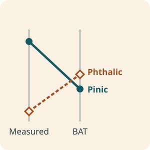
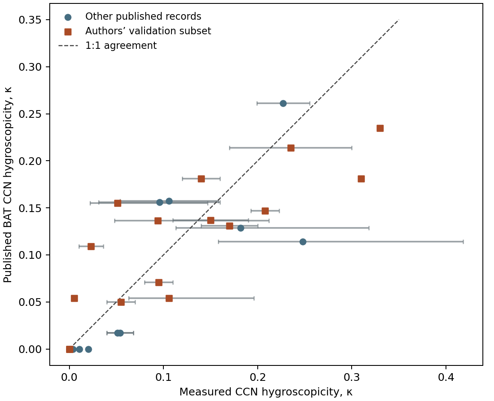

# BAT puts pinic acid’s activation hygroscopicity too low and phthalic acid’s too high



Across 30 organic aerosol records compiled by Gorkowski, Preston and Zuend, the authors’ Binary Activity Thermodynamics (BAT) model has a mean signed error of **−0.009** in the hygroscopicity parameter for cloud activation, κ. Individual acids tell a different story. For pinic acid the archived BAT value is **0.114** against **0.248** measured. For phthalic acid the prediction is **0.155** against **0.051** measured. The opposite signs help explain why a small mean error can coexist with a poor prediction for a particular aerosol. A separate sweep of three generic organic compositions shows how their modeled activation thresholds respond to oxygen content when dry diameter and molar mass are fixed. That sweep gives a compositional sensitivity, while the named compounds provide the experimental comparison. [Gorkowski et al., Figures 9 and 12](https://doi.org/10.5194/acp-19-13383-2019)

## How the authors tested water uptake at cloud activation

Gorkowski and colleagues used BAT to relate the composition of an organic–water mixture to its water activity. They compared model-derived κ at cloud activation with published measurements on individual organics in Figure 12. Their Figure 9 examined a simpler question by varying the oxygen-to-carbon ratio (O:C) of a generic organic at a fixed dry size. Returning to the authors’ archived tables makes it possible to examine the sign and spread of the compound-level errors and to recover the modeled thresholds separately. [Paper, sections 5–6](https://doi.org/10.5194/acp-19-13383-2019)

## What the two archived comparisons tell us about composition

<a id="figure-12-measurements"></a>

### A small mean bias hides opposite errors for two organic acids

[The measurement table](https://github.com/Gorkowski/particula/blob/0accbb62575869858c20446a33f174275ed94813/docs/data/thermodynamics/bat-ccn/figure12-measurements.csv) contains all 30 rows from the publisher workbook sheet `Fig12 TableS6`, cells A2:P31. The CSV retains all source columns, including the original study citations, duplicate chemical names, authors’ validation flags, available AIOMFAC results and asymmetric experimental errors. Column names have been normalized and surrounding whitespace removed. Blank cells represent missing entries. Both error magnitudes are available for 18 records. The printed table rounds values, so use the workbook for numerical reproduction. [Publisher supplement, CC BY 4.0](https://acp.copernicus.org/articles/19/13383/2019/acp-19-13383-2019-supplement.zip)

| Records | n | Mean BAT minus measured κ | RMSE | Slope through zero | Centered R² for this fit |
| --- | ---: | ---: | ---: | ---: | ---: |
| All published records | 30 | −0.008854 | 0.054836 | 0.799443 | 0.657540 |
| Authors’ validation subset (x) | 16 | −0.007371 | 0.060729 | 0.783789 | 0.480584 |

Pinic acid has the largest absolute discrepancy (BAT 0.1141, measured 0.2480). For phthalic acid the sign reverses (BAT 0.1552, measured 0.0510). The small overall bias therefore masks much larger errors for individual compounds. The all-record slope and RMSE reproduce the paper's rounded 0.799 and 0.055. Its reported 0.66 is reproduced by computing 1 − SSE/SST for the constrained fit with modeled κ as the response. Squaring the Pearson correlation of the two columns gives 0.6952. The worksheet footer lists subset RMSE 0.060701, slightly below 0.060729 recomputed from the 16 marked records. The reason for that difference is unresolved. The comparison uses the authors’ BAT outputs.



<a id="figure-9-modeled-activation"></a>

### Reducing the oxygen-to-carbon ratio raises the modeled activation threshold

[The activation table](https://github.com/Gorkowski/particula/blob/0accbb62575869858c20446a33f174275ed94813/docs/data/thermodynamics/bat-ccn/figure9-activation.csv) contains the stored critical saturation ratio, wet diameter and κ for three generic 200 g/mol organics at 100 nm dry diameter. For the primary solutions, reducing O:C from 0.50 to 0.25 to zero raises critical supersaturation from 0.3533% to 0.3858% to 0.5157%; critical wet diameter falls from 404 to 364 to 192 nm. These results describe equilibrium Köhler curves. They do not supply kinetic activation times.

The table also retains the authors’ two alternate β-branch extrema. The O:C 0.25 alternate has saturation ratio 0.999016 (below saturation) and must be distinguished from the primary CCN activation threshold. For traceability, temperature is the archived 293 K. The caption specifies 298.15 K. The conversion from saturation ratio to percent supersaturation is 100(S − 1). Diameters are converted from meters to nanometers. [Authors’ pinned figure archive](https://github.com/Gorkowski/Binary_Activity_Thermodynamics_Model/tree/6e0d5a4d1a9af4571358f0539682cbc0cc1e0257/Matlab_source_code/paper_figures/SI_figures) · [Archive license](https://github.com/Gorkowski/particula/blob/0accbb62575869858c20446a33f174275ed94813/docs/data/thermodynamics/bat-ccn/LICENSE-figure9.txt)

## Test individual compounds before transferring the mean bias

A correction based on the 30-record mean would shift both acid predictions in the same direction, although they need opposite corrections to match their measured central values. The Figure 9 sweep shows how O:C changes a model prediction under controlled inputs. It leaves open which properties account for each acid’s discrepancy. Independent, size-resolved activation measurements of both acids under matched conditions could test whether the opposite signed errors persist across dry diameters.

<a id="reproduce"></a>

## Reproduce the comparison from the published tables

Run `python scripts/bat_ccn/compare.py` from the repository root with NumPy and Matplotlib installed to regenerate the chart and metrics directly from the CSV. For a fresh extraction, download the publisher ZIP and the three MATLAB files named `DATA for figure kappaCCN {mid,lower,zero} O2C.mat` from the linked archive. Keep their filenames and pass their directory as the second argument:

```sh
python scripts/bat_ccn/extract.py /path/to/acp-19-13383-2019-supplement.zip /path/to/mat-files
```

The extractor uses SciPy and defusedxml, verifies all four source files by SHA-256 and regenerates both CSVs. No digitization or parameter fitting is used in extraction.
