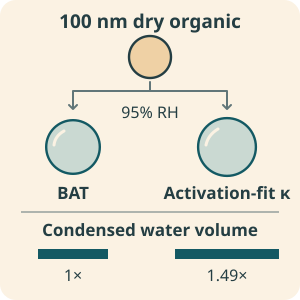
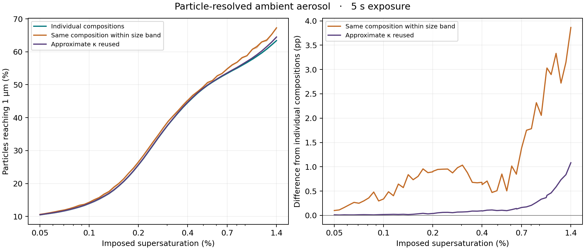

# A cloud activation fit predicts 49% more water than BAT at 95% humidity for one organic



Can a cloud activation measurement tell us how much water a particle takes up below saturation? For the fully miscible 200 g/mol organic with an oxygen-to-carbon ratio of 0.50 in Gorkowski et al.’s BAT model, fitting κ at 100 nm dry diameter reproduces BAT’s activation threshold across the other 50–200 nm sizes with 0.43% relative RMS error. At 95% relative humidity, the same fit predicts a wet diameter of **137.6 nm** for the 100 nm particle. BAT gives **127.7 nm**. After subtracting the dry core, the fitted model has **48.5% more condensed water by volume**. Both calculations hold organic mass fixed. Agreement at activation leaves a measurable difference in water uptake at a humidity commonly used to characterize particle growth. [BAT reference organic, Figure 9](https://doi.org/10.5194/acp-19-13383-2019) · [Water uptake at three humidities](https://github.com/uncscode/particula/blob/main/docs/data/thermodynamics/ccn-retrieval/bat-kappa-growth.csv)

## What cloud activation and humidified size measurements constrain

Petters and Kreidenweis related particle water uptake to a single hygroscopicity parameter, κ. Their equilibrium equations allow an activation threshold to be expressed as a κ value for a known dry size. A CCN counter contributes another condition. A growing droplet must reach the instrument’s optical threshold during its exposure to supersaturated air. We first use synthetic counts to examine that selection, then use independently calculated BAT equilibrium curves to test how far an activation-derived κ transfers. [Petters and Kreidenweis, Eqs. 6 and 10](https://doi.org/10.5194/acp-7-1961-2007) · [CCN experiment guide](../../../../guide/processes/ccn-retrieval.md)

## How counting, vapor exchange and calibration affect the inferred growth

<a id="from-dry-particles-to-counted-droplets"></a>

### An optical counter sees only droplets that reach its size threshold

We used 298.15 K, 101325 Pa, water density 1000 kg/m³, constant surface tension 0.072 N/m and unit accommodation. Spherical particles start at 95% RH. At time zero the water saturation ratio steps to a constant value. Diffusion of water vapor and removal of latent heat limit growth. For each dry size we calculate both the critical wet diameter and the time to reach the 1 µm optical gate. Number weighting over a lognormal dry distribution then gives the fraction counted. Each supersaturation setting starts with a fresh population. A physical counter's axial vapor history and optical efficiency would require independent characterization. [CCN growth model context](https://doi.org/10.5194/acp-12-4227-2012)

The laboratory planner varies median diameter from 10 to 200 nm with geometric standard deviations of 1.10 and 1.20. Its reference lines use a 5 s exposure. The setpoint table adds 0.5, 1, 2, 10 and 20 s. A finite predicted setpoint can exceed the experiment's calibrated supersaturation range. The particle-resolved calculation draws four independent populations of 32,768 particles, from modes centered on 35, 95 and 170 nm with number fractions 0.45, 0.40 and 0.15. Four components have κ values of 0.03, 0.12, 0.61 and 0. Each particle retains its sampled composition across all 53 supersaturation settings and six exposure times. The paired comparison replaces particle compositions within each 0.05-wide interval in logarithmic dry diameter by their dry-volume-weighted average.



<a id="holding-the-organic-mass-fixed-or-allowing-exchange"></a>

### Organic vapor exchange changes the mass available for growth

For a separate fully miscible binary organic–water liquid, direct BAT gives water and organic activities. The reference organic has molar mass 200 g/mol, O:C of 0.50 and density 1243.49 kg/m³. The ideal control uses mole fractions. Each species has its own Kelvin term. Condensed volumes are additive. For the exchange cases we assumed organic diffusivity of 6 × 10⁻⁶ m²/s and a flat-surface saturation concentration of 10 µg/m³. The imposed gas concentrations are sensitivity inputs. The four-component ambient calculation above uses volume-mixed κ and addresses a different population. [BAT model and Figure 9 reference organic](https://doi.org/10.5194/acp-19-13383-2019)

The open-reservoir CUDA scan covers 48 median sizes, two widths, 53 water supersaturations, four exposure times and three organic treatments per activity model (fixed mass or gas maintained at 10 or 30 µg/m³). Its 6–550 nm dry-size grid resolves the transmitted distribution tails. Pure-organic particles evaporating below 2 nm wet diameter leave the calculation, with no subsequent nucleation. The omitted initial number tail is about 0.26% at a 10 nm median and GSD 1.20. The finite-reservoir CPU calculation couples gas and particle organic mass during the exposure. Both calculations prescribe the water forcing.

<a id="how-far-does-the-fit-transfer"></a>

### The activation fit transfers across sizes but overpredicts subsaturated water uptake

We maximize the direct BAT equilibrium curve with organic mass held fixed at each of 191 integer dry diameters. The full local fit matches that maximum with Eq. 6. The analytical inversion uses Eq. 10 at the same maximum. The relative difference between the resulting κ values measures the shortcut's effect on the fitted parameter. We then compare predicted and BAT critical supersaturations at *withheld* sizes, giving each withheld diameter equal weight. [Petters and Kreidenweis (2007)](https://doi.org/10.5194/acp-7-1961-2007)

| Calibration and forward model | Fitted κ | Withheld sizes in 50–200 nm | Relative threshold error range |
| --- | ---: | ---: | ---: |
| 100 nm, full inversion and full prediction | 0.11037 | 150 | −1.24% to +0.47% |
| 50, 75, 100 and 150 nm, full fit and full prediction | 0.10966 | 147 | −0.88% to +0.80% |
| 100 nm, Eq. 10 inversion and full prediction | 0.11200 | 150 | −1.92% to −0.26% |
| 100 nm, Eq. 10 used for both inversion and prediction | 0.11200 | 150 | within ±0.009% |

The last row tests the diameter scaling of critical supersaturation within this particular BAT case. For the full fit at 100 nm, extending the prediction down to 10 nm widens the signed range to −9.35% to +0.47%. For the same 100 nm particle at 95% RH, the ratio of condensed volumes is (137.6³ − 100³)/(127.7³ − 100³), or about 1.49. Both curves describe a fixed dry core. The result is a test of how the two equilibrium models transfer between humidities. [Equilibrium results by dry diameter](https://raw.githubusercontent.com/uncscode/particula/main/docs/data/thermodynamics/ccn-retrieval/bat-kappa-equilibrium.csv) · [Water uptake by humidity](https://raw.githubusercontent.com/uncscode/particula/main/docs/data/thermodynamics/ccn-retrieval/bat-kappa-growth.csv)

## A humidified diameter would test the activation fit

For this organic, cloud activation alone gives little leverage to choose between the fitted κ and BAT over 50–200 nm. For the 100 nm particle the fitted κ predicts excess water at all three tested humidities. Its condensed water volume exceeds BAT by 39% at 90% RH, 49% at 95% RH and 23% at 99% RH. [Modeled growth across humidities](https://github.com/uncscode/particula/blob/main/docs/data/thermodynamics/ccn-retrieval/bat-kappa-growth.csv)

A paired measurement of critical supersaturation and humidified diameter at 100 nm dry size would test both observables. Keeping the organic mass fixed, or measuring any change in it, would make the 95% RH diameter informative about the water-activity model. An optical scan alone would also require a calibrated size threshold and exposure time.

## Reproduce the figures and tables

### Numerical checks

| Calculation | Check | Largest observed difference |
| --- | --- | ---: |
| Lab scan | Planner versus direct size integration | 0.049 percentage points counted |
| Particle-resolved scan | Sampled CPU versus CUDA threshold-crossing times | 1.38 × 10⁻⁶% relative, identical sampled counts |
| Particle-resolved scan | Refined integration over wet diameter | 0.0031 percentage points counted |
| Four synthetic realizations | Standard error of mean count across seeds | 0.361 percentage points |
| Binary BAT scan | Sampled CUDA state versus independent stiff CPU integration | 0.099% relative |
| Binary BAT scan | Time refinement and dry-size refinement at the primary setting | 0.0024 and 0.584 percentage points counted, respectively |
| Finite organic reservoir | Relative organic mass imbalance | 3.2 × 10⁻⁹ |
| Binary ambient mode | Dry-size refinement | 0.53 percentage points counted |
| Equilibrium BAT | Refined peak versus dense independent grid at eight sizes | 1.3 × 10⁻⁶% relative |
| Refined optical midpoints | Direct BAT CPU calculation versus scan interpolation at 100 nm | 0.00027 percentage points supersaturation |

The ideal binary control recovered its analytical κ within 3 × 10⁻¹¹% relative at the eight verification sizes. The full κ round trip recovered all 191 calibration thresholds within 10⁻¹²% relative. The seed standard error describes sampling of the stated synthetic population. Experimental size, supersaturation and residence-time uncertainties would need separate propagation.

### Run conditions and commands

The study and publication rerun used Particula 0.3.2 source at revision `87e018f3e202549aa750353f184bc1f78592d45a`, Python 3.12.12, NumPy 2.3.4, SciPy 1.16.2 and Matplotlib 3.10.7. The particle-resolved and open-reservoir runs used Warp 1.11.1 on an NVIDIA GeForce RTX 5060. The [downloadable CPU example](ccn_kappa_retrieval.py) has its own saved execution record and figure.

From the repository root with the Particula environment active, run the following commands in order. The third and fourth commands require CUDA. The last command uses the BAT scan outputs. Full grids, figures, seed populations and check summaries are written under `.artifacts/ccn-retrieval/`. [Simulation sources](https://github.com/uncscode/particula/tree/main/scripts/ccn_retrieval) · [Published tables](https://github.com/uncscode/particula/tree/main/docs/data/thermodynamics/ccn-retrieval)

```bash
study=scripts/ccn_retrieval
export PYTHONPATH=.
python "$study/dynamic.py"
python "$study/lab_scan.py"
python "$study/ambient_gpu.py"
python "$study/bat_exchange.py"
python "$study/kappa_fit.py"
```
