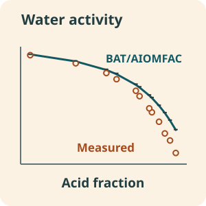
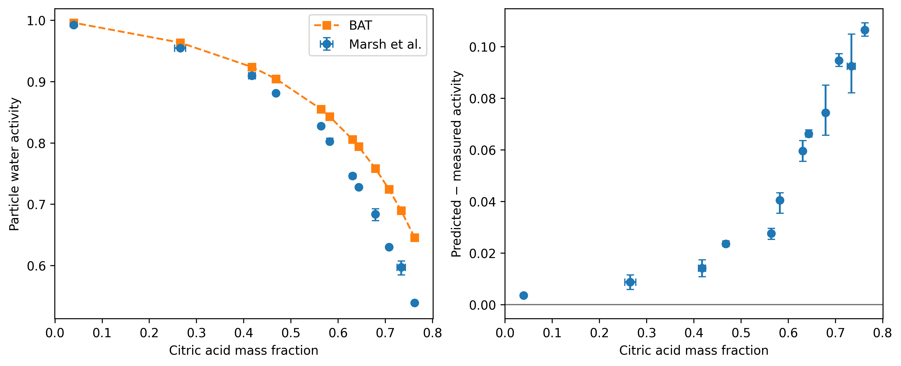

# BAT and AIOMFAC both overpredict water activity at all 12 measured citric acid concentrations



For aqueous citric acid at 293.15 K, BAT and AIOMFAC predict higher water activity than Marsh et al. measured at all 12 compositions. At the highest citric acid mass fraction, 0.76226, the measurement gives **0.539**, BAT **0.645**, and AIOMFAC **0.647**. The two models agree within 0.004 in water activity across the measured compositions. BAT was fitted to AIOMFAC predictions, so their close agreement shows how closely the reduced model follows its reference for this solution. Switching between the models leaves the discrepancy with the droplets. A fit to these measurements could reduce the discrepancy at those compositions. Independent measurements at the same temperature would show whether the revised fit transfers to other droplets. [Marsh et al., Figure S9.1 and Table S9.2](https://acp.copernicus.org/articles/17/5583/2017/acp-17-5583-2017-supplement.pdf#page=11) · [BAT parameterization](https://doi.org/10.5194/acp-19-13383-2019)

<a id="comparison-specification"></a>

## Twelve measurements constrain water activity at known compositions

Marsh and colleagues trapped individual aqueous droplets in an electrodynamic balance to determine how organic solutes affect water uptake. For citric acid at 293.15 K, their Table S9.2 pairs each water activity with a solute mass fraction and reports uncertainties in both quantities. Figure S9.1 also shows a calculated UNIFAC curve. The 12 measured pairs let us test models of equilibrium activity at the same compositions. The table gives no time series for testing how quickly a droplet approaches equilibrium. [Primary paper](https://doi.org/10.5194/acp-17-5583-2017) · [Supplement, p. 11](https://acp.copernicus.org/articles/17/5583/2017/acp-17-5583-2017-supplement.pdf#page=11) · [Data archive](https://doi.org/10.5523/bris.3eoilb28zwoqr2jifjxj7cntex)

## How closely do the models follow the measured activity curve?

We evaluated each model at the authors’ reported mass fractions, keeping the model parameters fixed. For BAT we also varied the composition over its reported uncertainty and compared the resulting activity range with the asymmetric measurement interval. For AIOMFAC we compare central values at the same compositions.

<a id="direct-activity-comparison"></a>

### BAT lies outside every measured uncertainty interval

The mean BAT prediction exceeds the measured water activity by 0.05096. None of the 12 BAT intervals overlaps its corresponding measurement interval when both axes’ uncertainties are included. Substituting Marsh et al.’s melt-density estimate of 1550 kg/m³ for the published BAT density increases the root-mean-square (RMS) error from 0.06160 to 0.06727. BAT represents the organic with a reduced set of descriptors. Its original activity fit used 298.15 K and has no explicit temperature correction. The comparison leaves the contribution of each approximation unresolved.



<a id="aiomfac-binary-curve"></a>

### AIOMFAC closely follows BAT across the measured compositions

| Difference at the 12 measured compositions | Mean signed | RMS | Maximum absolute |
| --- | ---: | ---: | ---: |
| BAT minus Marsh | +0.05096 | 0.06160 | 0.10645 |
| AIOMFAC minus Marsh | +0.05351 | 0.06370 | 0.10855 |
| BAT minus AIOMFAC | −0.00254 | 0.00273 | 0.00376 |

At a citric acid mass fraction of 0.76226, both models have their largest residual. The measured activity is 0.53894, BAT gives 0.64539 and AIOMFAC gives 0.64749. The RMS difference between the models across all 12 points is 0.00273, compared with an RMS difference from the measurements of about 0.06 for each model. BAT’s agreement with its modeling reference therefore survives a comparison in which both disagree systematically with the droplets. [AIOMFAC curve](https://github.com/uncscode/particula/blob/92615153d2dc0b191d349fe928d13927e0f6b2de/docs/data/thermodynamics/aiomfac-web315-citric-acid.csv) · [BAT model development](https://doi.org/10.5194/acp-19-13383-2019)

<a id="handoff"></a>

## Independent composition data could test a revised fit

For these droplets, adopting the full AIOMFAC calculation in place of BAT leaves the sign and most of the magnitude of the activity error intact. A useful next test would fit BAT on selected citric acid compositions and compare the revised and original predictions against independent composition–activity measurements at 293.15 K. A smaller residual at those independent compositions, particularly in the concentrated solution where the current error is largest, would support transferring the revised fit.

## Reproduce the activity curves and equilibrium checks

The BAT inputs follow the published citric acid curve in Figure 2b, with water/organic molar mass ratio 0.0938, O:C 1.16667, organic density 1469.184958 kg/m³ and the hydroxyl-equivalent fit. An inverse composition root reproduced the prescribed activities to within 1.5 × 10⁻¹³ for both density choices. [BAT Figure 2b](https://doi.org/10.5194/acp-19-13383-2019)

McGill's AIOMFAC-web 3.15 evaluated a single liquid phase at 293.15 K with water and predefined neutral Citric_acid (component 505). We supplied the temperature and citric acid mass fractions recorded in the [52-point curve](https://github.com/uncscode/particula/blob/92615153d2dc0b191d349fe928d13927e0f6b2de/docs/data/thermodynamics/aiomfac-web315-citric-acid.csv). The grid spans 0 to 0.975 in steps of 0.025 and includes the 12 exact experimental compositions. The output water activity is the water mole-fraction activity `a_x(01)`. All component flags were zero. [McGill calculator](https://aiomfac.lab.mcgill.ca/model.html) · [AIOMFAC parameterization](https://doi.org/10.5194/acp-11-9155-2011)

The [executable comparison](citric_acid_hygroscopicity.py) integrates water exchange against a fixed vapor reservoir from initial water-to-solute mass ratios of 0.05 and 80. In the flat-surface limit, doubling the end time from 2000 to 4000 s and tightening the relative tolerance from 10⁻⁷ to 10⁻⁹ met the 0.0001 endpoint activity criterion. The finer runs recovered the imposed activities within 3.4 × 10⁻¹⁵ and independent root mass fractions within 8.0 × 10⁻¹⁴. The terminal states check equilibrium. The chosen dry radius and diffusivity control the simulated timescale.

At the measured water activity closest to 0.75 (0.74592), the example also runs the native isothermal condensation process with a fixed water reservoir, transition-regime transport and finite-radius Kelvin pressure. Both initial droplets approach a citric acid mass fraction of 0.69009270. The independently solved Kelvin-corrected equilibrium gives the same result within 1e-6. Native output recording spans a 10 s checkpoint, and the resumed particle masses at 2000 s equal those from uninterrupted continuation.

From the repository root in a Particula environment with Matplotlib, run the comparison with Python 3.12 or later. It reads the measurement CSV, prints the principal metrics and plots the activity and residuals.

```bash
python docs/studies/literature/particle-water-uptake/citric-acid/citric_acid_hygroscopicity.py
```

On a headless machine, the following command saves the figure from the repository root.

```bash
MPLBACKEND=Agg python - <<'PYTHON'
from runpy import run_path

example = run_path("docs/studies/literature/particle-water-uptake/citric-acid/citric_acid_hygroscopicity.py")
figure = example["plot_results"](example["simulate"]())
figure.savefig("citric-acid.png", dpi=150)
PYTHON
```

A maintainer-side clean installation of revision `01755e91ce` reproduced the two-panel figure and the reported bias and RMS error using Python 3.14.8, NumPy 2.5.5, SciPy 1.18.1, Warp 1.19.0 and Matplotlib 3.11.2. Only the editable Particula checkout and Matplotlib were requested from pip.

To rebuild the saved figure and data in the documentation development environment, run `python scripts/docs_examples.py refresh citric-acid-hygroscopicity`. The downloadable example includes the measurement CSV.

Marsh et al.’s Table S9.2 is reproduced under [CC BY 3.0](https://creativecommons.org/licenses/by/3.0/) with normalized column headings. The CSV retains the published numerical values.
