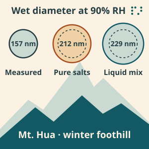
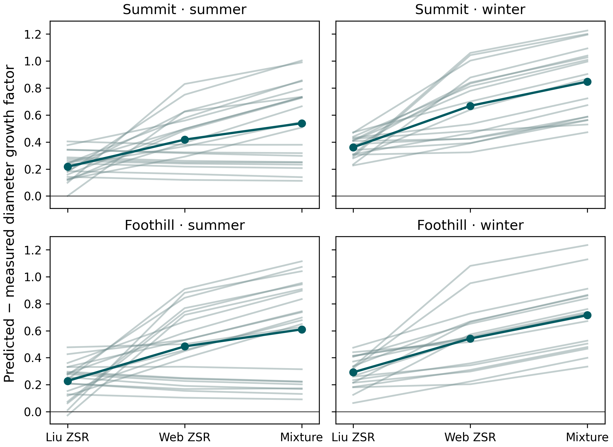

# Liquid salt mixing widens the winter foothill growth-factor bias at Mt. Hua from +0.54 to +0.72

Would interactions among dissolved salts bring the predicted water uptake of Mt. Hua aerosol closer to the measurements? Wang et al. measured humidified diameters of 100 nm dry particles made from inorganic extracts. For 18 winter foothill samples at 90% relative humidity, adding the volumes of water taken up by the pure salts gives a mean growth-factor bias of **+0.292** using literature inputs. Switching to AIOMFAC pure-salt inputs raises the bias to **+0.542**. Allowing those same ions to mix in one liquid raises it again, to **+0.716**. The positive bias means the predicted wet particles are too large. The mixing step increases mean bias in all four site and season groups. This comparison holds the reconstructed neutral inventory fixed, making dry volume and the fraction actually dissolved priorities for an independent measurement. [Wang et al., Figure 8](https://doi.org/10.5194/egusphere-2026-6766) · [Paired sample residuals](../../../../../website/public/study-data/mt-hua/sample-growth.csv)

## How water uptake varied between the summit and foothill

Wang and colleagues sampled water-soluble material at the summit and foothill of Mt. Hua in summer and winter. They separated inorganic and organic fractions and measured the humidified diameter of re-atomized particles. Diameter growth factor is the humidified diameter divided by dry diameter. Their Figure 8 compares the inorganic measurements with growth reconstructed from pure salts. Each extract has measured ion concentrations, while its salt pairings and dry volume must be inferred. The analysis below asks how far those inferences can move the comparison. [Wang et al., Figure 8](https://egusphere.copernicus.org/preprints/2026/egusphere-2026-6766/egusphere-2026-6766.pdf#page=17)

## How far can neutral salt pairing and liquid mixing move the predicted diameter?

### Counterion availability limits how much dry material enters the calculation

Each workbook sheet has distinct dates for bulk-extract chemistry and the subset measured after inorganic/organic separation. Matching by site and timestamp gives 40 observations at each site. Salt reconstruction uses eight measured bulk-extract ions. Wang et al. checked recovery for nitrate and sulfate in three samples. Fractionation adds uncertainty when applying bulk chemistry to the separated fractions. Our reduced mixture uses ammonium and sodium with sulfate, nitrate and chloride. The expanded reconstruction also includes potassium, calcium and magnesium. Ion identity and concentration come from the measurements. Neutral molecules, crystal densities and aqueous activity are modeling assumptions. [Wang and Li, CC BY 4.0 data](https://doi.org/10.5281/zenodo.23855218) · [Supporting information](https://doi.org/10.5194/egusphere-2026-6766-supplement)

We convert concentrations to charge equivalents and scale down the excess-charge side proportionally until the two sides balance. The central assignment distributes each cation in proportion to the available anion equivalents. The expanded reconstruction retains, on average, 62% and 77% of measured ion mass at the summer and winter summit, and 72% and 68% at the foothill. Material without a measured counterion contributes neither dry volume nor water in this calculation. The conclusion concerns the neutral subset. Acid sulfate, hydrates, other counterions, retained organics, phase state and nonideal mixing could change the answer.

### The summer summit bias agrees, while winter foothill predictions grow too much

The expanded mixture gives a mean summer summit growth-factor bias of +0.215, close to the authors’ +0.21. At the winter foothill, our proportional reconstruction gives +0.289, compared with their +0.02. Even letting each winter foothill sample choose the pairing that minimizes its own growth leaves a mean bias of +0.184. These signed differences use a dry mobility diameter of 100 nm. A growth-factor difference of 0.184 corresponds to about 18 nm of humidified diameter.

| Site and season | Measured samples | Reduced / expanded cases | Reduced mean bias | Expanded mean bias | Expanded extrema of mean bias | Authors’ expanded bias |
| --- | ---: | ---: | ---: | ---: | ---: | ---: |
| Summit, summer | 22 | 19 / 21 | +0.270 | +0.215 | +0.188 to +0.256 | +0.21 |
| Summit, winter | 18 | 18 / 18 | +0.416 | +0.358 | +0.264 to +0.431 | +0.10 |
| Foothill, summer | 22 | 22 / 22 | +0.289 | +0.226 | +0.179 to +0.273 | +0.11 |
| Foothill, winter | 18 | 18 / 18 | +0.319 | +0.289 | +0.184 to +0.376 | +0.02 |

Group means use all available cases for that reconstruction. The interval gives the extremes when samples can choose different pairings. It describes structural sensitivity at fixed inputs. The original Figure 8 describes variability across samples. [Wang et al., Figure 8](https://egusphere.copernicus.org/preprints/2026/egusphere-2026-6766/egusphere-2026-6766.pdf#page=17)

### Pairing uncertainty can be bounded without fitting the growth measurements

We use the 15 neutral-salt hygroscopicities in Liu et al., Table 2, and nominal anhydrous dry densities tabulated in the script. For each available sample and salt set, 720 allocation orders explore chemical pairing. Two linear-fractional optimizations give the exact minimum and maximum dry-volume-weighted κ at the fixed balanced inventory. Positive dry volumes and monotonic growth in κ carry those extrema through to the diameters. All allocations conserve the supplied balanced ion equivalents. [Liu et al., Table 2](https://doi.org/10.5194/acp-14-2525-2014)

The GPU evaluates Particula's κ water activity and Kelvin correction at a prescribed temperature of 298.15 K. Bisection locates the zero-flux endpoint at 90% relative humidity for each allocation. The independent CPU root agrees within 1e-11 in growth factor for the 15 pure salts and each central mixture. Every soluble CUDA solution recovers the prescribed RH to within 1e-11. An insoluble pure salt retains its dry diameter.

Seven of the 79 expanded reconstructions enclose the measured growth factor. For the other 72 the entire pairing range lies above the measurement. The remaining sample contains measured anions and zero reported cations, so this method cannot reconstruct it. [Runnable comparison and figures](mt_hua_salts.py)

### Liquid-mixture activity increases the winter foothill discrepancy

**All 72 original overpredictions persist.** With one homogeneous aqueous phase, AIOMFAC also overpredicts the other seven reconstructable growth factors. The winter foothill mean bias rises from +0.292 with the authors’ ZSR equation and our pure-salt inputs to **+0.716** with the full mixture. The paper reports +0.02. Liquid nonideality at this fixed neutral composition moves the prediction away from the measurements. [Paired sample predictions and activity tables](mixture_activity.py)

| Site and season | Samples | ZSR, literature pure-salt inputs | ZSR, AIOMFAC pure-salt inputs | Full AIOMFAC mixture | Full minus AIOMFAC-pure ZSR |
| --- | ---: | ---: | ---: | ---: | ---: |
| Summit, summer | 21 | +0.217 | +0.418 | +0.539 | +0.122 |
| Summit, winter | 18 | +0.361 | +0.668 | +0.848 | +0.180 |
| Foothill, summer | 22 | +0.228 | +0.484 | +0.610 | +0.126 |
| Foothill, winter | 18 | +0.292 | +0.542 | +0.716 | +0.173 |

The first three result columns are mean predicted minus measured diameter growth factors. Applying the same volume-additive ZSR equation to the 15 AIOMFAC pure-salt controls separates the change of pure-salt reference from the additional effect of mixing. At the winter foothill the two changes are +0.250 and +0.173. The +0.289 bias in the earlier comparison used a volume-weighted κ before solving for growth. The +0.292 value applies Equation 5 directly to the pure growth factors.

We submitted the same proportionally charge-balanced dry mass inventory used above, including divalent-ion stoichiometry. All 94 compositions have 33 web calculations at 298.15 K over water-to-dry mass ratios of 0.35–30. The downloadable inputs preserve each form submission, the server’s input and output text, the version (**AIOMFAC-web 3.15**) and flags. Particula interpolates water activity linearly in log mass ratio, adds water volume at 997 kg m⁻³ to the same anhydrous dry volume, and solves the Kelvin-corrected equilibrium for the same 100 nm dry diameter and 90% RH. Every composition brackets one increasing equilibrium crossing with unflagged endpoints. Halving the table resolution changes sample growth factors by less than 0.017. CPU root finding independently reproduces the GPU values. A separate web submission at 15% NaCl by mass gives water activity 0.891330, reproduced by interpolation within 0.001. The saved output includes the activities, sample identifiers, measured growth, both paired residuals and interpolation sensitivity. [AIOMFAC-web conventions](https://www.aiomfac.lab.mcgill.ca/help.html)

## Recover the dry volumes and dissolved calcium and sulfate

The authors’ sample-specific salt volumes and pure-salt growth factors would allow their Figure 8 to be replayed with the same inputs. The matched pure-salt controls show why this matters. At the winter foothill, changing the pure-salt reference adds +0.250 to the mean growth-factor bias. Mixing the same ions in a single liquid adds a further +0.173. All four site and season means move toward greater overprediction, though the change varies by extract. The full mixture assumes that even sparingly soluble calcium sulfate remains dissolved. Independent measurements of dry volume, counterion balance and the dissolved calcium and sulfate fractions would constrain the inventory and phase state that both calculations assume. [Original Figure 8 and supplement](https://egusphere.copernicus.org/preprints/2026/egusphere-2026-6766/)

## Reproduce the comparison

Run `python scripts/docs_examples.py refresh mt-hua-salts` on a CUDA machine. Run `python scripts/docs_examples.py replot mt-hua-salts` to redraw the figures from the saved numerical output. The example bundle includes the matched composition table and measured growth factors. The archived source workbook has SHA-256 `62ffa071a9e765f354d08f8995388009230807ce83cfc9843826079f6678dc54`. The CSV reproduces the authors’ Summit and Foothill sheets by joining column P to column A, using column Q for growth and columns G, F, H, J, I, E, D and C for ions in µg m⁻³. This independent automated Particula analysis used the public preprint and its first data deposit.

Run `python scripts/docs_examples.py refresh mixture-activity` on CUDA for the paired liquid-mixture controls using the saved AIOMFAC-web inputs.

The CSV tables give [sample residuals](../../../../../website/public/study-data/mt-hua/sample-growth.csv), [water activity versus water-to-dry mass ratio](../../../../../website/public/study-data/mt-hua/water-activity.csv) and [dry salt assignments and pure-control growth factors](../../../../../website/public/study-data/mt-hua/dry-composition.csv). Each mixture identifier joins the activity table to the sample results or a named pure control.
