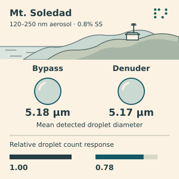
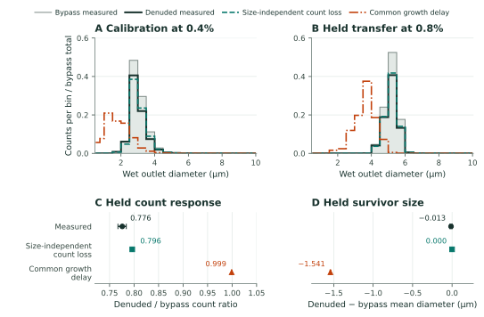
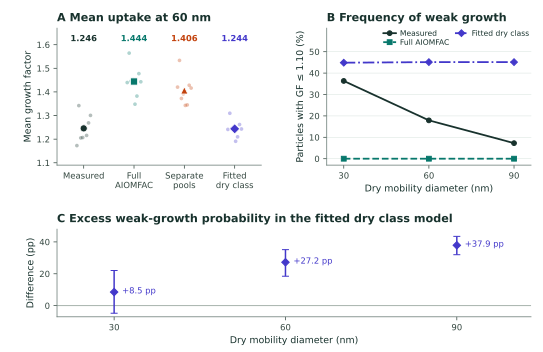

# At Mt. Soledad, the denuded path counted fewer droplets of nearly unchanged mean size

Removing trace gases can change the diameter at which a coastal aerosol particle activates as a cloud droplet. Ravichandran and colleagues observed that gas removal could either raise or lower the hygroscopicity inferred from activation. Their Mt. Soledad records also contain a count deficit among particles large enough to activate on both paths. For 120–250 nm particles at 0.8% supersaturation, the charcoal-denuded path recorded **22.4% fewer droplets per reference particle count** than the bypass across seven reserved dates. The droplets the instrument detected averaged 5.169 µm through the denuder and 5.182 µm on bypass. In our simulations, a common growth delay fitted at 0.4% predicted a diameter decrease of 1.54 µm at 0.8%, compared with 0.013 µm measured. An analysis of a separate instrument record exposed a similar ambiguity below saturation. Assigning 45% of particles to a nearly dry class reproduced the mean growth of 60 nm particles on eight reserved filter dates, yet only 18% grew by 10% or less. The outlet spectrum and the distribution of water uptake each expose an incorrect prediction hidden by an average.

## Gas removal followed mobility selection in the coastal experiment

Ravichandran and colleagues asked whether the surrounding gases change how readily an ambient particle forms a cloud droplet. Removing gases can allow semivolatile material to evaporate from the particle, or prevent soluble gases from entering it as it takes up water. At Mt. Soledad, California, the authors dried the ambient aerosol and selected particles by electrical mobility before removing gases. Successive scans sent the selected particles through an activated-charcoal denuder or a bypass into the same cloud condensation nuclei (CCN) counter. The humidity probe was upstream of the classifier. A condensation particle counter (CPC) on a common parallel line measured changes in particle supply. Neither branch had a downstream total-particle count. [Original article and instrument diagram](https://pmc.ncbi.nlm.nih.gov/articles/PMC12802841/) · [CCN measurement archive](https://doi.org/10.6075/J0KH0NHG)

The authors inferred hygroscopicity, κ, from the activation diameter. In their pooled 0.4% and 0.6% supersaturation data, activation occurred around 63 ± 10 nm. The median relative κ difference was near zero in the first period. Denuding increased inferred κ in the second period and decreased it in the third. The authors showed why both directions matter. Evaporation of soluble material can explain a decrease in κ, but denuding sometimes increased κ at low inlet humidity. They discussed changes at the particle–air interface as one possible explanation. We asked where the change appeared in the paired size spectra. A shift of the activation threshold changes counts most strongly near that threshold. A deficit among much larger seeds also depends on what the counter detects after activation. We restricted the comparison to May and June 2023 after some April reconstructions gave more than 100 times as many CCN as reference particles in the same size window. The authors also flagged an April malfunction. This calendar exclusion followed inspection of the records. [Original Figure 1 and methods](https://pmc.ncbi.nlm.nih.gov/articles/PMC12802841/) · [April instrument record, Fig. S5](https://www.science.org/doi/suppl/10.1126/sciadv.adx0960/suppl_file/sciadv.adx0960_sm.pdf) · [Sample selection](../../../../../studies/mt-soledad/evidence/README.md)

## Droplet counts and sizes test explanations for the denuder response

### A threshold shift missed the large-particle count deficit

We first fitted an effective κ on the 0.4% training scans and transferred it to 0.6% on 21 reserved dates. Across 30–360 nm, the measured denuded-minus-bypass difference was −183 CCN/cm³. Allowing denuded κ to vary with inlet humidity predicted −161 CCN/cm³. The size spectra showed where that apparent agreement broke down. In the 120–250 nm band, the measured concentrations were 223 CCN/cm³ through the denuder and 283 CCN/cm³ on bypass. The humidity-dependent κ calculation predicted a difference of just −0.3 CCN/cm³ in this band, where most particles were already large enough to activate. [Integrated counts](../../../../../studies/mt-soledad/evidence/integrated-counts.csv) · [Large-particle counts by date](../../../../../studies/mt-soledad/evidence/large-seed-date-means.csv)

### Uniform slowing shifted the optical spectrum too far toward small droplets

For each path, we summed the droplets recorded in the outlet optical size channels, converted the count to a concentration with the sampled volume, and divided by the coincident CPC concentration. The reported count ratio is this normalized response on the denuded path divided by the same response on bypass. A value of 0.8 therefore means 20% fewer optically detected droplets for the same reference particle signal. The one-second records also preserve each detected droplet’s wet-size channel. We assigned those records to mobility-selected seed sizes after accounting for the longer transport time through the denuder. At 0.8%, the ratio was **0.776** (95% date-bootstrap interval 0.767–0.784) across 47 paired cycles on seven reserved dates. The denuded-minus-bypass change in mean detected wet diameter was **−0.013 µm** (−0.029 to +0.003 µm). A broader processed record on 21 reserved dates gave a count ratio of 0.798 (0.790–0.805). The optical subset supplies the stronger constraint on growth because it retains the wet-size distribution. [Optical scores by date and observable](../../../../../studies/mt-soledad/evidence/optical-controls.csv) · [Processed counter comparison](../../../../../studies/mt-soledad/evidence/processed-counter.csv)

**Figure 1. The count response and outlet sizes test different consequences of a growth delay.** A and B show 120–250 nm mobility-selected seeds. Each optical channel is expressed relative to the bypass total in the same window. The count-loss model multiplies every wet-size channel by the same fraction. The delay model shortens every droplet’s growth time and counts only the droplets still above the optical threshold. Both were fitted to the total count at 0.4% and transferred to 0.8%. C and D summarize the denuded/bypass count ratio and denuded-minus-bypass mean diameter among detected droplets at 0.8%. Whiskers show 95% date-bootstrap intervals, conditional on the training parameters for the models. [Plotted spectra](../../../../../studies/mt-soledad/figures/optical-spectrum.csv) · [Summary values](../../../../../studies/mt-soledad/figures/optical-summary.csv)

We applied two mechanisms to the measured bypass spectrum in each six-hour window. At 0.4%, each reproduced the training count ratio of 0.796. A uniform growth delay of 1.60 s pushed some droplets below the assumed optical detection floor. A size-independent loss instead removed 20.4% of the optical response at every wet size. The mechanisms diverged at 0.8%, where the bypass droplets were larger. With the delay fixed, almost all modeled droplets remained detectable. The count ratio rose to **0.999**, while the mean detected diameter fell by **1.541 µm**. With the same loss fraction, the predicted ratio remained **0.796** and the mean diameter stayed unchanged. The measured ratio of **0.776** and diameter change of **−0.013 µm** were much closer to the latter predictions. Fitting the entire training spectrum gave a shorter common delay of 0.020 s, which preserved wet sizes but also predicted nearly equal counts. [Fitted delay and count-loss parameters](../../../../../studies/mt-soledad/evidence/optical-training.csv) · [Held optical spectra](../../../../../studies/mt-soledad/figures/optical-spectrum.csv)

Similar outlet sizes have a physical explanation. Soluble salts can lower a seed’s critical supersaturation enough for it to activate early in the column. Once activated, droplets exposed to similar water-vapor supersaturations for similar residence times can approach similar wet diameters despite differences in seed composition. Water-vapor depletion and differences in activation time can alter that growth. The outlet diameters alone therefore cannot establish that salt dominated either the seeds or their activation. [Continuous-flow CCN chamber growth and water-vapor supply](https://doi.org/10.1080/02786826.2010.551146)

The optical record constrains the droplets that entered the counter’s illuminated sampling volume and produced a detectable signal. A model in which 21% of particles experienced a much longer delay gave a held count ratio of 0.789 and changed the mean detected diameter by less than 0.001 µm. A particle lost on the path, a droplet that failed to reach a detectable size, and a droplet that passed uncounted each leave no measured diameter. The common CPC cannot distinguish these fates. Raising the assumed optical floor from 0.50 to 0.65 µm still gave a 1.49 µm predicted decline for the common delay. [Selective-delay fit and detection-floor sensitivity](../../../../../studies/mt-soledad/evidence/optical-controls.csv) · [Optical extraction and calibration](../../../../../studies/mt-soledad/README.md)

### Chemistry predicted too much growth below saturation

Could the chemistry that makes a seed easy to activate also predict how much water it took up before activation? This gives a second test of the paper’s chemical interpretation. The gas-removal comparison measures a change between paths. Here the target is the ambient aerosol’s growth below saturation and its activation on bypass. A separate instrument measured wet-to-dry diameter ratios, or growth factors, for 30, 60 and 90 nm particles at nominal 85% relative humidity, sampling the sizes sequentially. This gave us a water-uptake measurement independent of the κ inferred from CCN counts. We first used measured sulfate, nitrate, ammonium, chloride and organic mass, together with filter functional groups, to construct candidate particle recipes. We fixed those inventories before calculating either growth or the bypass activation threshold. AIOMFAC calculated water activity when the measured ions and candidate organic molecules shared one solution. We used that water activity and droplet curvature to predict wet diameter at 85% relative humidity and the dry diameter needed for activation. Unidentified organic material stayed dry in the primary recipe. A matched control kept the same inventory but let the salts and organics hydrate in separate pools at common water activity. Comparing both predictions with growth and activation tests whether the modeled interactions improve agreement across the two humidity regimes. The recipes and their activities were determined without fitting κ to either response. PM₁ chemistry represents all particles below 1 µm, so applying its proportions at a particular dry size is an assumption. [Growth measurements](https://doi.org/10.6075/J08G8KWG) · [Filter chemistry](https://doi.org/10.6075/J06W9B8D) · [Aerosol mass spectra](https://doi.org/10.6075/J0WM1DSC) · [Water-activity calculation](../../../../../studies/mt-soledad/source/field-mixtures/chem/thermo.py)

On eight reserved PM₁ filter dates, the measured mean 60 nm growth factor was **1.246**. Full AIOMFAC predicted **1.444**, and the separate-pool control predicted **1.406**. Including organic–ion interactions increased mean absolute error by 0.038 (paired 95% date-bootstrap interval 0.024–0.052). Independent salt standards also grew less than the nominal calculation. Applying the apparent humidities inferred separately from the two salts reduced the absolute full-model error from 0.198 to 0.106–0.141. Neither salt establishes the humidity experienced by the ambient mixtures. On the three dates with <180 nm filters, both activity models also overpredicted growth at all three sizes. Particle composition, salt phase and humidification history therefore limit a field test of the activity model. [Held growth scores and date contrasts](../../../../../studies/mt-soledad/evidence/growth-contrasts.csv) · [Small-filter cases](../../../../../studies/mt-soledad/evidence/small-filter-growth.csv) · [Pure-salt reference measurements](../../../../../studies/mt-soledad/evidence/salt-standards.csv)

**Figure 2. A fitted dry fraction matched mean growth while putting too many particles in the low-growth tail.** A shows individual held filter dates and their equal-weight mean at 60 nm. B shows the fraction with a wet-to-dry diameter ratio of 1.10 or less at nominal 85% relative humidity. C shows the fitted model’s excess probability in percentage points, with 95% intervals resampling whole training and held filters. Each dry size was sampled at a different time within the six-hour window. [Plotted filter values](../../../../../studies/mt-soledad/figures/growth-by-filter.csv) · [Interval estimates](../../../../../studies/mt-soledad/figures/growth-intervals.csv)

We then tested whether a fixed fraction of particles taking up almost no water could account for the discrepancy. Fitting that fraction at 60 nm on 11 training filters gave 0.451. On the eight reserved filters the model predicted a mean of 1.244, within 0.002 of the measured mean. It also predicted that **45%** of the particles at both 60 and 90 nm would have growth factors at or below 1.10. The time-averaged measured number distributions put **18%** and **7%** below that threshold. At 60 nm the model’s excess low-growth fraction was 0.27, with a 95% whole-filter resampling interval of 0.185–0.352. The observed width and size dependence of water uptake are incompatible with this particular fixed fraction. A contrast between nearly dry and fully growing particles at 85% RH describes a different population and experiment from any undetected subset at the CCN outlet. [Held growth distributions and fitted fraction](../../../../../studies/mt-soledad/evidence/near-dry-class.csv) · [Whole-filter resampling](../../../../../studies/mt-soledad/figures/growth-intervals.csv)

The bypass activation curve was less sensitive to how the organics and salts shared water. On 16 chemistry-matched windows across eight reserved dates at 0.8%, the mean measured half-height diameter was 45.17 nm and the width from 25% to 75% of the high-diameter response was 14.56 nm. With the instrument response fixed from 0.4%, separate hydration moved the uniform-mixture midpoint from 43.90 to 44.07 nm. Redistributing the same measured inventory between organic-rich and salt-rich particles gave a midpoint of 44.76 nm and a width of 14.28 nm, while the predicted subsaturated growth remained too high. Agreement with the average activation curve therefore leaves considerable latitude in the particle-level distribution of water. [Activation midpoints, widths and window errors](../../../../../studies/mt-soledad/evidence/activation.csv)

### A film on a subset can preserve the size of surviving droplets

The original paper considered whether interfacial effects could change the supersaturation required for activation. Here the film calculation tests a different consequence of surface material. An organic layer that resists the passage of water can slow condensational growth after a particle encounters supersaturation. As the droplet expands, the same surface material has a larger area to cover. The modeled resistance persists only if enough organic material remains available at the interface. The two central recipes fitted to functional-group measurements required no long-chain alcohol on any of the three small-particle filter dates. Under the reported group uncertainties, the June 10 filter also permitted as much as 36% of its organic mass to be assigned to a C16 alcohol proxy. With that upper-bound inventory made available to every particle from an internal reservoir, the modeled count ratio was 0.419 at reference growth exposure and the detected droplets averaged 3.01 µm. Concentrating the same inventory on a subset gave 0.638 and 5.18 µm. In the subset case, droplets on less hindered particles continued to grow and dominated the detected spectrum. Their mean size remained close to the measured 5.17 µm, although the predicted count ratio was below the observed 0.776. None of the seven qualifying small-filter windows coincided with a qualifying large-seed outlet spectrum. These calculations bound the consequences of an assumed film distribution. The composition of the missing droplets remains unknown. [Chemical inventory bounds](../../../../../studies/mt-soledad/evidence/c16-bounds.csv) · [Film exposure and outlet predictions](../../../../../studies/mt-soledad/evidence/june-film.csv)

## The detected droplets constrain how the count could fall

Ravichandran and colleagues showed that removing gases could either raise or lower apparent hygroscopicity near the activation threshold. The May–June records reveal a further response at larger seed sizes. Here even a uniform delay large enough to fit the training counts left nearly every droplet detectable at 0.8% and shifted their sizes much farther than observed. The measurements favor explanations that reduce how many droplets are counted while preserving the size distribution of those that remain. Particle transmission, counting efficiency and delayed growth below the optical floor remain indistinguishable in these records. Soluble salts could have enabled early activation of the detected particles, but their final wet sizes cannot identify the material that initiated growth.

Below saturation, independently constrained chemical recipes overpredicted mean water uptake. A fitted nearly dry fraction reproduced the mean while putting too many particles in the measured low-growth tail. For this campaign, an explanation of the branch response must account for which seed sizes contribute to the change, how many droplets the instrument counts, and the wet sizes of those it detects. These results constrain the large-seed count deficit under the tested conditions. The molecular cause of the original low-humidity increase in inferred κ remains open.

## Reproducibility

The optical transfer used 26 training windows on 12 dates at 0.4% and 16 test windows on seven dates at 0.8%, supplying each test window’s bypass spectrum. The growth transfer used 19 test windows on eight PM₁ filter dates. Whole dates or filters were resampled to retain dependence among scans. The intervals describe within-campaign variability and omit calibration drift, uncertainty in the optical floor and possible differences between bulk and mobility-selected composition. Date assignments were interleaved and parts of this campaign had been examined in earlier analyses. [Optical selection, fits and reproduction](../../../../../studies/mt-soledad/source/mechanisms/droplets/models.py) · [Growth windows, field comparisons and verification](../../../../../studies/mt-soledad/README.md)

The chemistry calculations used the pinned Particula 0.3.5 checkout with Particula-AIOMFAC 0.1.4, float64 CUDA on an NVIDIA GeForce RTX 5060, and CPU reference calculations. Mixture comparisons preserved dry inventories and used 64 filter-correlated chemistry draws per window and recipe. Doubling the water-volume grid changed the 85% RH, 60 nm growth factor by at most 0.000204 and the higher-setting activation threshold by at most 0.000368 nm. The retained scripts, compact predictions and input hashes document each calculation from the source measurements. [Chemical model and replay](../../../../../studies/mt-soledad/source/field-mixtures/chem/thermo.py) · [Primary field paper](https://doi.org/10.1126/sciadv.adx0960)

The [worked calculation](droplet_response.py) reconstructs the normalized optical comparison. The [simulation and figure guide](../../../../../studies/mt-soledad/README.md) traces the measurements, fits, AIOMFAC runs and figures. The [numerical evidence tables](../../../../../studies/mt-soledad/evidence/README.md) retain the reported cases and define the units and uncertainty.
