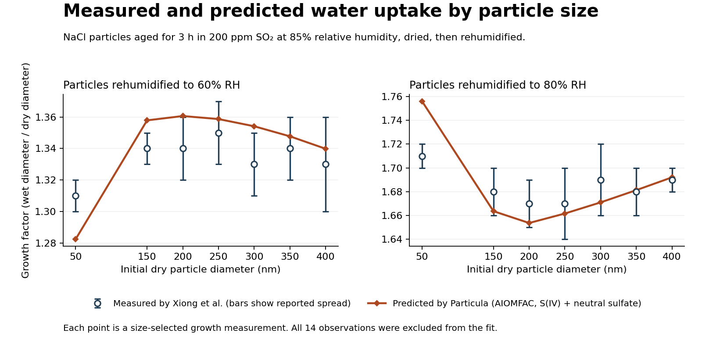
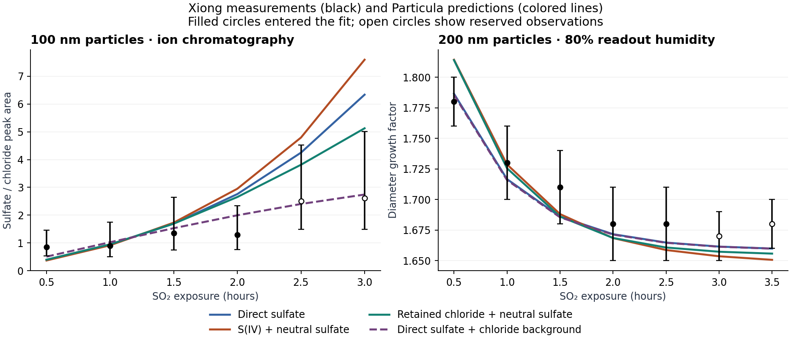

# Two reaction pathways fit water uptake in SO₂-aged sea salt

Water uptake in SO₂-aged salt admits two different reaction histories. Xiong and colleagues exposed salt particles to sulfur dioxide under UV light, then measured how much water the particles absorbed. We compared their growth and ion measurements with 13 models of sulfur uptake and reaction. After three hours, 200 nm particles rehumidified to 80% relative humidity had grown to 1.67 ± 0.02 times their dry diameter. Two models gave nearly the same prediction, 1.65 and 1.66, for this observation withheld from fitting. The direct model takes up oxidized sulfur as sulfuric acid and retains some unreacted chloride. The parallel model adds a second route in which captured SO₂ forms particle bisulfite before oxidation. After 30 minutes at 100 nm, the direct model predicts zero particle sulfur(IV) and the parallel model predicts 0.045 mol per mole of initial sodium. Measuring sulfur oxidation state at that point would distinguish the two fitted reaction histories.

## What Xiong’s microscope established

Xiong et al. deposited size-selected NaCl particles, exposed them to UV light and 200 ppm SO₂ at 85% relative humidity (RH), then dried and rehumidified them. They inferred the ratio of wet to dry diameter from the light scattered by each particle. With increasing exposure, particles took up more water below the humidity where NaCl dissolves and less water above it. The authors used pure NaCl and sodium bisulfate (NaHSO₄) growth factors and the Zdanovskii–Stokes–Robinson volume-mixing rule to infer the decline in dissolved NaCl concentration. Our reconstruction gave 0.653 h⁻¹ at 100 nm against their reported 0.6523 h⁻¹, and recovered the maximum near 200 nm. The authors interpreted the size maximum in terms of surface curvature and available surface area. Their water-uptake and chromatographic measurements also let us ask which chemical inventories could produce that same optical signal. [Xijie Xiong et al. (2026), Figs. 2–6](https://acp.copernicus.org/articles/26/12183/2026/) · [Reference fits](pathway-checks.md)

## How reaction products change water uptake

Each candidate received the same exposure. We tracked its sodium, chloride and sulfur, then used the AIOMFAC activity model to calculate how the dissolved ions change water uptake and bisulfate dissociation. We used the measured pure-salt growth factors to anchor the optical calculation. At 80% RH the uncorrected liquid model gave a growth factor of 1.766 for sodium bisulfate, compared with 1.658 measured. At lower readout humidities we also allowed salt components to take up water separately, because a particle that has dried can retain solid salt. [Activity model, pure-salt controls and optical assumptions](pathway-checks.md)

The candidate reactions conserve atoms while allowing sulfur uptake, oxidation, neutral sodium sulfate (Na₂SO₄) formation and chloride loss. In the diagram, H₂SO₄ represents delivery of already oxidized sulfur to the particle. The fit leaves the location and oxidant for that conversion open. Automatic differentiation supplied the gradients for fitting rate parameters within each candidate. We fitted 144 growth factors across particle sizes, together with the first four sulfate-to-chloride peak ratios measured at 100 nm. We reserved 156 growth factors across humidity, size and exposure time. The paper’s derived sulfate concentrations also use the optical measurement to estimate particle volume, so agreement with those concentrations supplies only a partial chemical check. [Pathways and fitting assumptions](pathway-checks.md)

### Neutral sodium sulfate improves the optical fit, while the sulfur intermediate remains unresolved

| Candidate treatment | Error in reserved growth factors¹ | Predicted S(IV) at 30 min² |
| --- | ---: | ---: |
| Direct formation of sodium bisulfate | 0.0343 | 0 |
| Direct formation followed by neutral sodium sulfate formation | 0.0295 | 0 |
| Parallel direct and S(IV) uptake routes, with neutral sulfate formation | 0.0266 | 0.045 |
| Direct sulfate route with retained chloride and neutral sulfate formation | 0.0267 | 0 |

¹ Root-mean-square error in the dimensionless wet-to-dry diameter ratio across the 156 reserved observations. ² Moles of sulfur in oxidation state +4 per mole of initial sodium in a 100 nm particle exposed to 200 ppm SO₂ at 85% RH. [Calibration and numerical sensitivity](pathway-checks.md)

The growth data favor allowing neutral sulfate to form more clearly than they determine how fast it forms. In Na₂SO₄, two sodium ions accompany each sulfate, changing how much sulfur corresponds to a given loss of NaCl. In the calibration with all designated fitting observations, rates between 1 and 8 h⁻¹ gave similar losses (22.2–22.6), while closing the channel raised the loss to 31.0. Restricting the fit to early high-humidity growth and early ion peaks shifted the fitted rate from 1.48 to 0.16 h⁻¹. That change increased the error on the same reserved growth measurements from 0.0295 to 0.1183. [Rate profiles](pathway-checks.md)

**Figure 1.** Circles and bars show Xiong’s measured growth factors and reported spreads. Diamonds show the Particula model with parallel sulfur uptake routes and neutral sulfate formation. All 14 three-hour observations shown here were reserved. Both panels follow the same 85%-RH reaction exposure. Their labels give the humidity at which particle diameter was subsequently measured. [Plotted measurements and predictions](https://raw.githubusercontent.com/uncscode/particula/main/docs/data/xiong-sea-spray/growth-size.csv)

Both leading models overpredicted the late sulfate-to-chloride peak ratio. At three hours, integration of the published sulfate and chloride peaks gave an area ratio of 2.62, with a graphical reading range of 1.49–5.00. The parallel model predicted 7.60 and the direct model with chloride retention predicted 5.13. The last two ion points were withheld from parameter fitting, but we had seen them before adding the retained-chloride model. A separate fit used the paper’s assumption that the two ions give equal signals per mole. In that control, direct conversion plus a fitted chloride background gave 3.82, close to 3.85 for retained chloride with zero background. A procedural blank and ion-specific recovery standards would help distinguish chloride remaining in the particle from chloride introduced during analysis. [Peak readings and chloride-background test](pathway-checks.md)

**Figure 2.** The fitted curves lie close together for water uptake (right) and diverge for the late ion peaks (left). The dashed curve includes a fitted chloride background. Filled points entered the original fit and open points were reserved. The late ion points subsequently informed the retention and background tests. The ion bars show graphical reading ranges and the growth bars show reported spreads. [Ion comparison](https://raw.githubusercontent.com/uncscode/particula/main/docs/data/xiong-sea-spray/ion-time.csv) · [Growth comparison](https://raw.githubusercontent.com/uncscode/particula/main/docs/data/xiong-sea-spray/growth-time.csv)

## Which size carries the sulfate if both pathways remain plausible?

The sizes with the fastest apparent reaction need not carry the most sulfate. Sulfate per cubic metre in equal logarithmic diameter intervals depends on particle number, initial salt mass and sulfate formed per mole of initial sodium. We applied Xiong’s laboratory exposure to three alternative number spectra from one separate artificial sea-spray experiment by Rosati et al. On the mean spectrum, a 300 nm class of spherical NaCl particles starts with 2.15 times as much sodium per diameter decade as the 200 nm class. Across 13 treatments and the three spectra, the 300 nm class was predicted to carry 1.79–2.22 times as much accumulated sulfate after three hours, even though the apparent NaCl concentration-decay rate peaked at 200 nm.

The size ranking persisted across the tested models, but the absolute sulfate amount remained sensitive to the pathway. At 300 nm on the mean spectrum, the parallel and chloride-retention models gave 29.5 and 32.7 µg SO₄ m⁻³ per diameter decade. Across all 13 treatments the range was 29.5–63.2. These are predictions for Rosati’s particle numbers under Xiong’s laboratory exposure. [Rosati et al., Fig. 2b](https://doi.org/10.1038/s41598-021-89346-6) · [From a rate to a sulfate size distribution](sulfate-by-size.md)

Both leading fits also predicted supersaturation with respect to mirabilite, a sodium sulfate hydrate, at 85% RH. If the hydrate crystallized, it could change the link between water uptake and sulfur yield. Its presence was unmeasured. [Saturation check](pathway-checks.md)

Extension to lower SO₂ is less certain. At 100 nm, scaling uptake down tenfold from 200 to 20 ppm gave ten-hour sulfate estimates of 1.59–2.62 mol L⁻¹ across the models, against the paper’s optical retrieval of 2.85 mol L⁻¹. Allowing the uptake multiplier to vary improved late predictions of NaCl decline in all six cross-dose refits. The effect on sulfate error varied by pathway. Matched sizes and sulfur exposures are needed to transfer the size ranking to marine air. [Lower-dose test](pathway-checks.md)

## A coating can explain a slower reaction, but its phase boundary is a separate test

Adding sodium octyl sulfate slowed the reaction in Xiong’s Figure 6. A model in which uptake declined with estimated hydrated shell thickness, fitted at organic volume fractions through 33%, predicted 0.166 h⁻¹ at 70% against the reported 0.157 h⁻¹. The higher-load measurements had already been inspected when we chose this comparison. A model using composition alone also came close at 0.141 h⁻¹. The shell calculation overpredicted sulfate at two hours at that same loading. Agreement on the rate alone leaves the surface coverage and permeability uncertain. [Coating rates, sulfate time course and measurement definitions](organic-coatings.md)

A separate test used the appearance of a second liquid during drying. We fitted a trial charged octyl sulfate species using binary water-activity data and ammonium sulfate microscopy. The NaCl onset measurements had been inspected previously and were excluded from this fit. At 50% dry organic volume the model predicted separation at 94.7% RH, well above the measured 84.0 ± 3.6%. At 70% it predicted 96.1% against 92.5 ± 3.9%. At 90% it predicted separation near 97%, while the microscopy showed no split before crystallization. The 85% aging humidity lies inside the measured onset spread at 50% loading and below it at 70%. These are fresh particles in a different experiment. Their visible phase onset constrains a proposed coating explanation, but transferring it to a reacting nanoscale surface would require measurements of morphology during aging. [Chun Xiong et al. (2023), Fig. 6](https://acp.copernicus.org/articles/23/8979/2023/) · [Measured and predicted phase boundaries](organic-coatings.md)

## A 30-minute sample can distinguish the two reaction histories

The most informative next measurement is S(IV), sulfate, chloride and sodium in the same 100 nm sample after 30 minutes at 200 ppm SO₂, 85% RH and the original UV exposure. The sample must preserve oxidation state through collection, with measured recovery and a chloride blank. Recovering about 0.045 mol S(IV) per mol of initial sodium would favor early sulfur capture followed by oxidation over the fitted direct route with chloride retention. A reliable upper bound well below that level would challenge the predicted intermediate pool. Either outcome would narrow the set of pathways compatible with the optical record. Measuring sulfate in the same sample would supply an independent check on yield.

## Reproducibility

The [worked comparison](compare_growth.py) reads the published plot values and checks both leading models against the same growth and ion measurements. The [source and replay instructions](https://github.com/uncscode/particula/tree/main/studies/xiong-sea-spray) cover the authors’ reference calculation, AIOMFAC, the reaction fits, the exploratory tests and figure generation. The [data inventory](https://raw.githubusercontent.com/uncscode/particula/main/docs/data/xiong-sea-spray/README.txt) identifies the five small plot tables and the original sources. The [digitized observations](https://raw.githubusercontent.com/uncscode/particula/main/docs/data/xiong-sea-spray/observations.zip) preserve the values read from figures, including graphical reading bounds where available.
