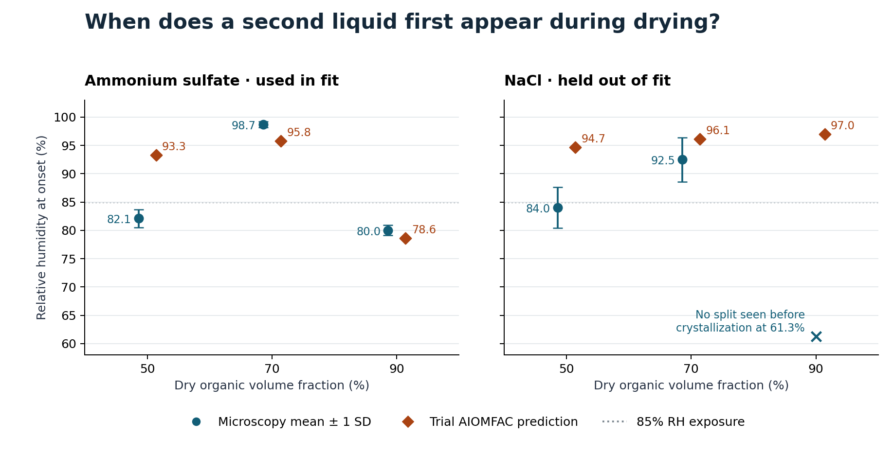

# An organic-rich particle reacts more slowly. Does it have a continuous coating?

Sodium octyl sulfate slowed the apparent NaCl reaction in Xiong’s coated-particle measurements. We tested whether a thicker hydrated coating could explain that trend and whether a trial octyl sulfate activity model could predict when a second liquid becomes visible. The rate and phase data come from different experiments. [Main analysis](index.md) · [Aging experiment, Figure 6](https://acp.copernicus.org/articles/26/12183/2026/) · [Independent microscopy, Figure 6](https://acp.copernicus.org/articles/23/8979/2023/)

## Coating thickness can account for the rate decline

A model that slows uptake as an organic shell thickens reproduced much of the apparent rate decrease. We fitted its attenuation coefficient at 5–33% dry organic volume and fixed the bare-salt baseline. At 50% and 70% organics it predicted 0.346 and 0.166 h⁻¹, close to the reported 0.360 and 0.157 h⁻¹. We had inspected these higher-load observations before choosing the fit. A model based on composition alone also came close at 70% (0.141 h⁻¹), so the rate measurements leave the continuity of the proposed shell unresolved.

The model formed too much sulfate early at 70% organics. At two hours, the optical retrieval was 0.37 ± 0.09 mol L⁻¹ and the parallel reaction model with shell attenuation gave 0.58–0.78 mol L⁻¹. By three hours its 0.84–1.16 mol L⁻¹ range overlapped the retrieved 0.96 ± 0.11. These model ranges show the effect of including or excluding the initial dry organic volume from the wet concentration denominator. Organic water and the precise volume convention used in the retrieval remain uncertain. The observed spreads are the published figure’s error-bar extents; the authors did not specify their statistical meaning for this panel.

## Can octyl sulfate parameters transfer from ammonium sulfate to sodium chloride?

We fitted a trial charged octyl sulfate species using five binary water activities and three observed separation onsets with ammonium sulfate. The NaCl onsets were excluded from the fit, although we had already inspected them. We checked the chemical assignments against the journal figure and article text because the accompanying workbook interchanges the sulfate and sulfonate labels. The observed onset is the first visible second liquid during drying. The model predicts loss of single-liquid stability. These can occur at different humidities if nucleation or optical visibility delays observation. [Source workbook](https://zenodo.org/records/8079001) · [Solution water activities](https://acp.copernicus.org/articles/25/14301/2025/) · [Concentrated salt water uptake](https://acp.copernicus.org/articles/21/7135/2021/)

**Figure 1.** Circles and bars show mean observed separation humidity and one reported standard deviation. Diamonds show modeled onset at 275.15 K for ammonium sulfate and along the microscope’s 610 Pa water-vapor path for NaCl. The cross marks crystallization. The horizontal reference is the 85% reaction humidity in the separate aging experiment. [Plotted onsets and crystallization observation](https://raw.githubusercontent.com/uncscode/particula/main/docs/data/xiong-sea-spray/phase-onset.csv)

The trial model predicted much too little change in NaCl phase onset with organic loading. From 50% to 70% organics the calculated onset rose just 1.4 RH percentage points, while the observed mean rose 8.5 points. At 50% organics the model predicted 94.7% RH against 84.0 ± 3.6%. At 70%, the 96.1% prediction lay within one reported standard deviation of 92.5 ± 3.9%. At 90% the model predicted separation near 97% RH, but the particle reached crystallization at 61.3% RH without a visible split. The model also missed the 50% ammonium sulfate calibration point by 11.2 points.

The 50% NaCl measurement was more informative about the other composition in this parameter search. At a fixed 275.15 K, calibrating to the binary water data and the 50% NaCl onset gave a prediction of 93.9% RH at 70%. Calibrating to the 70% datum instead gave a selected model with no onset at 50% over the tested range. These reciprocal fits excluded the ammonium sulfate onsets.

The phase measurements followed fresh 0.7–1 µm aerodynamic particles during drying. The aging experiment instead cycled particles through humidification and drying to induce phase separation before adding SO₂. Imaging size-matched 50% and 70% mixtures during exposure at 85% RH, while measuring new sulfate, would test whether the onset and persistence of organic domains coincide with the slowdown.
