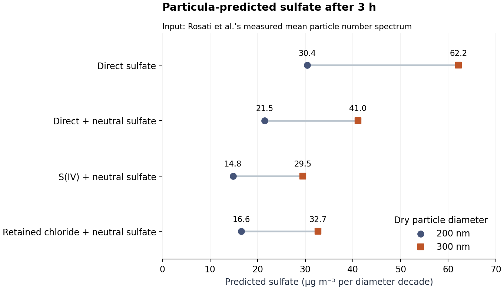

# A chamber sea-spray spectrum puts more sulfate at 300 nm than at 200 nm

Xiong’s microscope followed particles one size at a time. The apparent NaCl concentration-decay rate peaked near 200 nm, where it reached 1.17 h⁻¹ compared with 0.96 h⁻¹ at 300 nm. To ask which size carries more accumulated sulfate per cubic metre of air, we also need the initial salt mass at each size. For this calculation we applied Xiong’s 200 ppm SO₂ exposure to a separate measurement of artificial sea spray. [Main analysis](index.md) · [Xiong et al., Figure 5](https://acp.copernicus.org/articles/26/12183/2026/) · [Rosati et al., Figure 2b](https://doi.org/10.1038/s41598-021-89346-6)

## From particle number to sulfate mass

At each diameter we converted the dry mass of a spherical NaCl particle to moles of sodium, then multiplied by the measured particle number per diameter decade. The model supplies the moles of sulfate formed per mole of that initial sodium. On Rosati’s mean number spectrum, the 300 nm class starts with 2.15 times the sodium mass of the 200 nm class. At 300 nm, a sulfate yield of just 46.5% of the 200 nm yield per mole of sodium would therefore give equal sulfate mass per decade. Across the initial, mean and five-hour spectra, allowing for the uncertainty in reading each curve shifts this break-even threshold to 35.8–62.6%. Its application to a new population also depends on how much salt the particles contain at each measured diameter.

**Figure 1.** Predicted sulfate after three hours of Xiong’s exposure, using the mean Rosati number spectrum. Each pair compares equal logarithmic diameter intervals. The measured input is Rosati’s time-averaged particle number spectrum, used here to initialize a separate calculation. Sulfate mass at each size is a calculation. [Plotted sulfate masses](https://raw.githubusercontent.com/uncscode/particula/main/docs/data/xiong-sea-spray/size-budget.csv) · [Digitized spectra](https://raw.githubusercontent.com/uncscode/particula/main/docs/data/xiong-sea-spray/observations.zip)

The size spectrum can reverse the ranking. Using conversions reconstructed from the authors’ sulfate and residual NaCl curves, the 300 and 200 nm classes on the mean spectrum carry 61.4 and 29.4 µg SO₄ m⁻³ per diameter decade. Redistributing the same total salt equally among diameter decades gives 25.6 and 26.3 µg SO₄ m⁻³ per decade, respectively. The chemistry is identical in these two calculations. Across the 13 chemistry treatments and Rosati’s initial, five-hour and mean spectra, the 300-to-200 nm mass ratio is 1.79–2.22 after three hours.

## Accumulated mass and the current production rate

The mass accumulated over three hours can be better constrained than the sulfate produced between 2.5 and 3 hours. Growth factors from adjacent late times overlap. With sodium bisulfate as the product, two conversion histories consistent with the reported optical scatter and endmember-reading bounds give opposite rate rankings on the mean spectrum. Their 300-minus-200 nm production-rate differences are −6.70 and +25.05 µg SO₄ m⁻³ h⁻¹ per diameter decade over that interval. A sign change is possible even though more sulfate has already accumulated at 300 nm. Size-resolved sulfate measurements at matched exposures would test both predictions. Transferring the result to marine air would require the local dry salt spectrum and size-resolved sulfate yields at the lower sulfur dioxide exposure. [Lower-dose check](pathway-checks.md)
