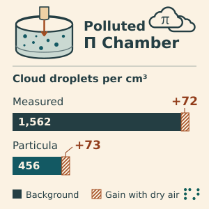
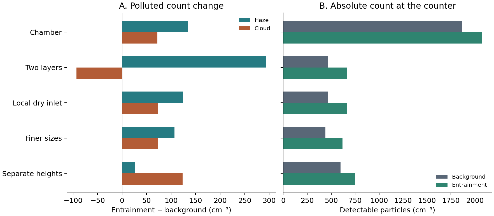
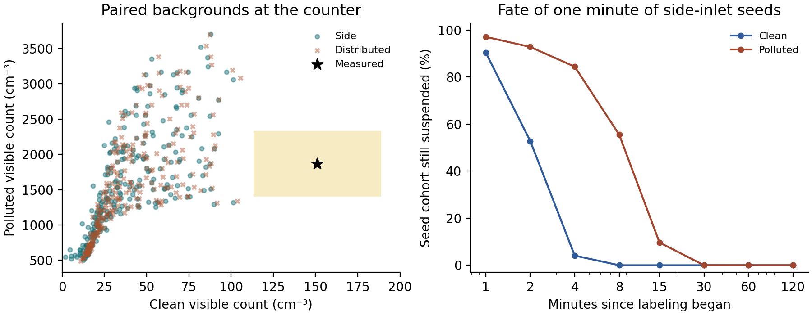
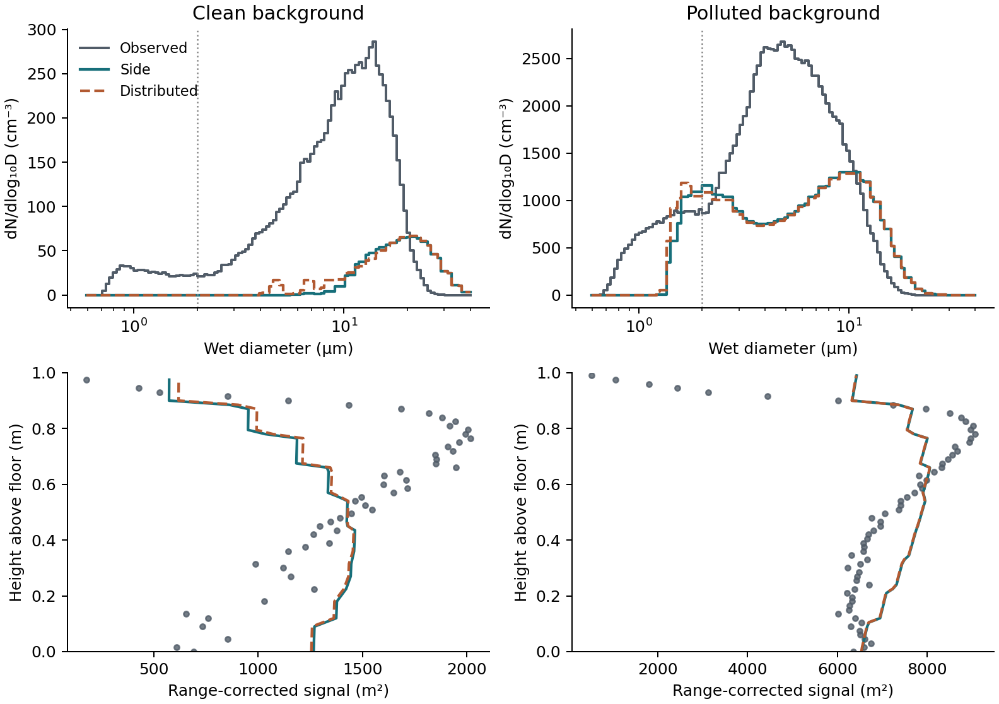

# Particula reproduces the polluted Π Chamber’s droplet gain but underestimates the background count

When Yeom and colleagues introduced warm, dry air into a polluted laboratory cloud, its liquid water fell by **32.5%** while its cloud droplet count **rose by 72/cm³**. How can a cloud gain droplets as it evaporates? One continuously seeded Particula simulation reproduced both changes. Dry air entering a small region of the upper chamber increased the cloud count by **73/cm³** and reduced liquid water by **33.1%**. Yet the simulated background contained only **456 cloud droplets/cm³**, compared with **1,562 measured**. Including haze gives 465 visible particles/cm³ against 1,867 measured. It also underestimated the clean cloud’s water loss. We tested whether seed delivery, vapor supply, droplet residence time or the position of the instruments could explain the discrepancy. Tracking seeds from the side inlet still left the clean background too sparsely populated. The model shows how a gain can occur, but the measured starting populations remain the harder test. [Yeom et al. (2026)](https://doi.org/10.1029/2026GL123212) · [Study data](https://github.com/uncscode/particula/tree/main/docs/data/pi-chamber-lidar)

## A pulsed laser and a particle counter sampled four steady clouds

Yeom et al. continuously supplied 130 nm dry sodium chloride particles at two rates to a 1 m tall convection chamber. For each loading they measured the steady background, then introduced particle-free air from above at 30 °C, 20% relative humidity and 20 L/min. A counter at 0.65 m measured wet diameters. Here *haze* spans 0.583–2 µm, *cloud* spans 2–40.679 µm, and *visible* includes both. The downward 515 nm lidar sent 15 million pulses per second and accumulated backscatter in 1.5 cm range gates over ten minutes. The pulses probed the cloud while the dry air drove evaporation. [Experimental methods and Figures 1–2](https://www.osti.gov/servlets/purl/3484638)

| Quantity at the counter | Clean background → entrained | Polluted background → entrained |
| --- | ---: | ---: |
| Haze particles, cm⁻³ | 11 → 13 | 305 → 440 |
| Cloud droplets, cm⁻³ | 140 → 142 | 1,562 → 1,634 |
| All visible particles, cm⁻³ | 151 → 155 | 1,867 → 2,074 |
| Liquid water, mg/m³ | 136.7 → 85.3 | 306.9 → 207.1 |

The authors printed the class counts. We reconstructed the four spectra from Figure 1b, scaled each class to its printed count and digitized the 251 visible lidar markers in Figure 2a. Thus integrated reconstructed counts reuse the published counts. The lidar profiles provide a second instrument for comparison. The extinction retrieval in Figure 2b incorporates a counter-derived reference, and the later two-height experiment used a different bottom plate. The author archive listed the data but the original downloads were inaccessible during this study. Graphical reading uncertainty in liquid water is about ±2 mg/m³. Run-to-run uncertainty is unavailable. [Accepted manuscript](https://www.osti.gov/servlets/purl/3484638) · [Authors’ data archive](https://digitalcommons.mtu.edu/all-datasets/79/)

## Which simulations could explain the increase?

Polluted air gained 135 haze particles and 72 cloud droplets per cm³, or **207 more visible particles/cm³**. Evaporating an initially visible population can move droplets between classes. An increase in both classes requires more particles to enter or remain in the sampled size range and volume. We first initialized parcels with the measured backgrounds to test evaporation, then built chambers that had to generate their own backgrounds from the seed feed. In the joint comparisons we calculated Mie extinction and 180° backscatter for spherical droplets, integrated backscatter through the attenuating column and fitted one lidar gain across both loadings. A gain changes the optical amplitude and leaves the absolute counter predictions untouched.

| Question | Simulations and comparison | What the result established |
| --- | --- | --- |
| Can dilution and evaporation of existing droplets explain the polluted change? | Eighteen CUDA salt–water parcel cases varied humidity, dry-air mixing and duration, with dilution-only and same-age controls. At 1% mixing the clean water loss selected 11.4 s. | At that same duration polluted water fell 36.0%, close to the measured 32.5%, but cloud count fell 43.1% against a measured 4.6% rise. [Transferred exposure](https://github.com/uncscode/particula/blob/main/docs/data/pi-chamber-lidar/transfer-scores.csv) |
| Does the vertical lidar profile identify the exposure? | We tested uniform and top-localized evaporation, size-dependent settling and mixing, then fitted the four spectra and profiles jointly with one or two parcel ages. We varied the fitted moments, lidar gains and background aging. | The uniform exposure reduced the polluted interior return by 33% against 23% measured. Settling applied to the local *measured* spectra gave a normalized upper return of 0.985 versus 0.980 in background air, then 0.988 versus 0.678 under entrainment. A particle-free upper layer improved the joint fit but left 294 mg/m³ of polluted liquid against 207 measured. All ages from 0 to 32 s fit equally well with that layer and a stationary background. [Joint fits](https://github.com/uncscode/particula/tree/main/docs/data/pi-chamber-lidar/joint) |
| Could fresh seeds and a distribution of exposure times supply the missing count? | A Monte Carlo study scored 36,864 combinations of closed parcels, fresh delivery or an upstream seed inventory, with common or separate humid and dry exposure times. We also fitted each loading and transferred its settings to the other. | Distinct background, wet and dry durations lowered the best joint error from 0.316 to 0.288. Nine stored-seed cases matched visible number and water within 10% in all four states. The best three-phase fit with stored seeds gave only 1,860/cm³ and 294 mg/m³ in polluted entrained air. [Exposure sweep](https://github.com/uncscode/particula/tree/main/docs/data/pi-chamber-lidar/exposure) |
| Could competition for vapor or intermittent condensation change haze into cloud? | Residents and incoming salt shared a finite vapor supply. We tested 884,736 short-trajectory fit combinations, ran 300 s source-on and source-off comparisons, then varied vapor timing and sampling phase at fixed total water. | At 124 s the fresh feed added 207 visible particles/cm³, almost all haze. At a stronger vapor supply, short pulses produced 43–52 extra cloud droplets/cm³ averaged over the 100–125 s cycle, against approximately zero with continuous supply. At cycle end all three schedules had zero fresh cloud droplets. Independent random sampling of the two parcels widened the simulated range of cloud-count changes. Both experimental steady states received seeds, so turning the source on tests a supply timescale. [Paired vapor tests](https://github.com/uncscode/particula/tree/main/docs/data/pi-chamber-lidar/shared_vapor) |
| Could extra deposition explain the water loss? | Surviving droplets exchanged vapor while gravity removed droplets and haze deposited on walls. A separate control gave the treatment additional fixed-size settling time. | At the earlier fitted exposures, gravity changed the polluted water loss from 2.43% to 2.45%. Giving only the treatment 117 additional seconds matched the water loss while removing a net 209 visible particles/cm³. Giving both states those 117 s left their water ratio at 0.976 against 0.675 measured. [Extra residence](https://github.com/uncscode/particula/blob/main/docs/data/pi-chamber-lidar/wall_loss/extra-residence.csv) |
| Can continuous seeding, water input and fallout reproduce both complete clouds? | We grew backgrounds from particle-free air, then continued seeding with and without dry air. Two independent sets of 128 settings covered nine one-, two- and three-layer configurations, including patchy dry inlets, random wet encounters and distinct source and counter heights. | Across 2,304 four-condition comparisons, 2,169 passed the late-time drift test after six- or twelve-hour stages. Of those, 150 got all six directions right across both loadings. Zero matched both loadings’ water, haze and cloud changes within the stated tolerances. [Maintained runs](https://github.com/uncscode/particula/tree/main/docs/data/pi-chamber-lidar/maintained) |
| Does concentrating the same seed input near the side inlet repair the backgrounds? | We ran 256 matched settings with side and distributed delivery at both loadings, giving 1,024 backgrounds at six hours and again at twelve. We changed the virtual counter and beam positions and refined 136 backgrounds. A one-minute tagged release tracked floor export. A separate age calculation estimated the time spent in the counter cell. | Neither source matched both spectra and lidar profiles within 25% in both loadings. At six hours the side source gave a better combined score in exactly 128 of 256 paired settings. The largest clean interior count from either source was 106/cm³ at both six and twelve hours, below the measured 151/cm³. [Background runs](https://github.com/uncscode/particula/tree/main/docs/data/pi-chamber-lidar/background_transport) |

The exposure times in these tests are imposed or fitted. The best short-trajectory shared-vapor fit selected zero additional seeds and predicted only a 2.4% polluted water loss. Providing both measured final counts instead reveals that water per visible particle fell by 39% in each loading. That relationship describes the measured populations and cannot independently predict their counts. The two instruments also favored different exposure times within the same model. Across two randomized samples, the best 5% of spectrum fits had median dry durations of 0.38–0.43 s. The best 5% of lidar fits had medians of 11.5–11.9 s. In a separate noise-free test the lidar distinguished synthetic 0.5 s and 8 s histories in 92–93% of cases. That test used the same model to generate and classify the histories. The experiment provides no measured parcel ages. [Simulation results and numerical checks](https://github.com/uncscode/particula/tree/main/docs/data/pi-chamber-lidar)

## Continuous seeding lets droplet number rise while liquid falls

In the two-layer case highlighted above, the localized dry inlet increased polluted haze by 124/cm³ and cloud by 73/cm³ against measured increases of 135 and 72/cm³. With the dry inlet active, the model’s liquid flux to the floor fell from 3.82 to 2.63 mg m⁻³ s⁻¹ as evaporation increased. The particle flux to the floor also fell, from 2.112 to 2.010 particles cm⁻³ s⁻¹, while the salt feed continued at 2.122 particles cm⁻³ s⁻¹. Smaller droplets could therefore remain suspended longer. This mechanism reproduced the polluted change from a background containing only one-quarter of the measured visible particles.

Refining 53 wet-size classes to 212 gave a polluted cloud increase of 73/cm³, a 31.6% water loss and a background of just 439/cm³. The clean water loss on the finer grid was 20.4% against 37.6% measured. Placing the dry inlet above a separate counter layer gave +123 cloud droplets/cm³ and a 22.5% polluted water loss at the same settings. The fitted case illustrates how the local population can change and how strongly the answer depends on where that population is sampled. [Selected runs and finer-grid comparisons](https://github.com/uncscode/particula/blob/main/docs/data/pi-chamber-lidar/maintained/matched-example.csv)

## A tagged side release exposes the background deficit

At the best joint setting for both source locations, the simulated interior counter saw only 26–29 visible particles/cm³ in clean air against 151 measured, while liquid water was 130 mg/m³ against 137 measured. The model put too much of the available water into a few large, fast-settling droplets. In a refined replay, four minutes after a one-minute side release began, **4.1%** of the clean tagged seeds remained suspended against **84.4%** of the polluted cohort. Their mean ages at exit were 100 and 502 s. These are predictions for the selected setting. No tracer lifetime was measured in the experiment.

The background size spectra put the clean shortage near the observed 13 µm peak. The modeled clean profiles also miss the upper-chamber maximum in the lidar return. Fitting the lidar alone improved the distributed-source lidar error from 0.306 to 0.286 while increasing its spectrum error from 0.757 to 0.950. Each score combines both loadings. [Instrument-selected settings](https://github.com/uncscode/particula/blob/main/docs/data/pi-chamber-lidar/background_transport/main/scored/selected.csv)

The clean measurements also constrain floor loss without choosing a simulated exposure. If the visible spectrum sampled at 0.65 m also filled the air next to the entire floor, its calculated settling flux per chamber volume would be **0.559 particles cm⁻³ s⁻¹**, more than twice the nominal clean feed of **0.265**. In steady state, floor export alone cannot exceed the gross supply. Under the adopted chamber volume, the true area-averaged clean floor flux can therefore be at most about **47%** of that estimate. A measurement of the near-floor size spectrum and its spatial variation would test this constraint directly. Until both seeded backgrounds can be sustained, matching the polluted +72/cm³ response cannot identify the chamber’s actual exposure history. [Chamber geometry on the preceding lidar platform](https://pmc.ncbi.nlm.nih.gov/articles/PMC12718331/) · [Floor-flux calculation](https://github.com/uncscode/particula/blob/main/docs/data/pi-chamber-lidar/background_transport/floor-proxy.csv) · [Tagged seed cohorts](https://github.com/uncscode/particula/blob/main/docs/data/pi-chamber-lidar/background_transport/refined/cohort.csv)

## Reproducing the comparison

The companion example and its downloadable ZIP rerun the highlighted chamber case and plot its measured and predicted counts. The evidence tables cover the broader sweeps. The original simulations used Particula 0.3.3, Warp 1.11.1 and an NVIDIA GeForce RTX 5060. Short parcel and Mie calculations used CUDA. The 300 s finite-vapor and pulse calculations used a CPU stiff solver with CUDA-checked growth coefficients. The maintained chamber checks compare 53, 106 and 212 size classes. The background transport checks extend nine vertical cells to fifteen and account for seed and water exports. The six-response test allowed five percentage points for water change and the larger of 5/cm³ or 25% of each measured class-count change. The separate 25% background spectrum and lidar thresholds are descriptive tolerances chosen before scoring. [Runnable comparison](closure.py) · [Observation provenance, run summaries and numerical checks](https://github.com/uncscode/particula/tree/main/docs/data/pi-chamber-lidar)
