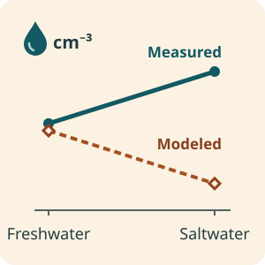
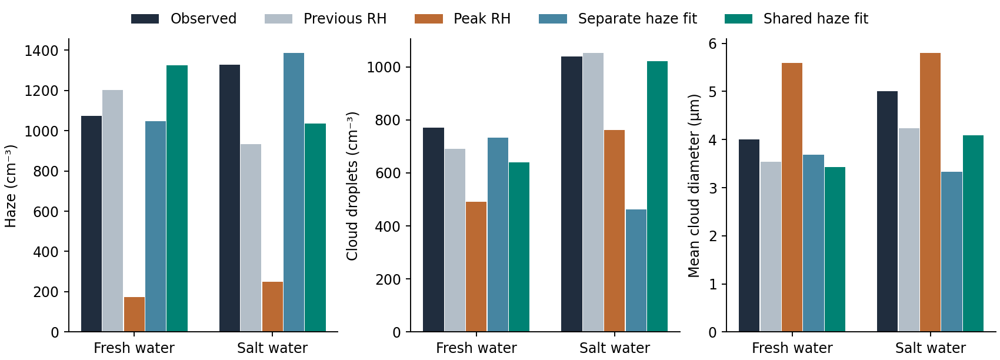
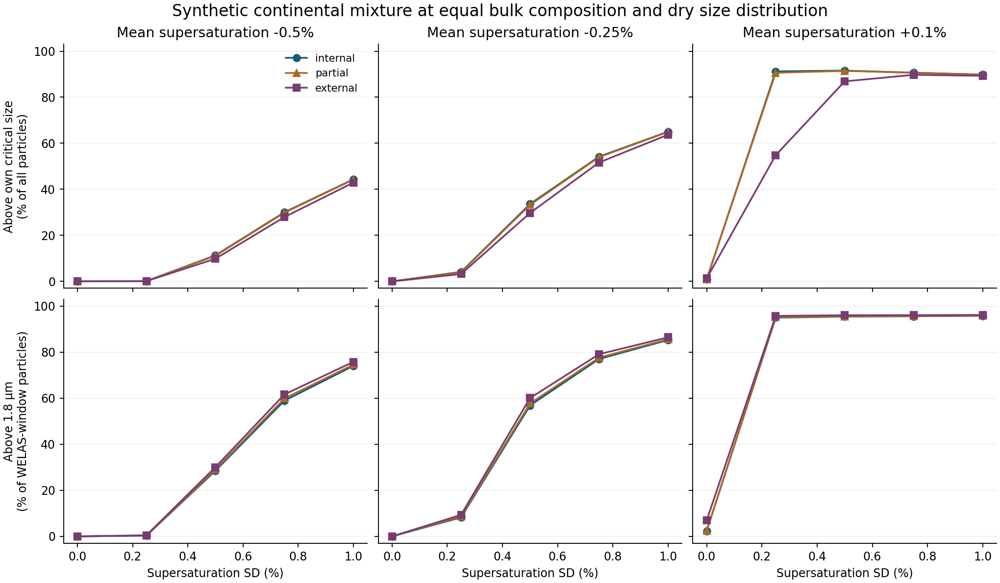

# Π Chamber cloud counts rose over salt water, but separate haze fits predicted a decline

[^emblem]

Can haze measurements in a turbulent cloud chamber tell us how many cloud droplets it sustains? Prabhakaran et al. measured 771 cloud droplets per cm³ over a fresh-water floor and 1,038 per cm³ over a salt-water floor. The plate temperature difference increased from 6 to 7 K between experiments, while the seed size and injection rate stayed the same. We fitted the mean interior humidity in Particula separately to the haze measurements from each experiment. Both modeled haze concentrations came within 5% of the observations, yet the predicted cloud concentration fell from 734 to 462 droplets per cm³. A shared humidity fit recovered the direction of the cloud response but reversed the haze response. With interior conditions held fixed, changing the assumed humidity near the floor could also reverse the predicted cloud response. Measuring droplet sizes near the floor and deposition at the surface would test whether the interior measurements represent the population the chamber loses. [Chamber measurements](https://doi.org/10.1073/pnas.2006426117) · [Humidity fits](https://github.com/uncscode/particula/blob/main/docs/data/pi-chamber/humidity-fits.csv)

## Why the Π Chamber experiments paired fresh-water and salt-water floors

A salt particle can absorb water and remain a small haze droplet. If it encounters sufficiently moist air, it can grow past its critical size and become a cloud droplet. Prabhakaran and colleagues used the Michigan Tech Π Chamber to study how turbulence affects this transition. They paired a fresh-water floor and a 6 K plate temperature difference with a salt-water floor and a 7 K difference to vary the intensity of humidity fluctuations while keeping the mean source of supersaturation comparable. Both experiments received 33 nearly monodisperse, 130 nm sodium chloride particles per cm³ per minute. An optical counter measured wet diameters from 0.6 to 40 µm. For these seeds, the authors classified droplets larger than about 1.8 µm as cloud droplets. [Prabhakaran et al., Table 1 and Figure 2C](https://doi.org/10.1073/pnas.2006426117)

The salt-water case sustained larger and more numerous cloud droplets at the same seed input. Larger droplets settle faster, so the steady population depends on what happens between the sampling point and the floor. A droplet that enters drier air can shrink, slow its descent and return to the chamber interior. The paired experiments let us ask whether humidity inferred from the smaller haze droplets can account for the cloud population, and how that inference depends on conditions near the floor.

## How humidity and settling shape Particula’s predictions of cloud droplet number

We first tested whether a humidity fit based on haze could predict the observed cloud counts. We then varied the conditions near the floor and the initial particle sizes to see which assumptions changed the prediction. A separate calculation examined how the optical size cutoff affects the apparent activation of particles with different compositions.

<a id="which-steady-state-observations-can-the-chamber-model-sustain"></a>

### Separate humidity fits reproduce haze counts but reverse the cloud response

We compared a well-mixed chamber with a model in which particles move between the interior and a lower region. For the two-region calculation we fitted mean interior relative humidity (RH) to the measured haze concentration and size distribution, first with one humidity shared by both experiments and then with a separate humidity for each. We held cloud counts and cloud size moments out of the humidity fits. Earlier work used the same experiments to select the chamber geometry and forcing scenarios.

| Observable, fresh water → salt water | Observed | Original uniform box | Two regions, shared RH | Two regions, separate RH |
|---|---:|---:|---:|---:|
| Mean interior RH (%) | Unmeasured | 99.75 → 99.75 | 99.55 → 99.55 | 99.65 → 99.05 |
| Haze (cm⁻³) | 1,073 → 1,327 | 240 → 88 | 1,323 → 1,035 | 1,048 → 1,386 |
| Cloud (cm⁻³) | 771 → 1,038 | 384 → 260 | 639 → 1,022 | 734 → 462 |
| Cloud mean diameter (µm) | 4 → 5 | 5.49 → 6.99 | 3.43 → 4.09 | 3.69 → 3.33 |
| Cloud diameter SD (µm) | 2 → 3 | 2.71 → 3.59 | 1.40 → 1.86 | 1.57 → 1.37 |

The separate RH fit came within 5% of both haze counts and reversed the observed cloud response. In both experiments about 40% of the observed 0.8–1.8 µm haze occupied the 1.0–1.3 µm interval. The largest modeled fraction was 29.3% across the 14 humidity settings. This concentration near 1 µm gives a size-resolved target for testing other humidity and residence-time distributions. The evidence for its shape comes from digitized, partially overlapping traces. The cloud diameter SD in the table describes droplet variability within a sample. [Humidity comparison](https://github.com/uncscode/particula/blob/main/docs/data/pi-chamber/humidity-fits.csv) · [Authors’ spectra, slide 3](https://asr.science.energy.gov/meetings/stm/presentations/2020/1064.pdf#page=3)



<a id="which-processes-change-the-sign-of-the-cloud-response"></a>

### Assumed humidity near the floor can reverse the modeled droplet response

A uniform 1 m chamber converts the measured cloud second diameter moments to Stokes settling losses of approximately 27.8 and 63.5 cm⁻³ min⁻¹ in fresh and salt water. The latter exceeds the measured input of 33 even before including haze and other losses. This calculation assumes that the floor receives the same size distribution as the instrument.

An exploratory 568-case CUDA series varied particle exchange, floor humidity, background loss, five humidity fluctuation laws, and four seed distributions. At fixed interior forcing, a homogeneous chamber predicted 59 fewer droplets per cm³ in salt water. A drier salt-water floor scenario predicted 362 more. Making that floor slightly supersaturated predicted 379 fewer. At fixed floor forcing, a 130 nm source, two lognormal sources and a source with a 10% tail at 200 nm all gave increases from 361 to 363 cm⁻³. The local near-floor RH histories were assumed. Measurements of the near-floor wet spectrum and size-resolved settling flux could distinguish these scenarios. [Paired CUDA contrasts and Monte Carlo half-widths](https://github.com/uncscode/particula/blob/main/docs/data/pi-chamber/process-effects.csv) · [Chamber simulations of spatially varying growth](https://doi.org/10.1103/PhysRevFluids.7.020501)

<a id="how-long-does-the-initial-size-distribution-matter"></a>

### Dry and wet starts converge before cloud counts settle

The [worked example](pi_chamber_spectra.py) tracks the wet diameter of individual residents and incoming seeds at 16 sampled times over 16,384 s. In each boundary condition, both initial populations have the measured total detected number. The dry population places all of that number at 130 nm. The wet restart samples inferred haze and cloud sizes. We assign each region the same initial local number concentration and size distribution. The measurements leave the initial lower-region spectrum and the number below the detection limit unresolved.

For each condition and start, eight independent groups each represent 1,024 initial particles and 2,048 stratified arrival times. Each arriving particle represents a physical number set by the constant injection rate and the simulation duration. Removal ends its trajectory. This yields instantaneous interior concentrations under a specified input, including during startup. The same incoming trajectories and matched random draws across starts isolate differences due to the initial resident water. The paper measured steady state. The temporal plots are predictions.

The summed absolute bin differences divided by the combined interior number first fell below 5% at the **8 s fresh-water** and **16 s salt-water** samples. Both fell below 1% at the 32 s sample. The 0.0625 s run and the independent 0.03125 s refinement agreed on those sampled times. Differences at 8 s were 4.8–4.9% for fresh water and 6.8–7.5% for salt water. Sampling times bracket the crossing. Common particle histories make this a controlled comparison of starts.

The chamber continued to evolve after the two starts agreed. On the finer timestep, the wet-start cloud concentration increased from 479 to 611 cm⁻³ in fresh water and from 905 to 970 cm⁻³ in salt water between 32 and 16,384 s. The spectrum can lose most of its dependence on initial droplet size well before ongoing injection and removal bring the absolute counts close to steady state.

<a id="would-the-same-optical-cutoff-resolve-a-mixing-state-effect"></a>

### The optical cutoff hides a modeled mixing-state effect on activation

A separate synthetic experiment held dry constituent volumes fixed at each size and varied which constituents occupied each particle. A continental-like mixture contained 35% sulfate, 55% organic material and 10% weakly wettable carbonaceous material by dry volume. At +0.10% mean supersaturation and a fluctuation SD of 0.25 percentage points, 91.3% of internally mixed residents and 54.6% of externally mixed residents exceeded their particle-specific critical size. The difference was 36.7 ± 0.4 percentage points (paired 95% Monte Carlo half-width). Using only detected particles and the fixed NaCl cutoff gave 95.0% and 95.8%. The externally mixed population placed many more particles below 0.6 µm. Simultaneous measurements below that limit would help test this prediction. At fluctuation SDs of 0.5 and 1.0 percentage points, the particle-specific differences fell to 4.7 and 0.5 points. [Mixing-state contrasts](https://github.com/uncscode/particula/blob/main/docs/data/pi-chamber/mixing-state.csv)



The [species and organic vapor companion](../seed-chemistry.md) compares NaCl and ammonium sulfate at 130 nm and tests semivolatile organic uptake and evaporation with BAT.

## Measure droplet deposition at the floor to test the chamber’s particle budget

The separate humidity fits capture how many small droplets the counter sees, but even the direction of the cloud response depends on how humidity is represented. At fixed interior forcing, changing the assumed floor humidity moved the simulated salt-water response from 362 more cloud droplets per cm³ to 379 fewer. The floor humidity history was unmeasured. A deposition measurement would give the floor scenarios an independent test. In the salt-water experiment, applying the interior size distribution at the floor implies a settling loss of 63.5 particles per cm³ per minute, nearly twice the seed input. A useful next experiment would measure the wet size distribution near the floor and count the cloud droplets deposited on the floor per minute. Dividing that count rate by the chamber volume would give a loss rate directly comparable to the estimate. A smaller measured loss would quantify how much the interior spectrum overstates removal. Concurrent humidity measurements would help determine whether evaporation near the floor can account for the difference.

<a id="inputs-uncertainties-and-reproduction"></a>
<a id="humidity-assumptions-spectrum-reconstruction-and-reproduction"></a>

## Reproducibility

The steady-state process and mixture calculations used Particula revision `c76cfb5993`. The subsequent 68-case inverse study used `4d6fcba740`, including the differentiable inversion work in PR #1676. The original adjoint recovery control reproduced the synthetic initial radii within 0.61 nm. The chamber fit differentiated a piecewise-linear interpolation of log observations from the aqueous particle model. Each of its intervals has a bounded quadratic minimum, which the downloadable example recomputes from the archived grid. Haze number and two log ratios of haze bins receive equal weight. There is no experimental covariance estimate for this objective. [Inversion qualification](../../../validation/condensation/initial-size/index.md) · [Optical grid](https://github.com/uncscode/particula/blob/main/docs/data/pi-chamber/haze-grid.csv)

The temporal example uses the shared fitted RH of 99.55%, a 15% lower region, 4 s exchange, and Gaussian humidity renewals with a 1 s mean waiting time. Interior RH standard deviations are 0.75 and 1.0 percentage points. Assumed lower-region means are 99.75% and 98.50% with one-quarter of the interior fluctuation amplitude. Background removal has a 7,200 s lifetime. Growth uses κ–Köhler equilibrium with κ = 1.28, transition-corrected vapor transfer and latent heat at fixed temperature. The model prescribes the humidity seen by a particle. It omits two-way vapor feedback and spatially resolved turbulent flow.

The wet initialization uses 128 equal-number representative diameters per optical class from our reconstructed population. The reconstruction used the shape in the authors’ presentation and adjusted the cloud weights to match the published mean and SD. This parameterization and the included plots are independent model products. The original experimental archive is available from Michigan Tech with its reuse statement. [Experimental data and attribution](https://digitalcommons.mtu.edu/data-files/3/) · [Restart parameters](https://github.com/uncscode/particula/blob/main/docs/data/pi-chamber/restart.json)

The continental mixing-state plots use 45 rows from the reference campaign. To redraw all three study figures from the published tables, run `python -m scripts.pi_chamber.figures`. [Mixing-state figure data](https://github.com/Gorkowski/particula/blob/172090a0b2369eb6620583387464b9a21b1e81c3/docs/data/pi-chamber/continental-spectra-summary.csv)

The published example requires CUDA for a fresh calculation. Its bundle records the execution device, library revision and exact inputs. Redrawing saved spectra uses the captured concentrations.

```bash
python scripts/docs_examples.py refresh pi-chamber-spectra
python scripts/docs_examples.py replot pi-chamber-spectra
```

[^emblem]: Two-cloud motif adapted from the Π Chamber emblem shown on the [Richter Lab’s chamber project page](https://richterlab.nd.edu/research/cloud-physics-in-the-pi-chamber/).
