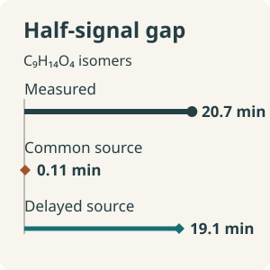
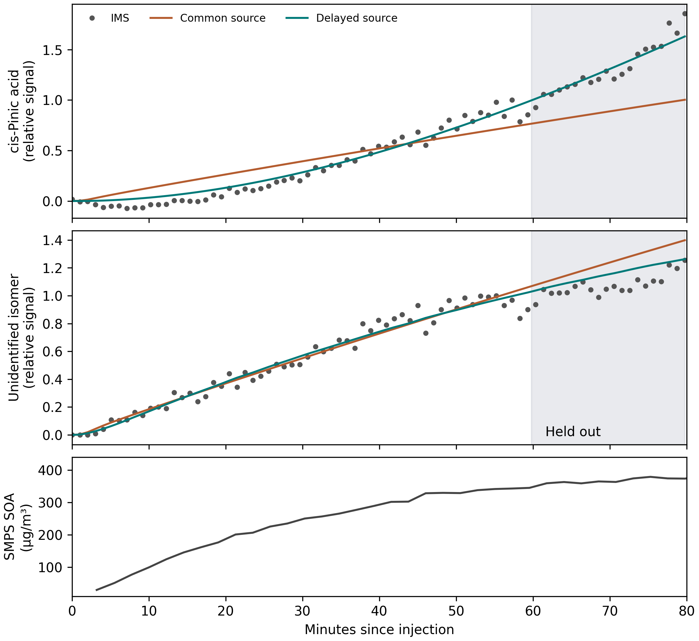

# Two C₉H₁₄O₄ isomers reach half signal 21 minutes apart in chamber aerosol

In Schaum et al.’s α-pinene oxidation experiment, two isomers with the same formula reached half their late particle-phase signals **20.7 minutes apart**. The combined signal crossed its own half-signal threshold at 38.4 minutes, obscuring the delay. Could differences in volatility alone explain the timing? Particula fitted two production histories to the first three quarters of the observations and tested their predictions on the remaining quarter. At an assumed 80 nm effective particle radius, a common production history gave a gap of **0.11 min**. Allowing delayed cis-pinic production gave **19.11 min** and reduced the held-out error for both isomers. The timing favors separate production histories within the tested models. The experiment leaves open whether a particular intermediate produced the delay and on what timescale. [Schaum et al., Figure 4A](https://doi.org/10.5194/ar-4-589-2026) · [Fits and withheld observations](isomer_history.py)

## One formula combines two distinct particle-phase signals

Schaum and colleagues used ion mobility to separate two C₉H₁₄O₄ signals in chamber aerosol. A standard identified one as cis-pinic acid. The other remains unidentified. The authors proposed that later-generation chemistry might explain the accelerating cis-pinic signal. Volatility, inlet behavior and instrument response can also affect a particle-phase trace. Their Figure 4A provides both isomer traces and the combined formula signal from the same experiment. [Chamber and sampling methods](https://ar.copernicus.org/articles/4/589/2026/)

## Testing production timing and volatility against different observables

### The isomer traces reach half signal at 31.4 and 52.1 minutes

The unidentified isomer reaches half its late signal at **31.4 min**, the formula-level signal at **38.4 min**, and cis-pinic acid at **52.1 min**. These times refer to each channel’s own signal range. The chamber data do not provide calibrated mass fractions or the vapor-pressure ratio. [Measured traces and simulated loading response](pinic_isomers.py)

We use 81 samples of the authors’ one-minute formula-level MS signal and two IMS peak-area signals, from −2.03 to 79.76 min. Each series is normalized separately. We subtract its mean through time zero (three samples) and divide by the difference between its final five-sample mean and that baseline. The primary half-time is the first linearly interpolated crossing of 0.5 in a centered three-sample mean. With unsmoothed and five-sample alternatives the cis-pinic-minus-unidentified delay is 20.0 and 20.7 min, respectively. These processing choices give a sensitivity range. Instrument response, calibration and between-run uncertainty are additional sources of uncertainty. [Authors’ figure data](https://cires.colorado.edu/jimenez-group/grp-figs/Schaum_2026_AR.zip)

### A common production profile misses the late cis-pinic rise

Adding delayed production predicts the held-out cis-pinic peak-area trace substantially better than changing volatility alone. The final quarter of the 79.76 min record was withheld from both fits. At an effective radius of 80 nm, the common-source model predicts a **0.11 min** half-signal separation. Allowing cis-pinic acid to form through an intermediate gives **19.11 min**, compared with the observed **20.7 min**. Each channel has an independent response factor fitted on the first three quarters. Errors below are in units of that channel’s maximum training signal. [Predicted and measured traces](isomer_history.py)

| Production model | Training RMSE, cis / unidentified | Held-out RMSE, cis / unidentified | Half times, cis / unidentified (min) |
| --- | ---: | ---: | ---: |
| Common decaying source, distinct volatilities | 0.145 / 0.057 | 0.468 / 0.174 | 37.53 / 37.42 |
| Additional delayed cis-pinic pathway | 0.065 / 0.053 | 0.085 / 0.093 | 52.04 / 32.93 |

We recovered total SMPS aerosol mass from the authors’ Figure 4 experiment. The saved graph maps the same horizontal interval to 4–80 injection-relative minutes and 3842936730–3842941290 IGOR seconds. This gives injection at 3842936490 s independently of either peak shape. The first loading is 29.66 µg m⁻³ at 3.22 min and the measured loading reaches 379.28 µg m⁻³ during the comparison. The primary reconstruction ramps from zero to the first scan. Holding that first value constant across the missing interval changes the delayed half-time separation by less than 0.01 min. The bulk loading constrains the absorbing phase. Neither IMS channel supplies a calibrated mass fraction. [Original graph archive](https://cires.colorado.edu/jimenez-group/grp-figs/Schaum_2026_AR.zip) · [Chamber and sampling methods](https://ar.copernicus.org/articles/4/589/2026/)

At 24.5 °C and 0.83 atm we use transition-regime gas transfer, unit accommodation, an assumed density of 1200 kg m⁻³ and a fixed effective radius to convert bulk mass into area. At 30 µg m⁻³, radii of 40, 80 and 160 nm give gas uptake times of 0.23, 0.54 and 1.49 min before accounting for evaporation. Across these radii the delayed half-time gap spans 19.10–19.23 min. Halving the integration step changes the central gap by 0.03 min. Centered finite differences verify the GPU derivatives, including the profiled instrument response factors.

The common production lifetime reaches its 500 min search limit. The delayed fit puts nearly all cis-pinic production through the intermediate and reaches the 300 min delay-timescale limit. The withheld trace discriminates the two predicted signal histories, while the fitted lifetimes remain poorly constrained.

### Can one calibrated volatility transfer to a different aerosol loading?

In each closed, dry box, 5 µg m⁻³ of initially gas-phase material partitions onto monodisperse nonvolatile absorbing seed. A resolved model carries cis-pinic acid and a hypothetical second isomer. A second model carries one surrogate with the same total mass. For each mixture independently, the surrogate volatility is chosen to match the resolved equilibrium at 10 µg m⁻³ seed, then held fixed at the other six loadings. Changing loading changes particle number at fixed initial radius. The measured chamber signals do not enter this calibration.

| Nonvolatile seed (µg m⁻³) | Two isomers condensed (µg m⁻³) | Single surrogate condensed (µg m⁻³) | Surrogate difference |
| ---: | ---: | ---: | ---: |
| 0.1 | 0.268 | 0.076 | −71.7% |
| 1 | 1.075 | 0.621 | −42.3% |
| 10 | 2.616 | 2.616 | 0% by construction |
| 30 | 3.480 | 3.726 | +7.1% |
| 100 | 4.286 | 4.502 | +5.1% |

The table uses equal vapor masses and a second isomer ten times more volatile than pinic acid. The fitted surrogate saturation concentration is 10.73 µg m⁻³. At low seed loading, the less volatile constituent contributes disproportionately to uptake. At high loading the more volatile constituent still leaves some mass in the gas. With equal volatilities the single surrogate reproduces the resolved trajectory across all seed loadings. [All loading and contrast cases](pinic_isomers.py)

#### Physical inputs and numerical checks

The pinic acid reference follows Bilde and Pandis’ pure-particle vapor pressure, log₁₀(p/Pa) = −5691.7 K/T + 14.73, measured from 290 to 323 K. At 298.15 K, pM/(RT) gives C* = 3.279 µg m⁻³ for M = 0.18621 kg mol⁻¹. Applying this pure-component value to an ideal organic mixture assumes a reference state. A solid-to-subcooled-liquid correction or nonideal activities could change the result. The unidentified isomer has C* equal to 0.01, 0.1, 1, 10 or 100 times the pinic value. Pinic fractions of the initial gas are 0.1, 0.5 and 0.9. [Bilde and Pandis](https://doi.org/10.1021/es001946b)

Seven seed loadings from 0.1 to 100 µg m⁻³ are crossed with 15 mixtures. Each of these 105 conditions has a resolved and a surrogate native CUDA condensation trajectory, with five saved times from 1 min to 24 h. Both use ideal mass-fraction activity, an initially 50 nm **radius**, density 1200 kg m⁻³, surface tension 0.03 N m⁻¹, diffusivity 5 × 10⁻⁶ m² s⁻¹ and pressure 101325 Pa. Seed supplies absorbing mass but cannot evaporate. The closed-box comparison holds mass fixed and excludes chemical production and chamber wall loss.

An independent CPU mass balance solves for condensed organic mass S. For seed mass B, total inventory Tᵢ and Kelvin correction K at the grown radius, each species contributes Tᵢ(B+S)/(B+S+C*ᵢK). The sum equals S. All 24 h CUDA endpoints match this scalar root within 3 × 10⁻¹⁴ µg m⁻³ in summed organic mass. Each species’ gas-plus-particle inventory closes to within 5 × 10⁻¹⁵ relative. A tenfold tighter integration tolerance changes individual species by less than 4.2 × 10⁻⁶ µg m⁻³ across the saved times at both extreme contrasts for equal vapor shares. Equal-volatility aggregate trajectories differ by less than 1.3 × 10⁻⁸ µg m⁻³.

## Measure gas-phase isomers as the absorbing aerosol loading changes

The chamber comparison supports a difference in the timing of particle-phase signals. It leaves open how much of that difference arose before the vapors reached the particles. The independent loading calculation shows why a single effective volatility can depend on the loading at which it was fitted. Among five simulated repeats spanning 0.25–4 times the recovered chamber loading, one quarter of the original loading gave the largest separation between predicted signal histories (root-mean-square difference 0.235 across the two normalized channels). A repeat at that loading could measure gas-phase isomer signals and size-resolved particle surface area simultaneously. A late rise already present in the gas would support delayed supply. Measured surface area would constrain how quickly that supply could reach the particles. [Loading and timing predictions](isomer_history.py)

## Reproduction

Run `python scripts/docs_examples.py refresh pinic-isomers` on CUDA. Run `python scripts/docs_examples.py replot pinic-isomers` to redraw the saved data. The download includes the normalized traces, the numerical model, and an optional extractor for the original Figure 4 IGOR PXP. To regenerate the CSV, install `igor2==0.5.16` and run `python scripts/pinic_isomers/extract.py FIGURE4.pxp docs/data/pinic-isomers/traces.csv`. The extractor checks the source-file SHA-256 and retains the archive time coordinate.

For the chamber timing comparison, run `python scripts/docs_examples.py refresh isomer-history` on CUDA. The [history example](isomer_history.py) includes the measured loading and held-out traces.
