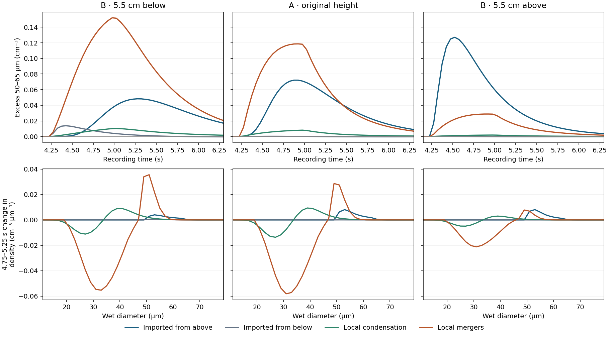
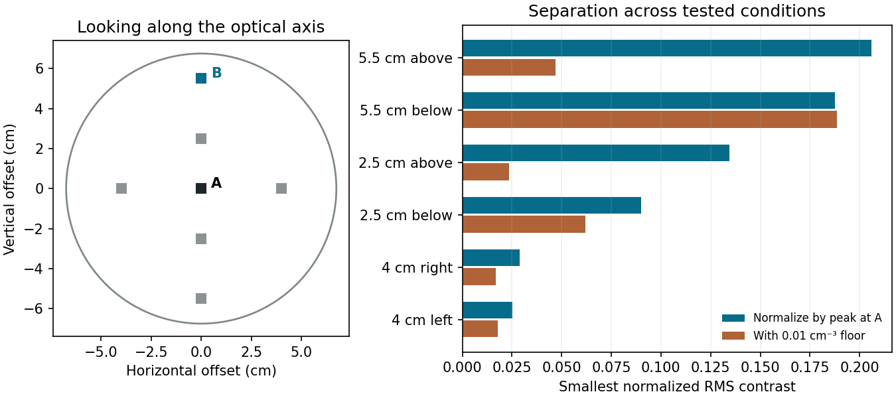

# Where a second camera could detect the arrival of large droplets

A 50 µm droplet in the REACh chamber was visible over about five times as much depth as a 10 µm droplet. Correcting counts for that volume gives a local concentration, but different sizes still sample different parts of the chamber. During the fan-off burst, a single hologram could therefore register large droplets carried into view or droplets formed nearby. The two possibilities predict different signals at a second height. In the overhead-arrival simulation, a parallel beam 5.5 cm above the original saw the large-droplet concentration start rising earlier. Simulated local mergers produced little difference in rise time and depleted the middle of the size distribution. Both signatures can be tested using synchronized cameras. [Sagan et al., Figures 1 and 7](https://doi.org/10.1063/5.0344133) · [Main comparison](index.md)

## What the original camera sampled

The 527 nm holography beam crossed the chamber horizontally along a diameter. Figure 1a places the sampled region near the center in plan view. The representative cross section was 5.4 × 3.1 mm. Its depth along the beam increased from 3.31 cm at 10 µm to 16.55 cm at 50 µm. The published spectra already divide each diameter class by its effective detection volume. We therefore averaged modeled concentration over the part of the chamber visible at each wet diameter. The separate infrared beam measured water vapor along a 0.97 m round trip to a wall mirror. [Sagan et al., Figure 1 and Section II](https://repository.library.noaa.gov/view/noaa/76087/noaa_76087_DS1.pdf#page=5)

The chamber drawing places the centers of the large viewports about 25 cm above the internal floor. We used 25.4 cm as the nominal elevation of camera A. The manufacturing drawing gives the flange position, while the two expansions leave the optical height and the near and far limits of focus unreported. This matters for comparison with a model. In one fan-off simulation with reversed circulation, zero intercell diffusion and standard collision rates, the **same droplet field** gave 5–7 s concentrations of 0.223, 0.205 and 0.169 cm⁻³ at elevations of 19.9, 25.4 and 30.9 cm. The chamber average was 0.047 cm⁻³. These are predicted location effects under that flow. [Dimensioned viewport drawing](https://doi.org/10.60893/figshare.rsi.28843976.v1) · [REACh apparatus, Figure 1](https://doi.org/10.1063/5.0255658) · [Model methods](methods.md)

## How well did the published curves resolve the peak?

With fans off, the camera measured **0.415 cm⁻³** at 50–65 µm during 5–5.25 s. Resampling contiguous groups of spectra from that quarter second gave a range of 0.302–0.524 cm⁻³. Across the full 5–7 s interval the mean was 0.188 cm⁻³, with a narrower within-run range of 0.165–0.214 cm⁻³. The nine holograms contributing to each nominal 15 ms spectrum can include repeated views of a moving drop. Keeping adjacent spectra together preserves some of that dependence. The two records selected for this comparison contain one expansion per fan setting, so burst repeatability remains unknown. [Source spectra and uncertainty tables](data.md)

Digitization adds a different uncertainty. Several detection counts map to the darkest plotted color. Requiring the reconstructed time panels to agree within 2% with the authors’ pooled spectrum bounds the fan-off two-second mean at 0.163–0.206 cm⁻³. A coherent ±1% shift in wet diameter gives 0.175–0.194 cm⁻³ after reassigning bin membership and adjusting each volume weight. That shift is a sensitivity test informed by earlier calibration-target measurements. A run-specific accuracy estimate would require the reticle calibration and raw detections from each expansion. [Optical calibration method](https://doi.org/10.1007/s00348-023-03633-8) · [Extraction and calibration checks](data.md)

## Arrival, condensation and mergers leave different changes in the spectrum

We first gave each simulated source the same timing and compared it with its own chamber replay without a pulse. During 4.75–5.25 s, a parcel of large droplets released above A added 0.067 cm⁻³ at 50–65 µm there, with little change at 20–48 µm. Local cooling of up to 4 K for 0.75 s added only 0.007 cm⁻³ to the tail. Enhanced local mergers added 0.104 cm⁻³ while removing 0.884 cm⁻³ from the middle band. Existing large droplets can travel into view without consuming smaller local drops. A parcel containing a broader mixture of sizes could also change the middle band, so velocity and temperature measurements would help interpret a repeat experiment. [Transport and growth controls](mechanisms.md)

*Figure S1. The upper row shows excess 50–65 µm concentration relative to each scenario’s no-pulse chamber. The lower row shows the change in concentration per micrometre around the burst. All four interventions use the same prescribed clock on a 2,304-cell grid. Each column samples the same evolving field at a different height.*

## Which height is most informative?

In a separate test we adjusted each source using camera A alone to give an extra 0.080 cm⁻³ at its peak during 5–5.25 s. The parcel arriving from above reached half its peak at the upper beam 0.13–0.24 s before A across changes in grid spacing, circulation direction and common beam height. For local mergers the upper half-rise ranged from 0.05 s later to 0.02 s earlier. These timings apply to the sources and flow patterns tested. Their absolute quarter means at A were 0.140 and 0.137 cm⁻³, well below the measured 0.415 cm⁻³. [Main paired-camera test](index.md)

*Figure S2. A marks the original beam. B marks the proposed first view 5.5 cm above it. Each bar shows the smallest root-mean-square difference between competing scenarios’ two-camera signals across the tested configurations. Blue scales by each scenario’s peak excess at A. Brown sets a minimum scale of 0.01 cm⁻³ so a weak signal at A receives less weight. The circle marks the nominal glass diameter.*

Vertical separation performed better than a 4 cm lateral shift under both normalizations. The upper position gave the strongest minimum contrast when scaled by the original camera’s peak. The lower position led when weak central signals received less weight. For an overhead source, the first test is a parallel beam 5.5 cm higher. A vertically adjustable mount also allows a repeat below A. Register both beams in vessel coordinates, check unobstructed optical access, and measure relative timing and diameter-dependent volume in a common calibration view. In repeated expansions, an upper lead accompanied by downward droplet velocities would support arrival from above. [Simulation settings](methods.md) · [Numerical results](data.md)
