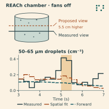
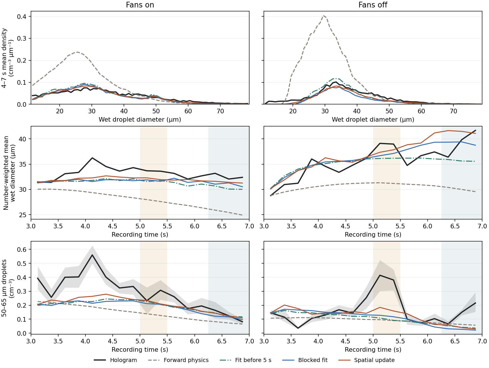
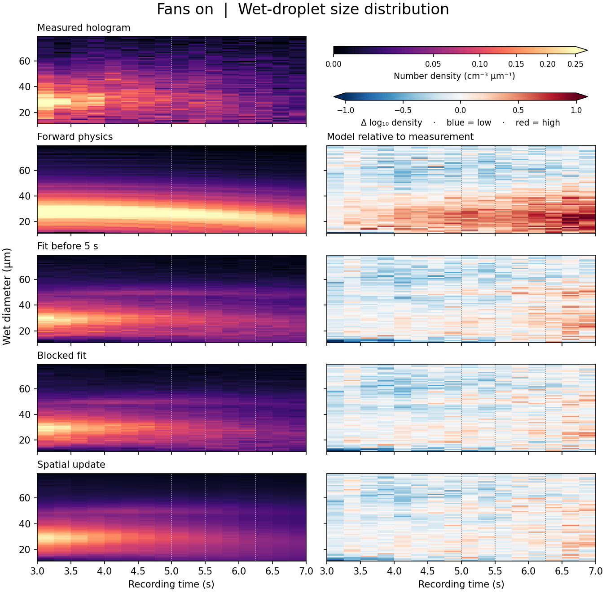
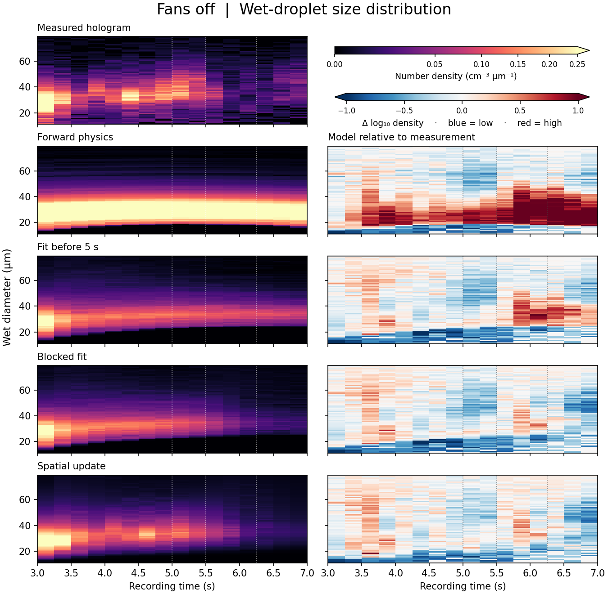
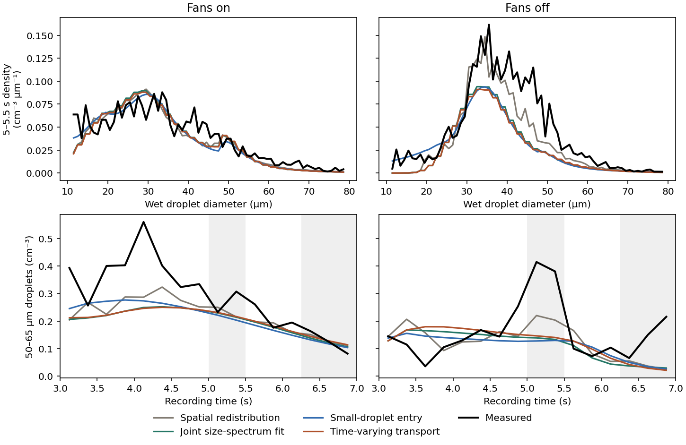
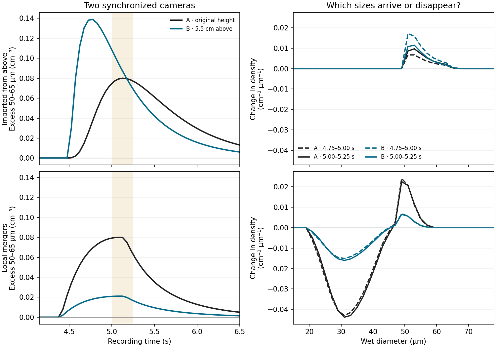

# Where did the large droplets in the REACh cloud chamber come from?

*With the fans off, a hologram caught a half-second burst. Did the droplets grow in the camera’s view, or did the flow carry them there?*

Between 5 and 5.5 s, the holograms published by Sagan and colleagues for the rapid expansion aerosol chamber (REACh) give a concentration of 0.398 droplets/cm³ at wet diameters of 50–65 µm. A well-mixed Particula model initialized from the early droplet distribution predicted 0.093 droplets/cm³ under the recorded temperature and vapor conditions, about a quarter of the measured concentration. A spatial model used earlier holograms to redistribute droplets and fitted its controls on both sides of the burst. It reached 0.172 droplets/cm³. To test what a second camera could distinguish, we simulated a passing parcel and a pulse of local mergers that produced the same extra peak concentration at the camera. A second simulated view 5.5 cm higher saw the arriving parcel peak 0.35 s earlier than the original view. With local mergers, the upper view peaked one 0.05 s step later. That difference in timing gives a new experiment a way to distinguish the two explanations. [Original experiment](https://doi.org/10.1063/5.0344133) · [Two-camera comparison](camera.md)

## Why turn on the fans during an expansion?

A droplet can vanish from a patch of cloudy air before that patch mixes with its surroundings. In an earlier REACh experiment with aerosol seeds, Erinin and colleagues counted fewer droplets as the cloud dissipated, even while the surviving droplets’ mean diameter stayed nearly constant. They proposed that warm air from the walls evaporated entire pockets of droplets. In the independently heated and cooled Π chamber, measurements at different locations showed a broader distribution of water-vapor saturation in the downdraft than in the updraft. A droplet’s route through a chamber can therefore matter even when the chamber-average conditions are known. [Erinin et al., Figure 7](https://doi.org/10.1063/5.0255658) · [Π chamber circulation measurements, Figure 13](https://amt.copernicus.org/articles/14/5473/2021/)

Sagan and colleagues asked how forced mixing affected droplets that nucleated directly from water vapor. They expanded humid nitrogen with and without the fans, choosing runs with similar peak saturation ratios, 5.31 and 5.40 respectively. This ratio compares the water vapor pressure with its equilibrium value over liquid water at the measured temperature. The runs began at different saturation ratios (0.65 and 0.50) and had different pressure drops (347 and 378 hPa), so the observed contrast includes differences in forcing as well as fan operation. Thermocouples measured local temperature and a laser measured vapor along its path. A second laser and a holographic camera resolved individual wet droplet sizes in a small volume near the chamber center. The fans made temperatures more uniform across the sensor array, yet the 4–7 s droplet distribution was broader. The authors proposed that smaller cold, moist and warm, dry pockets gave droplets different growth histories. We asked how much of the later spectrum follows from the droplets already visible at 2.5–3 s. The transient excess of large droplets with the fans off offered a further test of whether those droplets grew locally or arrived from elsewhere. [Sagan et al., Sections II D and III C, Figures 6–7](https://doi.org/10.1063/5.0344133)

## Following the same sizes through the original camera

We reconstructed 68 one-micrometer classes of wet diameter, covering 11–79 µm, from the two published time series. Nine holograms at 600 frames/s contributed to each nominal 15 ms spectrum. Large droplets could be detected farther from the focal plane, and the published concentrations already correct for that larger sampling volume. Each calculation starts at 2.75 s with the early distribution from its own run. Later temperature and vapor measurements supply the gas conditions. The original experiment had one holographic sampling region in each expansion. [Measurements and camera calibration](camera.md)

The forward calculation follows individual water droplets as they condense or evaporate under the measured gas conditions, collide, settle and deposit on the walls. Heat transfer limits how quickly the droplets can grow. A *collision kernel* gives the rate at which a pair of droplet sizes encounters one another. The spatial model divides the chamber into volumes that exchange air and droplets, then samples the simulated chamber through the size-dependent camera footprint. We tested whether the camera spectra could constrain collision rates, temperature differences and transport between volumes. Automatic differentiation computes how the predicted spectrum changes when these parameters change, allowing us to fit them over designated time intervals. [Model and fitting windows](methods.md)

| Curve in Figures 1–2 | Which holograms enter the calculation? |
|---|---|
| **Measured** | Sagan and colleagues’ time-resolved spectra and their pooled 4–7 s spectrum. |
| **Forward physics** | Only the early distribution. Individual droplets evolve in a well-mixed volume. Every later concentration is a prediction. |
| **Fit before 5 s** | The early distribution and spectra from 3–5 s. The last fitted controls carry forward in a 576-volume particle simulation. |
| **Blocked fit** | The early distribution and spectra from 3–5 and 5.5–6.25 s. Values in the 5–5.5 s gap use fitted periods on both sides. Values after 6.25 s use the last fitted controls. |
| **Spatial update** | The same fitted periods. After each available quarter second, a size-bin model shifts droplets between volumes according to the preceding camera discrepancy. Each update conserves the chamber-wide number of droplets in each size class. Updates stop throughout both scoring windows. |

*Figure 1. Black shows the original camera. Its pooled spectrum comes from Sagan et al.’s Figure 7c. Its time traces use the common 11–79 µm range of Figures 7a,b. All four calculations retain absolute concentrations. The population’s mean diameter can rise when smaller droplets disappear. Ochre marks the 5–5.5 s burst window and blue marks the 6.25–7 s forecast. The gray interval on the measured large-droplet trace comes from resampling contiguous time blocks within the run.* [Measured series and plot data](data.md)

The early fit carried useful information forward with the fans on. From 6.25 to 7 s the camera measured 0.123 droplets/cm³ at 50–65 µm. The well-mixed forward calculation gave 0.073 and the spatial particle simulation fitted only before 5 s gave 0.142. Spatial resolution and parameter fitting both change between those calculations. With the fans off, the pre-5 s fit gave 0.053 droplets/cm³ against 0.144 measured in the same late window. The blocked fit, which also used spectra from 5.5–6.25 s, reproduced the late distribution more closely overall but gave only 0.026 droplets/cm³ in this size range. [How the model variants compare](methods.md)

*Figure 2a. Fans on. Each quarter second and diameter class in the hologram is compared with the same time and size in each model. The forward calculation retains too many middle-sized droplets late in the expansion. In the difference panels blue means a deficit and red an excess. The color is the base-ten logarithm of (model + 0.005)/(measurement + 0.005), with both densities in cm⁻³ µm⁻¹. Dotted lines mark 5, 5.5 and 6.25 s.*

*Figure 2b. Fans off. The forward calculation retains too many middle-sized droplets while missing the large-droplet burst. All four models have a concentration deficit at 50–65 µm during 5–5.5 s. The density colors saturate above 0.25 cm⁻³ µm⁻¹ and the difference colors beyond a factor of ten. Figures 2a and 2b use identical scales.* [Bin-by-bin concentrations](data.md)

| Mean 50–65 µm concentration (droplets/cm³) | Fans off, 5–5.5 s | Fans on, 5–5.5 s | Fans off, 6.25–7 s | Fans on, 6.25–7 s |
|---|---:|---:|---:|---:|
| Measured | 0.398 | 0.270 | 0.144 | 0.123 |
| Forward physics | 0.093 | 0.132 | 0.062 | 0.073 |
| Fit before 5 s | 0.102 | 0.214 | 0.053 | 0.142 |
| Blocked fit | 0.117 | 0.230 | 0.026 | 0.125 |
| Spatial update | 0.172 | 0.230 | 0.041 | 0.131 |

*Table 1. The fan-off burst is the largest measured concentration in these four windows. Redistributing the earlier droplets brings the simulated burst closer to the camera measurement. In the last fan-off quarter second that calculation also gives a mean diameter close to the measured value, 41.4 versus 41.7 µm, while its visible concentration is only 0.206 against 1.071 droplets/cm³.* [Window and time-series data](data.md)

## Which fits came closest across the whole distribution?

We compared 44 configurations with results in both expansions. We gave the two fan settings and the two scoring windows equal weight, averaged the squared errors over size and time, and took the square root. Figure 3 compares the strongest configuration in each of the four highest-ranked model families. The small-droplet entry and joint fits differed by less than 0.000005 cm⁻³ µm⁻¹ in this retrospective ranking on two expansions. A new expansion would test how well the selected fits transfer. [Ranking and numerical checks](methods.md)

| Model family | What the fit could adjust | Density error (cm⁻³ µm⁻¹) |
|---|---|---:|
| Conservative spatial redistribution | Move droplets between volumes after observing a training quarter. The winning calculation used 18 volumes. | 0.0170 |
| Entry of small droplets | Supply droplets below the visible size range, drawing the added liquid water from vapor. | 0.0205 |
| Joint whole-spectrum fit | Adjust collision rates, spatial temperature contrast and transport. | 0.0205 |
| Time-varying transport | Vary circulation and exchange between volumes over time. | 0.0210 |

*Figure 3. The top panels average each spectrum over exactly the same 5–5.5 s interval. The bottom panels follow the large-droplet concentration through time, including the periods used for fitting. Gray shading identifies the scoring windows. All four curves come from calculations that track concentrations in size classes. The ranking rewards agreement across the full distribution, so even the best-scoring fit can miss a rare size class.* [Scores and displayed spectra](data.md)

## A second camera could distinguish arriving droplets from local mergers

An earlier collision test shows why timing matters. A 15,000-fold increase in collisions between middle-sized parents, selected using the burst itself, brought the 5–5.25 s concentration to 0.381 droplets/cm³ against 0.415 measured. By then the simulated count was falling as the measured count rose. [Collision-pulse comparison](mechanisms.md)

A passing parcel and a burst of local collisions can both raise the large-droplet count at the center. We tested whether they give different signals at a second height. Camera A sampled a horizontal diameter at an assumed elevation of 25.4 cm above the floor. Camera B sampled the same chamber 5.5 cm higher, at the same times and with the same optical calibration. The physical apparatus and its viewport drawing constrain these positions. The exact alignment of the original run is unknown. [Optical footprint and proposed camera positions](camera.md)

In the first simulation, we moved existing 50–65 µm droplets from an outer annulus to a parcel centered 10 cm above A, initially outside its view. In the second, we increased the collision rate near A for pairs of 20–48 µm droplets. For each intervention we used A alone to match an extra peak of 0.080 droplets/cm³ in the observed peak quarter. The resulting *absolute* means at A were 0.140 and 0.137 droplets/cm³ during 5–5.25 s, respectively. The hologram measured 0.415. Matching a common increment lets us compare the signals that these two mechanisms would produce elsewhere. [Matched simulations and assumptions](mechanisms.md)

*Figure 4. Each curve is a simulated change relative to the corresponding undisturbed calculation. The arriving parcel gives the upper camera an extra 0.139 large droplets/cm³ at 4.775 s, then A reaches its peak at 5.125 s. With local mergers the upper excess is only 0.021 droplets/cm³. The central merger signal peaks at 5.075 s and the upper signal at 5.125 s. The right panels show which size classes supplied or lost droplets. Times are midpoints of the 0.05 s simulation steps.* [Paired predictions and sensitivity checks](mechanisms.md)

A parcel arriving from above reached half its peak at B 0.13–0.24 s earlier than at A across changes in grid resolution, flow and alignment. For local mergers, the two half-rise times remained within about one simulation step. A parcel rising from below would call for a lower second view. The predicted difference between the two upper-camera peak concentrations is 0.118 droplets/cm³, comparable to uncertainty in one quarter second at the original camera. For the measured 0.415 droplets/cm³, resampling consecutive observations gives a within-record range of 0.302–0.524. Repeated expansions and synchronized observations at two heights would make timing a more discriminating test. [Measurement uncertainty](camera.md) · [Flow and placement tests](camera.md)

An upper-camera lead followed by the same sizes at A, with measured velocities consistent with the travel time, would support arrival from above. Nearly coincident half-rise times accompanied by depletion of the middle sizes and observed coalescence at A would support local mergers. A smooth progression through adjacent sizes alongside measured local supersaturation would support condensation. Co-locating the beams first would calibrate relative timing and sizing before the two-height experiment. The two records compared here contain one expansion per fan setting and one camera volume per expansion. They show where the well-mixed prediction falls short. The origin of the observed large droplets remains open until their sizes and motion can be followed at more than one location.

## Explore the experiment

[Hologram measurements and camera geometry](camera.md) · [Transport, collision and growth tests](mechanisms.md) · [Model, fits and reproducibility](methods.md) · [Source data and figure values](data.md)
