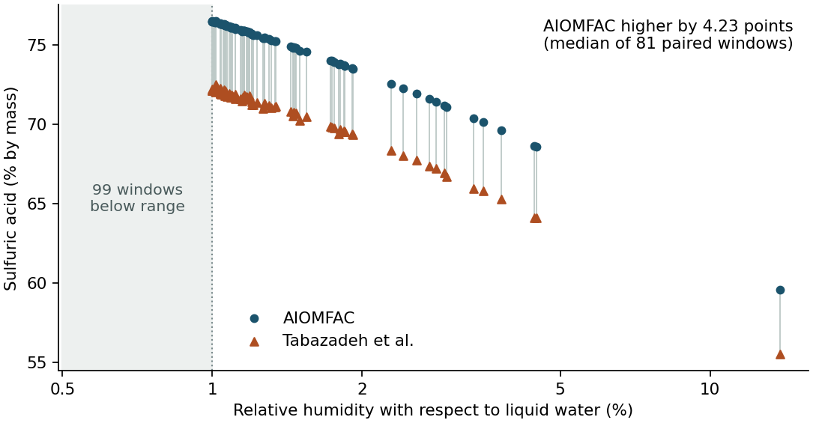
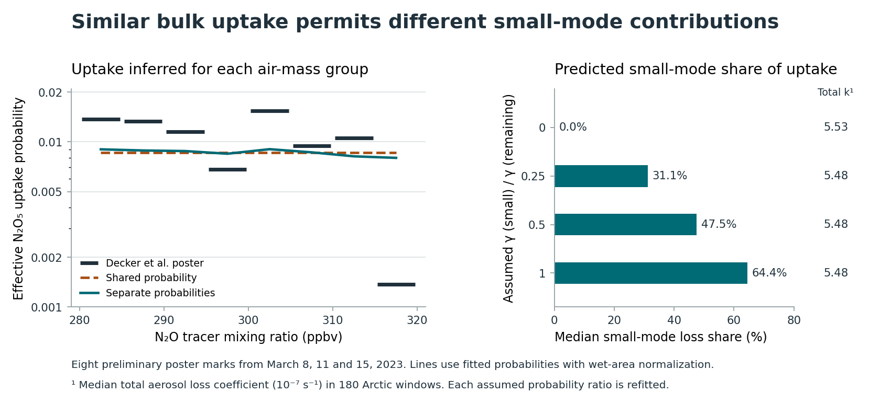

# What controls modeled N₂O₅ uptake on Arctic particles?

A gas molecule first encounters a particle surface. Whether the collision consumes dinitrogen pentoxide (N₂O₅) depends on the particle’s composition and its ability to take up and process the molecule. We tested those steps separately. The flight humidity and a thermodynamic model determine how much surface is available. Fits to preliminary campaign estimates then test which reaction probabilities the data can distinguish. [Integrated study](index.md) · [Decker et al., SABRE chemistry poster](https://insidecires.colorado.edu/rendezvous/uploads/Rendezvous_2024_7167_1715358233.pdf)

## The assumed inlet water changes the direction of the area correction

The airborne laser hygrometer measured relative humidity with respect to liquid water in all 180 selected windows. Temperatures ranged from 209.5 to 225.2 K. Liquid-relative humidity ranged from 0.50% to 13.81%, with a median of 0.93%. We retained the measured number of particles in each size interval and the small-mode fraction estimated from the dry spectra. In the nominal case, the dry small mode was equal masses of sulfuric acid and butanediol, a soluble organic proxy. We represented the remaining particles as sulfuric acid. Both compositions are model assumptions. [Flight selection and size fits](optics.md)

Particula-AIOMFAC calculates water activity, the equilibrium vapor pressure of water over the mixture relative to pure water. For each size and composition we found the amount of liquid water for which this activity, corrected for surface curvature, matched measured liquid-relative humidity. The calculation assumes homogeneous liquid particles in equilibrium. Phase separation, freezing or slow diffusion through an organic coating could change their response. Each wet particle retained its original size-bin and modal assignment. [AIOMFAC ion–organic interactions](https://acp.copernicus.org/articles/11/9155/2011/)

The correction was much larger for the acid particles. With water-free inlet diameters, the modeled small mode contained a median 1.76% water by mass and the remaining population 23.2%. Total area grew by a median 11.1% across the flight windows. Treating water as ideal, while retaining the same dissolved species and sulfate dissociation, gave only 0.3% growth. The model is sensitive to the initial water already present at sizing. The AMP header gives inlet humidity below 40%. Equilibrating inlet particles at 10% relative humidity and 298 K reversed the correction and gave a median 10.6% decrease in area at flight conditions.

| Assumption changed from the nominal case | Median ambient area / area at the measured diameter |
| --- | ---: |
| Nominal nonideal water, 50% organic mass in the small mode | 1.111 |
| Ideal water activity at the same solute speciation | 1.003 |
| Small mode at 25% or 75% organic mass | 1.200 or 1.102 |
| Measured humidity decreased or increased by 10% relative | 1.108 or 1.114 |
| Inlet particles equilibrated at 10% relative humidity, 298 K | 0.894 |

Two independent composition checks qualify these predictions. The Particle Analysis by Laser Mass Spectrometry instrument (PALMS) provided 103 distinct three-minute records contributing to 162 windows. In its sulfate–organic–nitrate class, the median organic fraction of combined organic and sulfate mass was 0.211, and the ammonium-to-sulfate molar ratio was 0.465. Assigning a mixture consistent with both ratios to every particle gave 9.2% median area growth, compared with 11.0% in the nominal case over those same windows. The corresponding small-mode water contents differed much more, at 8.21% and 1.72% by mass. PALMS integrates across sampled sizes starting around 120 nm, leaving the composition of the smaller particles open. [NOAA SABRE data and instrument records](https://csl.noaa.gov/projects/sabre/data.html)

The flight temperatures also fall below the usual range of the model’s ionic-mixture parameters. We compared predicted sulfuric-acid concentrations against a low-temperature binary acid–water parameterization at the same temperature and humidity. In the 81 windows inside its range, AIOMFAC predicted a median sulfuric-acid mass fraction 4.23 percentage points higher. The other 99 windows were too dry for this test. Refining the thermodynamic grid and doubling the diameter integration order changed total wet area by at most 0.0061% across the nine hydration cases. Numerical convergence leaves the uncertainties in inlet water and cold acid–organic thermodynamics in place. [Tabazadeh et al. (1997), equations 2–3 and Table 2](https://doi.org/10.1029/97GL01879)

*The two calculations use the same flight-window temperature and humidity. Each connector joins their predictions for binary liquid acid and water, with surface curvature switched off.*

## A limit independent of the fitted probabilities

The weights for each tracer group are the mean small- and remaining-population wet surface densities divided by the chosen reference surface. If the uptake probabilities are fixed and nonnegative, the ratio of the effective probabilities of two groups is a weighted average of the ratios for the two populations individually. The extreme is reached when one population accounts for all uptake. With the nominal wet reference, letting only the small mode react gives a maximum-to-minimum ratio of 1.066. Letting only the remaining particles react gives 1.129. Every fixed pair lies below that larger limit, compared with an 11.2-fold span in the eight preliminary field marks.

Removing the lowest mark gives a seven-group limit of 1.10 against a 2.26-fold field contrast. The corresponding dry-reference limits are 1.14 for all groups and 1.12 for seven. As a looser test, allow arbitrary positive averaging weights within the 133 matched flight windows. The range of individual-window surface weights still caps the contrast at 1.54 under wet normalization and 1.58 under dry normalization. Those limits cover different averages of the selected windows. The published retrieval could have sampled different windows and its per-group uncertainty remains unknown. [Flight matching and calculation order](reproduction.md)

## Several reaction probabilities fit the same eight tracer groups

Decker and colleagues inferred an effective uptake probability, γ, using measured N₂O₅ and a model of the preceding 24 hours of chemistry. Their preliminary poster gives eight central marks for 5 ppbv intervals of nitrous oxide (N₂O) between 280 and 320 ppbv. Our particle selection contributes 133 windows on the same three dates, March 8, 11 and 15. Each tracer group supplies one fit target. Exact retrieval times, aggregation, and the surface area used to normalize uptake are unavailable. Their model also showed about a 20% change in retrieved γ when switching between modeled and observed NO₂. [Decker et al., *Air Mass Relation* panel and NO₂ sensitivity](https://insidecires.colorado.edu/rendezvous/uploads/Rendezvous_2024_7167_1715358233.pdf)

For each window we multiply each population’s wet area by its assigned γ, add the two contributions, then divide by the assumed reference area. We average the resulting probability within each tracer group. The optimizer uses automatic differentiation to minimize the mean squared difference in log₁₀ probability, with equal weight for each of the eight groups. Using total wet area as the reference gives a common γ of 0.00862. With separate probabilities, the optimizer gives γ = 0.0246 on the remaining particles and places the small mode at the numerical lower limit near 10⁻⁶. A dry reference area gives 0.00777 and 0.0222 for the corresponding common and remaining-particle probabilities.

*Each dark horizontal mark represents a preliminary field estimate for one tracer group. The right panel holds a ratio of the two probabilities fixed, refits the overall scale, and reports the median over 180 flight windows.*

Changing the distribution of reactivity between particles barely changed the fit error. Fixing the small-to-remaining probability ratio at 0, 0.25, 0.50 or 1 gave small-mode shares of 0%, 31%, 47% or 64% of the modeled loss. Across those choices the root-mean-square error changed by 0.014 dex (units of log₁₀ probability). Leaving out one tracer group at a time gave errors of 0.364 dex with a common γ and 0.348 dex with separate γ values. Withholding the group at 315–320 ppbv made the separate-probability fit predict 0.0103 against its mark of 0.00137. The lower bound indicates a direction favored by the fit. The shallow change in error leaves a broad range of uptake shares compatible with the comparison.

Allowing the small-mode organic fraction to vary added little information. We differentiated the comparison through an interpolation between five directly calculated AIOMFAC compositions spanning 25–75% dry organic mass. Four additional compositions checked that interpolation, with a maximum difference of 0.60% in small-mode wet area. Using a wet reference area gave the lowest error at 25% organic, only 0.001 dex below the 50% case. A dry reference area moved the numerical minimum to 75%. Switching off the small-mode channel gave exactly the same dry-normalized error at every tested composition because only the remaining particles contributed to the numerator. Recovering a composition from uptake would require knowing the reference area and independently constraining at least one population’s reaction probability.

## Laboratory particles distinguish effects that the flight groups combine

Known organic compounds gave different uptake probabilities at similar organic mass fractions. Gaston, Thornton and Ng measured uptake relative to an ammonium bisulfate reference. At 50% relative humidity, with roughly one-third organic dry mass, the measured ratio was 0.33 for azelaic acid and 0.80 for succinic acid. We fitted 32 other preparations across four organic compounds and reserved one near one-third organic fraction per compound. Using a separate coefficient for each compound reduced held-out root-mean-square error from 0.173 to 0.091 in normalized uptake. The succinic-acid prediction still fell below its measured 95% interval. The comparison shows that organic identity can matter even with similar bulk composition. Its humidity range and solutes differ from the SABRE particles. [Gaston, Thornton and Ng (2014), Table 1](https://doi.org/10.5194/acp-14-5693-2014)

A cold flow-tube experiment gives a complementary constraint on the acid-rich population. At 230 K Fried and colleagues reported γ increasing from 0.077 near 60% sulfuric acid by mass to 0.146 near 70%. This concentration dependence offers a way to test whether acid content changes reactivity at fixed surface area. Further laboratory work would need to reach the temperatures, water contents and mixed compositions inferred for the Arctic samples. [Fried et al. (1994)](https://ntrs.nasa.gov/citations/19950051590)

## The reaction-channel replay checks gas loss and product accounting

For one March 8 window near the median modeled wet area, both particle populations shared a closed gas reservoir initially containing 1 pptv N₂O₅. Particula transferred gas into particles at the fitted surface uptake rate, then processed dissolved N₂O₅ and particle water through N₂O₅ + H₂O → 2 HNO₃. A prescribed first-order processing coefficient of 0.02 s⁻¹ set how quickly the dissolved reservoir formed nitric acid. The common-probability case consumed 0.0328% of the initial gas in ten minutes. Halving the time step reproduced the analytic gas loss, doubling the processing coefficient changed the amount of acid formed by ten minutes, and disabling both surface channels gave zero loss. Nitrogen bookkeeping closed to within 4 × 10⁻¹⁵ of the initial inventory.

This replay checks the conversion from surface area and collision probability to gas uptake and product formation in a closed model. An atmospheric product rate would also require time-matched N₂O₅ concentrations, information about competing products, and constraints on transport and photochemistry. The main study describes how time-resolved uptake and size-specific composition could discriminate the proposed processes in flight. [Conclusions and future measurements](index.md) · [Source recovery and reproducible tests](reproduction.md)
