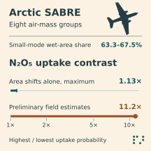
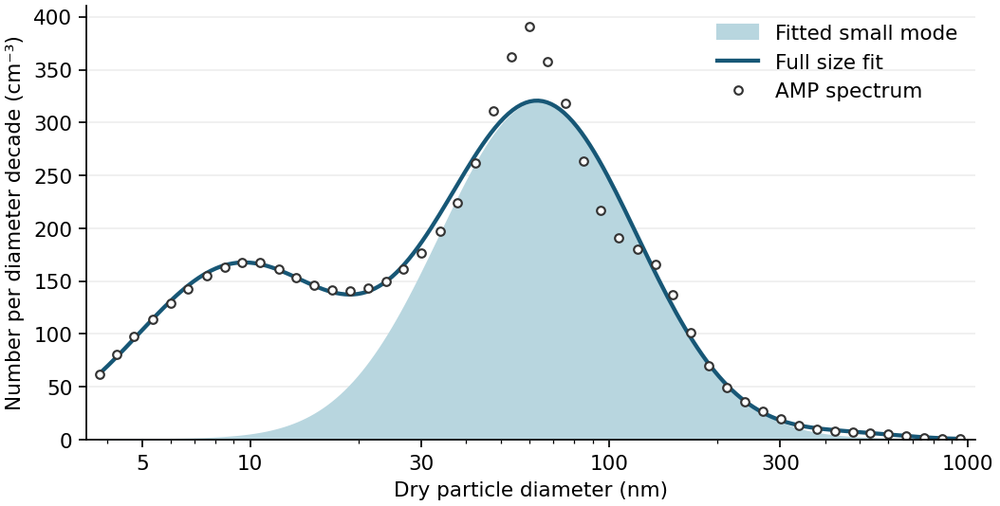
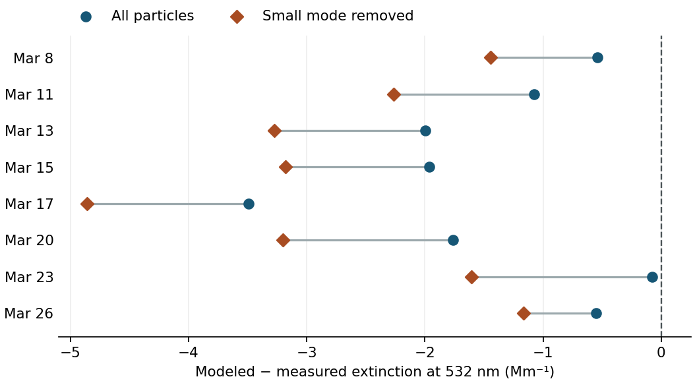
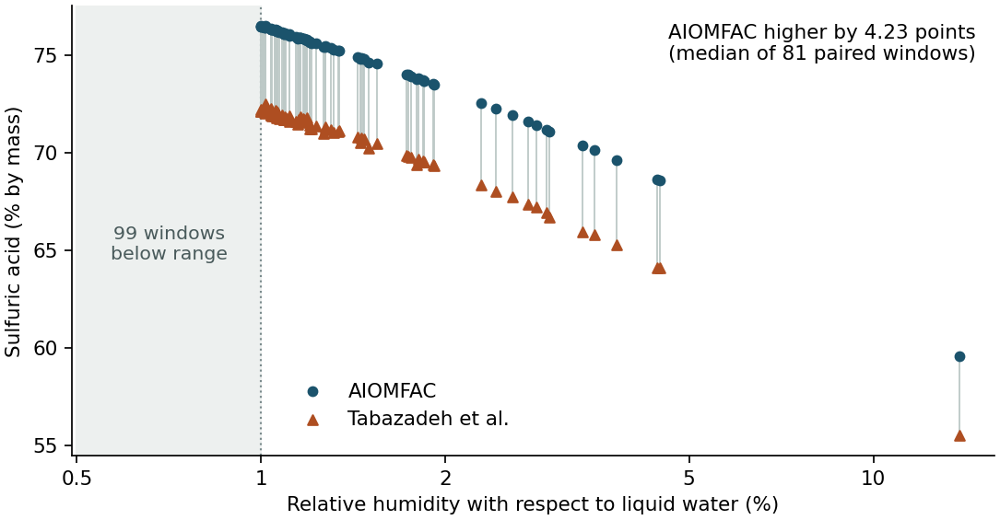
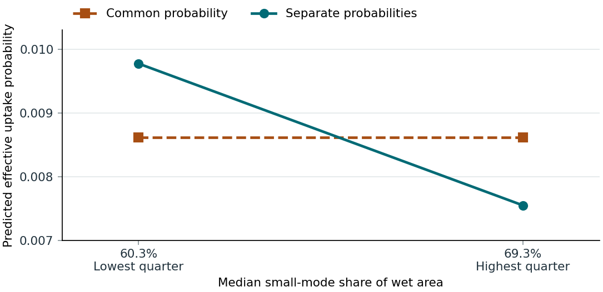

# SABRE’s inferred N₂O₅ uptake probabilities vary more than small-mode surface fractions can explain

Lyu, Ahern and colleagues found an abundant population of small, organic-rich particles in the lower stratosphere. Together those particles supply much of the surface that gases encounter. Does the share of surface they provide explain how readily a gas reacts in different air masses? We tested that idea for dinitrogen pentoxide (N₂O₅) using aircraft data from NOAA’s Stratospheric Aerosol Processes, Budget and Radiative Effects (SABRE) campaign. Across eight air-mass groups, the small particles supplied 63.3–67.5% of the modeled surface at flight humidity. Even if only one of two particle populations reacts, changing their surface shares this much allows at most a 1.13-fold change in uptake probability. The preliminary field estimates span 11.2-fold. The discrepancy persists when we omit the lowest estimate. The field comparison reveals how little the measured size distributions alone can explain, while leaving open which surfaces actually consumed N₂O₅. [Lyu et al., *Science* (2026)](https://doi.org/10.1126/science.adw8939) · [Decker et al., SABRE field estimates](https://insidecires.colorado.edu/rendezvous/uploads/Rendezvous_2024_7167_1715358233.pdf)

## Why the small particles matter

During the 2023 campaign, instruments aboard NASA’s WB-57 counted particles down to about 3 nm. Lyu and colleagues identified a *mode*, a population that forms a peak in the number of particles plotted against diameter. The small mode occurred below 19 km in air enriched in nitrous oxide (N₂O), a tracer of relatively recent transport from the troposphere. Its characteristic diameters were 30–110 nm when weighted by particle number and 80–200 nm when weighted by surface area. The larger particles in the mode count more heavily toward area because a sphere’s surface grows as diameter squared. Many of these particles fall below the useful sensitivity of satellite and balloon optical measurements. The chemistry–climate model examined by Lyu and colleagues also struggled to reproduce their size and organic content. [Original paper](https://doi.org/10.1126/science.adw8939) · [NOAA’s account of the observations](https://csl.noaa.gov/news/2026/442_0423.html)

*Circles trace the published size distribution for the 300–330 ppbv N₂O group, drawn from 359 thirty-second samples. The small mode peaks near 64 nm in the fit, which underestimates the height of the measured peak.* [Jensen et al., slide 14](https://csl.noaa.gov/events/sabre2024/presentations/day3/Jensen.pdf)

The chemical question concerns a different nitrogen compound from the N₂O air-mass tracer. When gaseous N₂O₅ reaches a particle, it can enter the particle and react with water to form nitric acid. This reaction, called hydrolysis, shifts nitrogen into a reservoir that affects the chemistry of stratospheric ozone. The probability that a collision results in uptake is denoted by γ. Particle size and abundance determine how often collisions occur. The particle’s composition and water content can determine what happens after contact. [Decker et al., SABRE chemistry poster](https://insidecires.colorado.edu/rendezvous/uploads/Rendezvous_2024_7167_1715358233.pdf)

## What the aircraft could see

We first checked whether our fit recovered the size scale in the paper. In two published SABRE size distributions grouped by N₂O, the fitted small mode supplied 71% and 78% of dry surface area. Its area peaked at 198 and 141 nm, respectively, within the range reported by Lyu and colleagues. This comparison uses overlapping campaign observations. We then applied the fitted size dependence to 180 individual 75-second windows from eight flights at or north of 60°N, between 12 and 19 km, with N₂O between 270 and 330 parts per billion by volume. [SABRE size distributions, slide 14](https://csl.noaa.gov/events/sabre2024/presentations/day3/Jensen.pdf) · [Size fits and flight selection](optics.md)

The Aerosol Microphysical Properties instruments measured particle number by diameter. A separate instrument, the Spectrometers for Optical Aerosol Properties (SOAP), measured extinction, the amount of light lost from a green beam by scattering and absorption. Omitting the entire fitted mode from our calculation worsened agreement with SOAP in 155 of 180 windows. Its largest particles scatter appreciable light. Omitting every particle measured below 150 nm removed a median 28% of dry area and only 0.86% of predicted extinction. Those two omissions select different particles because the fitted mode extends above 150 nm and overlaps other populations. [Optical tests, instrument uncertainty and three matched examples](optics.md)

*Each line joins two median modeled-minus-measured extinction values for the same flight. Zero is agreement with SOAP. Removing the fitted mode increases the underestimate on all eight flights.*

## From inlet diameters to the surfaces a gas encounters

The particles were sized in a dried inlet. To predict their surface at flight conditions, we used Particula-AIOMFAC to calculate how interactions between water, organics and dissolved ions affect equilibrium water uptake. The reference case assigns equal dry masses of sulfuric acid and a soluble organic surrogate to the small mode and sulfuric acid to the remaining particles. At the measured humidity, the acid-rich particles took up more water. Across the 180 windows, the fitted mode’s median surface share fell from 70.4% using inlet diameters to 64.4% after equilibration. [Hydration and composition tests](chemistry.md)

Water already present at sizing can reverse the area correction. The instrument record gives an inlet relative humidity below 40%. We tested two inlet conditions on the same 180 windows and compared the ambient area with the area calculated from the measured diameters.

| Inlet condition | Water activity model | Median change in total area |
| --- | --- | ---: |
| Water-free | Nonideal | +11.1% |
| Water-free | Ideal | +0.3% |
| Equilibrated at 10% relative humidity and 298 K | Nonideal | −10.6% |

On 162 windows with coincident particle-composition measurements, applying the organic and neutralization ratios from a single-particle mass spectrometer’s sulfate–organic–nitrate class to all particles gave 9.2% area growth versus 11.0% in the corresponding reference cases. Those measurements mainly cover diameters above about 120 nm, leaving the composition of the smallest particles uncertain. [Inlet, cold-acid and composition checks](chemistry.md)

### How concentrated is the sulfuric acid at flight temperature?

At 210–225 K, Particula-AIOMFAC extrapolates the interaction parameters for dissolved ions. To check the acid-rich particles, we compared it with a low-temperature reference for liquid sulfuric acid and water. Both calculations use the same flight temperature and humidity and assume a flat liquid surface. AIOMFAC gives a more concentrated acid solution in all 81 windows that the reference covers. The other 99 windows fall below its 1% liquid-relative-humidity limit, so the comparison leaves the driest air untested. [Cold-acid and composition checks](chemistry.md) · [Tabazadeh et al. (1997)](https://doi.org/10.1029/97GL01879)

*Each vertical line joins two predictions for the same air sample. The median difference is 4.23 percentage points of sulfuric acid by mass. Both symbols represent calculated equilibrium compositions.*

## How much uptake variation can the surface fractions produce?

For wet-area normalization the calculation has a simple form. Let $f$ denote the fraction of wet area on small-mode particles, $\gamma_s$ their uptake probability, and $\gamma_r$ the probability on the remaining particles. A molecule colliding with a randomly encountered surface then has effective probability

$$
\gamma_{\mathrm{eff}} = f\,\gamma_s + (1-f)\,\gamma_r .
$$

Decker and colleagues inferred N₂O₅ uptake using aircraft chemistry measurements and a model of gas production and loss over a day. Their preliminary poster shows eight uptake estimates for groups spanning 280–320 parts per billion N₂O on three flight dates. We matched 133 of our windows to those dates and groups and averaged their modeled area fractions within each group. The eight poster marks provide eight chemical fit targets. Their exact sampling times, uncertainties, averaging convention and reference area are unavailable, so the groups may contain different individual air samples. [Decker et al., air-mass comparison](https://insidecires.colorado.edu/rendezvous/uploads/Rendezvous_2024_7167_1715358233.pdf) · [Matching and contrast calculation](chemistry.md)

The fractions hardly change across these groups. Even assigning *all* reactivity to the remaining particles changes effective uptake by at most the ratio of their largest and smallest wet-area shares, 36.7% / 32.5%, or 1.13. Assigning all reactivity to the small mode gives a smaller contrast. Any mixture of the two fixed probabilities lies within these extremes. The preliminary field estimates span a wider range, even when the lowest estimate is omitted. Each entry below gives the highest effective uptake probability divided by the lowest for the same set of groups.

| Air-mass groups | Span of field estimates | Maximum span from wet-area fractions |
| --- | ---: | ---: |
| All eight | 11.2× | 1.13× |
| Seven, lowest field estimate omitted | 2.26× | 1.10× |

The eight-group maximum stays below 1.15 across the tested hydration and reference-area choices. Variation in how readily a population reacts, or a mismatch between the retrieved and modeled air samples, could contribute to the remaining difference. [Contrast bounds and sensitivity tests](chemistry.md)

## Different particles can carry the same bulk loss

The area limit leaves a second question. How is the total N₂O₅ loss divided between particle types? We fitted probabilities by minimizing differences between predicted and field-inferred uptake on a logarithmic scale. Giving all particles a common probability of 0.00862 assigned the fitted small mode 64.4% of uptake. Giving the populations separate probabilities assigned the remaining particles a probability of 0.0246 and pushed the small mode to the chosen lower bound near 10⁻⁶. That fit assigned the small mode less than 0.01% of uptake. When we left out one tracer group at a time, allowing separate probabilities reduced the root-mean-square prediction error in log₁₀ uptake from 0.364 to 0.348. When the lowest field estimate was withheld, the separate-probability fit predicted a value 7.5 times larger. The lower-bound solution therefore supplies little evidence that the small mode is chemically inactive. [Fits, probability-ratio tests and held-out predictions](chemistry.md)

The modeled total loss barely changes as uptake shifts between populations. In each row we fixed the small-to-remaining probability ratio and refitted the overall scale to the same eight field estimates. The last two columns give medians across 180 flight windows.

| Probability ratio (small / remaining) | Small-mode share of uptake | Total loss coefficient (10⁻⁷ s⁻¹) |
| ---: | ---: | ---: |
| 0 | 0% | 5.53 |
| 0.25 | 31.1% | 5.48 |
| 0.50 | 47.5% | 5.48 |
| 1 | 64.4% | 5.48 |

At a fixed loss coefficient of 5.5 × 10⁻⁷ s⁻¹, aerosol uptake acting alone would reduce the N₂O₅ concentration to about 37% of its starting value in 21 days. Atmospheric concentrations also depend on gas production, other losses and transport. A particle-resolved Particula replay checked that the prescribed uptake and hydrolysis channels reproduce the expected gas loss and conserve nitrogen. The field observations leave the population-specific reaction probabilities open. [Model replay, laboratory comparison and composition fit](chemistry.md)

## What measurements could distinguish the chemistry?

A field test could determine whether uptake falls as more surface shifts onto the small mode. For the 45 windows in the lowest quarter of small-mode wet-area share and the 45 in the highest quarter, the median shares were 60.3% and 69.3%. Between those two conditions the common-probability fit predicts constant effective γ of 0.00862. The separate-probability fit predicts a decline from 0.00978 to 0.00755, about 23%. Concurrent gas measurements, retrieval uncertainties, wet surface area and size-resolved composition extending below 120 nm would let that comparison be made in the same air. Repeated samples at comparable temperature, humidity and air-mass history would help separate a composition response from uncertainty in gas production or the area normalization. A reproducible decline would favor preferential uptake on the remaining particles. A flat response precise enough to resolve that decline would favor the common-probability model over this particular separate-probability fit. [Conditions behind the predictions](chemistry.md)

*Each endpoint is a model prediction for one quarter of the flight windows (45 windows per quarter). The lines connect the predicted medians. Measuring uptake over this range would test whether it stays level or falls by about 23%.*

### Testing the acid and organic pathways in the laboratory

Fried and colleagues found that N₂O₅ uptake nearly doubled as the acid concentration increased in a 230 K flow reactor. Their sulfuric acid–water particles provide a laboratory benchmark for the colder SABRE particles, which also contained organics. [Fried et al. (1994)](https://ntrs.nasa.gov/citations/19950051590)

| Sulfuric acid by mass | Measured N₂O₅ uptake probability at 230 K |
| --- | ---: |
| About 60% | 0.077 |
| About 70% | 0.146 |

A complementary cold-aerosol experiment could investigate *why* the probabilities differ. One proposed mechanism limits uptake through how readily N₂O₅ dissolves in organic-rich material. Another involves entry into a sulfuric-acid surface followed by acid-catalyzed hydrolysis nearby. At flight temperatures, compare independently prepared particles with matched wet area and measured water content. Vary the organic material at controlled acidity, and vary acidity separately at fixed organic composition. Measure N₂O₅ disappearance and nitric acid in both gas and particles, with gas-only loss controls. A response following organic identity and independently measured solubility would support a bulk-solvation contribution. A response following acidity at matched water content and solubility would support acid-sensitive processing. Varying particle radius at fixed composition and total wet area can test sensitivity to the volume available behind each unit of surface. Measuring phase state and diffusivity, and correcting for size-dependent gas transport, would help distinguish that volume response from transport limitations. Both processes may operate, so the combination of measurements carries more information than a single bulk loss rate. [Proposed field mechanisms in Decker’s public seminar abstract](https://csl.noaa.gov/seminars/2025/Decker.html) · [Laboratory evidence for composition-dependent uptake](https://doi.org/10.5194/acp-14-5693-2014)

## Reproducibility

The optical comparison uses final Arctic aircraft records and digitized campaign spectra. The chemistry comparison adds humidity, particle composition and the eight digitized preliminary uptake estimates. The replay instructions identify the original datasets, calculation order and compact values behind the figures. [Data, source recovery and replay](reproduction.md) · [Download the figure data and digitizations (ZIP)](../../../../website/public/study-data/sabre-small-mode/figure-data.zip)
