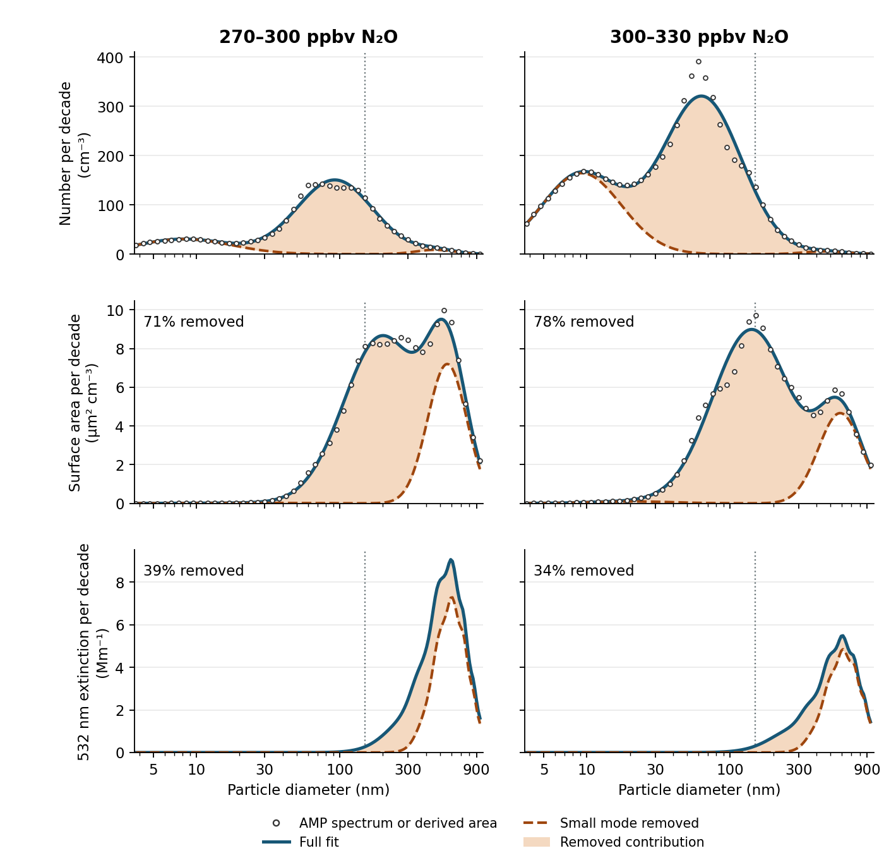
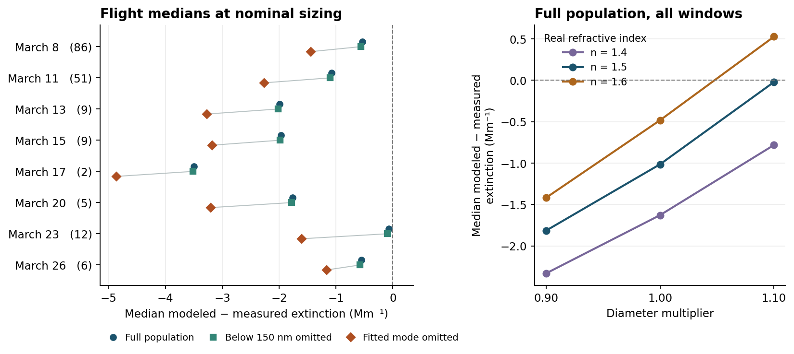

# Which part of the small mode can extinction detect?

Particles in the upper tail of the Arctic small mode contribute enough scattered light to affect an aircraft extinction measurement. Particles near the mode’s number peak can carry considerable surface area with a much weaker optical signature. Two comparisons establish the difference. We first reconstructed the mode from published SABRE size spectra. We then used final flight records to test how much removing particles changes agreement with a separate optical instrument. [Lyu, Ahern and colleagues (2026)](https://doi.org/10.1126/science.adw8939) · [Integrated study](index.md)

## Recovering the mode from the number spectra

The Aerosol Microphysical Properties instrument suite (AMP) reports how many particles fall in each diameter interval. We digitized two campaign spectra grouped by nitrous oxide (N₂O), a tracer of air-mass history. Each published curve has 49 points from 3.8 to 951 nm. The 270–300 and 300–330 parts-per-billion-by-volume (ppbv) groups represent 226 and 359 thirty-second records. The plotted curves summarize those records. Individual sample variability and the averaging weights are unavailable. [Jensen, SABRE campaign presentation, slide 14](https://csl.noaa.gov/events/sabre2024/presentations/day3/Jensen.pdf) · [NOAA’s AMP description](https://csl.noaa.gov/groups/csl2/instruments/amp/)

Each curve has an ultrafine feature near 8–9 nm, a small mode in the range identified by Lyu and colleagues, and a larger-particle shoulder. We fitted three lognormal components to number per decade of diameter. Multiplying each component by the spherical area per particle, πD², shows which diameters supply the surface. The fit gives small-mode number medians of 93 and 64 nm and surface-area peaks of 198 and 141 nm in the two tracer groups. The campaign team reported surface peaks of 171–197 and 110–158 nm across the corresponding finer tracer groups. The overlapping observations support the recovered size scale and its shift with N₂O. [Lyu, Ahern and Brock in the SABRE overview, slide 10](https://csl.noaa.gov/events/sabre2024/presentations/day1/Thornberry.pdf)

*Circles show the digitized number spectrum and the area calculated from it. Shading follows the fitted small mode across its entire diameter range. The dotted vertical line marks 150 nm.*

The fitted mode includes particles large enough to scatter appreciable green light. Integrating the modeled 532 nm extinction over the published size range assigns 39% and 34% to the mode in the two groups, alongside 71% and 78% of dry surface area. Half of the mode’s extinction comes from diameters above 387 and 336 nm, respectively. Increasing the fit weight on high particle counts changes the second group’s assigned area from 78% to 60% and its extinction from 34% to 15%. The small mode retains most of the surface under either weighting, while the optical prediction depends strongly on how the modes share their upper tails.

## Comparing size-based extinction with independent flight measurements

Extinction is the sum of the light scattered and absorbed per unit path length. The Spectrometers for Optical Aerosol Properties (SOAP) measured dry extinction at 532 nm by cavity ringdown. We matched AMP spectra, SOAP extinction, aircraft navigation and N₂O for 75-second intervals. The latitude, altitude and tracer selection retained 180 windows on eight March 2023 flights at or north of 60°N, at 12–19 km and between 270 and 330 ppbv N₂O. At least 57 valid seconds of SOAP data were required per window. Number and optical concentrations in this comparison refer to standard air volume at 273.15 K and 1013 hPa. [NOAA’s SOAP description](https://csl.noaa.gov/groups/csl2/instruments/soap/) · [Flight files and matching procedure](reproduction.md)

For each window we predicted extinction with Mie theory for homogeneous spheres, initially using a real refractive index of 1.50 and zero absorption. We used all archived diameter bins, whose edges extend from 2.8 to 2524 nm. Their coverage describes the data product. NOAA expects inlet transmission to limit the largest sampled particles to about 1000 nm. Within the range of the published spectra we kept the previously fitted fraction assigned to the small mode at each diameter fixed. We compared a full prediction, a calculation removing that fitted fraction, and a calculation deleting every particle measured below 150 nm. The last choice includes particles from overlapping modes. [NOAA AMP inlet and size coverage](https://csl.noaa.gov/groups/csl2/instruments/amp/)

*A residual of zero indicates agreement between modeled and measured extinction. Flight medians preserve the pairing between the size-based calculation and the optical observation in each window. The optical sensitivity calculation uses the same 180 windows.*

Removing the whole small mode usually made the model’s underestimate larger. With the full dry spectrum, the median signed residual was −1.01 Mm⁻¹, where Mm⁻¹ means inverse megametres. Removing the mode shifted the residual to −2.00 Mm⁻¹ and increased absolute error in 155 windows. After excluding the two flights that supplied 137 of the 180 windows, removal still worsened agreement in 40 of the remaining 43. The count was 130 of 148 for a subset with ozone above 500 ppbv and 148 of 180 with the alternative fit weighting. Nearby windows share air-mass conditions and instrument calibration.

Particle sizing and refractive index also affect the absolute prediction. Increasing all diameters by 10% at fixed counts moved the median full-spectrum bias to −0.02 Mm⁻¹. Raising the real index to 1.60 at that diameter scale moved it to +0.53 Mm⁻¹. An instrument calibration or a composition estimate would be needed to assign a likelihood to either scenario.

## Three examples of area that the optical comparison leaves open

Removing particles below 150 nm cost a median 27.7% of dry area and 0.86% of modeled extinction. Four full-spectrum predictions fell within SOAP’s quoted ±2% dry accuracy component. Three of those stayed within it after all particles below 150 nm were removed. The residuals are percentages of each window’s measured extinction. Areas in the final column use ambient pressure and temperature with dry diameters.

| Flight date | Measured extinction (Mm⁻¹, standard air) | Full residual | Residual after cutoff | Dry area removed (µm² per ambient cm³) |
| --- | ---: | ---: | ---: | ---: |
| March 8 | 2.941 | −0.55% | −1.50% | 0.316 |
| March 11 | 3.053 | −0.10% | −0.91% | 0.267 |
| March 23 | 3.945 | −0.25% | −0.87% | 0.298 |

SOAP also reports precision of ±20% at 10 Mm⁻¹ and ±5% at 100 Mm⁻¹. The highest selected window mean was 9.20 Mm⁻¹. A precision estimate at these lower loadings, including the effect of averaging correlated one-second measurements, would allow a statistical limit on missed area. The three windows instead show how much surface the optical accuracy comparison admits in specific samples. Whether that surface takes up N₂O₅ depends on its ambient hydration and reaction probability. [Chemistry tests](chemistry.md) · [Data provenance and reproduction](reproduction.md)
