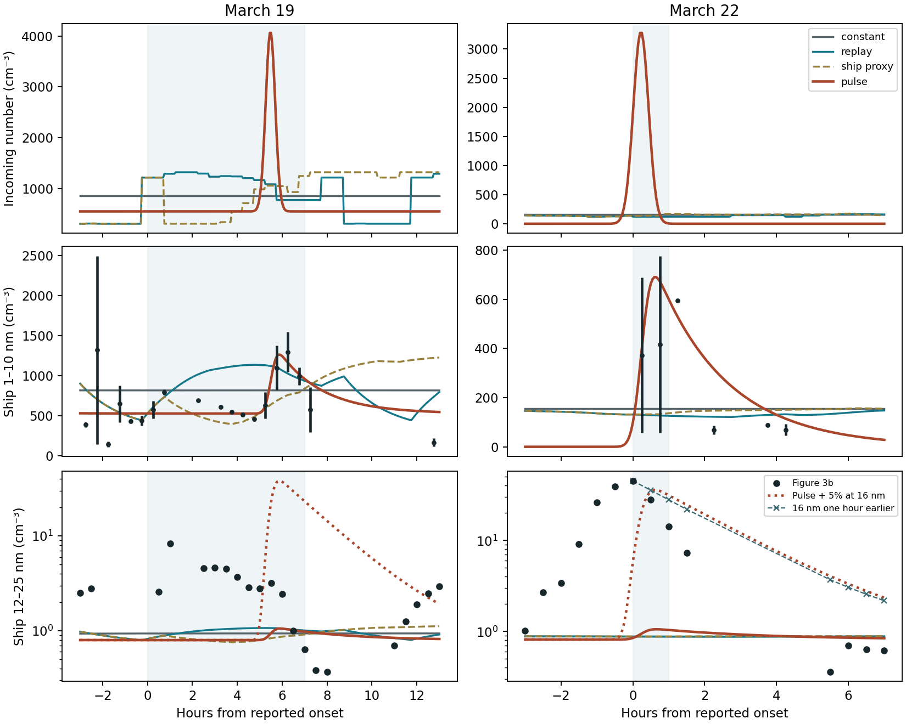
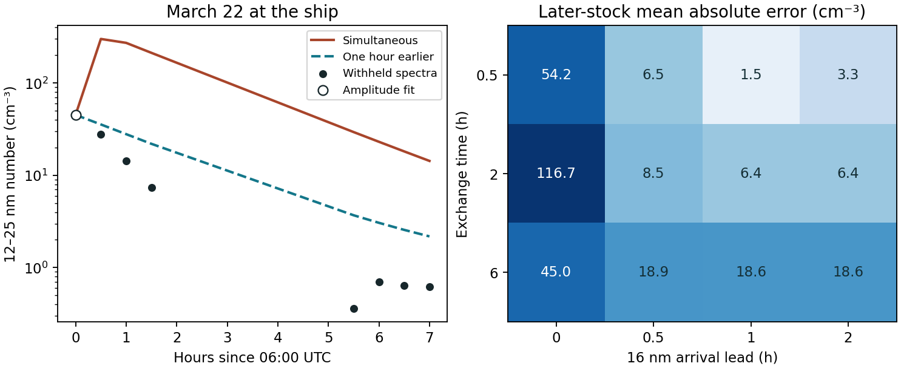
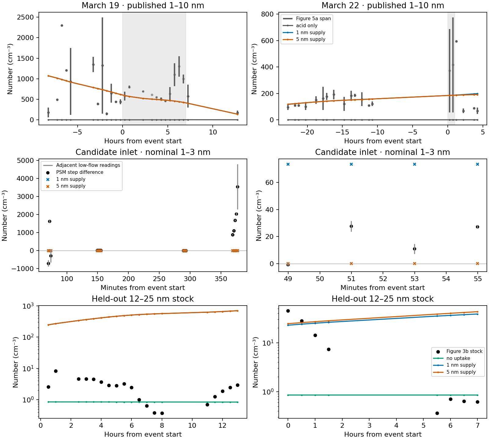
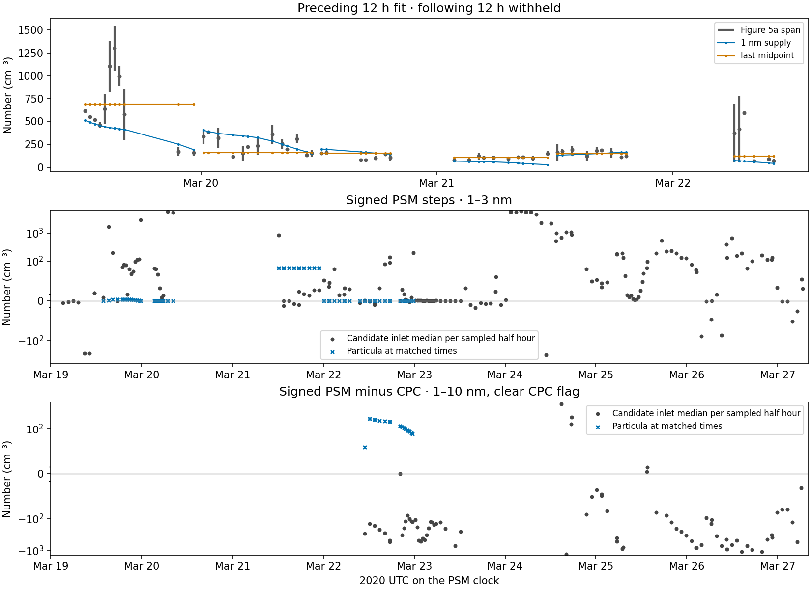
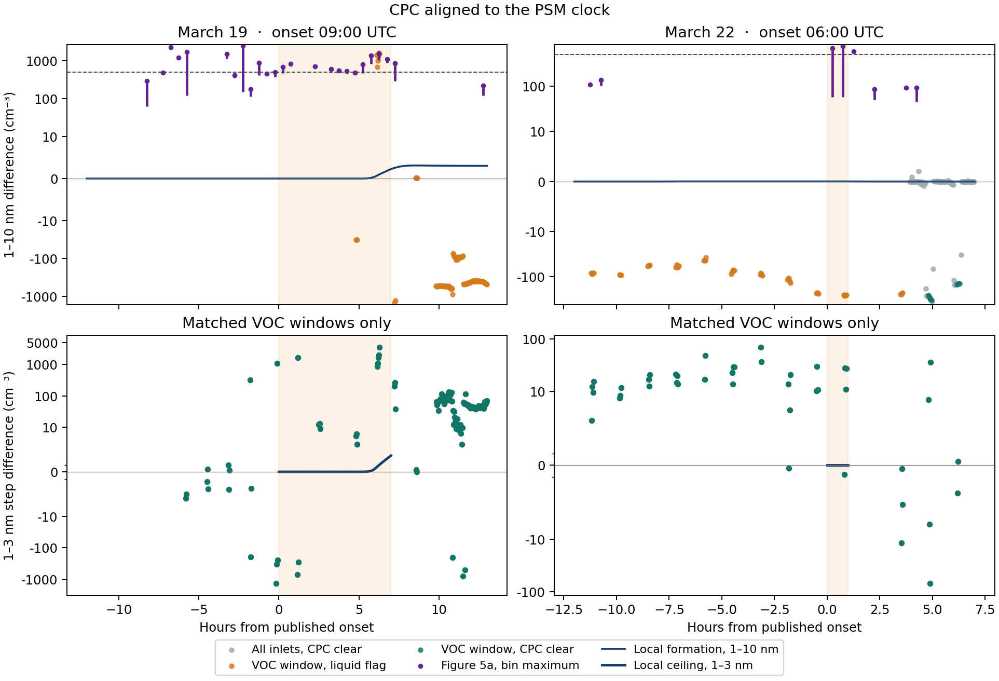

# A pulse fitted to Sea2Cloud’s smallest particles misses the early 12–25 nm enhancement


At 06:00 UTC on March 22, the *Tangaroa* size spectrum already contained about **45 particles cm⁻³ at 12–25 nm**. Ninety minutes later it contained **7 cm⁻³**. In between, Salignat et al.’s **1–10 nm** count reached **776 cm⁻³**. An incoming pulse fitted to the smaller particles can supply much of that peak, but a 16 nm component arriving in step with the pulse puts the larger particles’ rise too late. In a second test, we set the 16 nm pulse amplitude using the first larger-size observation. The seven later observations favored an earlier arrival of the larger particles in the central two-hour exchange model. Several arrival times fit about equally well. The shipboard record constrains the sequence of the two populations, while their upwind origin remains unresolved. [Salignat et al., Figures 3b and 5a](https://doi.org/10.5194/egusphere-2026-6891) · [March 22 fit and withheld spectra](../../../../website/public/study-data/sea2cloud/incoming-size-lead.csv)

## What the regional model and the ship can each tell us

Salignat et al. studied nighttime particle formation above the biologically active Chatham Rise off New Zealand. They used a marine detection criterion of 500 particles cm⁻³ at 1–10 nm. This criterion can identify a burst without requiring the sustained growth to larger sizes used to recognize many continental events. In their WRF-Chem simulations, a chamber-derived formation law using nitric acid as a proxy for nitrate ions reproduced the March 19 event better than the default sulfuric-acid schemes. The March 22 event remained unexplained. The study is a preprint. [Paper, sections 3.1.3 and 3.2](https://egusphere.copernicus.org/preprints/2026/egusphere-2026-6891/) · [Marine detection criterion](https://acp.copernicus.org/articles/22/6231/2022/)

The regional model follows formation, growth and transport before air reaches the vessel. Particula lets us ask a narrower question. Given the modeled acid at the ship, how many particles could form there, how many would have to enter with the air, and where should we find them in the size spectrum afterward? We use the published, exhaust-filtered Figure 5a for the ambient 1–10 nm target. Its half-hour spans enclose visible observations. Their midpoints are fitting targets, and their upper edges retain brief peaks. The estimated plot-reading precision is about 30 cm⁻³. For the independent larger-size comparison, we integrate the digitized Figure 3b distribution in log diameter. The plotted concentrations already include the authors’ SMPS correction. [Paper, Figures 3 and 5](https://doi.org/10.5194/egusphere-2026-6891) · [Acid and trajectory data, Figures S3 and S5](https://doi.org/10.5194/egusphere-2026-6891-supplement)

## What can the size record tell us about arrival and growth?

### A changing inflow can supply a peak. Can its arrival be predicted?

We replace air continuously in a well-mixed box. For each size class, exchange contributes the difference between its incoming and resident number concentrations divided by the exchange time. Particles also grow by organic condensation and are scavenged by the measured background. The central test uses a two-hour exchange time, 80% relative humidity and 10⁶ condensable molecules cm⁻³. Entering small particles are divided equally among four dry diameters (1.5, 3, 6 and 8 nm). We initially give each incoming population the same pre-event 12–25 nm background, then test an explicit change to that assumption.

The vessel moved only 23 and 26 km between the endpoints of the respective 12-hour pre-event tracks. Air at the reported median wind speed would travel about 449 km in that time. The published trajectories indicate 14–18 hours of preceding marine boundary-layer residence on March 19 and 12–24 hours on March 22. We found no trajectory-matched upwind size distribution for either arrival. The Baring Head 2020 aerosol campaign began after the voyage. We therefore test a shipboard indicator and an event-conditioned inflow, each with an explicit limit on what it can establish. [Ship positions](https://www.ncei.noaa.gov/data/oceans/ncei/ocads/data/0224235/61TG20200316.csv) · [Back trajectories](https://doi.org/10.5194/egusphere-2026-6891-supplement) · [Baring Head sampling periods](https://acp.copernicus.org/articles/22/6231/2022/)

| Incoming history | Information used | March 19 peak (cm⁻³) | March 22 peak (cm⁻³) |
| --- | --- | ---: | ---: |
| Constant concentration | Pre-event small-particle counts | 821 | 154 |
| Repeated pre-event variation | Pre-event counts and preceding 12 h of 25–100 nm ship spectra | 1,138 | 132 |
| Concurrent ship variation | Pre-event fit plus newly available 25–100 nm spectra | 842 | 137 |
| Pulse with the peak bin withheld | Other event and post-event 1–10 nm bins | 1,062 | 607 |
| Pulse including the peak reading | Event and post-event 1–10 nm bins, including the observed peak | 1,265 | 690 |
| **Published maximum** | **Figure 5a** | **1,548** | **776** |

The replay crossed 500 cm⁻³ near the March 19 onset, then peaked around **13:45 UTC**, about 90 minutes before the highest observed bin. Its average distance outside the March 19 observed ranges was **271 cm⁻³**, compared with **149 cm⁻³** for constant inflow. A better peak magnitude alone would have given the wrong impression about timing. On March 22 the replay stayed below 500 throughout. The event-conditioned pulse crossed the threshold around **06:21 UTC**. At the **06:45** peak-bin center it gave **673 cm⁻³**, or **592 cm⁻³** when that bin was withheld. Both fits use the subsequent decay. Their timing is a retrospective inference.

With two-hour exchange, the fitted incoming air reaches about **4,060 cm⁻³ on March 19** and **3,280 cm⁻³ on March 22**. Both fits choose the shortest tested pulse, 30 minutes wide at half maximum. The exchange model smooths that pulse before it reaches the modeled counter. These concentrations describe what this box requires under its assumed mixing time. The voyage provides no upwind measurement confirming either amplitude or width.



Shading marks the reported events. The 25–100 nm ship indicator supplies a history independent of the target size bands. The pulse curve uses the event itself. The dotted lower curve adds five incoming 16 nm particles per hundred particles in the small-particle pulse. The crosses on March 22 show the one-hour-lead case, with its amplitude set from the first larger-size observation. [Boundary and receptor histories](../../../../website/public/study-data/sea2cloud/incoming-curves.csv) · [All exchange times, growth settings and event scores](../../../../website/public/study-data/sea2cloud/incoming-scores.csv).

### The March 22 size spectrum distinguishes histories with similar peaks

With only sub-10 nm particles in the pulse, the central calculation gives **0.84–1.05 cm⁻³** at 12–25 nm over the March 22 comparison. Adding a simultaneous 16 nm component at 5% gives **5.8 cm⁻³ at 06:00** and **34.4 at 06:30**. The ship measured **45.1 and 27.9**, respectively. Increasing the larger-particle fraction can fix the first count, but sends the second in the wrong direction. On March 19 the same 5% addition raises the largest predicted 12–25 nm stock from 1.05 to 37.3 cm⁻³. The reconstructed measurements span 0.37–8.28 cm⁻³.

We tested timing independently of that particular 5% assumption. For each proposed lead, we fixed the small-particle pulse and set the 16 nm amplitude from **only the first March 22 spectrum**. The remaining **seven** spectra, through 13:00 UTC, test how the larger particles decline.

| Lead of the 16 nm pulse | 16 nm amplitude per 100 small particles in the pulse | Mean absolute error on seven later stocks (cm⁻³) |
| --- | ---: | ---: |
| Simultaneous | 44.7 | 116.7 |
| 30 minutes earlier | 6.6 | 8.5 |
| 1 hour earlier | 7.3 | 6.43 |
| 2 hours earlier | 12.1 | 6.42 |



In the central box, simultaneous arrival would predict **300 cm⁻³ at 06:30** after matching 45.1 at 06:00. A one-hour lead gives **35.5**, much closer to the observed 27.9. The one- and two-hour leads have nearly identical errors despite quite different incoming concentrations. The spectra constrain the ordering more strongly than the lag. Varying the exchange time changes that inference. At 30-minute exchange and the central vapor level, one hour of lead gives an error of 1.5 cm⁻³. At six-hour exchange and the highest vapor setting, all four leads give roughly 27 cm⁻³ error. Other compositions, earlier growth and dilution histories remain plausible. [Predictions for every size spectrum and timing assumption](../../../../website/public/study-data/sea2cloud/incoming-size-lead.csv).

### Local production leaves a measurable number deficit

At the chamber calibration ceiling of 2 × 10⁷ HNO₃ molecules cm⁻³, the published law produces about **157 particles cm⁻³ h⁻¹**. Even seven hours at that ceiling with perfect survival supplies only 1,100 cm⁻³ on March 19. One hour supplies 157 cm⁻³ on March 22. Using the recovered ship-track acid gives much lower local peaks of **2.24 and 0.021 cm⁻³** in the original 12-hour-history calculation. March 19 lacks acid for its first three initialization hours. Holding that interval at the calibration ceiling gives a maximum of 403 cm⁻³ in the slow-growth, weak-scavenging case, at the beginning of the event. [Runnable production calculation](sea2cloud_events.py) · [Pre-event hindcasts](marine_history.py)

The observed *rise* constrains how much additional number the ship must encounter. We subtract the highest earlier count, allow 30 cm⁻³ of reading error at each endpoint, and subtract an upper estimate of all local births between the outer edges of the two bins. The strongest resulting bounds are **997 cm⁻³ within two hours** on March 19 (13:45 to 15:15 bin centers) and **607 cm⁻³ within 12.5 hours** on March 22 (18:45 the preceding day to 06:45). Scavenging and growth past 10 nm increase the required supply. Changing air masses and formation from another precursor could both contribute. These bounds assume comparable ambient sampling and growth toward larger diameters. [Number budgets and bin times](../../../../website/public/study-data/sea2cloud/process-gain.csv).

### Growth can remove small particles and still put them in the wrong size band

The earlier CUDA optimization fitted organic uptake, initial inventory and a continuous source to pre-event small-particle counts. On March 19, growth improved the pre-event midpoint RMSE from **594 to 581 cm⁻³**. Yet that fit placed **245–695 cm⁻³ at 12–25 nm**, compared with the measured 0.37–8.28. Across 19 larger-size observations the mean absolute error was **489 cm⁻³**, falling to **1.98 cm⁻³** with organic uptake switched off. This is evidence against the tested steady-growth history in a single parcel. The regional calculation can also move growing particles away from the vessel. Organic uptake earlier along a trajectory remains physically possible. [Role of low-volatility organics in initial growth](https://doi.org/10.1038/nature18271)



The fixed-input collision comparisons used 350 initial particles cm⁻³, continuous 1 nm supply of 50 cm⁻³ h⁻¹ and 10⁶ organic molecules cm⁻³. Changing RH across the events’ 78.1–82.7% interquartile range moved either peak by about 28 cm⁻³. At 80% RH, neutral Brownian and hard-sphere kernels gave March 19 peaks of 727 and 742, respectively. The Gatti–Kortshagen implementation gave 541 at zero charge and 546 under the assumed bipolar mixture. Its March 22 charge increment was 3 cm⁻³. The larger difference comes from changing the underlying collision law. A measured charge distribution would be needed to translate these sensitivities to the voyage. [κ-Köhler hydration](https://doi.org/10.5194/acp-7-1961-2007) · [Gatti and Kortshagen](https://doi.org/10.1103/PhysRevE.78.046402) · [Particula rates by size](../../../../website/public/study-data/sea2cloud/process-physics.csv).

### Nine days of counters and 56 withheld bins put the events in perspective

We trained on successive 12-hour windows and withheld the following 12 hours. Six windows supplied 56 published half-hour bins. The modeled acid record ends at 00:00 UTC March 23. The counter analysis continues through March 27.

| Later 1–10 nm prediction | Mean absolute error against bin midpoints (cm⁻³) |
| --- | ---: |
| Local acid-driven births alone | 269.4 |
| Constant incoming concentration with two-hour exchange | 195.8 |
| Replay of the preceding 12 h with the same exchange | 167.4 |
| Exchange using concurrently arriving 25–100 nm ship spectra | 146.4 |
| Continuous 1 nm supply with fitted organic uptake | 112.5 |
| Carry the last observed midpoint forward | 111.8 |

Allowing incoming concentrations to vary improved the pooled error over constant exchange. The replay still performed worse than carrying the last reading forward. Using contemporaneous spectra further reduced the error, but requires observing the air as it arrives. The pulse fitted to each event is ineligible for this comparison because it uses the withheld counts. [Paired rolling exchange predictions](../../../../website/public/study-data/sea2cloud/incoming-rolling.csv) · [Original model and persistence errors](../../../../website/public/study-data/sea2cloud/cruise-predictions.csv).



The nine PSM files contain 712,661 one-second records. We matched them to eight daily files from the independent CPC. Non-event days identify a **13-hour relative offset**. On the same 158 five-minute bins on March 22, shifting the CPC clock increases the correlation from −0.34 to 0.99. The absolute clock, valve state and ship-exhaust mask remain uncertain. On the PSM clock, six successive candidate differences exceed 500 near the March 19 peak, reaching **1,621 cm⁻³ at 15:15**. Every candidate event pair carries the CPC liquid-level flag. On March 22 the five candidate differences are all negative. [PSM archive](https://doi.org/10.6096/4009) · [CPC archive](https://doi.org/10.6096/4011)



Of 5,934 high-flow PSM plateaus, 1,023 were bracketed by low-flow plateaus within the same candidate ambient tracer stream. Among 452 candidate pairs with a clear CPC flag, **433** have negative nominal 1–10 nm differences, and only **four** satisfy 0 ≤ N₁₋₃ ≤ N₁₋₁₀. With the opposite absolute clock, 116 of 659 clear candidate pairs satisfy the ordering. Three clear March 24 pairs exceed 500 on the PSM clock, but their 1–3 nm differences exceed the corresponding 1–10 nm counts. The authors discuss terrestrial influence for March 24. These passages warrant a clock and inlet check before any assignment to a published event. [Sampling system](https://doi.org/10.1029/2024JD041072) · [Counter pairs, flags, clock alternatives and raw-file hashes](../../../../website/public/study-data/sea2cloud/tangaroa-counts.zip).

<a id="what-the-experiments-establish"></a>

## Follow the same incoming air to test particle origin

Local ship-track nitric acid cannot supply the observed number fast enough under the published formation law. The regional nitrate mechanism can still contribute upwind, where residence time, concentrations and transport differ. March 19 illustrates why both scale and timing matter: replaying earlier variability recovers a threshold crossing, yet places the peak early. Assigning the decline entirely to rapid growth creates a larger-particle population far in excess of the measured spectrum. These two independent tests narrow the possible histories in a way that matching the sub-10 nm maximum alone cannot.

On March 22, incoming particles can supply much of the observed number even with little local acid-driven production. The rapidly declining 12–25 nm population was present by the start of the event. Within the tested exchange model, its later evolution is better reproduced when the larger-particle enhancement precedes the smallest particles. Several leads and amplitudes explain the observations about equally well. Neither a unique transport time nor a chemical origin follows from this fit.

The most discriminating next comparison would follow the **same incoming air** with synchronized 1–3, 3–10 and 12–25 nm counts, beginning before the larger-size enhancement. Co-located nitric acid or nitrate-ion measurements would test formation along that path. At the ship, verified valve times, counter response and the exhaust mask would allow the 1–3 nm channel to constrain the source size: earlier fits supplying particles at 1 or 5 nm predicted almost identical March 22 1–10 nm peaks of 186–187 cm⁻³, yet predicted **73.7 versus 0.018 cm⁻³** at 1–3 nm. Until those inputs are available, the particle budgets and the ordering of the size changes provide firmer conclusions than a choice of precursor. [Precursor hypotheses and campaign measurements](https://doi.org/10.1073/pnas.2308696120)

## Methods and reproducible results

- **Exchange and boundary fits.** We initialize March 19 at 21:00 UTC on March 18 and March 22 at 06:00 UTC on March 21. The first three hours use zero missing acid in the exchange study. Units are hours, dry diameter in nm and particles cm⁻³. Survival along each size trajectory includes Particula Brownian scavenging and exponential replacement at rate 1/τ. Inflow adds the external concentration divided by τ. The local nucleation source uses the interpolated hourly acid. Background and incoming concentrations apply to a stationary box on the moving ship track.
- **Incoming history.** Pre-event data set the initial inventory and either one constant concentration or two concentrations interpolated against the 25–100 nm indicator. Its pre-event 10th and 90th percentiles define the two ends. Each spectrum becomes available at its half-hour bin end. Gaps beyond two hours use the pre-event median. Replay repeats the previous 12 hours of this indicator. The concurrent case updates it with later ship spectra. No post-onset 1–10 nm measurements enter either fit. Every coefficient lies between zero and 6,000 cm⁻³.
- **Pulse and uncertainty.** A steady reservoir plus one Gaussian pulse is fitted independently to each event and six post-event hours, holding the initial inventory from the constant pre-event fit. The full fit targets the observed upper edge in the peak bin and midpoints elsewhere. The withheld fit omits that bin entirely. Pulse centers span three hours before onset through the event end in 15-minute increments. Widths at half maximum span 0.5, 1, 2 and 4 hours. We vary τ over 0.5, 2 and 6 hours and vapor over 0, 1 and 4 × 10⁶ molecules cm⁻³. Fitted event maxima span **1,025–1,418** and **473–765 cm⁻³** across those inputs. These scenario ranges describe model sensitivity. Fixed 5% additions affect only the pulse excess. The size-lead test fits a separate nonnegative 16 nm amplitude to the first larger-size observation, then freezes it.
- **Growth and detection.** The box uses 287.35 K, 101325 Pa, dry density 1500 kg m⁻³, κ = 0.3, curvature-corrected water uptake and a fixed pre-event median scavenging spectrum. The organic tracer has molar mass 200 g mol⁻¹, diffusivity 6 × 10⁻⁶ m² s⁻¹, unit accommodation and negligible equilibrium vapor pressure. Water and vapor come from external reservoirs. Small-particle self-coagulation, composition-dependent evaporation and a trajectory-specific mixing rate remain unmodeled. Smooth upper cuts have a width of 5% of nominal dry diameter. The ship’s instrument response and losses near the SMPS lower cutoff introduce additional uncertainty.
- **Counters.** The 1–3 nm estimate differences alternating PSM saturator settings. We discard settling periods, require stable plateaus, interpolate the adjacent low-flow readings and match the independent CPC within 30 s. The candidate inlet uses three successive plateaus in the same VOC-tracer window. The CPC archive names a TSI 3772 and the paper names a 3010. The main-inlet SMPS deposit describes 64 channels, but its linked file has the 26 channels and cadence of the sea-spray generator. Figure 3b supplies our larger-size reference. [Main-inlet deposit](https://doi.org/10.6096/4021) · [Sea-spray deposit](https://doi.org/10.6096/4003)
- **Numerics.** For the exchange study, the CPU builds Particula collision and growth coefficients, propagates cohorts by convolution and fits the boundary concentrations. Independent direct cohort sums on an NVIDIA RTX 5060 agree on the central sub-10 nm inflow contribution to better than 10⁻⁸ cm⁻³. Halving the three-minute step changes central band counts by less than 0.03 cm⁻³. A lossless unit reservoir stays within 0.00042 of equilibrium. In the preceding CUDA inverse study, all four automatic derivatives of the fit objective agree with finite differences within 10⁻⁶ relative error. [Exchange checks](../../../../website/public/study-data/sea2cloud/incoming-checks.json) · [Gradient and CPU integration checks](../../../../website/public/study-data/sea2cloud/process-checks.csv).

From the repository root with CUDA available, run these modules in order to regenerate the figures and comparison tables. The input figure reconstructions are in `docs/data/sea2cloud-events/`. The counter reduction is already included in the downloadable archive above.

```bash
python -m scripts.sea2cloud_events.process_inverse
python -m scripts.sea2cloud_events.cruise_series
python -m scripts.sea2cloud_events.incoming
```

The original exposure and pre-event hindcasts are also available as [runnable production](sea2cloud_events.py) and [ship-history](marine_history.py) studies. Additional tables include the [process fits](../../../../website/public/study-data/sea2cloud/process-scores.csv), [vapor sensitivity](../../../../website/public/study-data/sea2cloud/process-profile.csv), [12–25 nm stocks](../../../../website/public/study-data/sea2cloud/process-spectrum.csv), [1–10 nm observations and fits](../../../../website/public/study-data/sea2cloud/process-observations.csv), [1–3 nm comparisons](../../../../website/public/study-data/sea2cloud/process-counters.csv), [rolling fit parameters](../../../../website/public/study-data/sea2cloud/cruise-fits.csv), [daily coverage](../../../../website/public/study-data/sea2cloud/cruise-daily.csv), [half-hour counter series](../../../../website/public/study-data/sea2cloud/cruise-half-hour.csv) and [time-matched cruise predictions](../../../../website/public/study-data/sea2cloud/cruise-matched.csv).
