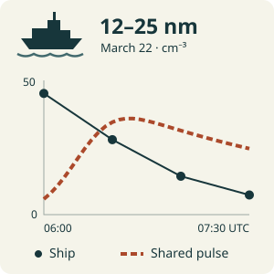

# Local production during two Sea2Cloud detection windows falls short of both plotted peaks

How much of the 1–10 nm particle population observed aboard the *Tangaroa* could have formed locally during each detection window? At the upper calibration limit of the Salignat et al. nitric-acid formation law, an initially empty box gains at most **157 particles cm⁻³ per hour**. The two reported pristine-marine windows span seven hours and one hour. Both plotted peaks exceed the respective production ceilings, even if every new particle survives. [Runnable comparison](sea2cloud_events.py) · [Salignat et al., Eq. 1, §3.1.3 and Fig. 5a](https://doi.org/10.5194/egusphere-2026-6891)

| Event (UTC, March 2020) | Figure 5a peak (cm⁻³) | No-loss ceiling (cm⁻³) | Additional inventory required (cm⁻³) | Minimum equivalent formation time |
| --- | ---: | ---: | ---: | ---: |
| 19 March, 09–16 | ~1,540 | 1,100 | ~440 | 9.8 h |
| 22 March, 06–07 | ~770 | 157 | ~613 | 4.9 h |

The last column divides the plotted peak by the ceiling rate. It assumes constant exposure at the upper limit, zero loss and no growth past 10 nm. The detection windows describe when the measured number exceeded the authors’ 500 cm⁻³ criterion. Formation may already have been underway for hours in an advecting air mass. The one-hour event cannot reach even the detection criterion from an empty box under these assumptions.

## Source and measurement

The authors prescribe J = 3.5 × 10⁻³⁷ [HNO₃]⁴·⁸⁰⁷ in particles cm⁻³ s⁻¹, for acid concentrations in molecules cm⁻³ below approximately 2 × 10⁷. We use that upper edge as a limiting case. The box uses an ideal count window extending from birth at 1 nm to exit at 10 nm. The positive physical count difference is the number above 1 nm minus the number above 10 nm. The comparison uses the published positive series directly.

We read the highest black observational marker in each stated window of Figure 5a. In the 1727 × 1079 embedded figure, the 0 and 2500 cm⁻³ ticks are approximately at raster rows 450 and 23. Marker centers near rows 187 and 319 give the rounded peaks above. Half a marker width corresponds to about ±30 cm⁻³ and describes reading precision only. The PSM archive requires registration, and the published nitric-acid forcing is a WRF-Chem model field. The comparison therefore addresses finite exposure, with no sample-matched fit to the instrument or the acid time series. [Sea2Cloud particle size magnifier dataset](https://doi.org/10.6096/4009) · [Published figure](https://egusphere.copernicus.org/preprints/2026/egusphere-2026-6891/egusphere-2026-6891.pdf#page=18)

## Growth competes with scavenging and exit

The 960 CUDA cases cross four exposure times (1, 3, 7, 12 h), five prescribed diameter growth rates (0–4 nm h⁻¹), four background concentrations (0–300 cm⁻³), three background diameters (50, 100, 200 nm), and four nitric-acid levels from 0.5 to 2 × 10⁷ molecules cm⁻³. A continuous source injects spherical dry particles. A stationary background captures them at Particula’s neutral Brownian collision rate with unit sticking. Campaign-average temperature is 287.35 K. Assumed pressure is 101325 Pa and density is 1500 kg m⁻³. Constant growth supplies external mass. Background feedback, self-coagulation, deposition, mixing and dilution are omitted.

At 1 nm h⁻¹ with 150 background particles cm⁻³ of diameter 100 nm, 736 particles cm⁻³ survive after seven hours and 135 after one hour at the acid ceiling. The corresponding scavenging losses are 364 and 22 cm⁻³. At 4 nm h⁻¹, particles cross the 10 nm cutoff after 2.25 h. Faster growth can reduce the risk of scavenging early in life yet shorten the time a particle contributes to the measured window. [Cohort and sensitivity plots](sea2cloud_events.py)

## Independent checks

GPU automatic differentiation recovers an acid elasticity of 4.807 across the grid. At the seven-hour, 1 nm h⁻¹, 100 nm and 150 cm⁻³ case, the background elasticity is −0.393. For a local 1% rise in background, the remaining count falls by about 0.39%. A centered finite difference verifies the background derivative. The neutral collision table is checked against Particula’s CPU kernel for 17 diameters per collector. Constant-diameter cases also match the independent exponential-loss integral. A zero source yields zero particles. The maximum relative number and mass budget residuals are below 0.006%, and doubling the age grid from 512 to 1024 intervals changes window counts by at most 0.017%.

Run `python scripts/docs_examples.py refresh sea2cloud-events` on CUDA to repeat the coupled calculations. Run `python scripts/docs_examples.py replot sea2cloud-events` to draw the figures from saved results. Event-matched precursor measurements, the incoming spectrum and air-mass histories would constrain a subsequent test of the observed time evolution.
