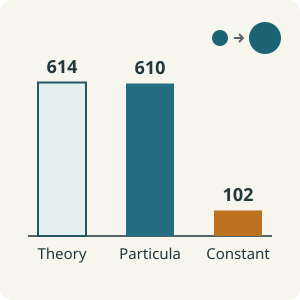
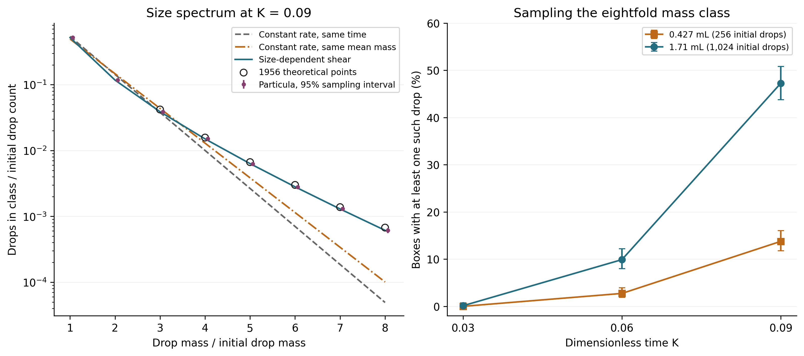

# Particula reproduces Saffman and Turner’s prediction for the number of large drops

*All three bars are model predictions. The shear-theory bar comes from an independent integration of Saffman and Turner’s equations. The eddies illustrate the assumed turbulent flow.*

Saffman and Turner (1956) asked how quickly turbulent air could produce large drops in a cloud that started with identical droplets. Their model lets larger drops encounter other drops faster. At the final time in Figure 2, Particula produced **610 drops of exactly eight times the initial mass per million starting drops**. Integrating the authors’ equations independently gave **614**. Reading the authors’ plotted marker gives approximately 675, with some uncertainty in locating the center of the printed point. Giving every pair the same collision rate and fitting that rate to the final mean mass gave only **102**. Matching mean growth therefore leaves a sixfold shortfall in this mass class. The comparison tests a calculation of cloud growth against theory. Testing its accuracy in real clouds requires measured drop counts. [Saffman and Turner, equations 1–3 and Figure 2](https://authors.library.caltech.edu/records/mvczm-fey53)

## How drop size enters the collision rate

Saffman and Turner asked whether shear could broaden an initially uniform drop population enough to help initiate rainfall. In their shear calculation, drops are small compared with the smallest turbulent eddies. Nearby fluid velocities differ across a drop pair, so even equal-sized drops can collide. The authors integrated their collision equations and plotted the predicted abundance of each mass class in Figure 2. [Saffman and Turner (1956)](https://authors.library.caltech.edu/records/mvczm-fey53)

Their cloud example uses **600 water drops/cm³** and **1.5 g of liquid water/m³**. At a liquid density of 1,000 kg/m³, each drop starts with a radius of **8.42 µm** and a mass of **2.50 ng**. Eight times that mass corresponds to **twice the initial radius**. The drops follow the turbulent air, and every encounter leads to coalescence. Only turbulent shear acts. We use the paper’s example dissipation rate of 0.01 m²/s³ and air kinematic viscosity of 1.7 × 10⁻⁵ m²/s. [Original cloud example, pp. 23–24](https://doi.org/10.1017/S0022112056000020)

For drops with radii $r_i$ and $r_j$, equation 1 gives the pair collision kernel $\beta_{ij}$ in m³/s,

$$
\beta_{ij} = \sqrt{\frac{8\pi\epsilon}{15\nu}}\,(r_i+r_j)^3 .
$$

Here $\epsilon$ is turbulent kinetic energy dissipation per unit mass and $\nu$ is air kinematic viscosity. Both stay fixed. After each merger, Particula recalculates encounter rates using the new drop sizes. Particula samples individual mergers on CUDA. The independent CPU calculation integrates equation 2 for the abundance of each integer mass class. Both use the exact square-root coefficient in equation 1, which the authors confirmed in their corrigendum. [Particula shear strategy](../../../guide/processes/coagulation.md#turbulent-shear-coagulation) · [1988 corrigendum](https://doi.org/10.1017/S002211208800285X)

## Can a rate fitted to mean growth reproduce the large-drop counts?

We compare the exact eightfold mass class at the final dimensionless time and then ask whether a sample of the modeled cloud is likely to contain a drop in that class.

### Matching average growth still leaves too few large drops

Figure 2 reports time as $K=\sqrt{8\pi\epsilon/(15\nu)}\,r_1^3 n_0t$, where $r_1$ is the initial radius, $n_0$ is the initial number concentration and $t$ is elapsed time. At $K=0.09$ (about 133 minutes here), the CUDA ensemble retained **70.26%** of its starting drop count. Because water mass is conserved, fitting the final number also fits final mean mass. The upper end of the distribution still distinguishes the models.

| Calculation at $K=0.09$ | Exact eightfold drops per million initial drops |
| --- | ---: |
| Particula, particle-resolved shear | 610 (95% sampling interval 558–666) |
| Independent integration of the published shear equations | 614 |
| Authors’ plotted shear point, read from Figure 2 | ≈675 |
| Constant pair rate, fitted to the CUDA mean mass | 102 |
| Constant pair rate, fixed at its initial two-drop value | 49 |

The ratio of the CUDA shear result to the fitted constant-rate result is **6.00** (95% box-bootstrap interval **5.49–6.57**). The marker in the printed figure sits about 10% above the independent integration. Moving its center by two pixels gives 648–703 per million. The authors used an integration step of 0.006 in $K$. The figure alone cannot establish the source of the difference. Comparing the authors’ two model assumptions at their *original* rates gives ratios of **24.4**, **17.4** and **12.5** from the equations at $K=0.03$, 0.06 and 0.09. Their description of a twentyfold or larger difference fits the earliest time most closely. [Figure 2 and discussion, pp. 22–23](https://authors.library.caltech.edu/records/mvczm-fey53)

*Left, abundance in each mass class relative to the starting count. Open circles are digitized theoretical results from the 1956 paper. The mean-matched line uses the continuous shear solution’s mean. The table fits the same baseline to the CUDA mean. Right, fraction of independent boxes containing an exact eightfold drop, with 95% Wilson intervals. The two volumes have identical initial concentration.*

### A small sample can miss the large drops

At $K=0.09$, just **141 of 1,024** simulated 0.427 mL boxes (13.8%) contained an exact eightfold drop. Increasing the volume to **1.71 mL** raised the fraction to **363 of 768** (47.3%). The corresponding pooled abundances were similar at **595 and 610 per million initial drops**. Earlier, at $K=0.03$, only one of the 768 larger boxes contained a drop in this class.

The authors also estimated roughly **100 drops/L** at two different times and minimum masses. These are cumulative counts. At 90 minutes every drop at or above eight times the initial mass contributes, including drops that have outgrown the exact eightfold class. The shear simulations reproduced the scale of both estimates. [Authors’ physical-time estimates, p. 24](https://authors.library.caltech.edu/records/mvczm-fey53)

| Time and minimum mass | Authors’ approximate theory, drops/L | Constant rate at its initial value, drops/L | Integrated shear equations, drops/L | Particula shear, drops/L (95% sampling interval) |
| --- | ---: | ---: | ---: | ---: |
| 16 min, four initial masses | 100 | 40.8 | 96.7 | 89 (73–105) |
| 90 min, eight initial masses | 100 | 5.2 | 116.7 | 101 (85–118) |

## What would test this in a cloud chamber?

Measure the initial size distribution, the large drops already present, turbulent dissipation and the probe’s sampling volume. Fit a constant rate using only the total number of drops. Then compare the withheld count at or above twice the initial radius at 90 minutes with both predictions. Calibrate detection near that radius and repeat across independent samples. Initial size spread, gravitational settling, spatial mixing and imperfect coalescence could all alter the measured tail. The reported intervals describe simulation sampling under the stated assumptions.

## Reproduce the comparison

The runnable example uses seven native CUDA ensembles on an RTX 5060, with 3,360 box trajectories in total. The main estimate pools two independent 384-box ensembles. At 1,024 starting drops per box, time steps of 89.0, 44.5 and 22.2 s gave 585, 610 and 641 exact eightfold drops per million at the final time. The sampling intervals overlap. The CPU calculation checks mass conservation and the sensitivity to retaining 32, 64 and 128 mass classes. The CUDA calculation checks unit counts, integer droplet masses, nonincreasing drop number and relative water-mass drift below 10⁻¹² per box. The saved results retain the seeds, case sizes, reference curves, digitized points and uncertainty summaries. Use the example’s ZIP download to repeat the full calculation or its saved data to redraw the figure. [Runnable study](shear_drop_spectrum.py)

### Numerical readings from Saffman and Turner (1956)

The CSV records independent manual readings of Figure 2, journal page 23 (PDF page 8). The circles represent the authors’ numerical integration. The crosses represent their constant-rate calculation. All symbols describe theoretical abundances. The input retains the three plotted dimensionless times, elementary mass class, marker type and vertical pixel coordinate. The published article and artwork are credited to Cambridge University Press. The downloadable study uses our numerical readings and original plots. [Caltech publication and PDF](https://authors.library.caltech.edu/records/mvczm-fey53)

The source PDF has SHA-256 digest `933a1e661d2e81816a906c01b67ee837db269a423532648973ba35a8d37c960f`. Render the eighth page with `pdftoppm -f 8 -l 8 -r 120 -singlefile -png paper.pdf figure2`. In that 840 × 1260 pixel image, y increases downwards. The axis runs from unity at y = 290 to 10⁻⁵ at y = 853. Thus the base-ten logarithm of abundance per initial drop is (290 − y) × 5 / 563. Moving a marker center by two pixels shifts the abundance by about 4%. This estimates reading sensitivity. The paper supplies no experimental uncertainty for this theoretical figure.
