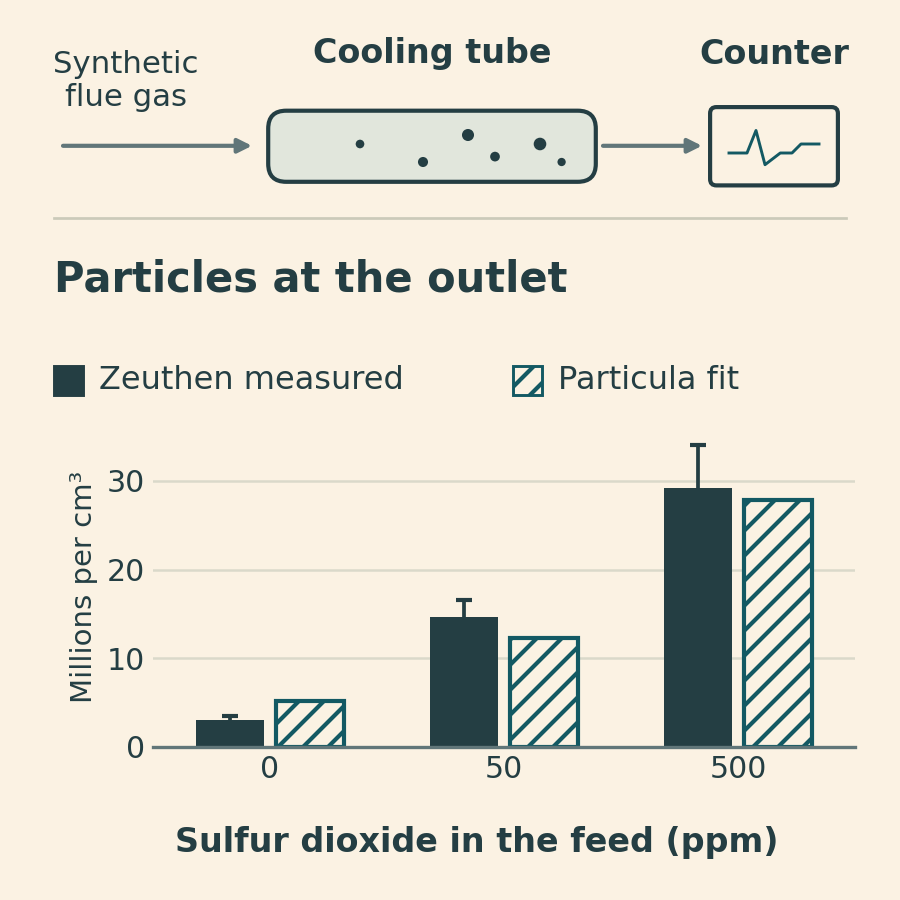
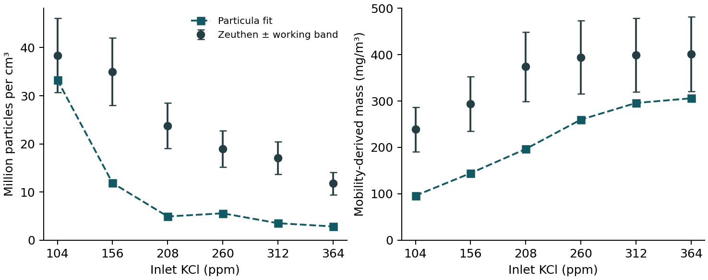

# Particula fits the measured rise in particle number with sulfur dioxide in a straw-combustion analogue

How many fine particles form as gases from burning straw cool? Jacob Zeuthen studied this question by passing a synthetic flue gas containing potassium chloride through a cooling tube and counting the particles at the outlet. Raising sulfur dioxide from 50 to 500 ppm nearly doubled the measured count, from **14.7 to 29.2 million particles per cm³**. We used Particula to simulate the same feed conditions, following potassium salts as they reacted, formed particles, and grew during cooling. A model fitted across 85 gas and aerosol measurements represented cooling with two paths through the tube and gave **12.3 and 27.8 million particles per cm³** at the two sulfur dioxide levels. It reproduced the size of the measured increase closely. In the sulfur-free case, Particula gave **5.2 million particles per cm³** where Zeuthen measured **3.0**. Across the full dataset, 49 of 85 measurements fell within their comparison bands. Using the same rates along 32 cooling paths reversed the modeled sulfur response. The agreement therefore depends on how the model represents cooling inside the tube. [Zeuthen, Tables 2–3](https://backend.orbit.dtu.dk/ws/files/4716854/JZ-Thesis%2009-07-07%20-%20final.pdf) · [Measurements and fitted values](../../../../website/public/study-data/straw-combustion/measurements.csv)

## What the cooling tube measures

Potassium released during straw combustion can travel downstream as potassium chloride (KCl) vapor. Sulfur chemistry can convert some of that potassium to the less volatile potassium sulfate (K₂SO₄). Sulfate can then form particles while much of the chloride is still gaseous. As the gas cools further, KCl can condense on those particles or form additional particles. The same mass of potassium can therefore end up in many small particles or fewer large ones. Separate post-flame experiments found sulfate aerosol at higher temperatures than chloride aerosol, using the temperature at which laser light scattering first appeared to infer the salt identity. [Jensen et al., alkali salt aerosol formation](https://doi.org/10.1080/02786820050195340) · [Weng et al., post-flame optical measurements](https://doi.org/10.1016/j.fuel.2018.03.095)

Zeuthen isolated this cooling stage with a synthetic feed containing 200 ppm KCl, 5% oxygen and 5% water vapor. A scanning mobility particle sizer counted particles from 14 to 800 nm. The whiskers in the opening figure show reported count scatter. Zeuthen did not state a reference temperature for the tabulated counts. Model counts use the 293.15 K reference volume. A low-pressure impactor collected size-separated samples for mass and composition. The 85 comparison values include 37 aerosol quantities from six feed compositions, 12 count and mass values from a separate pure-KCl series, and 36 outlet SO₂ concentrations from dry, potassium-free gas experiments. Reported count scatter, instrument accuracy and adopted size, mass and composition tolerances provide the respective comparison bands. Several quantities come from the same particle-size scan. [Zeuthen, Figures 14 and 20, Tables 2–3 and Appendix A](https://backend.orbit.dtu.dk/ws/files/4716854/JZ-Thesis%2009-07-07%20-%20final.pdf) · [Yilmaz et al., sulfur trioxide decomposition](https://doi.org/10.1021/jp0557215)

## Can one set of rates explain number and composition?

For this Particula study we coupled gas chemistry and salt thermodynamics to a particle model written for these reactors. The model followed reversible cluster growth, salt condensation and losses to the tube wall along cooling paths at different radii. The calculation applied the instrument size ranges to the predicted outlet aerosol. Each fit used one set of chemical and particle parameters across all feeds. In addition to the established salt formation pathways, the simulations tested whether KCl and K₂SO₄ could form a stable mixed cluster, whether a third molecule of potassium bisulfate (KHSO₄) could assist that process, and whether ions could stabilize the first particles. Pure KCl cluster thermochemistry and potassium sulfation kinetics have published estimates. Mixed-cluster binding and the charge supply in this particular tube are less well constrained. [Marshall et al., KCl clusters](https://doi.org/10.1016/j.jaerosci.2026.106900) · [Chanpirak et al., gas-phase KCl sulfation](https://doi.org/10.1016/j.fuel.2024.130974)

### How can sulfur reach the particle phase?

The sulfur feed for both routes is SO₂. KOH can capture SO₂ as **bisulfite (KHSO₃)**, which O₂ oxidizes to **bisulfate (KHSO₄)**. Alternatively, some SO₂ first becomes SO₃. KCl captures SO₃ as **chlorosulfate (KClSO₃)**, which water converts to the same bisulfate intermediate. Adding another potassium, from KCl or KOH, makes K₂SO₄ vapor. KOH can also capture SO₃ directly or react with chlorosulfate. The diagram shows the principal forward steps. Arrows track the potassium and sulfur intermediates. The equations below also identify coproducts. A third collision partner helps stabilize the gas associations R11–R13. The model retains prompt sulfate formation alongside the explicit intermediates and permits breakup, product return and losses. [Chanpirak et al., reaction scheme and Table 2](https://doi.org/10.1016/j.fuel.2024.130974)

**What the rate search recovered.** Before resolving intermediates, we fitted the net conversion 2 KCl + SO₂ + H₂O + ½ O₂ → K₂SO₄ + 2 HCl. At 1100 K, 200 ppm KCl, 50 ppm SO₂, 5% O₂ and zero HCl, the flexible law gave **4.05 ppm K₂SO₄/s** from the 56-reading fit and **5.69 ppm/s** from the all-data fit. The first fit had local reaction orders of 1.55 in KCl, 0.81 in SO₂ and 4.00 in O₂, the upper search bound. These are effective sensitivities of net production. The oxygen exponent alone cannot identify the elementary oxidation step. A separate KSH (potassium hydrosulfide) sensitivity required added H₂S and contributed zero for the nominal feeds. [Flexible rate and local slopes at the reference composition](../../../../website/public/study-data/straw-combustion/flexible-rate-diagnostics.csv)

### How fast are the competing gas reactions in the two fits?

The table compares the final combined models fitted to 56 and 85 readings. It gives the **modeled reaction frequency per molecule of the indicated species** at one common diagnostic state. The gas is at 1000 K and 1 atm, with 5% each of O₂ and H₂O, 200 ppm KCl, 50 ppm SO₂ and 5 ppm HCl. SO₃, gaseous K₂SO₄ and each explicit potassium intermediate are set to 1 ppm. Both columns therefore compare rates at the same imposed concentrations. The real reactor cools and depletes its intermediates. A fast reaction acting on a nearly empty reservoir can contribute little sulfate.

| Gas reaction in the model | Frequency per | 56-reading fit (s⁻¹) | 85-reading fit (s⁻¹) |
| --- | --- | ---: | ---: |
| R10b · KCl + H₂O → KOH + HCl | KCl | 4.93 × 10⁻⁵ | 1.03 × 10⁻⁶ |
| R11 · KOH + SO₂ → KHSO₃ | KOH | 0.519 | 0.0488 |
| R11b · KHSO₃ → KOH + SO₂ | KHSO₃ | 2.23 × 10⁷ | 1.54 × 10⁶ |
| R17b · KHSO₃ + O₂ → KHSO₄ + O | KHSO₃ | 1.45 × 10⁵ | 6.75 × 10⁴ |
| R12 · KOH + SO₃ → KHSO₄ | KOH | 2.93 × 10⁻⁷ | 0.601 |
| R13 · KCl captures SO₃ into KClSO₃¹ | SO₃ | 0.0724 | 0.00501 |
| R20 · KClSO₃ + H₂O → KHSO₄ + HCl | KClSO₃ | 6.09 × 10⁷ | 6.09 × 10⁷ |
| R19 · KHSO₄ + KCl → K₂SO₄ + HCl | KHSO₄ | 1.03 × 10⁵ | 7.82 × 10⁴ |
| R18 · KHSO₄ + KOH → K₂SO₄ + H₂O | KHSO₄ | 0.0148 | 0.437 |
| R21 · KClSO₃ + KOH → K₂SO₄ + HCl | KClSO₃ | 7.49 | 0.0385 |

¹ The reduced reactor assigns a fitted fraction of the prompt SO₃ capture to the explicit KClSO₃ reservoir. The table reports that entry frequency. The published elementary coefficients have their own units. For example, Chanpirak et al. give **3.0 × 10⁷ m³ mol⁻¹ s⁻¹** for R19. At 1000 K and 200 ppm KCl in the humid gas, this coefficient gives 7.31 × 10⁴ s⁻¹ per bisulfate molecule before the fitted adjustments. In the separate dry reactor, SO₃ dissociation in N₂ at 1273 K and 1.05 atm gave **0.126 and 0.125 s⁻¹** per SO₃ in the two fits. The download compares 25 quantities, with reference coefficients and their origins, fitted values, units and bath composition. [Reaction rates at the reference states](../../../../website/public/study-data/straw-combustion/reaction-rates.csv) · [Yilmaz et al., dry SO₃ kinetics](https://doi.org/10.1021/jp0557215)

Temperature enters differently in the two gas networks. For dry SO₃ dissociation, the source law is $k(T)=5.7\times10^{11}\exp(-40000\,\mathrm{K}/T)$ m³ mol⁻¹ s⁻¹, established over 1273–1348 K. Multiplication by the N₂ molar concentration gives the first-order frequency before fitted adjustments. For wet R11 association, the unadjusted model uses the falloff expression $k=k_0[M]/(1+k_0[M]/k_\infty)$, where $k_0=2.6\times10^{30}T^{-7.6}$ m⁶ mol⁻² s⁻¹ for numerical $T$ in kelvin, $[M]$ is total molar density, and $k_\infty=10^8$ m³ mol⁻¹ s⁻¹. A fitted multiplier on explicit KOH + SO₂ association further scales KHSO₃ formation. A separate parameter diverts some prompt sulfate production into the same bisulfite pool. [Dry dissociation measurements](https://doi.org/10.1021/jp0557215) · [Wet association and reverse-rate thermochemistry](https://doi.org/10.1016/j.fuel.2024.130974)

The competition between R11b and R17b illustrates why rates and yields answer different questions. Considering just those two exits from bisulfite at the stated bath, oxidation accounts for **0.65%** of their combined frequency in the 56-reading fit and **4.2%** in the all-data fit. Oxidation itself slows in the second fit, but breakup slows even more. These local fractions describe the fate of a bisulfite molecule under the test conditions. The integrated source shares reported below count gross SO₂ uptake and SO₃ capture along each cooling path, before intermediate recycling.

### Which cluster routes improved the fit?

In the separate neutral chloride calculation, (KCl)ᵢ and (KCl)ⱼ combine and can evaporate back to smaller clusters. Marshall et al. assign a common forward collision coefficient of **8 × 10⁷ m³ mol⁻¹ s⁻¹** to their 525-channel mechanism and use cluster thermochemistry for reverse rates of reversible channels. In the final combined fit, the three additional sulfate-core routes in the figure use model-specific collision efficiencies. For 56 readings, all three efficiencies went to zero. For all 85, they were **2.26 × 10⁻⁹** for KCl + K₂SO₄, **3.20 × 10⁻⁸** for KCl + KHSO₄ and **zero** for ion + K₂SO₄. The middle route requires a subsequent sulfate addition and releases the assisting bisulfate upon commitment. At 1000 K the corresponding all-data first-contact coefficients are **4.29 × 10⁻²⁰**, **6.06 × 10⁻¹⁹** and **0 cm³ molecule⁻¹ s⁻¹**, respectively. The larger bisulfate-assisted coefficient acts on a different reactant pool. Which route improves the fit is tested by turning it off. [Marshall et al., neutral KCl clustering](https://doi.org/10.1016/j.jaerosci.2026.106900) · [Reaction and process modifiers across the 20- and 40-round searches](../../../../website/public/study-data/straw-combustion/reaction-modifiers.csv)

In the 500 ppm SO₂ run, impactor analysis implied **about 35% potassium sulfate by mass**. The all-data model gave **35.0%** alongside the fitted count of 27.8 million/cm³. Turning off all three added cluster routes with the gas chemistry fixed dropped that count to **7.9 million/cm³**. Refitting the earlier chemistry with those routes off still brought **47/85** readings inside their bands, compared with **49/85** when the routes could compete. Binary KCl–sulfate clustering accounted for nearly all the improvement in the combined fit. Adding bisulfate assistance changed the fit cost by less than 0.001, and the fitted ion contribution was zero. The outlet measurements support mixed clustering as one possible contributor and leave its molecular mechanism unresolved. [Fitted alternatives](../../../../website/public/study-data/straw-combustion/fits.csv) · [Fixed-rate pathway removals](../../../../website/public/study-data/straw-combustion/robustness.csv)

### Predictions for feeds excluded from calibration

A separate fit used 56 readings and reserved both the high-oxygen and high-KCl aerosol feeds, one dry-gas oxygen series, and alternating concentrations in the pure-chloride series. The 29 reserved readings had been examined in earlier analyses. Fitting the established chemistry alone and fitting it together with all three candidate cluster routes each placed **13/29** reserved readings inside their bands. The latter fit selected zero activity for all three added routes. [Individual predictions and the original split](../../../../website/public/study-data/straw-combustion/measurements.csv)

| Outlet condition | Measured count | Prediction from 56 readings | Fit to all 85 readings |
| --- | ---: | ---: | ---: |
| High oxygen, 8% O₂ | 32.1 ± 1.7 | 42.4 | 32.7 |
| High KCl, 300 ppm | 18.3 ± 4.1 | 7.0 | 15.9 |

Counts are in millions of particles per cm³. Holding the earlier chemical rates at their inherited values gave just 8.2 million/cm³ in the withheld high-oxygen run. Recalibrating those rates moved the prediction across the measured value to 42.4. The high-SO₂ sulfate fraction, meanwhile, remained close to the measurement at 35.5% in the 56-reading fit and 35.0% in the all-data fit. An earlier gas-reaction comparison illustrates why composition alone leaves the mechanism open. Its 56- and 85-reading calibrations attributed 13.5% and 89.1%, respectively, of gross sulfate production at this feed to the wet SO₂ pathway. Both reproduced the collected sulfate fraction within one percentage point. These production shares come from integrated model reactions. The impactor measures the salt that reaches its size window. [Changes in the earlier chemical parameters](../../../../website/public/study-data/straw-combustion/earlier_coefficients.csv) · [Sulfate production by reaction in the earlier network](../../../../website/public/study-data/straw-combustion/network_fluxes.csv)

## Pure chloride exposes the remaining discrepancy

Across the separate pure-KCl series, increasing the inlet concentration from 104 to 364 ppm reduced the measured number from **38.4 to 11.8 million/cm³** while mobility-derived mass rose from **239 to 401 mg/m³**. The model fitted to all 85 readings gave **33.3 to 2.9 million/cm³** and **96 to 306 mg/m³** at the same endpoints. It captured the directions of both changes, but just **one of the 12** pure-KCl values fell inside its 20% comparison band. A sulfate pathway cannot directly correct this sulfur-free series. [Zeuthen, Figure 14](https://backend.orbit.dtu.dk/ws/files/4716854/JZ-Thesis%2009-07-07%20-%20final.pdf) · [Six concentration pairs](../../../../website/public/study-data/straw-combustion/measurements.csv)

## The fitted sulfur response changes when more of the cooling tube is resolved

The measured gain from 50 to 500 ppm SO₂ was **14.5 million particles/cm³**. The two-path fit in the opening figure gave a gain of **15.5 million/cm³** at its 0.1875 ms target step. Its 50 ppm count was just below the reported scatter, while its 500 ppm count was inside. How much of that agreement comes from the cooling paths chosen to represent the tube?

| Fixed rates, common 0.375 ms target step | 50 ppm SO₂ | 500 ppm SO₂ |
| --- | ---: | ---: |
| Two equal-flow radial paths | 12.2 | 27.9 |
| Eight paths | 77.6 | 14.7 |
| Thirty-two paths | 59.08 | 16.95 |

Counts are in millions per cm³. Increasing radial resolution reversed the sulfur response even though the rates and inlet gases stayed fixed. A separate all-data refit on eight paths gave **13.5 and 12.4** at the two sulfur levels. Zeuthen measured wall temperatures. Reconstructing the gas temperature across the tube changes when nuclei form and how much vapor reaches existing particles. The measured sulfur response is clear. A transferable chemical explanation must also reproduce it across plausible cooling histories and account for the sulfur-free counts. [Radial, temporal and refitted comparisons](../../../../website/public/study-data/straw-combustion/robustness.csv)

## Reproducing the comparison

The frozen all-data model replays the 85 gas and aerosol values. The measurement table identifies each reactor condition, observed value, comparison band and model prediction. The fit table gives the corresponding scores with the earlier rates fixed or refitted. [Measurement-level results](../../../../website/public/study-data/straw-combustion/measurements.csv) · [Fit summaries](../../../../website/public/study-data/straw-combustion/fits.csv)

The impactor readout uses the Davies slip correction with a 66 nm mean free path. At 100 nm, the correction factor is 2.8887. The earlier calculation followed the doubled prefactor printed in Zeuthen’s Eqs. 8 and 67. At 500 ppm SO₂ the correction reduced the all-data prediction for the impactor mass geometric mean diameter from 280.33 to 278.17 nm. Zeuthen reported 305 nm. We rescored all 58 candidates on their original calibration rows and recovered the same parameter selections in all 20 comparisons. As a sensitivity test, we also refitted the two particle-size-distribution parameters with chemistry and cluster rates fixed. For the all-data combined model this reduced the corrected cost from 10.770563 to 10.770559. The training-only model still placed 13 of 29 withheld readings inside their bands. The figures use the original campaign selections evaluated with the corrected readout. [Paired size-distribution refits](../../../../website/public/study-data/straw-combustion/impactor-refits.csv) · [Davies slip equation](https://doi.org/10.5194/gmd-16-1119-2023)

Run the [companion calculation](straw_combustion.py) with the downloadable input bundle to reproduce the fitted and withheld counts. The calculation uses Python 3.12, NumPy, SciPy, Matplotlib and Warp 1.11.1. The CPU replay integrates the stored chemical and particle parameters with two radial paths and a maximum time step of 0.1875 ms. It preserves the original 56/29 split. The original parameter search used CUDA and automatic differentiation. The companion replays the selected fits without repeating that search.

From a repository checkout, run `python scripts/straw_combustion/replay.py --device cpu --output /tmp/straw-combustion-results` to export the four final fits, including both chemistry-only controls. Run `python scripts/straw_combustion/plot_figures.py` to regenerate the opening and pure-chloride figures from the archived comparisons. [Earlier parameter values](../../../../website/public/study-data/straw-combustion/earlier_coefficients.csv)

Generate the reference-state rate and modifier tables with `python scripts/straw_combustion/reaction_rates.py`. The modifier catalog includes the literature-based form, search bounds and both selected coordinate values for each of the 60 earlier reaction, transport and thermochemical perturbations.
