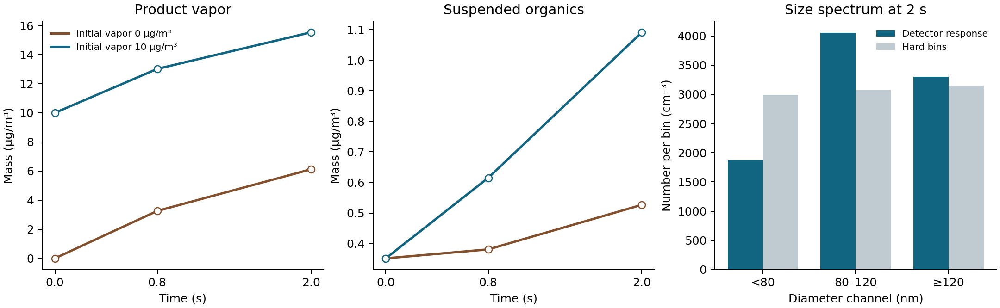
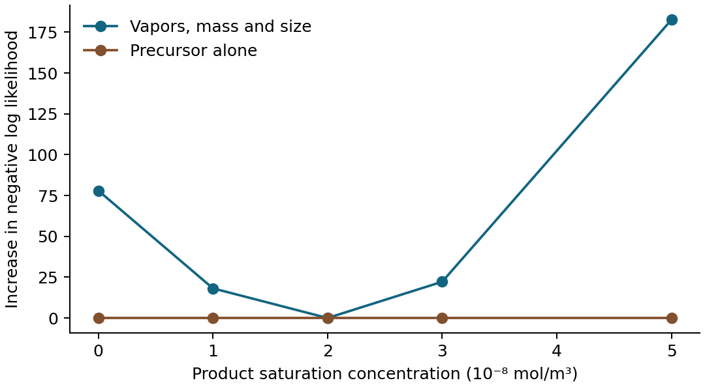
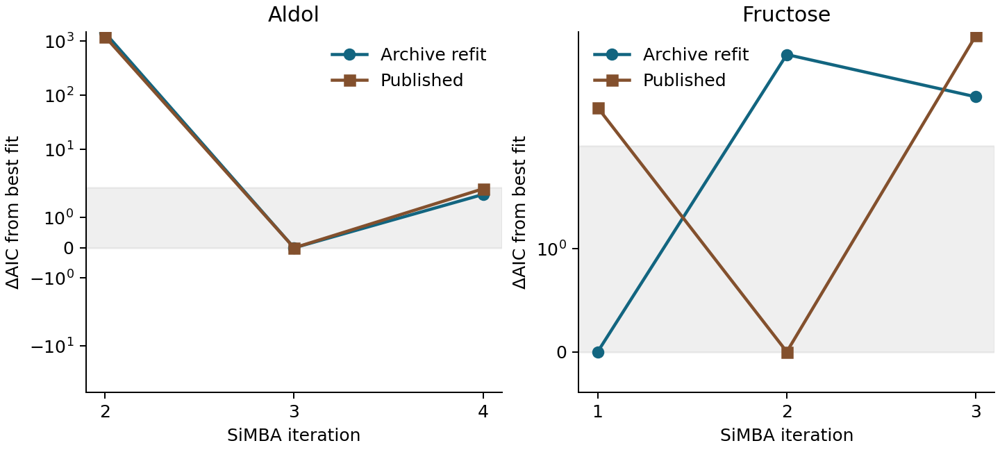

# Can vapor and aerosol measurements distinguish a reaction mechanism?

A two-reaction chamber with known synthetic chemistry gives us a test with an answer. Fitting two noisy experiments recovered a precursor rate of 0.4993 s⁻¹ and a saturation concentration of 1.945 × 10⁻⁸ mol/m³. The generating values were 0.5000 s⁻¹ and 2.000 × 10⁻⁸ mol/m³. At a third dose and seed loading, the largest channel error was 0.235 times its measurement noise standard deviation. This tests parameter recovery for a specified network. Comparing competing networks is a separate test. Across three published SiMBA benchmarks, selecting a mechanism depended on which quantities the original generator actually conserved.

## A chamber with two phases and a size-selective instrument

Gas precursor A forms vapor V. V can condense, evaporate, and undergo first-order conversion to P within the particle. Three size cohorts sample a lognormal seed with median diameter 100 nm and geometric standard deviation 1.4. At the start, V makes up 5% of seed volume. The gas reaction and particle aging rates are 0.5 and 0.2 s⁻¹. Deposition reduces each cohort's number and suspended mass at a rate inversely proportional to its diameter, with a coefficient of 0.04 s⁻¹ at 100 nm. Deposited material enters a separate wall inventory. The test assumes an ideal liquid, flat interface, and unit accommodation.



Lines join the three Warp CUDA samples. Circles are independent SciPy Radau predictions. With zero initial V in air the seeds initially evaporate, then the gas reaction replenishes condensable vapor. With 10 µg/m³ initially in air they condense immediately. By two seconds, suspended organics reach 0.527 and 1.091 µg/m³, respectively. The right panel uses the higher-vapor case. A Gaussian response of width 0.12 in natural-log diameter spreads a cohort's number across neighboring channels. Including both tails preserves total surviving number.

The independent solver evolves moles per particle and cohort weights. Warp uses concentrations per volume of air and an explicit midpoint step. After refinement from 0.1 to 0.025 s, the largest difference across both cases, six channels and three observation times was 0.00169% of the relevant channel peak. This comparison ran in float64 on Warp CPU and a GeForce RTX 5060 with Warp 1.11.1.

The gradient test differentiated an observation loss through all steps. It perturbed nine inputs individually: two gas doses, two rate coefficients, product saturation concentration, seed number, median size, geometric width and wall loss. Independent reference differences used relative increments of 0.001, 0.0003 and 0.0001, with a one-sided perturbation at zero initial V. Multiplying each absolute derivative difference by its parameter scale gave a maximum of 7.02 × 10⁻⁵ in loss units. The zero-dose check used a scale of 10⁻⁷ mol/m³. [Per-channel errors, gradient discrepancies and device record](https://github.com/uncscode/particula/blob/codex/simba-reaction-discovery/studies/simba/trajectory_qualification.json)

A separate native CPU replay alternated resolved chemistry half-steps with an isothermal condensation step. It used a particle dimerization reaction, unequal material densities, and zero deposition. With 0.025 s steps, peak-normalized discrepancies from the inverse trajectory were 0.00124% for precursor, 0.000675% for vapor and 0.0198% for suspended organics. The organic discrepancy fell from 0.0683% at 0.1 s. [Native process comparison](https://github.com/uncscode/particula/blob/codex/simba-reaction-discovery/studies/simba/native_parity.json)

## Recovering kinetics and volatility at a withheld loading

The Radau solver generated five samples per channel over four seconds. Gaussian noise had a standard deviation of 0.2% of each channel's peak, and one vapor sample was masked. Two training runs had different precursor doses and seed numbers. The fit shared a gas reaction rate and saturation concentration across them. The withheld run started at 1.5 × 10⁻⁷ mol/m³ precursor and 1.3 × 10¹⁰ seeds/m³. Its noiseless trajectory was reserved for scoring.

| Differentiation used in fit | Evaluations across two starts | Elapsed on RTX 5060 (s) | Largest withheld RMSE in noise units |
| --- | ---: | ---: | ---: |
| Warp reverse-mode AD | 45 | 3.89 | 0.235 |
| Three-point finite differences | 180 | 4.57 | 0.235 |

During calibration, the AD path transferred 55,080 bytes to the device and 62,280 bytes back to the host. The finite-difference fit transferred 133,920 and 214,560 bytes, respectively. The process-level device pool high-water mark was 298,936 bytes for both readings. These figures cover the small experiment with three cohorts.

Both starts converged for each method. Reverse mode used fewer objective calls, and the single-run elapsed times were close. The largest withheld error was in vapor V. Suspended organic mass had an error of 0.035 noise standard deviations, and each size channel stayed below 0.006. These results concern two inferred parameters, fixed seed properties, the stated noise model and the given reaction pathways. [Fit inputs and scoring](https://github.com/uncscode/particula/blob/codex/simba-reaction-discovery/studies/simba/heldout_recovery.py) · [Fitted rates and held-out predictions](https://github.com/uncscode/particula/blob/codex/simba-reaction-discovery/studies/simba/heldout_recovery.json)



The joint observations distinguish volatility in this experiment. Fixing saturation concentration at 1 × 10⁻⁸ or 3 × 10⁻⁸ mol/m³ and refitting the gas rate increased the negative log likelihood by 18.18 or 22.19 relative to the grid minimum at 2 × 10⁻⁸ mol/m³. Repeating the profile with only precursor A gave exactly the same loss at every tested saturation concentration from 0 to 5 × 10⁻⁸ mol/m³. The parent decays before gas–particle exchange, so its time series alone leaves this parameter unconstrained.

## Reproducing the published SiMBA cases

The original SiMBA study compared networks of increasing complexity using synthetic species concentrations. All 15 archived input profiles reproduced to within 7 × 10⁻¹⁴ in their source concentration units. We refitted the published finalist at each complexity using the original observed channels and their joint time histories. Lower Akaike information criterion (AIC) ranks a mechanism higher within each case. [SiMBA study](https://doi.org/10.1039/D5SC01473E) · [Source audit and complete AIC tables](https://github.com/uncscode/particula/blob/codex/simba-reaction-discovery/studies/simba/REFERENCE.md)

| Experiment | Published winning iteration | Refit result |
| --- | ---: | --- |
| Hypothetical | 3 | Iteration 3 with the generator's unit changes; iteration 1 with molecular stoichiometry |
| Aldol condensation | 3 | Iteration 3, with the four-step competitor within two AIC units |
| Fructose dehydration | 2 | Iteration 1; AIC −171.45 versus −165.23 for iteration 2 |



Each series is centered at its own lowest AIC. Shading marks a difference of two units, where the aldol three- and four-step fits lie close together. The vertical scale is linear near zero and logarithmic beyond two units.

The hypothetical generator labels one reaction 2A → B but removes one A from inventory for each B formed. Enforcing molecular balance changes a predicted concentration by up to 2.45 source units at the original rates. In the fructose case the hidden intermediates have no measured trajectories, and the measurements were generated from an empirical rate law. The archived fourth experiment also uses different starting concentrations from those listed in its generator. Absolute AIC values can depend on fitting bounds, initial conditions and optimization. The available evidence leaves the fructose ranking discrepancy unresolved.

## Reproduction

From an environment with Particula, SciPy, Warp and a CUDA device, run the following from the repository root. The first command compares both devices with Radau. The second calibrates against noisy training data and scores the withheld run. The plot command reads the checked-in trajectory record.

```bash
PYTHONPATH=. python studies/simba/qualify_trajectory.py /tmp/trajectory.json
PYTHONPATH=. python studies/simba/heldout_recovery.py cuda:0 /tmp/heldout.json
python studies/simba/render_figures.py
```

For the upstream archive and commands to repeat all three published benchmarks, see the [reference protocol](https://github.com/uncscode/particula/blob/codex/simba-reaction-discovery/studies/simba/REFERENCE.md). For a runnable comparison of direct conversion and a hidden intermediate, see the [worked discovery example](../../../examples/custom-processes/discover_hidden_intermediate.py). The [chamber guide](../../../../guide/processes/resolved-chemistry.md#differentiate-a-candidate-mechanism-through-a-seeded-chamber) explains how to configure the observations and fitted controls.

Using the declared elemental or pool compositions for each reported
complexity, Particula enumerated all eleven published finalist structures.
The largest bounded search examined 1,385,979 combinations. Composition
priors constrain the search: reproducing a candidate under those priors
establishes reachability, while its fit and experimental interpretation are
separate tests. Independent refits used the archived measured-species masks
and included competing published candidates at each complexity.
[Enumeration settings and candidate counts](https://github.com/uncscode/particula/blob/codex/simba-reaction-discovery/studies/simba/enumeration.json)
