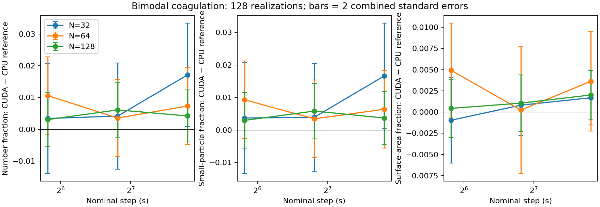

# Coagulation convergence against a Gillespie reference

Status: validation in progress on the Stage 1 branch based on `894f60350`.
Measurements below use Python 3.12, float64 CPU calculations; CUDA checks use
an NVIDIA RTX 5060 with driver 615.78.08. They verify implementation and
numerical limits, not agreement with independent laboratory measurements.

## Scalable native coagulation: issue 1661

This separate validation uses the issue-1661 implementation based on
`eea5699f770c4c9a10a132fd7784a1d1ef75f699`, Python 3.12, Warp 1.11.1 and native
CUDA on an RTX 5060 (driver 615.78.08). The executable study is
`scripts/gpu_studies/coagulation_convergence.py`. Run it from the checkout with
`python scripts/gpu_studies/coagulation_convergence.py --device cuda:0 --ensembles 128 --output docs/data/gpu/coagulation-convergence-1661.json`.

The population has unit represented counts, density 1000 kg/m³, number density
10¹⁰ m⁻³, and an exactly resolved 7:1 ratio of 100 nm particles to 4 µm
collectors. Brownian motion, SP2016 differential settling and ST1956 turbulent
shear are summed at 298.15 K, 101325 Pa, dissipation 10⁻³ m²/s³ and fluid density
1.2 kg/m³. Varying particle count changes representative volume at fixed number
density. Each size uses 128 independent realizations over 1800.808 s.

The CPU reference is a continuous-time Gillespie chain that recomputes the CPU
strategy matrix after each merger. It independently selects exponentially timed
and rate-weighted pairs; it does not call the device sampler. Nominal GPU steps
are 225.101, 112.551 and 56.275 s, with explicit resource-bound checks in the
study driver. The library itself does not subcycle. Both paths check mass and
charge inventories; device steps also check number loss against accepted events.

The error bars span two combined standard errors about each CUDA minus CPU
difference. Redraw these panels from the published JSON with
`python -m scripts.gpu_studies.coagulation_convergence_figure`.

| Particles | CPU events | CUDA events at finest step | Largest finest-step discrepancy / combined standard error |
| ---: | ---: | ---: | ---: |
| 32 | 857 | 843 | 0.43 |
| 64 | 1685 | 1598 | 1.78 |
| 128 | 3362 | 3312 | 0.71 |

The three observables are remaining number fraction, remaining small-particle
fraction (radius below 0.5 µm, normalized by initial total count), and surface
area relative to its initial value. All finest results satisfy the predeclared
criterion of five combined standard errors plus one event per ensemble
population. The [saved numerical data](https://github.com/uncscode/particula/blob/main/docs/data/gpu/coagulation-convergence-1661.json)
contain means, standard errors, actual steps and events for every refinement.

This establishes finite-ensemble agreement for this resolved bimodal case.
It does not demonstrate a formal convergence order, monotonic errors, physical
kernel accuracy against measurements, throughput, or adequate sampling of a
10⁶:1 rare minority. Removing a population cap does not solve rare-event
representation. Resource-admitted timesteps still require accuracy studies.

### CUDA population boundaries and resource scaling

The full scalable example also ran on the same RTX 5060 across both former
limits, with conservation and exact count-loss assertions. These are example
workloads, not maximum supported sizes. The time column measures preflight
wall time, including host setup and possible compilation during concurrent
validation; it is not a throughput benchmark. Storage excludes particle arrays.

| Active particles | Workspace/output bytes | Preflight seconds | Attempted trials | Accepted collisions |
| ---: | ---: | ---: | ---: | ---: |
| 255 | 31660 | 0.0273 | 64 | 1 |
| 256 | 31844 | 0.0021 | 64 | 3 |
| 257 | 32036 | 0.0015 | 64 | 0 |
| 2000 | 152868 | 0.0100 | 128 | 4 |
| 5000 | 332868 | 0.0420 | 128 | 6 |
| 10000 | 632868 | 0.1427 | 128 | 4 |
| 16383 | 1015844 | 0.4324 | 128 | 2 |
| 16384 | 1015908 | 0.4433 | 128 | 1 |
| 16385 | 1015964 | 0.3575 | 128 | 4 |
| 32768 | 1998948 | 1.4998 | 128 | 1 |

The 257-particle realization attempted 64 trials and accepted none; this is a
valid stochastic outcome. [Complete settings and results](https://github.com/uncscode/particula/blob/main/docs/data/gpu/coagulation-scaling-1661.json)
retain the exact timesteps and demand. Reproduce by calling `simulate` in
`docs/studies/validation/coagulation/native-sampling/scalable_coagulation.py` with `device="cuda:0"` and
`sizes=(255, 256, 257, 2000, 5000, 10000, 16383, 16384, 16385, 32768)`.
