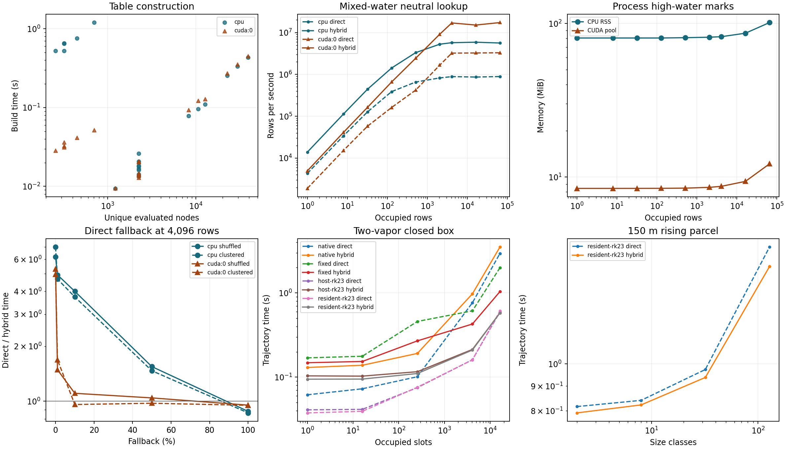

# When sparse AIOMFAC activity tables pay off

The cost of an activity table has three parts. A contributor evaluates direct
chemistry at the grid nodes, a simulation interpolates at occupied particle
compositions, and any row outside the qualified domain still incurs a direct
solve. The benchmark measures each part for float64 Particula AIOMFAC on a
CPU and an 8 GiB NVIDIA GeForce RTX 5060.

## Accuracy and domain coverage

Seven recipes cover neutral, fixed-electrolyte and speciating mixtures.
The water table uses ln(water mass/dry mass) from 0 to 6 and 286–302 K.
The two-vapor recipe also allows butanediol from 4% to 14% of dry mass, at a
fixed vanillic-acid/NaCl mass ratio of 1:20. The fourth coordinate in the
variable-acid recipe spans 2.5% to 7.5% acid in the remaining dry mass.

In all four CPU/GPU build and lookup combinations, the largest absolute water
activity error on independent test compositions was below 0.000007. The
largest absolute error in log neutral activity was below 0.00009. These
numbers quantify approximation to the native direct model. Each artifact
was evaluated on 4,096 seeded interior compositions and independent near-face
compositions and 256 concentrated states near the low-water boundary. [Per-recipe errors and build records](../../../../../website/public/study-data/aiomfac-sparse/qualification.jsonl)

The 150 m test transfers water and butanediol between gas and droplets.
In a two-class run the largest relative radius error against direct Radau
was 0.000030. Species budget errors stayed below 2e-16. In the 1.5 km
activation test, initially subsaturated haze had only 0.012% butanediol in
its dry mass. The table's dry-composition check sent almost every row to
direct CUDA. The hybrid trajectory reached cloud base at 399.97 m. Direct
critical-radius diagnostics put activations at 463.48 and 707.24 m. This case
shows why a parcel can satisfy every scientific tolerance and still gain
little from tabulation. Across all two-vapor box runs the largest normalized budget residual was 2.92e-13 and the largest relative radius error was 1.11e-5. [Closed-box and parcel checks](../../../../../website/public/study-data/aiomfac-sparse/workflows.jsonl) ·
[Activation results](../../../../../website/public/study-data/aiomfac-sparse/activation.jsonl)

## Build cost and simulation speed

At nominal tolerance the mixed-water table evaluated 2,241 states. Median
construction took **20.6 ms on CPU and 20.8 ms on CUDA**, before roughly 1 ms
for compression. The sparse file is 14 kB. In a separate fresh process the first RTX build took 7.40 s with an empty Warp kernel cache and the second took 22 ms. More expensive equilibrium solves
changed the comparison. The sulfate table took 759 ms on CPU and 41 ms on
CUDA. The carbonate table took 646 ms and 31 ms respectively. Fixed-node
replays in the downloadable build records use identical coordinates on each
device. [Build measurements](../../../../../website/public/study-data/aiomfac-sparse/build-summary.csv)

At 4,096 fully occupied, in-domain mixed-water states, lookup gave about
**6.4× CPU and 5.2× CUDA activity speedup**, including host input and output.
Shuffling 10% out-of-bounds states reduced those speedups to about 4.0× and
1.1×. At 100% fallback direct evaluation was faster on both devices.
For 65,536 fully in-domain equilibrium rows, sulfate took 103.4 s direct and 7.50 ms hybrid on CPU, or 98.4 ms direct and 3.64 ms hybrid on CUDA. Closed carbonate took 131.2 s and 7.52 ms on CPU, or 86.6 ms and 3.65 ms on CUDA. These figures apply to neutral water activity within the qualified chemistry domain. The fallback timings include locating misses and returning exact values. The CPU
baseline also skips vacant rows. [Throughput and latency](../../../../../website/public/study-data/aiomfac-sparse/activity-summary.csv)
· [Fallback by occupancy and ordering](../../../../../website/public/study-data/aiomfac-sparse/fallback-summary.csv) ·
[First tested CUDA crossover](../../../../../website/public/study-data/aiomfac-sparse/crossovers.csv)



For a single droplet exchanging water on CPU, the 20-step run took about
15.0 ms direct and 9.1 ms hybrid on either side of equilibrium. Four such
runs recovered the nominal build on either device. Fixed-step CUDA replay took 46.4 ms direct and 7.1 ms hybrid for 20 steps. A single run recovered either warmed build. With a cold CUDA build, the first-use cost rises to about 190 of these GPU water-transfer runs. The break-even table includes the cold and warmed estimates separately. In the 16,384-slot
two-vapor fixed-step CUDA box, activity evaluation was 2.30× faster
host-to-host (4.40× on device), and the full trajectory fell from 1.99 s to
1.04 s. One box run recovered either build. These two workloads meet the
promotion criteria. The 150 m parcel showed more modest whole-run gains,
from 1.03× at two classes to 1.10× at 128 classes.

The long activation trajectory took 61.9 s with direct RK23 and 66.2 s with
hybrid RK23. Of 266,808 occupied row evaluations, 40 used the table. This
workload has no observed amortization point. [Matched end-to-end timing pairs](../../../../../website/public/study-data/aiomfac-sparse/workload-summary.csv) · [Build cost and break-even by device pair](../../../../../website/public/study-data/aiomfac-sparse/amortization.csv)

Nsight captured the warmed hybrid box and parcel RK23 replays together. Two graph launches executed 454 kernels, including 24 table lookups. The capture range contained zero CUDA memory copies and zero allocation calls. Setup, requested observations and checkpoint I/O fall outside this range. [Replay trace counts](../../../../../website/public/study-data/aiomfac-sparse/replay-profile.json)

## ROS3 stage fluxes and physical derivatives

ROS3 interpolates both neutral activities for eligible stage fluxes. Its
linear solve uses a finite-difference Jacobian of the direct physical rate.
Both perturbed rates, and the base rate for a one-sided difference, use direct
AIOMFAC on the simulation device. The box also uses this rule for its
time-dependent forcing derivative. A perturbation can therefore cross a table
face without introducing an interpolation offset divided by a tiny step.
The CPU and CUDA box tests compare these derivatives with direct ROS3. The
closed-box trajectory test also permutes the material order and includes a
vacant slot and an occupied class with a different dry composition.

| RTX 5060 workload | Direct ROS3 | Hybrid ROS3 | Maximum hybrid relative radius error against CPU Radau |
| --- | ---: | ---: | ---: |
| Host-controlled box, 16 occupied slots | 118 ms | 75 ms | 8.76e-7 |
| Resident box, 16 occupied slots | 74 ms | 49 ms | 8.76e-7 |
| Resident 150 m parcel, 2 classes | 2.92 s | 3.69 s | 2.93e-5 |

Times are medians over five alternating warmed pairs. Box times cover the
last 3.5 ms of physical integration. Parcel times cover all 150 m of replay.
The parcel used 2,593 table hits, 2,057 out-of-bounds fallbacks and 264
flux-sign fallbacks. Jacobian samples always use direct chemistry and are
excluded from those counts. The largest normalized inventory residual was
6.25e-16 across the sampled boxes and 1.88e-16 in the hybrid 150 m parcel.
[Box measurements](../../../../../website/public/study-data/aiomfac-sparse/ros3-box.jsonl)
and [parcel measurements](../../../../../website/public/study-data/aiomfac-sparse/ros3-parcel.jsonl).

The 1.5 km hybrid ROS3 parcel crossed cloud base at 399.9685 m and activated
the classes at 463.4752 m and 707.2378 m using direct critical-radius
diagnostics. Class activation shifted by less than 0.00005 m against direct
CUDA ROS3. Peak radius error against CPU Radau was 4.50e-6 relative and
first-law closure was 6.40e-7 K equivalent. Only 57 of 12,960 eligible
stage rows used the table. Restart at the midpoint reproduced every subsequent
sample exactly. [Activation and restart records](../../../../../website/public/study-data/aiomfac-sparse/ros3-activation.jsonl).

Nsight recorded 27 sparse lookup kernels across the warmed hybrid ROS3 box
and parcel graphs. The two launches executed 1,160 kernels with zero CUDA
copies and zero allocation calls inside replay. Select `--hybrid --method ros3`
in the profiling command below to reproduce this capture.
[ROS3 replay trace counts](../../../../../website/public/study-data/aiomfac-sparse/ros3-replay-profile.json).

## Reproduction

Run from the checkout in Python 3.12+ with the local combined wheels. Use a fresh output directory per campaign. The JSONL writers append each completed measurement. Install
Matplotlib to replot the evidence. Use one GPU and run the timing jobs serially.
The benchmark host used an AMD Ryzen AI 9 HX 370, NumPy 2.3.4, SciPy 1.16.2, Warp 1.11.1, and NVIDIA driver 615.78.08. Set
`OPENBLAS_NUM_THREADS=1` for the full timing campaign. A CUDA request requires
a functioning NVIDIA driver.

```sh
tools=packages/particula-aiomfac/tools
out=.artifacts/sparse-study
mkdir -p "$out"
python "$tools/sparse_study.py" qualification --output "$out/qualification.jsonl"
python "$tools/sparse_study.py" cold-build --devices cpu --recipes mixed-water --output "$out/cold-builds.jsonl"
python "$tools/sparse_study.py" cold-build --devices cuda:0 --recipes mixed-water --output "$out/cold-builds.jsonl"
python "$tools/sparse_study.py" build --output "$out/builds.jsonl"
python "$tools/sparse_study.py" throughput --recipes neutral mixed-water mixed-two-vapor shared-ion sulfate carbonate --output "$out/activities.jsonl"
python "$tools/sparse_study.py" fallback --recipes mixed-water --output "$out/fallback.jsonl"
python "$tools/sparse_trajectories.py" water --output "$out/workflows.jsonl"
python "$tools/sparse_trajectories.py" water --table .artifacts/sparse-tables/mixed-water-cuda-0.npz --output "$out/workflows.jsonl"
python "$tools/sparse_trajectories.py" box --output "$out/workflows.jsonl"
python "$tools/sparse_trajectories.py" box-accounting --output "$out/box-operations.jsonl"
python "$tools/sparse_trajectories.py" parcel --solvers resident-rk23 direct-ros3 --output "$out/parcels.jsonl"
python "$tools/sparse_trajectories.py" activation --solvers resident-rk23 direct-ros3 --output "$out/activation.jsonl"
python "$tools/sparse_trajectories.py" restart --output "$out/workflows.jsonl"
python "$tools/sparse_trajectories.py" box --sizes 1 16 --solvers host-ros3 resident-ros3 --output "$out/ros3-box.jsonl"
python "$tools/sparse_trajectories.py" parcel --sizes 2 --solvers resident-ros3 --output "$out/ros3-parcel.jsonl"
python "$tools/sparse_trajectories.py" activation --sizes 2 --solvers resident-ros3 --pairs 1 --restart --output "$out/ros3-activation.jsonl"
python "$tools/sparse_report.py" "$out"
```

Download the underlying [build timings](../../../../../website/public/study-data/aiomfac-sparse/builds.jsonl),
[cold-cache timings](../../../../../website/public/study-data/aiomfac-sparse/cold-builds.jsonl),
[activity timings](../../../../../website/public/study-data/aiomfac-sparse/activities.jsonl),
[fallback timings](../../../../../website/public/study-data/aiomfac-sparse/fallback.jsonl)
and [parcel scaling records](../../../../../website/public/study-data/aiomfac-sparse/parcels.jsonl).
To repeat the replay trace, run `nsys profile --capture-range=cudaProfilerApi
--capture-range-end=stop --sample=none --trace=cuda --cuda-graph-trace=node
-o hybrid python packages/particula-aiomfac/tools/profile_condensation.py --hybrid`,
then use `nsys export --type sqlite hybrid.nsys-rep` and the same Python
script with `--summary hybrid.sqlite`.

The separate [box operation counts](../../../../../website/public/study-data/aiomfac-sparse/box-operations.csv) report evaluator calls, row misses, requested snapshots, adaptive control readbacks and the initial GPU flux download. The native counter includes activity reads for physical observations. Counts come from a separate run to keep instrumentation outside the timing pairs.

The throughput sweep returns the same named neutrals on each device. Device
event timings exclude host copies. Host-facing timings include result and
status transfers. Synthetic misses move temperatures outside the table.
Shuffled and clustered cases keep the same number of misses. Class and slot
replication divides represented counts so the physical loading and source
reservoirs remain fixed. Total RSS includes the interpreter, allocator and
dependencies. The Warp pool high-water mark measures device-pool allocation
and excludes CUDA driver and graph-executable memory.

Each pair alternates direct-first and hybrid-first order across repetitions.
Reported spreads come from the measured pairs. Direct ROS3 provides a separate reference run at each parcel size. The 128-class ROS3 reference used 179,568 activity evaluations and 470 s of replay. Amortization divides table
build time by the median paired time saved per trajectory. The water-only runs measure both artifact origins on both devices. For the other trajectories the CUDA-build estimate uses the saving measured with the shipped CPU-built artifact, which had the same grid topology. The CSV identifies measured and inferred combinations. Round up to
a whole run. Zero or negative savings have no observed break-even. Published
timings describe this hardware, recipe, input distribution and precision.
