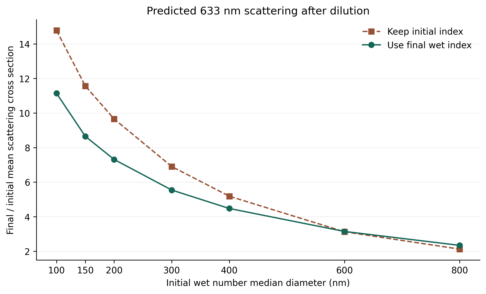

# Match wet size and refractive index when a salt droplet takes up water

Suppose a liquid ammonium bisulfate particle is 200 nm in diameter. As it takes up water, its salt becomes more dilute. Which radius and refractive index should you give a light-scattering calculation? Tang and Munkelwitz measured solution properties at 25 °C that let us put numbers to both inputs. Diluting the particle from 61.86% to 18.09% salt by mass gives a **326 nm wet diameter** at constant salt mass. For the final particle, use **163 nm radius and a solution refractive index of 1.3550**. The initial index of 1.4083 describes the more concentrated liquid. [Tang and Munkelwitz (1994), Table 3](https://patarnott.com/atms749/pdf/TangMunkelwitz.pdf#page=7)

The [worked Python example](wet_bisulfate.py) runs on CPU. It shows how to pair the inputs, calculate how much the particles scatter at 633 nm, and check the answer against saved CUDA results.

## Get both inputs from the same composition

The authors weighed a levitated droplet as it evaporated and recorded light scattered at 90°. They used the scattering pattern to infer solution density and refractive index across concentrations. They also measured both properties in bulk liquid. Here are the two bulk compositions used in the example. Both starting and ending diameters refer to **wet particles**.

| Salt by mass | Measured density (g/cm³) | Measured solution index | Wet diameter in the example |
| ---: | ---: | ---: | ---: |
| 61.86% | 1.3951 | 1.4083 | 200 nm, chosen starting size |
| 18.09% | 1.1032 | 1.3550 | 326 nm, calculated |

To obtain the final diameter, conserve the amount of salt. If the mass fraction of salt is $w$, solution density is $\rho$, and droplet diameter is $D$, salt mass is $w\rho\pi D^3/6$. This gives a final-to-initial diameter ratio of 1.629. Particula’s Mie function takes **radius in metres**, so divide the diameter by two before calling it. The example assumes homogeneous spheres and applies the tabulated indices at 633 nm. The authors leave the bulk refractometer wavelength unspecified. [Paper, equations 3–6 and Table 3](https://patarnott.com/atms749/pdf/TangMunkelwitz.pdf#page=6) · [Particula optics guide](../../../../guide/optics/index.md)

**If you have a measured index for the whole solution**, use the value for its current composition and wavelength. That value already accounts for water. **If your simulation tracks water and salt as separate materials**, you can instead supply each material’s index through `species_index` in the optical configuration. Particula uses the current material volume fractions in its Lorentz–Lorenz mixing rule. This example takes the first approach.

For a single diluted droplet, the CPU call below uses the rounded wet radius and the measured index. The returned scattering efficiency is dimensionless. Multiply by the droplet’s geometric cross section to get a scattering cross section in m².

```python
import numpy as np
from particula.optics import get_mie_efficiencies

wet_radius_m = 163e-9
efficiencies = get_mie_efficiencies(wet_radius_m, 633e-9, 1.3550)
scattering_area_m2 = efficiencies.scattering * np.pi * wet_radius_m**2
```

## See what happens if only the radius changes

The CPU example gives every particle the same proportional growth and keeps the particle count fixed. It calculates the population’s mean scattering cross section before and after dilution. Their ratio is the **scattering gain**. Holding the index fixed in a second calculation lets you see the effect of changing only the radius.

| Initial wet median diameter | Gain with wet size and solution index | Gain with the initial index retained |
| ---: | ---: | ---: |
| 200 nm | 7.31× | 9.66× |
| 600 nm | 3.15× | 3.13× |
| 800 nm | 2.34× | 2.12× |

These are predictions for light at 633 nm and lognormal size distributions with geometric standard deviation 1.3. The higher initial index gives 32% more predicted growth at 200 nm and 9% less at 800 nm, relative to updating both inputs. Scattering depends on the size of the sphere relative to the wavelength as well as its contrast with the surrounding air. Agreement at one size can hide an input mismatch elsewhere.



*Both curves use droplets grown to 1.629 times their initial diameter. The green circles use the dilute solution index. The dashed curve retains the concentrated solution index.*

## What you can check against the literature

- **Material properties.** Applying the authors’ equations for solution density and molal refraction gave refractive indices within 0.00124 of all nine bulk refractometer values. The largest density difference across nine measurements was 0.00064 g/cm³. This checks the paper’s fitted relations against its separate bulk measurements. The built-in species mixing rule would require its own comparison using independently specified component properties. [Tables 1, 3 and 4](https://patarnott.com/atms749/pdf/TangMunkelwitz.pdf#page=5)
- **Numerical scattering.** The example includes seven reference populations from a Particula 0.3.3 CUDA run on an NVIDIA GeForce RTX 5060 at revision `77b383cdb3`. The reference integrates number-weighted cross sections over 1,025 points spanning eight standard deviations on either side in log diameter. Its three columns are mean cross sections in m² per particle for the initial liquid, the diluted liquid retaining its initial index, and the diluted liquid using its measured index.
- **Experimental scope.** The population scattering gains are a sensitivity calculation using measured solution properties. To test them experimentally, measure the wet size distribution and total scattering per particle at both compositions and the same optical wavelength.

To try another composition, look up its density and index, calculate the new wet radius, and use those inputs in the single-droplet call above. The downloadable example compares against saved reference values for the two original solutions and seven original size distributions.
