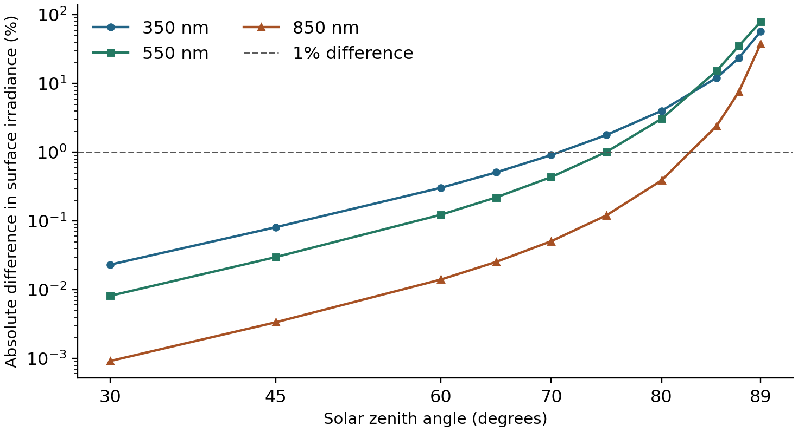
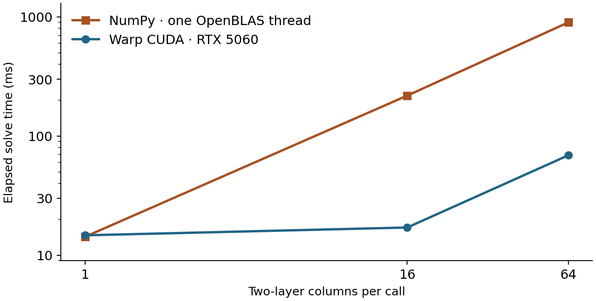

# How closely does the column reproduce an independent radiative transfer solver?

Adding an aerosol layer with 550 nm optical depth 0.01 increased reflected shortwave at the top of an ideal Earth column by **0.500 W/m²** in Particula's default spectral calculation. A separately installed libRadtran 2.0.6 C DISORT solver with finer gas absorption bands gave **0.498 W/m²**. The absolute reflected flux of the aerosol-free atmosphere differed by **0.547 W/m²**. In this case, much of the absolute spectral bias was shared by the two aerosol states and cancelled in their difference. [libRadtran](https://gmd.copernicus.org/articles/9/1647/2016/) · [Reference runs and replay scripts](https://github.com/uncscode/particula/tree/main/studies/spectral-radiation/benchmark)

## Transfer through a single aerosol layer

We ran 36 matched pairs over Lambertian albedos of 0.04, 0.40, and 0.80. The solar zenith cosine was 0.30, 0.65, or 0.90. The initial 550 nm aerosol optical depth was 0.02 or 0.40, the single-scattering albedo was 0.72 or 0.98, and each perturbation added 0.01 optical depth. Wavelength-dependent depth followed an Ångström exponent of 1.2. Both codes used a Henyey–Greenstein phase function with asymmetry 0.55. There was no gas in this slab.

For this numerical test the irradiance and optics were evaluated on the *same* three wavelengths in both codes. Applying the same trapezoidal weights across 450, 550, and 850 nm isolates transfer and angular integration errors. This test integrates a prescribed three-point spectrum; the Earth comparison below separately checks errors from spectral sampling. The native solver used 12 streams per hemisphere and DISORT used 32 total. The sensor view cosine was 0.8 and the physical Sun–sensor azimuth separation was 60°.

| Maximum absolute discrepancy over the 36 paired changes | Value |
| --- | ---: |
| Upward flux at column top | 0.00056 W/m² |
| Total downwelling flux at the surface | 0.00203 W/m² |
| Emergent directional radiance | 0.00053 W m⁻² sr⁻¹ |

Values are rounded upwards. These tests cover dark and bright ground, absorbing and weakly absorbing particles, and optically thin to moderate loading. Direct transmission alone would have missed the diffuse component supplied by scattered sunlight. [DISORT inputs and observables](https://github.com/uncscode/particula/blob/main/studies/spectral-radiation/benchmark/disort.py)

## Spectral refinement in a full clear atmosphere

The full column extends from sea level to 120 km through the 49 layers of the AFGL US standard atmosphere. All runs use the same TSIS-1 energy per spectral interval at 1 au, solar zenith cosine 0.65, and a surface albedo of 0.20. Aerosol occupies the lowest kilometre, with single-scattering albedo 0.90 and asymmetry 0.55. The results cover 280.034–4000 nm. For the external calculation, each REPTRAN band's outgoing and surface fluxes were normalized by its top incident energy, then weighted by TSIS-1 energy integrated over that band. [REPTRAN](https://doi.org/10.1016/j.jqsrt.2014.06.024) · [TSIS-1 reference spectrum](https://lasp.colorado.edu/lisird/data/tsis1_hsrs/)

| Solver and spectral grid | Aerosol-free reflected flux | Change in reflected flux | Change in surface downwelling |
| --- | ---: | ---: | ---: |
| libRadtran DISORT, fine REPTRAN | 167.506 W/m² | +0.498 W/m² | −2.204 W/m² |
| libRadtran DISORT, coarse REPTRAN | 167.914 W/m² | +0.499 W/m² | −2.208 W/m² |
| Particula, 4,082 nodes from coarse REPTRAN | 167.860 W/m² | +0.501 W/m² | −2.206 W/m² |
| Particula, 217 nodes in 22 broad intervals | 168.053 W/m² | +0.500 W/m² | −2.206 W/m² |

The largest paired reflected-flux discrepancy between either native grid and fine DISORT was 0.00241 W/m². For absolute, aerosol-free surface downwelling the default native result was 689.623 W/m² against 687.527 W/m² for fine DISORT. Numerical agreement for a perturbation therefore gives a narrower claim than accuracy of absolute irradiance; a site also requires its observed atmosphere and surface. The spectral integral and angular transfer checks cover this aerosol perturbation in this atmosphere. [Full-precision values](https://github.com/uncscode/particula/blob/main/studies/spectral-radiation/benchmark/earth_flux.csv)

## Cloud slabs and low Sun

The Bai cloud study archived visible optical profiles from its clean, slowly ascending parcels. We integrated the original extinction and normalized Mie phase moments into four 25 m layers. We compared the two aerosol-aging histories at 450, 550, and 700 nm, over black ground at solar zenith cosine 0.5. With eight streams per hemisphere, the largest reflectance error against the archived 1 m vertical solution was 0.0000093. The largest error in the *paired* reflectance was 0.0000015. The archived problem prescribes sunlight entering the cloud. Its top is the cloud boundary. [Bai study radiation boundaries](../../literature/bai-limonene/seasonal-light.md) · [Angular refinement data](https://github.com/uncscode/particula/blob/main/studies/spectral-radiation/benchmark/bai_visible.csv)

A separate libRadtran control changed only solar ray geometry between plane-parallel and pseudo-spherical DISORT. For the aerosol-free US standard atmosphere above albedo 0.20, surface total spectral irradiance agreed to within 1% at the tested solar zenith angles through 70° at 350, 550, and 850 nm. The largest difference across wavelengths grew to 1.79% at 75°, 4.02% at 80°, and 15.31% at 85°. Use 70° as the tested one-percent limit for this surface quantity and atmosphere. Nearer the horizon, geometry dominates comparisons even with identical optical coefficients. [Low-Sun comparison](https://github.com/uncscode/particula/blob/main/studies/spectral-radiation/benchmark/low_sun.csv)

Each marker compares the plane-parallel and pseudo-spherical DISORT solutions at the same solar zenith angle. The vertical axis gives the absolute difference as a percentage of the pseudo-spherical total downwelling irradiance. At 75° the differences reach 1.79% at 350 nm and 1.01% at 550 nm, while the 850 nm difference is 0.12%.

## What changes for a directional surface?

With solar and view zenith cosines both 0.8 and surface-relative azimuths of 60°, 170°, and 180°, the native Ross–Li land model agreed with libRadtran radiance to within 0.077% at the three wavelengths. Both codes used isotropic, volumetric and geometric coefficients of 0.22, 0.08 and 0.015. For this test the atmosphere contained a 550 nm aerosol depth of 0.1 with the same optical spectrum as the slab comparison, single-scattering albedo 0.92, and asymmetry 0.55.

At 5 m/s wind speed, comparing native glint-only ocean reflection with libRadtran's default pigment and salinity ocean model also changes the physical lower boundary. Native blue (450 nm) radiance was 66.8% lower off glint at 60° separation. At 850 nm it was 2.8% lower for the same view and 8.4% lower at 180°. These residuals bound the tested simplified water surface. Water-leaving light, whitecaps, the refractive index spectrum and facet reflection affect satellite comparisons. Use measured local surface inputs and the instrument response when a directional ocean observable is the target. [Directional comparison](https://github.com/uncscode/particula/blob/main/studies/spectral-radiation/benchmark/directional.csv) · [Surface and sensor theory](../../../theory/optics/surface-and-sensor.md) · [Satellite matchups](observations.md)

## How many columns benefit from CUDA?

For 64 two-layer columns, Warp computed interface fluxes in **69 ms** on a GeForce RTX 5060. A sequential NumPy loop over the same columns took **899 ms** with one OpenBLAS thread. A single column took about 15 ms on either backend. The batch uses the 217-node Earth spectrum, eight ordinates per hemisphere, and one shared dusty-ground boundary.

| Columns per call | Warm Warp CUDA | NumPy loop |
| ---: | ---: | ---: |
| 1 | 14.7 ms | 14.3 ms |
| 16 | 17.1 ms | 219 ms |
| 64 | 68.9 ms | 899 ms |

The markers are measured batch sizes. At 64 columns the GPU solve was 13 times faster than the one-thread CPU loop. Both axes use logarithmic spacing. [Recorded benchmark values](https://github.com/uncscode/particula/blob/main/studies/spectral-radiation/benchmark/warp_scaling_rtx5060.csv)

CUDA times are medians of three synchronized solves after workspace preparation, with inputs and results on device. The first preparation took 326 ms including Warp initialization with a populated kernel cache. The benchmark checks every column's upwelling spectrum against NumPy after timing. Directional radiance, live particle Mie calculations, changing surface geometry and host downloads have separate costs. [Timing script](https://github.com/uncscode/particula/blob/main/studies/spectral-radiation/benchmark/warp_scaling.py) · [Running on a simulation stream](../../../guide/optics/index.md)

At 16 ordinates per hemisphere, a separate three-wavelength CUDA calculation reproduced NumPy upwelling flux and directional radiance to within 2 × 10⁻¹⁴ of their respective peak magnitudes. The first compilation of the flux and directional kernels took about 32 s and 40 s, respectively. A 32-ordinate trial exhausted device memory on this card, so the Warp API accepts up to 16 ordinates per hemisphere.
