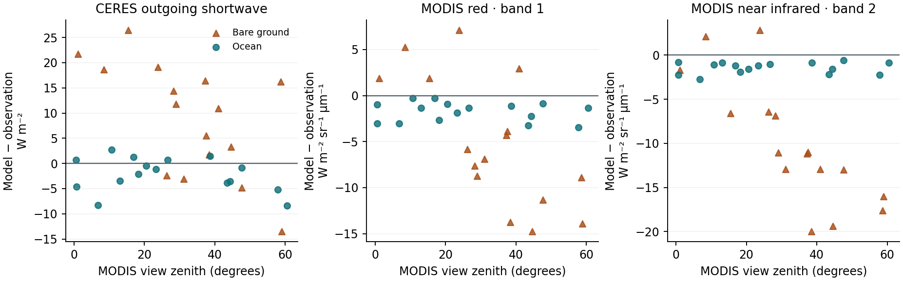

# Reflected sunlight over bare ground and ocean from Terra

Particula reproduced absolute outgoing shortwave flux more closely over water than over bare ground on two Terra overpasses. Across 16 clear ocean footprints its mean reflected shortwave flux was 2.2 W/m² below the CERES estimate, with a root-mean-square error (RMSE) of 3.9 W/m². Across 16 bare-ground footprints the model was 8.9 W/m² high, with a 14.0 W/m² RMSE. Relative to the mean observed flux, these errors were 4.4% over water and 5.6% over land. Yet the model underestimated near-infrared radiance over the same ground. A model can return too much light to the whole sky while sending too little toward the satellite. [Footprints, inputs and replay](https://github.com/uncscode/particula/tree/main/studies/spectral-radiation/observations) · [NASA CERES footprint products](https://ceres.larc.nasa.gov/data/)

## What the instruments saw

On 13 and 29 November 2001, Terra crossed northeast Africa, the Arabian Peninsula, the Red Sea and the Indian Ocean. CERES FM1 measured broadband radiance. Its Single Scanner Footprint (SSF) product converts that measurement to upward top-of-atmosphere flux using a scene-dependent angular distribution model. Terra MODIS measured radiance in each sensor band along one viewing direction. We compare the hemispheric model flux to CERES and integrate the model's directional radiance against Terra's measured red and near-infrared responses before comparing to MODIS. We used both dates for evaluation and fitted no parameters to the outgoing quantities. They sample the same ground track sixteen days apart. [CERES Edition 4 product fields](https://ceres.larc.nasa.gov/documents/DPC/DPC_current/pdfs/DPC_SSF-Ed4_R5V1.pdf) · [MODIS spectral calibration](https://mcst.gsfc.nasa.gov/calibration/parameters)

Each value pair below gives the mean signed difference (model minus observation) and RMSE. Flux is in W/m². Band-mean radiance is in W m⁻² sr⁻¹ µm⁻¹. Glint angle is the separation from the mirror-reflection direction. Each group has four footprints per date.

| Surface and geometry | Footprints | CERES shortwave bias / RMSE | MODIS red bias / RMSE | MODIS near-infrared bias / RMSE |
| --- | ---: | ---: | ---: | ---: |
| Bare ground, view zenith below 35° | 8 | +13.33 / 16.77 | −1.62 / 6.14 | −5.08 / 7.39 |
| Bare ground, view zenith at least 35° | 8 | +4.46 / 10.62 | −8.49 / 10.31 | −15.14 / 15.52 |
| Ocean, glint angle 23–40° | 8 | −2.52 / 4.17 | −1.55 / 1.90 | −1.51 / 1.63 |
| Ocean, glint angle at least 40° | 8 | −1.86 / 3.67 | −1.96 / 2.16 | −1.37 / 1.50 |

The differences persisted across both dates. Land broadband bias averaged +7.8 and +10.0 W/m² on the two passes, while ocean bias averaged −2.9 and −1.5 W/m². The sample covered solar zeniths of 17–53°, view zeniths of 0.6–60.5°, and 550 nm aerosol optical depths of 0.033–0.315. The archive reports separate residuals by date, surface, band, optical depth and angle. Nearby footprints share meteorology and retrieval assumptions, so the sample supplies two overpasses for judging repeatability. [Stratified results](https://github.com/uncscode/particula/blob/main/studies/spectral-radiation/observations/residual-summary.csv)

## How the footprints and columns were matched

We selected 32 clear, homogeneous footprints, balanced across two dates and four surface and viewing conditions. Of 99,361 and 99,358 SSF records in the two one-hour files, 2,805 and 1,717 met the illumination, coverage, surface and ancillary-data screens. We required latitude within 40° of the equator, a good Earth-view shortwave measurement, at least 99% imager coverage and clear area, and 100% of the reported surface contribution from bare ground or water. Cloud screening removed 23,798 and 26,547 candidates after the preceding screens. A further 6,462 and 4,883 had mixed or other surfaces. We took evenly spaced ranks within each date and geometry group, with one ocean rank set to the closest eligible approach to glint. This sampling gives each condition equal weight. The comparison covers homogeneous footprints. A mixed coastline would require solving each surface column and combining its flux or directional radiance with its footprint weight. [Selection and sequential rejection counts](https://github.com/uncscode/particula/blob/main/studies/spectral-radiation/observations/footprints.json)

The incident spectrum uses TSIS-1 at the overpass Earth–Sun distance and the SSF solar zenith. The column extends from the reported elevation to 120 km. The SSF surface pressure scales the reference pressure profile for Rayleigh scattering. For gas absorption we recomputed REPTRAN tables for four water columns and interpolated to the SSF precipitable water above each footprint. Temperature, ozone and the vertical distribution of water follow the AFGL U.S. standard profile. Measured 550 nm MODIS aerosol depth and its Ångström exponent set the spectral extinction in the lowest 2 km. In the eight ocean glint cases, the nearest qualifying retrieval came from the same orbit within two minutes and up to 248 km away. Particle height, phase function and parts of the absorption spectrum remain assumed. [Atmospheric inputs and calculation](https://github.com/uncscode/particula/blob/main/studies/spectral-radiation/observations/README.md)

For water, a Cox–Munk surface with an isotropic distribution of wave slopes uses the SSF wind speed, with a refractive index of 1.34 and zero water-leaving radiance. For land, the MODIS Deep Blue surface reflectances at 412, 470 and 659 nm constrain the amplitude at the observed geometry. Global MODIS-derived Ross–Li kernel ratios prescribe the angular shape. Outside those three bands, the ideal mineral-soil spectrum supplies the spectral shape. The 858 nm comparison therefore tests an extrapolation. The enhanced land inputs cut broadband RMSE from 47.9 to 14.0 W/m² compared with the ideal ground. Over water the wind-driven surface cut red radiance RMSE from 7.3 to 2.0 W m⁻² sr⁻¹ µm⁻¹, while broadband RMSE increased from 2.8 to 3.9 W/m². Deep Blue uses the same imager, so its red constraint and the evaluation radiance share instrument and retrieval lineage. [HLS angular coefficients](https://hls.gsfc.nasa.gov/algorithms/) · [NASA Deep Blue](https://earth.gsfc.nasa.gov/climate/data/deep-blue)

## How much of the difference can the comparison resolve?

The average near-infrared land bias was −10.1 W m⁻² sr⁻¹ µm⁻¹, reaching −15.1 at oblique views. The median within-footprint spatial standard deviation was 8.0 in that band over land and 0.26 over ocean. We also read the original calibrated Terra MODIS Level-1B pixels from the public TerraFusion sampler. All 32 footprints had quality-screened pixels within a 10 km circular aperture, with 83–313 pixels retained per comparison. Equal-pixel means in that aperture differed in absolute value from the production footprint means by 2.23 in red and 1.45 in near infrared on average. The production means include the CERES point-spread function. Using the independent extraction still gave a near-infrared land RMSE of 13.4. The measured pixel variability, weighting choice and spectral extrapolation are all relevant to that comparison. [Native MODIS pixel audit](https://github.com/uncscode/particula/blob/main/studies/spectral-radiation/observations/native-pixels.csv) · [TerraFusion public archive](https://registry.opendata.aws/terrafusion/)

Varying the prescribed aerosol optical depth by ±25% gave a broadband half-range as large as 7.6 W/m² over water and 3.2 W/m² over land. For the seven footprints with some identified cloud, the maximum possible change from making the reported cloud fraction reflect all modeled incident light was 5.7 W/m². Undetected cloud and horizontal transport remain unresolved. Changing aerosol asymmetry from 0.60 to 0.80 gave a near-infrared half-range of up to 1.42 W m⁻² sr⁻¹ µm⁻¹ at oblique land views.

Raising the angular quadrature from eight to twelve streams per hemisphere changed the calculated broadband flux by at most 0.031 W/m² and the two band radiances by at most 0.27 W m⁻² sr⁻¹ µm⁻¹. For context, independent tests of the CERES angular-distribution models estimated typical instantaneous clear-scene shortwave uncertainties of 1.9 W/m² over ocean and 4.5 W/m² over land. Those are ensemble estimates, and the published ocean test excluded strong glint. [CERES angular uncertainty study](https://doi.org/10.5194/amt-8-3297-2015)

In a separate polarization test, the independent MYSTIC solver traced two million photons per run through an aerosol-free molecular atmosphere. At the most oblique land geometry, including polarization raised 645 nm intensity by 0.26 ± 0.13 W m⁻² sr⁻¹ µm⁻¹. At the ocean geometry closest to glint, the increase was 0.22 ± 0.06 in the same units. The uncertainties are one Monte Carlo standard error of the scalar–vector difference. At 858 nm the corresponding changes were 0.029 ± 0.076 and 0.016 ± 0.012. The polarized contribution of actual nonspherical dust is unresolved, so these tests cannot assign the angular residual to a single physical cause. [Polarization controls](https://github.com/uncscode/particula/blob/main/studies/spectral-radiation/observations/polarization.csv) · [MYSTIC polarized radiative transfer](https://doi.org/10.5194/acp-10-383-2010)

The transport grid covers approximately 280–4000 nm. At 1 au the full TSIS-1 reference assigns 6.58 W/m² below 280 nm and 11.83 W/m² above 4000 nm. After projection and distance scaling, the omitted incident energy gives an upper bound of about 11–18 W/m² per footprint on reflected sunlight from those wavelengths. The true outgoing tail depends on wavelength-dependent absorption and reflection. The CERES product estimates total reflected solar flux from its filtered measurement. These absolute residuals include spectral coverage and surface errors. A measured aerosol-induced change would require a second, physically matched reference scene. [TSIS-1 reference spectrum](https://lasp.colorado.edu/lisird/data/tsis1_hsrs_binned_fs/) · [CERES radiance unfiltering](https://doi.org/10.5194/amt-17-2147-2024)
