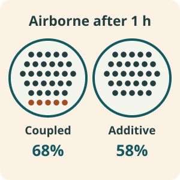
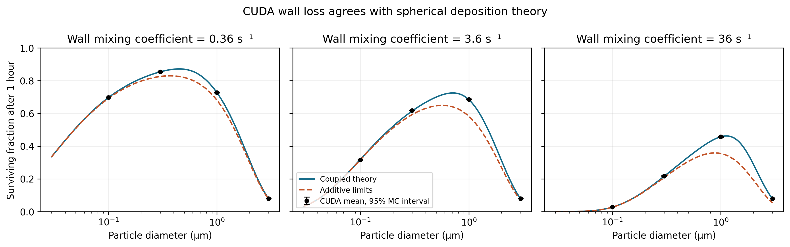

# Adding settling and diffusion lowers predicted one-hour survival of 1 µm particles from 68% to 58% in a sphere

<a id="adding-settling-and-diffusion-losses-predicts-too-few-airborne-particles-in-a-spherical-chamber"></a>



How much aerosol remains in a spherical chamber after an hour if diffusion and settling act together at the wall? For neutral particles 1 µm in diameter in a sphere of radius 0.30 m, Crump and Seinfeld’s coupled theory predicts **68.4%** airborne at a wall mixing coefficient of 3.6 s⁻¹. Adding the two limiting loss rates instead leaves **58.2%**. Particula’s particle-resolved simulation leaves **68.55% ± 0.27 percentage points**, where the 95% interval describes sampling at fixed model inputs. Using the additive correction would attribute about ten extra percentage points of disappearance to the wall under these conditions. Size-selected decay measurements with independently characterized mixing would test whether the calculated difference holds in a real chamber. [Crump and Seinfeld, equations 13 and 17](https://thesis.caltech.edu/3500/3/crump-jg_1983.pdf#page=39)

<a id="the-comparison-tests-a-published-coupling-not-measured-chamber-decay"></a>

## Diffusion and settling share a size-dependent wall loss rate

Crump and Seinfeld derived the flux of aerosol to a vessel wall when Brownian diffusion, turbulent mixing and gravitational settling act across the same thin boundary layer. In a sphere the component of settling toward the wall varies over the surface. Integrating the local flux over the sphere gives the size-dependent loss rate for particles mixed uniformly in the interior. That geometry makes a sphere a useful case for testing an approximation that treats diffusion and settling independently. [Derivation for a spherical vessel](https://thesis.caltech.edu/3500/3/crump-jg_1983.pdf#page=39)

## How much does adding the two limiting rates change the airborne fraction?

### The surface integral provides a reference for the additive approximation

The authors' [Eq. 13 and Eq. 17, PDF page 39](https://thesis.caltech.edu/3500/3/crump-jg_1983.pdf#page=39)
provide the surface integral and its Debye-function form. For settling speed
v [m/s], Brownian diffusion coefficient D [m²/s], sphere radius R [m], and
wall mixing coefficient kₑ [s⁻¹], define x = πv/(2√(kₑD)). The coupled rate is
β = 6√(kₑD)D₁(x)/(πR) + 3v/(4R), where D₁ is the first Debye function.
Our baseline sets D₁=1, adding the zero-settling diffusion rate to the
zero-diffusion settling rate. It loses the coupling through x and overpredicts
loss. This is an illustrative approximation, not the authors' recommended model.
We evaluate Eq. 13 independently by angular quadrature using the same D and v as Particula.

The 0.30 m radius, water density and kₑ=36 s⁻¹ follow the authors' Fig. 2.
We set the temperature to 298.15 K and the pressure to 101325 Pa, added kₑ values of 0.36 and 3.6 s⁻¹ and followed one hour of wall loss for particles of fixed size. These calculations use no chamber measurements or fitted parameters. They isolate wall loss by diffusion and settling in the absence of condensation, coagulation, charge, ventilation and inertial deposition.

### CUDA ensembles resolve the ten-point difference

For the central 1 µm, kₑ=3.6 s⁻¹ case, 16 independent CUDA boxes with 8192
unit-count particles each gave **68.546% survival ± 0.266 percentage points**
(95% Student-t interval for the ensemble mean). This interval describes Monte
Carlo sampling only. It does not cover uncertainty in chamber physics or inputs.



*Solid curves give the independent surface quadrature, dashed curves add the two limiting rates, and points show CUDA ensemble means with 95% Monte Carlo intervals. The sphere radius is 0.30 m and particle density is 1000 kg/m³.*

| Wall mixing coefficient [s⁻¹] | Largest survival difference in scan [percentage points] | Diameter at scanned maximum [µm] |
| --- | ---: | ---: |
| 0.36 | 5.588 | 0.659 |
| 3.6 | 10.175 | 0.986 |
| 36.0 | 13.361 | 1.419 |

At the same 1 µm diameter, the additive approximation also lowers predicted survival at the two other mixing settings. The shortfall is 4.6 percentage points at 0.36 s⁻¹ and 10.2 points at 36 s⁻¹. The diameter of the largest shortfall moves with mixing because diffusion and settling compete at different diameters. These are sampled maxima over 0.03–3 µm, not global
optima. The coarse end is particularly subject to the paper's inertia limits.

### Refinement shifts are smaller than the principal approximation error

The campaign completed 12 physical conditions, each with 16 independent boxes,
for a 2048-particle baseline, a halved timestep (30 to 15 s), and an
8192-particle refinement: 576 boxes plus the 4-box pilot. Independent root
seeds are recorded per run; refinement differences include sampling noise.
All 36 ensemble means met the predeclared five-binomial-standard-error plus
0.002 absolute gate against the reference. Maximum mean/reference difference
was 0.418 percentage points. Halving the timestep shifted means by at most
0.504 points; increasing particle number shifted them by at most 0.359 points.
This supports resolution of the central ten-point effect, not a zero timestep
error claim for all cases or resolution of every small effect in the scan.

Doubling the reference diameter grid from 121 to 241 points changed the largest
survival difference by at most 0.009 percentage points. CPU Particula wall-loss
coefficients differed from quadrature by at most 0.1001%, within the preset
0.5% gate. This finite coefficient approximation is separate from Monte Carlo
uncertainty. All retained mass states were finite/nonnegative; remaining mass
fraction and particle survival fraction agreed within 3.34e-16. Wall deposition
removes mass, so total airborne mass is not conserved.

## Measure decay near 1 µm before adopting an additive correction

For chamber studies needing percentage-point survival accuracy, the additive
baseline is inadequate in the tested crossover regime. The next test is
size-selected decay near 0.3, 1 and 3 µm in a sphere with independently
characterized mixing, charge and ventilation, comparing observed rate constants
with both predictions. An independently determined mixing coefficient is
needed because fitting it separately to each diameter could conceal the effect.
A useful target would be survival precision below two percentage points, an
experimental design target rather than an established instrument uncertainty.

The main unresolved uncertainty is whether a real chamber meets the homogeneous
mixing, thin boundary layer and negligible inertia assumptions. No experimental
uncertainty interval is available here. A calibrated flow/mixing relation and
inertia check should precede quantitative interpretation of the coarse end.
A decay measurement precise enough to separate the two predicted fractions near 1 µm would test the wall correction directly at the crossover.

## Reproduction and provenance

The original automated independent analysis ran at revision
`5ec711e600fa21d81a89f19d0bfa5e29ac89c68e` with source Particula 0.3.2,
Python 3.12.12, NumPy 2.3.4, SciPy 1.16.2 and Warp 1.11.1.
All 580 boxes ran on NVIDIA GeForce RTX 5060 (`cuda:0`, 8 GiB), with
119.09 seconds total pilot/campaign wall time including setup and observations.
The initial sandbox GPU probe failed; host CUDA execution succeeded.
Installed distribution metadata reported 0.2.14, but the actual imported
source and execution revision were verified. This is source-version evidence.

[Original ensemble summaries](https://github.com/uncscode/particula/blob/main/docs/data/spherical-wall-loss/summary.csv),
[refinement checks](https://github.com/uncscode/particula/blob/main/docs/data/spherical-wall-loss/analysis.json), and the
[frozen specification](spherical-wall-loss-specification.md)
preserve the reviewed numbers and checks. The
[worked example](spherical_wall_loss_theory.py)
contains the executable reference, pilot, full ensemble and refinements.
Its saved results retain the publication rerun's own version, device, execution
revision and script hashes. The initial study and rerun are distinct executions. Researcher approval for documentation publication was recorded on 2026-11-19.

From a checkout with the documented dependencies and CUDA:

```bash
python scripts/docs_examples.py refresh spherical-wall-loss-theory
python scripts/docs_examples.py check --changed --base upstream/main
```

To redraw verified saved numerical data without CUDA or simulation:

```bash
python scripts/docs_examples.py replot spherical-wall-loss-theory
```

The downloadable example also runs directly with Python. No paper text,
measurement dataset or source figure is redistributed. Figure curves are
original calculations credited to the authors' equations. The script assertions
check coefficient accuracy, finite/nonnegative masses, survivor inventory and
Monte Carlo agreement without silently substituting CPU for CUDA.
