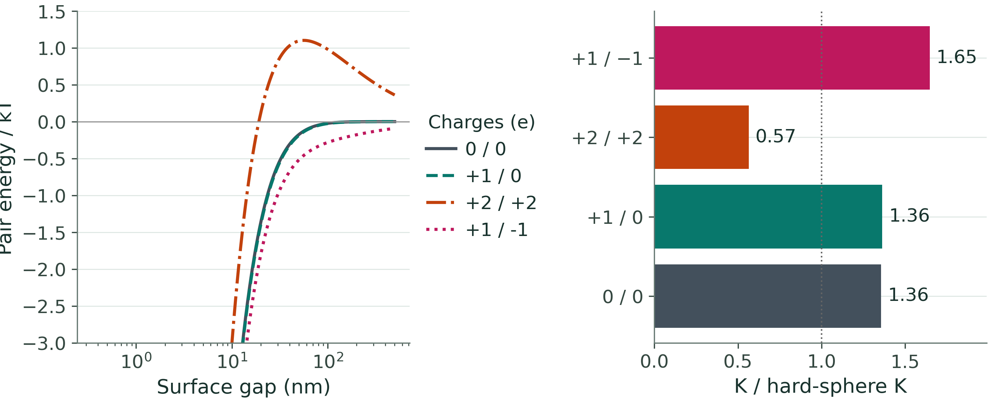

# Dispersion and dielectric polarization in aerosol coagulation

Brownian motion brings two spheres together. Whether they reach contact
depends on the energy along their approach. Dispersion draws neutral particles
together. A charged particle can also polarize a neutral neighbour. Two
like-charged particles can experience a repulsive barrier outside an attractive
well. The encounter rate depends on the whole path from large separation to
contact. Evaluating the energy only at the surface misses the barrier.

The figure uses 90 and 150 nm diameters, 298 K, 1 atm, density 2160 kg/m³,
relative permittivity 5.9 and a Hamaker constant of 8.9 × 10⁻²⁰ J. The energy
axis is cropped to show the barrier. The like-sign pair carries two elementary
charges on each particle. Charge–neutral and opposite-sign cases carry one
elementary charge on each indicated charged particle. The scalar material
inputs are illustrative.

## Sphere–sphere energy

Let $R=a+b$ be the contact distance, $s>R$ the centre separation,
$x=R/s$, and $p=a/R$. For a material pair across air with effective Hamaker
constant $A$ [J], introduce $u=4p(1-p)x^2/(1-x^2)$. The nonretarded
dispersion energy of smooth, homogeneous spheres is

$$
U_{\mathrm{vdW}}=-\frac A6\left[\frac{u}{2}
 +\frac{u}{2(1+u)}-\ln(1+u)\right].
$$

At large separation the terms in brackets nearly cancel. Their leading term
is $u^3/6$, giving the expected $s^{-6}$ dependence. At contact dispersion
is singular. The integrals below use its one-sided limit. [Hamaker (1937)](https://doi.org/10.1016/S0031-8914(37)80203-7)

Free charge is distributed uniformly over each sphere and bound charge
responds to the other sphere's field. Expand the exterior potential around
each centre in axial multipoles. The response of degree $l$ to the incident
regular field at the surface has coefficient
$-l(\epsilon_r-1)/[l(\epsilon_r+1)+1]$. Translating the scattered field
back to the partner and solving the coupled linear systems gives coefficients
for $q_i^2$, $q_iq_j$ and $q_j^2$. Add their induced energy to the bare
$q_iq_j/(4\pi\epsilon_0s)$. Here $q_i=z_i e$ [C], the surrounding gas has
relative permittivity one, and both particles share $\epsilon_r$. This model
assumes static dielectric response and unscreened forces. [Bichoutskaia et al. (2010)](https://doi.org/10.1063/1.3457157)

## From energy to encounter rate

With $U=U_{\mathrm{vdW}}+U_{\mathrm{electric}}$, the continuum enhancement
is the reciprocal of the dimensionless diffusive resistance,

$$
\eta_C^{-1}=\int_0^1\exp[U(x)/(k_BT)]\,dx .
$$

In the ballistic limit a collision with kinetic energy $t k_BT$ and impact
parameter $b_c$ must clear every angular momentum barrier. The limit is
$t b_c^2/R^2=\max(0,\min_{0<x\le1}[(t-U(x)/(k_BT))/x^2])$.
Integrating this expression against $e^{-t}\,dt$ gives $\eta_{FM}$.
Both factors equal one for hard spheres. The CPU and CUDA implementation
integrates the piecewise linear minimum in energy analytically over a radial
grid. The verification script independently refines the orbit minimum and
performs adaptive thermal quadrature. [Alam (1987)](https://doi.org/10.1080/02786828708959118)

With reduced mass $\mu$, reduced friction $f$, and diffusive Knudsen number
$q=\sqrt{k_BT\mu}/(fR)$, Particula evaluates the dimensionless hard-sphere
function $H$ at the modified Knudsen number,

$$
K=\frac{fR^3}{\mu}\frac{\eta_{FM}^2}{\eta_C}
H\left(q\frac{\eta_C}{\eta_{FM}}\right).
$$

The corresponding limits are $4\pi R(D_i+D_j)\eta_C$ and
$\pi R^2\sqrt{8k_BT/(\pi\mu)}\,\eta_{FM}$ in m³/s. This closure was developed
for singular attractive potentials. Like-sign barriers and strong opposite-sign
attraction require independent trajectory checks. The validation record gives
the observed departures and the implemented boundary on opposite charges.
[Ouyang et al. (2012)](https://doi.org/10.1063/1.4742064) ·
[Trajectory and measurement comparisons](../../studies/validation/coagulation/dispersion/index.md)

## Applying the model

Use one complete thermal encounter rate per pair. Turbulent shear and
settling can supply additional mechanisms. Unit sticking, compact spheres,
constant single-particle mobilities and nonretarded dispersion delimit the
interpretation. Near-contact hydrodynamic resistance, large-separation
retardation, aggregate shape and mixed-material dielectric evolution require
additional physics. The reference hard-sphere transition curve here is $H(q)$;
the Fuchs Brownian strategy has a different interpolation. [CPU example](../../studies/validation/coagulation/dispersion/van_der_waals.py) ·
[Prepared CUDA example](../../studies/validation/coagulation/dispersion/gpu_van_der_waals.py)
